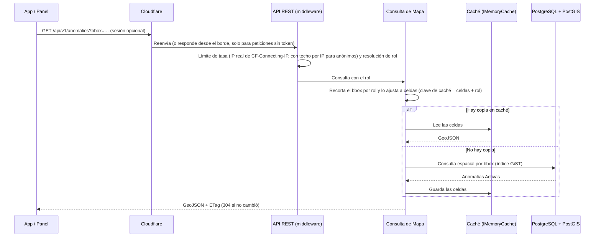

# Arquitectura Inicial del Sistema

> **Proyecto:** KillaUru · **Versión:** 2.2 · **Revisión:** 2026-10-21 · **Estado:** Vigente (alineado con ADR-001…ADR-015)
> **Relacionados:** `estilo-arquitectonico.md`, `enfoque-arquitectonico.md`, `componentes-arquitectonicos.md`, `Nivel1…Nivel4`, `07-decisiones-arquitectonicas.md`

## 1. Propósito y alcance

Este documento da la **visión de conjunto** de KillaUru: de qué zonas se compone, cómo viaja un dato desde el sensor hasta el mapa, dónde están las fronteras de confianza y qué entra en v1.0. El detalle por nivel está en los diagramas C4 (`Nivel1…Nivel4`); las decisiones, en los ADR.

KillaUru es una plataforma colaborativa que detecta, valida y presenta anomalías viales de la carretera PE-28A (Vía Los Libertadores, 333 km). Se compone de tres piezas ejecutables:

- una **app Android** que detecta y clasifica en el dispositivo y funciona sin internet;
- un **backend monolítico modular** (ASP.NET Core 10) con 6 módulos, que valida, clasifica y sirve el mapa;
- un **panel web** de administración (SPA).

## 2. Diagrama de arquitectura (vista por zonas)


## 3. Descripción de las zonas

| Zona | Qué contiene | Responsabilidad principal | Decisiones |
|---|---|---|---|
| **1 · Dispositivo** | App Android nativa con modelo TFLite embebido, buffer SQLite local, mapa base offline | Detectar y clasificar sin internet, guardar eventos, sincronizar cuando hay señal, alertar de forma local | ADR-003, ADR-004, ADR-011 |
| **2 · Navegador** | Panel Admin (SPA) | Gestión de usuarios, anomalías, dashboard, auditoría y exportación | ADR-009 |
| **3 · Borde** | Cloudflare: DNS, TLS, proxy, caché de borde, Tunnel y Pages | Terminar TLS, ocultar el origen y servir el panel estático | ADR-010 |
| **4 · Servidor** | Un proceso API (monolito modular), PostgreSQL + PostGIS, `cloudflared`, Grafana Alloy (solo envía telemetría), job de backup; un segundo `docker compose` de pruebas, con límites de CPU y memoria, que se levanta solo para simulacros y pruebas de carga y estrés (R-11) | Recibir, validar, clasificar y servir anomalías; autenticar y auditar; tareas por reloj de caducidad y purga | ADR-001, ADR-002, ADR-005, ADR-006, ADR-008 |
| **5 · Operación** | UptimeRobot (con su página de estado pública gratuita), Grafana Cloud, almacenamiento de objetos, GitHub Actions y GitHub Container Registry (GHCR) | Detectar caídas y degradaciones (RNF-20, RNF-22), conservar backups cifrados fuera de la VM, con los secretos también fuera (RNF-07, RNF-34), y construir, probar y desplegar cada cambio de `main` (RNF-17, RNF-18) | ADR-010 |

> El backend **no** contiene módulos de detección ni de sincronización: viven en la app (ADR-001, ADR-003, ADR-004). El servidor nunca recibe la señal cruda de los sensores.

## 4. Flujos principales

### 4.1 Del sensor al mapa (ingesta durable)

```mermaid
sequenceDiagram
    participant S as Sensores + Detector
    participant B as Buffer SQLite
    participant Y as Sincronizador
    participant API as API KillaUru (Ingesta)
    participant DB as PostgreSQL + PostGIS
    participant W as Procesador (BackgroundService)
    participant A as Anomalías
    participant K as Caché del mapa

    S->>B: Evento con confidence ≥ 0.75 (PENDING, eventoId, seudónimo, modeloVersion)
    Y->>B: Lee PENDING (lotes de hasta 50, todos del mismo seudónimo)
    Y->>API: POST /api/v1/anomalies/batch (vía Cloudflare Tunnel)
    API->>API: Genera el loteId; reglas de recepción por evento (RN-11, sin BD; otro seudónimo → SeudonimoInconsistente) y marca con_sesion según el token
    API->>DB: INSERT de los aceptados en evento_recibido ON CONFLICT DO NOTHING
    API-->>Y: HTTP 200 {loteId, aceptados, duplicados, rechazados con indice}
    Y->>B: Marca SYNCED los ids del 200 y REJECTED_LOCAL los rechazados (por indice) (ante 400 parte el lote; ante 401 renueva y reenvía)
    API->>W: Aviso del lote (Channel)
    W->>A: ProcesarReporteAsync(evento, contexto)
    A->>A: Plausibilidad (RN-15) y revalidación de recepción
    alt Evento descartado
        A->>DB: Marca DESCARTADO y registra el motivo (métrica)
    else Evento válido
        A->>DB: Bloqueo por celda, agrupa (RN-05), confirma (RN-06, RN-14, RN-15a), clasifica (RN-12, RN-07), persiste
        A-->>K: Publica AnomaliaCambiada (tras el commit) → Consulta de Mapa invalida sus celdas
    end
```

1. El **HTTP 200 se envía solo después del *commit*** en `evento_recibido` (ADR-005). Si el proceso se reinicia, ningún evento aceptado se pierde (RNF-06, EQ-09).
2. Un reintento con los mismos `eventoId` devuelve `duplicados` y no reinserta (EQ-02). Un evento mal formado sale en `rechazados` (con su `indice` en el lote e `id: null` si no trae `eventoId`) y nunca hace fallar el lote; un evento con un seudónimo distinto al del lote sale con `SeudonimoInconsistente` (un lote = un seudónimo: la app parte el lote al rotar su seudónimo); el `loteId` lo genera el servidor. El 400 queda para un lote ilegible, sin arreglo `eventos`, vacío o de más de 50, y el 401 hace que la app renueve el token y reenvíe (contrato en `03-requisitos-funcionales.md`).
3. El Channel es solo un **aviso de trabajo**: al arrancar, el `BackgroundService` reprocesa las filas que sigan pendientes.

### 4.2 Consulta del mapa con alcance por rol



| Rol | Resultado |
|---|---|
| Anónimo | Solo anomalías `Activa` del tramo demo Ayacucho–Vinchos (~65 km), aunque pida un `bbox` mayor; es la única respuesta que puede guardarse en la caché de borde |
| Conductor Registrado | Solo anomalías `Activa`, en el corredor completo |
| Administrador | Todos los estados (sin `estado` recibe los 5; el panel abre con «Activa + PendienteConfirmacion» marcados), con filtros por tipo, severidad, estado y fechas |

Con `updatedSince`, la respuesta incluye las anomalías que dejaron de ser visibles como `{id, eliminada: true}`, para que la copia offline las borre (RF-14, RF-26).

### 4.3 Operación offline

1. Sin señal, la app **detecta, guarda y alerta con datos locales**: eventos `PENDING` en SQLite, mapa base y polilínea del corredor descargados y copia local de anomalías. Las alertas son para el conductor registrado (RN-08) y se miden a lo largo de la vía (RN-16). La app muestra «Actualizado hace…» y deja de alertar de las anomalías cuya copia superó su caducidad (RF-26).
2. Al recuperar conectividad, la app **reinicia el backoff** y sincroniza en ≤ 60 s (RF-04, HU-04).
3. Con fallos, reintenta con backoff exponencial y *jitter*, respetando `Retry-After` (RF-07).
4. El permiso local que habilita el corredor sin conexión dura lo mismo que la sesión, no se corta durante un viaje y se borra al cerrar sesión o al saberse que la cuenta fue desactivada (RN-21).

## 5. Zonas de confianza

| Frontera | Qué no se asume | Control |
|---|---|---|
| App ↔ API | La app puede estar modificada o ser simulada | El servidor valida cada evento (RN-11), aplica las defensas por contenido (RN-13…RN-15), marca `con_sesion` por el token y no por lo que diga la app, aplica límite de tasa con la IP real (RNF-11) y **decide el alcance por rol** (RNF-27) |
| Internet ↔ Servidor | El origen no debe ser alcanzable directamente | Cloudflare Tunnel (sin puertos abiertos), TLS y HSTS en todos los subdominios (RNF-08) |
| Borde ↔ Clientes | La caché de borde no debe mezclar roles | Solo se cachean respuestas anónimas; las que llevan token son `private, no-store` (ADR-006) |
| API ↔ BD | La BD no se expone | Red interna de Docker Compose; credenciales por variables de entorno o secretos |
| Panel ↔ API | El navegador puede sufrir XSS o CSRF | Cookie `HttpOnly; Secure; SameSite=Strict`, CSP y HSTS (RNF-09) |
| Datos ↔ Persona | Un seudónimo + ubicación puede reidentificar | Seudónimo rotativo, purga a 72 h de los reportes **y** de la copia de recepción (con `lote_id` en `NULL` y `recibido_utc` redondeado a la hora), horas de sesión guardadas truncadas a la hora, historial solo local y borrado al cerrar sesión (ADR-007, RN-09, RN-21) |

## 6. Alcance de v1.0 y roadmap

| Capacidad | v1.0 | Después |
|---|:---:|:---:|
| Detección, buffer offline, sincronización idempotente | ✅ | |
| Mapa offline y alertas anticipadas locales | ✅ | |
| Términos de uso, aviso de privacidad aceptado, permisos e indicador de estado (HU-27, RF-29, RF-35, RF-36) | ✅ | |
| Dataset propio y modelo entrenado en Ayacucho–Vinchos (HU-28) | ✅ | |
| Actualización del modelo sin reinstalar (RF-33) | ✅ (*Should*, recortable) | |
| Ingesta durable, validación, clasificación y ciclo de vida | ✅ | |
| Registro y login de conductor | ✅ | |
| Panel: login, mapa con filtros, usuarios, auditoría | ✅ | |
| Dashboard, moderación (con lista «Por revisar»), exportación | ✅ (*Should* y *Could*) | |
| Verificación de correo y recuperación de contraseña (HU-18b, HU-25) | ✅ | |
| Notificaciones push desde el servidor | | v1.5+ |
| Empresas suscriptoras (analítica de tramos) y Autoridad Vial | | v1.5+ / v2.0+ |
| Detección para vehículos pesados y motos (otro modelo, S-06) | | Futuro |
| Caché distribuida (Redis) o extracción de módulos | | Solo si hay más de una instancia (S-03) |

## 7. Decisiones que dan forma a la arquitectura

| Decisión | Efecto visible |
|---|---|
| ADR-001 Monolito modular | Un solo proceso API con 6 módulos (Validación, Clasificación y Exportación integradas en Anomalías) |
| ADR-002 Clean Architecture | Cuatro capas por módulo y contratos públicos entre módulos |
| ADR-003 / ADR-004 | La app es autónoma: buffer SQLite y modelo embebido |
| ADR-005 Ingesta durable | Tabla `evento_recibido`, HTTP 200 tras el *commit*, idempotencia por `eventoId` |
| ADR-006 Caché en memoria | Sin Redis; claves por celdas de rejilla y rol; caché de borde solo para anónimos |
| ADR-007 Privacidad | Seudónimo rotativo, purga a 72 h (reportes y recepción), historial local, aceptación explícita también del anónimo |
| ADR-008 Ciclo de vida | Estados de la anomalía, caducidad revisada cada hora, «vuelve a nacer» con confirmación y lista «Por revisar» |
| ADR-009 Identidad | Módulo único; sesión validada en middleware; rotación del *refresh* con 60 s de gracia; bloqueo de RN-19 |
| ADR-010 Despliegue | Tunnel, Pages, backups fuera de la VM, migraciones en dos fases, CI/CD con GitHub Actions y GHCR (despliegue automático al unir a `main`), rollback por *tag*, Grafana Alloy, `/health/live` y `/health/ready` |
| ADR-011 Mapa offline | Mapa base vectorial y polilínea del corredor, con manifiesto y descarga reanudable |
| ADR-012 Convenciones | Lenguaje ubicuo, EF Core, umbrales por configuración |
| ADR-013 Auditoría transaccional | Ninguna acción sensible sin rastro |
| ADR-014 Persistencia políglota | SQL, documental (`JSONB`), SQLite, objetos (R2) y clave-valor en memoria |
| ADR-015 Integridad del dato | Solo eventos sobre la vía, sesión para confirmar lo grave, plausibilidad sin descartar picos reales |

## 8. Mapa de documentos

| Si quieres saber… | Lee |
|---|---|
| Quién usa el sistema y con qué se integra | `Nivel1-diagrama-de-contexto.md`, `01-actores.md` |
| Qué piezas ejecutables existen | `Nivel2-diagrama-de-contenedores.md` |
| Qué módulos tiene el backend | `Nivel3-diagrama-de-componentes.md`, `componentes-arquitectonicos.md` |
| Cómo está construido el código | `Nivel4-diagrama-de-codigo.md`, `enfoque-arquitectonico.md` |
| Por qué es monolito modular y qué reglas sigue | `estilo-arquitectonico.md` |
| Qué decisiones se tomaron | `07-decisiones-arquitectonicas.md` |
| Qué debe cumplir | `03-requisitos-funcionales.md`, `04-atributos-de-calidad.md`, `08-escenarios-y-atributos-de-calidad.md` |