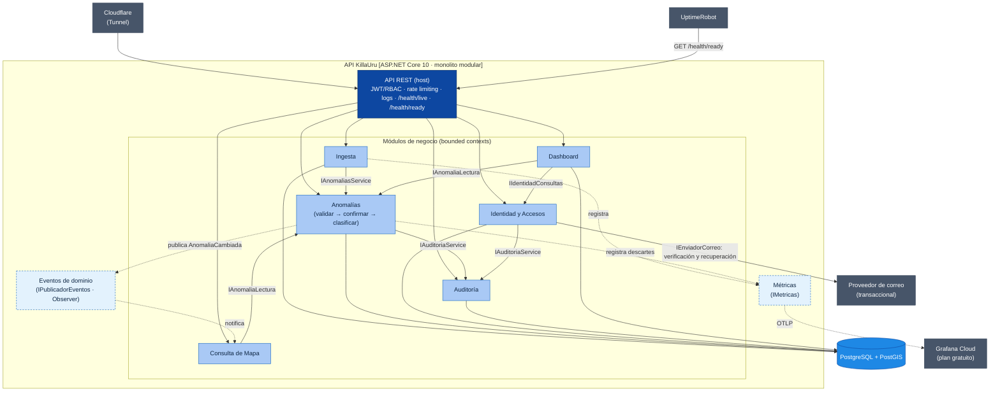
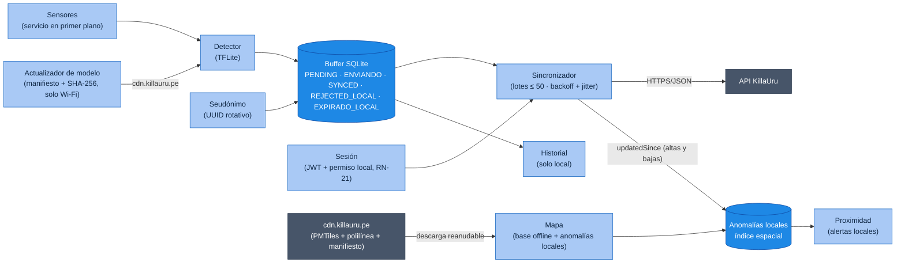

# Componentes Arquitectónicos — KillaUru

> **Proyecto:** KillaUru · **Versión:** 2.2 · **Revisión:** 2026-10-21 · **Estado:** Vigente (alineado con ADR-001…ADR-015)
> **Modelo:** C4 · Nivel 3 (componentes) · **Detalle visual:** `Nivel3-diagrama-de-componentes.md`
> **Relacionados:** `estilo-arquitectonico.md`, `enfoque-arquitectonico.md`, `03-requisitos-funcionales.md`

## 1. Propósito

Este documento es el **catálogo de componentes** de KillaUru: qué componentes existen en el backend y en la app, qué responsabilidad tiene cada uno, qué contratos públicos expone, qué datos posee y de quién depende. El diagrama de componentes del backend (C3) se mantiene en `Nivel3-diagrama-de-componentes.md`; aquí se complementa con los contratos, la propiedad de datos y los procesos en segundo plano.

Todo el backend corre en **un único proceso** (`docker compose up -d`, DA-06). Se mantiene separado en *bounded contexts* internos para poder extraerlos más adelante (DA-09).

## 2. Diagrama de componentes del backend

> **Cómo leer el diagrama:** solo los módulos **dueños** de una tabla (`ING`, `ANO`, `ID`, `AUD`, `DASH`) tienen flecha a la base de datos. Consulta de Mapa **lee a través del contrato** del dueño, nunca con SQL propio (regla 3 de `estilo-arquitectonico.md`). Las métricas son un puerto técnico compartido (como la caché): los módulos las registran sin depender de Dashboard, lo que evita el ciclo Anomalías ↔ Dashboard.

## 3. Catálogo de componentes del backend

| Componente | Responsabilidad | Funcionalidades principales | Carpeta |
|---|---|---|---|
| **API REST** (host) | Punto de entrada HTTP único y composición de módulos | Rutas `/api/v1`; middleware de sesión y **RBAC**; rate limiting con clave compuesta (seudónimo en cabecera + IP real tomada de `CF-Connecting-IP`), cuota aparte de lotes para el anónimo, techo por IP para las peticiones anónimas (600 lotes/h y 300 consultas/h) y tope de 5 registros/h por IP (RNF-11); cabeceras de caché por rol (solo las respuestas anónimas son públicas, ADR-006); OpenTelemetry y logs Serilog enviados a Grafana Cloud (sin exponer `/metrics`); manejo de errores; `/health/live` (para Docker) y `/health/ready` (BD, antigüedad de la cola, corredor cargado y migraciones al día, para UptimeRobot) (RF-28). La auditoría de lecturas administrativas sensibles **no** la hace el host: la hace el módulo dueño de cada dato (D15). **Los controladores viven en `Adapters/` de cada módulo.** | `Api/` |
| **Identidad y Accesos** | Cuentas, credenciales, sesión y roles (ADR-009) | Registro e inicio de sesión de conductor con *refresh* (RF-21); login de administrador con sesión de máximo 8 h (RF-16); tokens de acceso de 5 min y tokens de actualización revocables y rotativos, con 60 s de gracia ante reintentos, para todos los roles (ADR-009); cierre de sesión que revoca el *refresh* (RF-38); bloqueo temporal progresivo por intentos fallidos (RN-19); versión aceptada de la política de privacidad y de los términos de uso (RF-29, RF-37); CRUD de usuarios y roles y registro de la revisión mensual de privilegios (RF-19, RNF-30); desactivación efectiva en ≤ 5 min (RNF-26); consentimiento (RF-29), eliminación de cuenta (RF-30) y «mis datos» `GET /api/v1/me` (RF-31); verificación de correo y recuperación de contraseña mediante el adaptador `IEnviadorCorreo` (RF-22, RF-32) | `Modules/Identidad/` |
| **Ingesta** | Recepción durable e idempotente de lotes (ADR-005) | `POST /api/v1/anomalies/batch`; genera el `loteId` (UUIDv7) en el servidor; un lote = un seudónimo (el de la cabecera o, si no viene, el del primer evento con seudónimo válido; otro seudónimo → `SeudonimoInconsistente`); aplica a cada evento las reglas de recepción de RN-11; marca `con_sesion` en cada evento según el token del lote (solo conductor registrado con correo verificado, RN-14); persiste solo los aceptados en `evento_recibido` con `ON CONFLICT DO NOTHING`; responde 200 con `aceptados`, `duplicados` y `rechazados` (cada uno con `id` —`null` si el evento no trae `eventoId`—, `indice` y motivo); 400 solo para un lote ilegible, sin arreglo `eventos`, vacío o de más de 50; 401 con token vencido; 503 si la cola está saturada; avisa por Channel de lotes; barredor de recuperación; métrica de retraso de cola (RF-11, RNF-23) | `Modules/Ingesta/` |
| **Anomalías** | Dueño del agregado `Anomalia`: calidad del dato, confirmación, clasificación y ciclo de vida | **Validar:** expone las reglas de recepción (`EvaluarIntrinseca`: esquema, confidence, precisión GPS, timestamp, tipo y distancia a la vía, RN-11, RN-13) que Ingesta aplica antes del 200; al procesar, descarta por velocidad imposible (RN-15b) y cuenta los descartes como métricas; si el dispositivo supera su tope por hora (con el conteo de eventos recibidos que le pasa Ingesta), las anomalías nuevas que crea nacen pendientes en lugar de descartarse (RN-15a). **Confirmar:** severidad 4–5 exige ≥ 2 dispositivos distintos en 100 m y 72 h, con detecciones separadas ≥ 3 min (mismo vehículo = uno), al menos uno con sesión (RN-06, RN-14); una anomalía `Expirada` (con un reporte detectado después de su vencimiento) o `Reparada` (con un reporte detectado después de la reparación) vuelve a nacer y pasa otra vez por esta regla. **Clasificar:** agrupa reportes del mismo tipo a ≤ 100 m de la posición fija de la anomalía y calcula la severidad mostrada como mediana de 15 días redondeada hacia arriba (RN-05); PERSISTENTE / EPISÓDICA con día local UTC−5 (RN-12, RF-13). **Ciclo de vida:** `Activa`, `PendienteConfirmacion`, `Expirada`, `Reparada`, `Descartada` (RN-07, RF-23), con caducidad revisada cada hora; `kmVia` calculado al nacer con `CorredorVia.KmSobreVia` (posición fija); moderación según la tabla de acciones del administrador y lista «Por revisar» de anomalías descartadas que siguen recibiendo reportes (RF-24); retención histórica de 2 años (una `Descartada` solo se borra tras 2 años sin ningún reporte nuevo, RN-10). Es **dueño de su transacción y de su bloqueo por celda**; idempotente por `eventoId` (restricción única en `reporte_anomalia`); invalida la caché. **Exportar:** CSV y GeoJSON filtrados, **sin seudónimos de dispositivo**, contando las filas primero y auditando cada exportación con ese número antes de escribirla (RF-20, RF-15) | `Modules/Anomalias/` |
| **Consulta de Mapa** | Lectura del mapa con alcance por rol | `GET /api/v1/anomalies?bbox=` en GeoJSON; **recorta el `bbox` por rol** (demo / corredor / todo); filtros `tipo`, `severidad`, `desde`, `hasta` y `estado` (solo administrador); `updatedSince` con las bajas como `{id, eliminada: true}` y `ETag`; *cache-aside* por celdas **y alcance del rol** con **su propia** `IMemoryCache` (solo las respuestas anónimas son cacheables en el borde), que invalida al recibir `AnomaliaCambiada` (RF-14, ADR-006) | `Modules/Mapa/` |
| **Dashboard** | Indicadores **de negocio** | Eventos por día, conductores registrados activos (sesiones renovadas en 7 días), dispositivos que aportaron datos (conteo diario de seudónimos distintos, sin guardar cuáles), cobertura, tasa de confirmación y de reaparición (RF-18). Un proceso diario pide el resumen del día a Anomalías (`IAnomaliaLectura.ResumenDelDiaAsync`, calculado con su historial `transicion`) y a Identidad (`IIdentidadConsultas`), y guarda solo los números en `dashboard.indicador_diario` (detalle en `diseño-interno-de-modulos.md`, sección 3.8). Las métricas técnicas no viven aquí: están en Grafana | `Modules/Dashboard/` |
| **Auditoría** | Trazabilidad de acciones sensibles | Registro *append-only* (timestamp UTC, actor, acción, contexto); consulta de solo lectura (RF-15). **No** registra descartes de ingesta | `Modules/Auditoria/` |
| **Eventos de dominio** | Componente técnico de comunicación (patrón Observer) | `IPublicadorEventos` en memoria: un módulo publica un hecho (`AnomaliaCambiada`) **después del *commit*** y los suscriptores reaccionan sin que el publicador los conozca (ADR-006) | `Shared/Eventos/` |
| **Métricas** | Componente técnico de observabilidad | Puerto `IMetricas` (contadores e histogramas: lotes, rechazos y descartes por motivo, eventos retenidos por RN-15a, tamaño y antigüedad de la cola, retraso de cola, última ejecución correcta de cada tarea programada). Lo implementa el host con `System.Diagnostics.Metrics` y **OpenTelemetry**, que exporta a Grafana Cloud | `Shared/Metricas/` |
| **Shared / Kernel** | Solo lo verdaderamente compartido | `Coordenada`, `Severidad`, `Confidence`, `SeudonimoInstalacion`, `Celda`, `Roles` (`Shared/Domain`); `IPublicadorEventos`; `IMetricas`; `IContextoTransaccion` (`Shared/Persistencia`, ADR-013); `ProgramaReloj` (`Shared/Tareas`, próximo instante de cada tarea por reloj); `TimeProvider`. **No** contiene configuración de negocio (cada módulo tiene su `<Modulo>Options`) ni contratos de un módulo (`EventoReportado` y `TipoAnomalia` viven en `Anomalias/Contracts`) | `Shared/` |

### 3.1 Contratos públicos entre módulos

*(Los nombres marcados con * son propuestas a confirmar en Nivel3 y Nivel4.)*

| Módulo dueño | Interfaz (`Contracts/`) | Operaciones | Consumidores |
|---|---|---|---|
| Anomalías | `IAnomaliasService` | `EvaluarIntrinseca(evento, recibidoUtc)` (síncrona y pura, al recibir el lote), `ProcesarReporteAsync(evento, contexto)` (validar → agrupar → confirmar → clasificar). El `contexto` es `ContextoReporte(bool ConSesion, int EventosEnLaHora, DateTimeOffset RecibidoUtc)`: lo arma Ingesta con sus propios datos (`conSesion`, el número de eventos ya recibidos de ese seudónimo en esa hora de detección para RN-15a y la hora de recepción, para que la reevaluación use el mismo instante), porque Anomalías no puede leer la tabla de Ingesta | Ingesta |
| Anomalías | `IAnomaliaLectura` | `ActivasPorCeldasAsync(celdas)` (mapa con caché), `FiltrarAsync(bbox, filtros)` (peticiones con filtros, sin caché por celdas), `CambiosDesdeAsync(desde)` (altas y bajas de `updatedSince`), `ResumenDelDiaAsync(dia)` (eventos válidos, dispositivos, cobertura, confirmaciones y reapariciones), `CeldasDelCorredor()` (síncrona: celdas que toca la polilínea, para el recorte por rol). Todo el SQL vive dentro de Anomalías | Consulta de Mapa, Dashboard |
| Auditoría | `IAuditoriaService` | `RegistrarAsync(acción, actor, objetivo, contexto, ct)` **exige** la transacción del que actúa unida en `IContextoTransaccion` (si falta, lanza `InvalidOperationException`, ADR-013); `RegistrarLecturaAsync(acción, actor, objetivo, contexto, ct)` con transacción propia, solo para lecturas sensibles (lista y detalle de usuarios, consulta de la auditoría, exportación) | Identidad, Anomalías, Auditoría (cada módulo audita las lecturas de sus datos; Mapa y Dashboard no se registran) |
| Identidad | `IIdentidadConsultas`* | `ContarConductoresActivosAsync(dias)`: cuentas con sesión renovada en los últimos N días | Dashboard |
| Anomalías | Evento `AnomaliaCambiada` | `anomaliaId`, `celda` (una sola: la posición es fija, RN-05) | Consulta de Mapa (invalida su caché); futuro: notificaciones |
| Shared | `IPublicadorEventos` | `PublicarAsync(evento)`, suscripción por tipo de evento | Todos los módulos |
| Shared | `IMetricas`* | `RegistrarLote(…)`, `RegistrarDescarte(motivo)`, `RegistrarLatencia(…)`, `RegistrarRetrasoCola(TimeSpan)` (histograma `killauru.ingesta.retraso_cola_s`) | Ingesta, Anomalías, API REST (registran); el host lo implementa con OpenTelemetry |

> El conteo de dispositivos distintos para confirmar (RN-06) ya no es un contrato público: es una consulta **interna** del módulo Anomalías.
>
> `MotivoDescarte` (`Anomalias/Contracts`) tiene **8** motivos: los 7 de RN-11/RN-13/RN-15b más `SeudonimoInconsistente = 8`, que evalúa Ingesta en la recepción (un lote = un seudónimo, RN-11).

## 4. Procesos en segundo plano

| Proceso | Módulo | Frecuencia | Qué hace | Referencia |
|---|---|---|---|---|
| `ProcesadorEventosBackgroundService` | Ingesta | Continuo + barrido cada ~60 s y al arrancar | Procesa lotes recibidos y recupera los pendientes tras un reinicio | ADR-005, EQ-09 |
| Caducidad de anomalías | Anomalías | Al arrancar y cada hora (minuto :05) | Marca `Expirada` según los plazos configurables, medidos con la hora de detección (RN-07) | ADR-008 |
| Purga de seudónimos | Anomalías e Ingesta | Al arrancar y cada hora (minuto :10) | En la misma sentencia, 72 h después de recibido: pone en `NULL` el `seudonimo` de los reportes y de `evento_recibido`, pone en `NULL` el `lote_id` de `evento_recibido` y redondea `recibido_utc` a la hora en las dos tablas (el seudónimo nunca se guarda dentro del `payload`) | RF-27, RNF-25, RN-09 |
| Purga de recepción | Ingesta | Al arrancar y diario a las 03:00 (hora local) | Elimina filas de `evento_recibido` con más de 30 días | RNF-25 |
| Purga histórica | Anomalías | Al arrancar y diario a las 03:30 | Borra los reportes con más de 2 años desde su detección y las anomalías que llevan 2 años en un estado final; una `Descartada` solo si además pasaron 2 años sin ningún reporte nuevo | RN-10 |
| Purga de Identidad | Identidad | Al arrancar y diario a las 03:45 | Borra las sesiones de *refresh* vencidas o revocadas hace más de 30 días y los tokens de correo vencidos o usados hace más de 30 días; trunca a la hora el `usado_utc` con más de 2 min | RN-09, RNF-10 |
| Indicadores diarios | Dashboard | Al arrancar y diario a las 00:30 | Guarda los conteos de negocio del día (conductores activos, dispositivos que aportaron, confirmación, reaparición) | RF-18, RN-17 |
| Backup | Host (fuera de la API) | Diario a las 02:00 | `pg_dumpall --roles-only` + `pg_dump` cifrados a R2, fuera de la VM; retención de 30 días; al terminar bien escribe la hora en un archivo que Grafana Alloy convierte en métrica; tras una restauración se revocan todas las sesiones, se rota la clave de firma JWT y se repiten las purgas y eliminaciones de cuenta (RN-10) | RNF-07, ADR-010 |

> **Tareas por reloj, no por intervalos de 24 h:** todas corren **al arrancar** y luego en su minuto u hora local fija, calculada con `Shared/Tareas/ProgramaReloj` sobre `TimeProvider`; así un reinicio o un despliegue no las retrasa. Cada una registra su última ejecución correcta con su nombre de métrica: `caducidad`, `purga-seudonimos`, `purga-seudonimos-recepcion`, `purga-recepcion`, `purga-historica`, `purga-identidad`, `indicadores`, `backup` (Grafana alerta a las 26 h).

## 5. Componentes de la app Android

| Componente | Responsabilidad | RF | RNF |
|---|---|---|---|
| **Sensores** | Capturar acelerómetro y giroscopio a 50 Hz en un servicio en primer plano si la velocidad GPS supera 5 km/h durante ≥ 10 s (RN-03), la categoría elegida es Liviano (RN-18), el usuario no eligió «Solo ver el mapa» y la batería no está en ahorro (RN-22); mostrar el indicador de estado de la detección | RF-01, RF-34, RF-36 | RNF-15 |
| **Detector** | Clasificar ventanas de 500 ms con TFLite (tipo, severidad, confidence) | RF-02, RF-05 | RNF-04 |
| **Buffer** | Guardar eventos con `eventoId`, hora de detección tomada del GPS, `modeloVersion` y estado local (`PENDING`, `ENVIANDO`, `SYNCED`, `REJECTED_LOCAL`, `EXPIRADO_LOCAL`); borrar los estados finales a los 7 días | RF-03, RF-05, RF-06 | RNF-15 |
| **Seudónimo** | Generar el UUID de instalación y rotarlo mensualmente | RF-27 | RNF-10 |
| **Sincronizador** | Enviar lotes ≤ 50; reintentar con backoff y *jitter*; reiniciar el backoff al recuperar red; interpretar 200/400/401/429/503 y los estados locales del evento (RF-06) | RF-04, RF-06, RF-07 | — |
| **Mapa** | Descargar (con manifiesto, SHA-256 y de forma reanudable) y mostrar el mapa base vectorial y la polilínea del corredor; mostrar las anomalías `Activa` con «Actualizado hace…»; aplicar las bajas de la descarga incremental; para el anónimo, sombrear la zona fuera del tramo demo y avisar una vez por viaje | RF-08, RF-09, RF-26, RF-05 | RNF-15 |
| **Proximidad** | Alertar al conductor registrado de anomalías por delante en el sentido de marcha, sin red, midiendo la distancia a lo largo de la vía, con más anticipación para vehículos pesados y una alerta por pasada (RN-16); sonido que baja la música y funciona con la pantalla bloqueada (RN-20); sigue activa aunque la detección esté en pausa por batería (RN-22) | RF-10, RF-05 | — |
| **Historial** | Calcular y mostrar 6 meses de recorridos, solo en el dispositivo; se borra al cerrar sesión (RN-21) | RF-25 | RNF-10 |
| **Actualizador de modelo** | Con Wi-Fi, consultar el manifiesto de `cdn.killauru.pe`, descargar el modelo nuevo, verificar su SHA-256 y activarlo solo con la detección detenida y si la app cumple la versión mínima del manifiesto; si falla, conservar el anterior. Prioridad *Should* (recortable) | RF-33 | RNF-15 |
| **Sesión** | Registro con aceptación de la política, inicio de sesión, renovación del JWT, derecho de acceso al corredor guardado localmente, «Mi perfil» y eliminación de cuenta (borra también el historial local); solicitud de permisos de Android, aceptación de los términos de uso y del aviso de privacidad (también sin cuenta) en el primer uso; opción «Solo ver el mapa, no enviar datos»; cierre de sesión y vigencia del permiso local (RN-21) | RF-21, RF-29, RF-30, RF-31, RF-35, RF-37, RF-38 | — |

## 5.1 Componentes del Panel Admin

SPA en **React + MapLibre GL JS**, servida como estático desde Cloudflare Pages (`panel.killauru.pe`). No tiene lógica de negocio: toda regla y todo permiso se decide en la API (regla 8 de `estilo-arquitectonico.md`).

| Pantalla | Responsabilidad | Endpoints que usa (módulo) | RF | HU |
|---|---|---|---|---|
| **Inicio de sesión** | Login, recuperar contraseña, renovación silenciosa de la sesión (cookie `HttpOnly; Secure; SameSite=Strict`) | Identidad y Accesos | RF-16, RF-32 | HU-11, HU-25 |
| **Mapa con filtros** | Todas las anomalías, incluidas las no confirmadas; filtros por tipo, severidad, fecha y estado | Consulta de Mapa | RF-17 | HU-12 |
| **Moderación** | Marcar `Reparada`, `Descartada` o reabrir según la tabla de acciones de RN-07; lista «Por revisar» de anomalías descartadas que siguen recibiendo reportes | Anomalías | RF-24 | HU-19 |
| **Dashboard** | Indicadores de negocio y enlace a los paneles técnicos de Grafana | Dashboard | RF-18 | HU-13 |
| **Usuarios** | Crear, editar rol, desactivar; revisión mensual de privilegios | Identidad y Accesos | RF-19 | HU-14 |
| **Exportación** | CSV y GeoJSON con filtros, sin seudónimos | Anomalías | RF-20 | HU-20 |
| **Auditoría** | Consulta de solo lectura | Auditoría | RF-15 | HU-15 |

## 6. Propiedad de los datos

Cada tabla tiene **un solo módulo dueño** que escribe en ella. Los demás acceden por el contrato del dueño. La regla se **hace cumplir** así:

1. **Un esquema de PostgreSQL por módulo** dentro de la misma base de datos (`identidad`, `ingesta`, `anomalias`, `auditoria`, `dashboard`). Consulta de Mapa no tiene tablas propias.
2. **Un `DbContext` de EF Core por módulo**, que solo mapea su esquema y es `internal` al módulo: otro módulo no puede usarlo.
3. **Sin llaves foráneas entre esquemas.** Las referencias cruzadas son identificadores simples (p. ej. `auditoria.registro.actor_id`), para que eliminar una cuenta (RF-30) no rompa la auditoría.
4. Las **pruebas de arquitectura** (RNF-28) verifican que ningún módulo referencie el `DbContext` ni el esquema de otro.
5. Para ADR-013, el `DbContext` de Auditoría se une a la transacción del módulo que actúa usando **la misma conexión** (`UseTransaction`), sin compartir el `DbContext`.

| Esquema · tablas *(nombres propuestos)* | Dueño (escribe) | Módulos que leen (por contrato) | Retención |
|---|---|---|---|
| `identidad`: `usuario` (rol como enumeración), `sesion_refresh`, `consentimiento`, `token_correo` | Identidad y Accesos | Dashboard (`IIdentidadConsultas`) | Cuentas y consentimientos: mientras la cuenta exista; se borran al eliminarla (RF-30). Sesiones vencidas o revocadas y tokens de correo: 30 días (horas de sesión guardadas truncadas a la hora) |
| `ingesta`: `evento_recibido` | Ingesta | Anomalías (a través del procesador de Ingesta) | 30 días (RNF-25); a las 72 h, `lote_id` en `NULL` y `recibido_utc` redondeado a la hora |
| `anomalias`: `anomalia`, `reporte_anomalia` (único por `evento_id`), `transicion` (historial de estados para RF-18), `corredor_via` (polilínea de RN-13) | Anomalías | Consulta de Mapa, Dashboard (`IAnomaliaLectura`) | Reportes: seudónimo purgado y `recibido_utc` redondeado a la hora a las 72 h; reportes y anomalías en estado final, 2 años; `Descartada`, 2 años sin ningún reporte nuevo (RN-10) |
| `auditoria`: `registro` | Auditoría | Panel Admin, a través de la API | Permanente (solo inserción) |
| `dashboard`: `indicador_diario` | Dashboard | Panel Admin, a través de la API | 2 años (son solo números agregados) |

## 7. Sistemas y servicios externos

| Sistema | Rol | Se integra desde |
|---|---|---|
| **Cloudflare** | DNS, TLS, proxy, caché de borde, **Tunnel** hacia el origen y **Pages** para el panel | Borde: reenvía el tráfico a la API REST |
| **Grafana Cloud** (plan gratuito) | Recibe métricas, trazas y logs por OTLP; paneles técnicos y alertas por degradación (RNF-20…22, RNF-32) | Host de la API (OpenTelemetry) y contenedor **Grafana Alloy** (métricas de disco, CPU y memoria de la VM, logs de Docker y hora del último backup correcto; solo envía, ADR-010) |
| **UptimeRobot** | Consulta `GET /health/ready` cada 5 minutos; alerta por correo; alimenta su página de estado pública gratuita (sin dominio propio) | API REST |
| **Proveedor de correo transaccional** | Verificación de correo (HU-18b) y recuperación de contraseña (HU-25) | **Solo** Identidad y Accesos, mediante un adaptador |
| **GitHub Actions** y **GitHub Container Registry (GHCR)** | CI en cada PR (build, pruebas, cobertura ≥ 90 % del dominio) y, al unir a `main`, imagen arm64 en GHCR con etiqueta = commit y despliegue automático a la VM por SSH a través de Cloudflare Access (RNF-17, RNF-18, RNF-28) | Fuera de la API: la VM descarga la imagen de GHCR |
| **Almacenamiento de objetos** | Destino de los backups cifrados (30 días), en un *bucket* privado de R2 fuera de la VM | Job de backup del host |
| **Cloudflare R2** (`cdn.killauru.pe`) | Archivo PMTiles del corredor (ADR-011), modelos TFLite versionados con su manifiesto (ADR-004) y backups cifrados en un *bucket* privado aparte (ADR-010) | La app lo descarga y el panel lo lee por rangos HTTP, ambos con MapLibre; no pasa por la API |

## 8. Reglas de composición

| # | Regla | Motivo |
|---|---|---|
| 1 | Todos los componentes se despliegan juntos en el contenedor **API KillaUru**. | Monolito: un proceso y un `docker compose up -d` |
| 2 | Un módulo usa a otro solo por su `Contracts/`, nunca por clases internas ni por su repositorio. | Evolutividad (DA-09) |
| 3 | Un módulo no escribe en tablas de otro; la lectura cruzada solo ocurre por el contrato del dueño. | Independencia de los datos |
| 4 | Las dependencias entre módulos **no forman ciclos**. Grafo actual: Ingesta → Anomalías → Auditoría; Mapa y Dashboard → Anomalías; Dashboard → Identidad; Identidad → Auditoría. Todos pueden usar `Shared` (caché, métricas), que no depende de ningún módulo. | ADR-009 eliminó el ciclo Autenticación ↔ Usuarios; mover las métricas a `Shared` evitó el ciclo Anomalías ↔ Dashboard |
| 5 | Cada sistema externo se integra desde un único módulo. | Fácil de reemplazar |
| 6 | La validación de sesión es **middleware** de la API REST, no una llamada entre módulos. | Evita dependencias circulares |
| 7 | Dominio sin dependencias externas; las dependencias apuntan hacia adentro; los controladores solo usan casos de uso y sus DTOs (tabla de capas en `enfoque-arquitectonico.md`, sección 3). | Reglas de `09-reglas-de-negocio.md` testeables |
| 8 | Cada módulo maneja su propia transacción. **Única excepción:** la auditoría de una acción sensible se escribe en la misma transacción que la acción (ADR-013). | «No hay acción sensible sin rastro» (D.S. 016-2024-JUS) |

## 9. Trazabilidad

| Componente | RF | HU | Épica | RNF |
|---|---|---|---|---|
| API REST (host) | RF-28 | HU-17 | EP-06 | RNF-08, RNF-11, RNF-21, RNF-26 (middleware de sesión, RBAC y límite de tasa) |
| Identidad y Accesos | RF-16, RF-19, RF-21, RF-22, RF-29, RF-30, RF-31, RF-32, RF-37 | HU-11, HU-14, HU-18, HU-18b, HU-22, HU-23, HU-24, HU-25, HU-27 | EP-05, EP-07 | RNF-26, RNF-30 |
| Ingesta | RF-11, RF-27 | HU-04, HU-05, HU-21 | EP-02, EP-03, EP-07 | RNF-02, RNF-03, RNF-06, RNF-25 |
| Anomalías | RF-12, RF-13, RF-20, RF-23, RF-24, RF-27 | HU-05, HU-06, HU-19, HU-20, HU-21 | EP-03, EP-05, EP-07 | RNF-10, RNF-23, RNF-25 |
| Consulta de Mapa | RF-14, RF-17, RF-26 | HU-07, HU-08, HU-12 | EP-04, EP-05 | RNF-01, RNF-27 |
| Dashboard | RF-18 | HU-13 | EP-05 | RNF-22 |
| Auditoría | RF-15, RF-30 | HU-15, HU-23 | EP-05, EP-07 | RNF-29, RNF-30, RNF-31 |
| Eventos de dominio | RF-14 | HU-08 | EP-04 | RNF-01 |
| Métricas (OpenTelemetry) | — | HU-17 | EP-06 | RNF-20, RNF-21, RNF-22, RNF-32 |

## 10. Alineación con Nivel3

**Resuelta (2026-10-14):** `Nivel3-diagrama-de-componentes.md` se rediseñó desde cero (versión 3.0) a partir de este documento. Ya no quedan diferencias pendientes.
