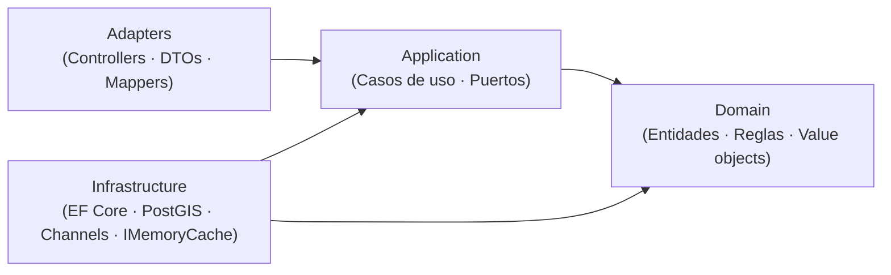
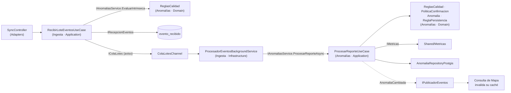
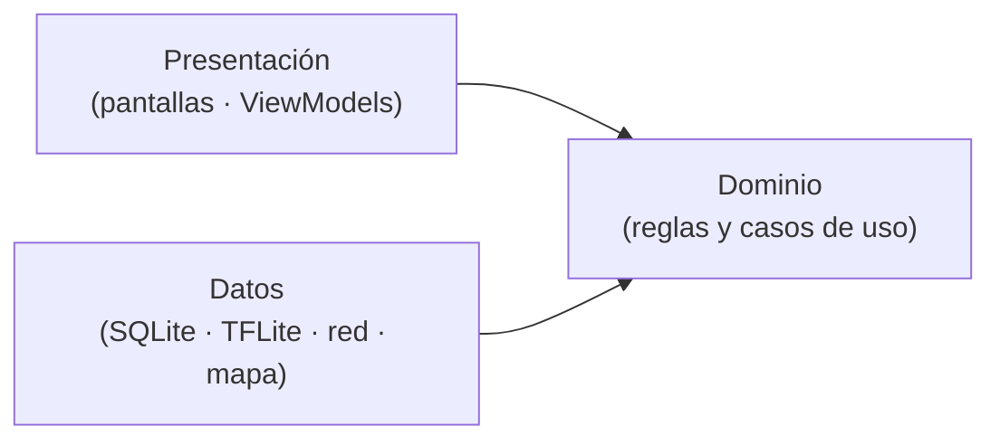

# Enfoque Arquitectónico — Clean Architecture

> **Proyecto:** KillaUru · **Versión:** 2.2 · **Revisión:** 2026-10-21 · **Estado:** Vigente (alineado con ADR-002 y ADR-012)
> **Relacionados:** `estilo-arquitectonico.md`, `componentes-arquitectonicos.md`, `Nivel4-diagrama-de-codigo.md`, `07-decisiones-arquitectonicas.md`

## 1. ¿Qué es Clean Architecture?

Es un enfoque propuesto por Robert C. Martin que organiza el sistema alrededor de las **reglas de negocio**. Su principio fundamental es la **Regla de Dependencia**: las dependencias del código fuente solo apuntan hacia adentro, hacia el dominio. El núcleo del negocio no debe depender de la interfaz, la base de datos, los frameworks ni los servicios externos.

> Si mañana cambiamos de PostgreSQL a otro motor, o de ASP.NET a otro framework, las reglas RN-11 y RN-12 no cambian ni una sola línea.

## 2. Alcance: un enfoque, dos aplicaciones

| Aplicación | Cómo se aplica | Sección |
|---|---|---|
| **Backend** (ASP.NET Core 10) | Clean Architecture **dentro de cada módulo** del monolito, con 4 capas y `Contracts/` | 3 a 8 |
| **App Android** (Kotlin) | Misma regla de dependencia, simplificada en 3 capas | 9 |

> Las dos aplicaciones **no comparten código ni capas**. La detección y la sincronización viven solo en la app; el backend nunca recibe señal cruda (ADR-001, ADR-004).

## 3. Las cuatro capas del backend



| Capa | Contiene | Puede referenciar | Nunca referencia |
|---|---|---|---|
| **Domain** | Entidades, value objects, servicios de dominio, enumeraciones | Solo `Shared/Domain` y la BCL de .NET | Application, Adapters, Infrastructure, ASP.NET, EF Core |
| **Application** | Casos de uso y **puertos** (interfaces que necesita el caso de uso) | Domain y `Contracts/` de otros módulos | Adapters, Infrastructure, EF Core |
| **Adapters** | Controladores, DTOs HTTP y mappers (solo donde hay frontera HTTP) | **Solo Application** (casos de uso y sus DTOs de entrada y salida) | Domain e Infrastructure. **Nunca expone entidades del dominio por HTTP** |
| **Infrastructure** | EF Core, PostGIS, Channels, `IMemoryCache`, adaptador de correo; implementan los puertos | Application (sus puertos) y Domain | Adapters |

> **Regla de dependencia:** las dependencias apuntan **hacia adentro**, hacia Domain; no es una fila estricta de «solo la capa inmediata». Infrastructure puede conocer Domain porque guarda y lee entidades; Adapters no, porque su contrato con el exterior son los DTOs del caso de uso. Así, cambiar una entidad no rompe la API que usa la app Android.
>
> **Los puertos viven en Application** (ADR-002), no en Domain. La capa interna define lo que necesita; la externa lo implementa.

## 4. Plantilla de un módulo

```text
src/
├── KillaUru.Api/                 → Componente «API REST» (Program.cs, middleware, composición)
├── KillaUru.Shared/
│   ├── Domain/                   → Kernel mínimo: Coordenada, Severidad, Confidence, SeudonimoInstalacion, Celda, Roles
│   ├── Eventos/                  → IPublicadorEventos + PublicadorEnMemoria (patrón Observer)
│   ├── Metricas/                 → IMetricas (puerto técnico)
│   ├── Persistencia/             → IContextoTransaccion (une la transacción del módulo que actúa con la auditoría, ADR-013)
│   └── Tareas/                   → ProgramaReloj (próximo instante de una tarea por reloj, con TimeProvider)
└── Modules/
    └── KillaUru.<Modulo>/        → UN proyecto (.csproj) por módulo: todo es internal salvo Contracts/ y el registro
        ├── Contracts/            → public: interfaces y DTOs, lo único que otros módulos pueden usar
        │                           (p. ej. Anomalias/Contracts: IAnomaliasService, EventoReportado, TipoAnomalia, AnomaliaCambiada)
        ├── Domain/               → Entidades, value objects y reglas. Sin using de ASP.NET ni EF
        ├── Application/          → Casos de uso y puertos
        ├── Adapters/             → Controladores, DTOs HTTP y mappers (solo si hay frontera HTTP)
        ├── Infrastructure/       → EF Core, PostGIS, Channels, adaptadores: implementan los puertos
        └── <Modulo>Module.cs     → Raíz de composición (registro en el contenedor DI)
```

> **Un proyecto por módulo:** si otro módulo intenta usar una clase interna (por ejemplo `Anomalia` o `AnomaliasDbContext`), **no compila**. Así la regla 2 de `estilo-arquitectonico.md` la garantiza el compilador, no solo las pruebas. Estructura completa de la solución en `diseño-interno-de-modulos.md`, sección 2.

**Convención de nombres (ADR-012):** términos de negocio en español (`Anomalia`, `ReporteAnomalia`, `Severidad`, `TipoAnomalia`); términos técnicos de capa en inglés (`Domain`, `Application`, `Adapters`, `Infrastructure`).

### 4.1 Qué capas tiene cada módulo

No todos los módulos necesitan las cuatro capas con el mismo peso (DA-12):

| Módulo | Domain | Application | Adapters (HTTP) | Infrastructure |
|---|---|---|---|---|
| **Ingesta** | Mínimo (estado de recepción, hora de detección) | `RecibirLoteEventosUseCase` con su lote y su resultado (`LoteEntrante`, `LoteAceptado`, `ResultadoLote`) | `SyncController` | `ColaLotesChannel`, `RecepcionEventosPostgres`, `ProcesadorEventosBackgroundService` |
| **Anomalías** | **Rico**: `ReglasCalidad`, `CorredorVia` (polilínea en memoria), `PoliticaPlausibilidad`, `PoliticaConfirmacion`, `Anomalia` (agregado con ciclo de vida, posición fija y severidad mostrada), `ReporteAnomalia`, `ReglaPersistencia` | `ProcesarReporteUseCase` (validar → agrupar → confirmar → clasificar), `ModerarAnomaliaUseCase`, `CaducarAnomaliasUseCase`, `PurgarSeudonimosUseCase`, `PurgarHistoricoUseCase`, `ExportarDatasetUseCase` | `ModeracionController`, `ExportacionController` | `AnomaliaRepositoryPostgis`, escritores CSV y GeoJSON, jobs de mantenimiento |
| **Consulta de Mapa** | Recorte por rol (polígono demo) | `ConsultarMapaUseCase` (incluye las bajas de `updatedSince`) | `AnomaliasController` (GET, con cabeceras de caché por rol) | Caché por celdas y rol |
| **Identidad y Accesos** | `Usuario`, `Rol`, política de bloqueo (RN-19) | Registro con aceptación de política y términos, login, refresh con 60 s de gracia, cierre de sesión, gestión de usuarios y revisión mensual de privilegios | `AuthController`, `UsuariosController` | Repositorio EF, emisor de JWT, adaptador de correo `IEnviadorCorreo` |
| **Dashboard** | Indicadores de negocio | Consulta y cálculo diario de indicadores | `DashboardController` | Job diario de indicadores |
| **Auditoría** | Registro inmutable | `RegistrarAuditoriaUseCase`, consulta | `AuditoriaController` (solo lectura) | Repositorio *append-only* |

> Los módulos de soporte (Dashboard, Auditoría) pueden mantener un dominio liviano. La regla de dependencia se respeta igual, pero no se crean entidades artificiales.
>
> **Entradas y salidas de los casos de uso en Application:** como Adapters solo referencia Application (sección 3), los tipos que cruzan la frontera HTTP viven en Application: `LoteEntrante`, `LoteAceptado` y `ResultadoLote` (Ingesta); `ResultadoModeracion` y el comando de moderación (Anomalías; el dominio conserva `AccionAdmin` y Application lo mapea); los resultados de Identidad; `IndicadorResumen` y `ResumenDashboard` (Dashboard). El dominio **no usa contratos de otro módulo**: Ingesta mapea `EventoReportado` en Application y Dashboard construye `DiaIndicadores` con valores simples (el mapeo desde `ResumenDia` vive en Application).

## 5. Las reglas de negocio viven en el dominio

| Regla | Dónde vive | Parámetro (`AnomaliasOptions`, salvo que se indique) |
|---|---|---|
| Confidence mínimo (RN-11) | `ReglasCalidad` (Anomalías · Domain) | `ConfidenceMinimo = 0.75` |
| Precisión GPS máxima (se rechaza si **>** 20 m) | `ReglasCalidad` | `PrecisionGpsMaximaMetros = 20` |
| Timestamp en rango | `ReglasCalidad` | `AntiguedadMaximaDias = 7`, `ToleranciaFuturoMinutos = 5` |
| Confirmación de severidad alta | `PoliticaConfirmacion` | `SeveridadAltaDesde = 4` (RN-06), `DispositivosRequeridos = 2`, `VentanaConfirmacionHoras = 72` (radio: `RadioAgrupacionMetros`), `SeparacionMinimaMinutos = 3` |
| Fuera del corredor (RN-13) | `ReglasCalidad` (intrínseca: compara con la polilínea del corredor en memoria) | `DistanciaMaximaViaMetros = 50` |
| Plausibilidad del dispositivo (RN-15) | `PoliticaPlausibilidad` (necesita los eventos previos del seudónimo, por eso se evalúa al procesar y no al recibir) | `MaxEventosPorHoraDeteccion = 120`, `VelocidadMaximaPlausibleKmh = 150`, `SeparacionMinimaPlausibilidadSegundos = 10` |
| Sesión para confirmar (RN-14) | `PoliticaConfirmacion` | `ReportesConSesionRequeridos = 1` |
| Agrupación y severidad mostrada (RN-05) | `Anomalia` (agregado): mediana de los últimos 15 días, redondeada hacia arriba | `RadioAgrupacionMetros = 100`, `VentanaSeveridadDias = 15` |
| Persistente / episódica (RN-12) | `ReglaPersistencia` (Anomalías · Domain) | `DiasDistintosMinimos = 3`, `VentanaDias = 15`, `DesfaseHorarioHoras = -5` |
| Ciclo de vida de la anomalía (RN-07) | `Anomalia` (agregado): transiciones permitidas, «vuelve a nacer» desde `Expirada` o `Reparada`, caducidad revisada cada hora con la hora de detección | `CaducidadEpisodicaHoras = 72`, `CaducidadPersistenteDias = 7`, `CaducidadPendienteHoras = 72` |
| Purga del seudónimo | Caso de uso de mantenimiento | `PurgaSeudonimoHoras = 72` |
| Revisión de anomalías descartadas (RN-07) | `Anomalia` (agregado) y consulta del panel | `VehiculosRevisionDescartada = 3`, `VentanaRevisionDescartadaDias = 7` |
| Retención histórica (RN-10) | Caso de uso de mantenimiento | `RetencionHistoricaDias = 730` |
| Lote máximo | `RecibirLoteEventosUseCase` | `IngestaOptions.MaxEventosPorLote = 50` |
| Un lote = un seudónimo (RN-11, motivo `SeudonimoInconsistente`) | `RecibirLoteEventosUseCase` | — |
| Seudónimo con formato válido | `SeudonimoInstalacion.Crear` | — |
| Severidad 1–5 y confidence 0.0–1.0 | Fábricas de `Severidad` y `Confidence` | — |

```csharp
// Modules/Anomalias/Domain/AnomaliasOptions.cs (esqueleto) · POCO sin dependencias: Domain puede usarlo
// ADR-012: umbrales por configuración tipada · ISP: cada módulo recibe solo SUS parámetros
public sealed class AnomaliasOptions
{
    public const string Seccion = "Anomalias";            // appsettings.json → "Anomalias": { ... }

    // RN-11 · Calidad
    public double ConfidenceMinimo { get; init; } = 0.75;
    public double PrecisionGpsMaximaMetros { get; init; } = 20;
    public int AntiguedadMaximaDias { get; init; } = 7;
    public int ToleranciaFuturoMinutos { get; init; } = 5;

    // RN-05 · Agrupación y severidad mostrada (mediana redondeada hacia arriba)
    public int RadioAgrupacionMetros { get; init; } = 100;
    public int VentanaSeveridadDias { get; init; } = 15;

    // RN-06 y RN-14 · Confirmación
    public int SeveridadAltaDesde { get; init; } = 4;
    public int DispositivosRequeridos { get; init; } = 2;
    public int VentanaConfirmacionHoras { get; init; } = 72;
    public int SeparacionMinimaMinutos { get; init; } = 3;   // celulares del mismo vehículo = 1
    public int ReportesConSesionRequeridos { get; init; } = 1;

    // RN-13 y RN-15 · Antifraude
    public double DistanciaMaximaViaMetros { get; init; } = 50;
    public int MaxEventosPorHoraDeteccion { get; init; } = 120;   // al superarlo se exige confirmación (no se descarta)
    public int VelocidadMaximaPlausibleKmh { get; init; } = 150;
    public int SeparacionMinimaPlausibilidadSegundos { get; init; } = 10;  // descuenta el error GPS

    // RN-12 · Persistencia
    public int DiasDistintosMinimos { get; init; } = 3;
    public int VentanaDias { get; init; } = 15;
    public int DesfaseHorarioHoras { get; init; } = -5;          // Perú no usa horario de verano

    // RN-07 y RN-09 · Ciclo de vida y privacidad
    public int CaducidadEpisodicaHoras { get; init; } = 72;
    public int CaducidadPersistenteDias { get; init; } = 7;     // un bache reparado sin aviso sale del mapa en ≤ 1 semana
    public int CaducidadPendienteHoras { get; init; } = 72;
    public int PurgaSeudonimoHoras { get; init; } = 72;
    public int RetencionHistoricaDias { get; init; } = 730;      // RN-10: 2 años
    public int VehiculosRevisionDescartada { get; init; } = 3;   // RN-07: «Por revisar»
    public int VentanaRevisionDescartadaDias { get; init; } = 7;
}
```

| Clase de configuración | Sección de `appsettings.json` | Qué contiene | Dónde vive |
|---|---|---|---|
| `IngestaOptions` | `Ingesta` | `MaxEventosPorLote = 50`, `CapacidadCola`, `Trabajadores`, intervalo y antigüedad del barredor, `AntiguedadMaximaColaMinutos = 5` (RF-28), `PurgaSeudonimoHoras = 72` (copia del valor de Anomalías, con prueba de igualdad), `RetencionRecepcionDias = 30`, `TamanoMaximoCuerpoKb` | `Modules/Ingesta/Application/` |
| `AnomaliasOptions` | `Anomalias` | RN-05 a RN-15 (arriba) | `Modules/Anomalias/Domain/` |
| `IdentidadOptions` | `Identidad` | Duración de los tokens y periodo de gracia de la rotación (60 s), `IntentosMaximos`, `VentanaIntentosMinutos` y `DuracionesBloqueoMinutos` (RN-19), `ContrasenaMinima = 10` (RF-21), versiones vigentes de la política de privacidad y de los términos de uso (RF-29, RF-37) | `Modules/Identidad/Application/` |
| `DashboardOptions` | `Dashboard` | `DiasConductorActivo = 7` (RN-17) | `Modules/Dashboard/Application/` |
| `MapaOptions` | `Mapa` | Polígono del tramo demo (km 268 → 333, margen 200 m, ≤ 60 vértices), tiempo de caché. **Sin** tamaño de celda: la celda es la de `Shared` (0,005°), la misma que guarda Anomalías. Sin estados por defecto del administrador: sin `estado`, recibe los 5 (RN-08) | `Modules/Mapa/Application/` |
| `ApiOptions` | `Api` | Límites de tasa (RNF-11): `LimiteTasa:AnonimoConsultasPorHora = 60`, `AnonimoLotesPorHora = 120`, `RegistradoPorHora = 1000`, `AdministradorPorHora = 3000`, techo por IP para anónimos `TechoIpLotesPorHora = 600` y `TechoIpConsultasPorHora = 300`, `RegistrosPorHoraPorIp = 5`; telemetría, JWT, origen del panel | `KillaUru.Api/Configuracion/` (host) |
| Configuración de la app | (en el APK; no es del backend) | RN-03 (`VelocidadMinimaKmh`, `DuracionSostenidaSegundos`), RN-16 (`TiempoAvisoSegundos`, `DistanciaAvisoMinimaMetros`, `TiempoAvisoPesadoSegundos`, `DistanciaAvisoMinimaPesadoMetros`, `DistanciaFinPasadaMetros`), RN-18 (`CategoriasQueDetectan`), RN-21 (`DuracionPermisoLocalDias`, `ParadaFinViajeMinutos`), RN-22 (`BateriaMinimaPorcentaje`) y RN-09 (`RotacionSeudonimoDias`) | App Android · capa de dominio |

> Cada módulo registra **su** clase en su `<Modulo>Module.cs`. Un módulo nunca lee la sección de configuración de otro (principio de segregación de interfaces).

```csharp
// Modules/Anomalias/Domain/ReglasCalidad.cs (esqueleto) · sin using de ASP.NET ni EF
public sealed class ReglasCalidad(AnomaliasOptions o, CorredorVia corredor)   // CorredorVia: polilínea en memoria (RN-13)
{
    // Reglas de RECEPCIÓN (RN-11): puras, sin BD; se evalúan evento por evento antes del 200.
    // El esquema inválido (campos faltantes o mal formados) ya lo rechazó el mapeo a ReporteAnomalia.
    public MotivoDescarte? EvaluarIntrinseca(ReporteAnomalia e, DateTimeOffset recibidoUtc)   // value object del dominio; Application lo mapea desde EventoReportado (Contracts)
    {
        if (!Enum.IsDefined(e.Tipo))
            return MotivoDescarte.TipoDesconocido;
        if (e.Confidence.Valor < o.ConfidenceMinimo)
            return MotivoDescarte.ConfidenceBajo;
        if (e.Ubicacion.PrecisionMetros > o.PrecisionGpsMaximaMetros)
            return MotivoDescarte.PrecisionGpsInsuficiente;
        if (e.DetectadoUtc > recibidoUtc.AddMinutes(o.ToleranciaFuturoMinutos) ||   // contra la hora de recepción:
            e.DetectadoUtc < recibidoUtc.AddDays(-o.AntiguedadMaximaDias))         // al reprocesar da el mismo resultado
            return MotivoDescarte.TimestampFueraDeRango;
        if (corredor.DistanciaMetros(e.Ubicacion) > o.DistanciaMaximaViaMetros)
            return MotivoDescarte.FueraDelCorredor;
        return null;
    }
}
```

```csharp
// Modules/Anomalias/Domain/ReglaPersistencia.cs (esqueleto)
public sealed class ReglaPersistencia(AnomaliasOptions o)
{
    public EstadoPersistencia Evaluar(IEnumerable<DateTimeOffset> reportesUtc, DateTimeOffset ahora)
    {
        var desfase = TimeSpan.FromHours(o.DesfaseHorarioHoras);
        var desde = ahora.AddDays(-o.VentanaDias);

        var diasDistintos = reportesUtc
            .Where(t => t >= desde && t <= ahora)
            .Select(t => DateOnly.FromDateTime(t.ToOffset(desfase).DateTime))   // día local, no UTC
            .Distinct()
            .Count();

        return diasDistintos >= o.DiasDistintosMinimos
            ? EstadoPersistencia.Persistente
            : EstadoPersistencia.Episodica;
    }
}
```

> Un cambio de umbral se hace en `appsettings` y no toca código (EQ-05). `TimeProvider` reemplaza a `DateTime.UtcNow`, lo que permite pruebas deterministas.

## 6. Flujo de código: de la petición a la anomalía persistida (ADR-005)



```csharp
// Modules/Ingesta/Application/RecibirLoteEventosUseCase.cs (esqueleto)
public sealed class RecibirLoteEventosUseCase(
    IAnomaliasService anomalias,         // Contracts de Anomalías (evaluación intrínseca pura)
    IRecepcionEventos recepcion,         // puerto: persiste evento_recibido
    IColaLotes cola,                     // puerto: aviso de trabajo
    IMetricas metricas,                  // Shared/Metricas (puerto técnico)
    IOptions<IngestaOptions> opciones,   // ADR-012: el tope del lote es configuración, no constante
    TimeProvider reloj)
{
    public async Task<ResultadoLote> EjecutarAsync(LoteEntrante lote, CancellationToken ct)
    {
        if (lote.Eventos.Count is 0 || lote.Eventos.Count > opciones.Value.MaxEventosPorLote)
            return ResultadoLote.Invalido();                                              // → 400
        if (!cola.HayCapacidad()) return ResultadoLote.Saturado();                        // → 503 + Retry-After

        var recibidoUtc = reloj.GetUtcNow();
        var loteId = Guid.CreateVersion7(recibidoUtc);   // el loteId lo genera el servidor (no viene en el cuerpo)
        var seudonimo = lote.SeudonimoDelLote();          // cabecera o, si no viene, el del primer evento con seudónimo válido
        var rechazados = lote.Eventos
            .Select((e, indice) => (e.EventoId, Indice: indice,   // id = null si el evento no trae eventoId (EsquemaInvalido)
                Motivo: e.Seudonimo != seudonimo ? MotivoDescarte.SeudonimoInconsistente   // un lote = un seudónimo
                                                  : anomalias.EvaluarIntrinseca(e, recibidoUtc)))
            .Where(x => x.Motivo is not null)
            .ToList();

        // INSERT … ON CONFLICT (evento_id) DO NOTHING: durable e idempotente.
        // Solo se guardan los aceptados; los rechazados vuelven en la respuesta (RN-11)
        var aceptados = LoteAceptado.De(loteId, lote, rechazados, recibidoUtc);
        var nuevos = await recepcion.InsertarAsync(aceptados, ct);       // ids nuevos; el resto = duplicados
        var resultado = ResultadoLote.Aceptado.De(loteId, aceptados, nuevos, rechazados);

        cola.TryEscribir(new LoteRecibido(loteId));   // solo avisa; si falla, el barredor lo recupera
        metricas.RegistrarLote(resultado);            // contadores en memoria, volcados cada minuto
        return resultado;                             // → 200 {loteId, aceptados, duplicados, rechazados[{id, indice, motivo}]}
    }
}
```

**Algoritmo de `ProcesadorEventosBackgroundService`:**

1. Al **arrancar**, y luego cada ~60 s, busca filas `RECIBIDO` pendientes (barredor de recuperación, EQ-09).
2. Con cada aviso de lote, carga sus eventos desde `evento_recibido`.
3. Para cada evento arma el **contexto** `ContextoReporte(ConSesion, EventosEnLaHora, RecibidoUtc)` con datos propios de Ingesta (`conSesion`, guardado al recibir según el token del lote; el número de eventos ya recibidos de ese seudónimo en esa hora de detección, para RN-15a; y la hora de recepción guardada) y llama a `IAnomaliasService.ProcesarReporteAsync(evento, contexto)`, que devuelve `Descartado` (con motivo) o `Procesado`. **Ingesta no abre transacciones ni toma bloqueos sobre tablas de Anomalías.**
4. **Solo después** de una respuesta correcta marca la fila como `PROCESADO` o `DESCARTADO` (transacción propia de Ingesta, solo sobre `evento_recibido`) y registra el retraso de cola (procesado − recibido, `IMetricas.RegistrarRetrasoCola`). Los descartes incrementan **métricas**, no auditoría.
5. Si el proceso se cae entre el paso 3 y el 4, la fila sigue `RECIBIDO`; el barredor la reenvía y Anomalías la reconoce como ya procesada (idempotencia por `eventoId`). Entrega **al menos una vez** + receptor idempotente = **efecto exactamente una vez**.

**Algoritmo de `ProcesarReporteUseCase`** (módulo Anomalías). Anomalías es **dueño de su transacción y de su bloqueo**:

0. **Idempotencia y bloqueo** — abre **su propia** transacción. Si ya existe un reporte con ese `eventoId` (restricción única en `reporte_anomalia.evento_id`), devuelve el resultado anterior sin hacer nada más. Si no, toma un **bloqueo consultivo por celda geográfica** (la celda es ≥ 5× el radio de 100 m) sobre **cada celda que toca el radio de 100 m alrededor del punto**: normalmente una, dos si está cerca de un borde y hasta cuatro si está cerca de una esquina (`Celda.Alrededor`), siempre en orden ascendente para evitar interbloqueos. Así dos reportes simultáneos del mismo bache no crean dos anomalías.
1. **Validar** — `ReglasCalidad.EvaluarIntrinseca` otra vez con la `RecibidoUtc` del contexto, por seguridad ante filas antiguas y con el mismo resultado que al recibir (RN-11, RN-13), y `PoliticaPlausibilidad` con el evento anterior del mismo seudónimo: velocidad plausible descontando las precisiones GPS y solo si están separados ≥ 10 s; se descarta solo el evento posterior (RN-15b). Si hay motivo → `IMetricas.RegistrarDescarte(motivo)` y `Descartado`. Si el conteo del contexto supera el tope por hora de **detección** (RN-15a), el evento **sigue** pero marcado `RequiereConfirmacion`.
2. **Agrupar** — busca una anomalía del mismo tipo a ≤ 100 m de su **posición fija** (la del reporte que la creó; si hay dos, la más cercana) (RN-05) y la lee con `SELECT … FOR UPDATE` dentro del bloqueo de celda, revalidando su estado. Si no existe, `Anomalia.Crear`; si existe, `Anomalia.RegistrarReporte` (actualiza `UltimaDeteccionUtc` con la hora de detección y la **severidad mostrada**: mediana de los reportes de los últimos 15 días, redondeada hacia arriba). Si la anomalía está `Descartada`, el reporte se guarda pero no la reactiva; si ya suma reportes de ≥ 3 vehículos en 7 días, la anomalía queda marcada «Por revisar» para el panel (RN-07). Si está `Expirada` y la hora de detección es posterior a su vencimiento, o está `Reparada` y la hora de detección es posterior a la reparación (`estado_desde_utc`), **vuelve a nacer** y pasa al paso 3 como si fuera nueva (RN-06).
3. **Confirmar** — solo para una anomalía que aún no está publicada (nueva, pendiente o que vuelve a nacer). Exige confirmación si alguno de sus reportes de las últimas 72 h es de severidad 4–5 o si su severidad mostrada es 4–5 (RN-06), o si la creó un evento marcado `RequiereConfirmacion` (RN-15a). Para confirmar cuenta los reportes **de cualquier severidad** de la misma anomalía: dispositivos distintos dentro de la ventana cuyas detecciones están separadas al menos `SeparacionMinimaMinutos` (celulares del mismo vehículo cuentan como uno), con una consulta **interna** del repositorio. Caso grave: ≥ 2 vehículos y ≥ 1 reporte con `con_sesion = true` (RN-14) → `Activa`. Caso del tope (RN-15a) sin gravedad: ≥ 2 vehículos, sin exigir sesión → `Activa`. Si no se cumple → `PendienteConfirmacion`. Sin ninguna de esas condiciones → `Activa`. Una anomalía que ya está `Activa` no vuelve a pendiente.
4. **Clasificar** — la entidad recalcula `Persistencia` con `ReglaPersistencia` (RN-12) y su estado de ciclo de vida (RN-07). Si el estado cambió, anota **una** transición (`desde → hacia`) para los indicadores del Dashboard (RF-18).
5. Guarda el reporte (con su `eventoId`), la anomalía y sus transiciones, confirma (*commit*) y libera el bloqueo.
6. **Después del *commit***, publica `AnomaliaCambiada(anomaliaId, celda)` con `IPublicadorEventos` (una sola celda, porque la posición de la anomalía es fija, RN-05). Anomalías no sabe quién escucha; Consulta de Mapa invalida esa celda (patrón Observer, ADR-006). Si se publicara antes del *commit* y la transacción fallara, el mapa se limpiaría por un cambio que nunca existió.

**Procesos de mantenimiento** (ver `componentes-arquitectonicos.md`, sección 4; todos corren al arrancar y luego por reloj con `Shared/Tareas/ProgramaReloj`): caducidad de anomalías cada hora (ADR-008), purga del seudónimo a 72 h de recibido en reportes y en `evento_recibido` (RN-09), purga de `evento_recibido` a 30 días (RNF-25), purga histórica a 2 años (RN-10) y purga diaria de sesiones y tokens de Identidad a 30 días.

## 7. Composición e inyección de dependencias

Cada módulo expone una extensión que registra sus tipos en el contenedor DI nativo de ASP.NET Core. La capa **Api** es la única que conoce todos los módulos.

```csharp
// Modules/Ingesta/IngestaModule.cs (esqueleto)
public static class IngestaModule
{
    public static IServiceCollection AddIngestaModule(this IServiceCollection s, IConfiguration c) => s
        .Configure<IngestaOptions>(c.GetSection(IngestaOptions.Seccion))          // solo SU sección
        .AddScoped<RecibirLoteEventosUseCase>()
        .AddScoped<IRecepcionEventos, RecepcionEventosPostgres>()     // puerto → implementación
        .AddSingleton<IColaLotes, ColaLotesChannel>()
        .AddHostedService<ProcesadorEventosBackgroundService>();
}

// Api/Program.cs (extracto)
// Cada módulo registra su propia configuración dentro de Add<Modulo>Module (ISP)
builder.Services.AddSingleton(TimeProvider.System);
var cfg = builder.Configuration;
builder.Services.AddIdentidadModule(cfg).AddIngestaModule(cfg).AddAnomaliasModule(cfg)
                .AddMapaModule(cfg).AddDashboardModule(cfg).AddAuditoriaModule(cfg);
```

## 8. Estrategia de pruebas por capa

| Capa | Tipo de prueba | Herramientas *(propuestas)* | Qué se aísla |
|---|---|---|---|
| Domain | Unitarias puras (valores límite: 0.74/0.75/0.76, 19/20/21 m, 49/50/51 m de la vía, 2 días vs 3 días locales, reporte nocturno en UTC−5, detecciones a 2:59 y 3:00 min, mediana par e impar, 9 y 10 s en RN-15b, reactivación de una `Expirada` con un 5) | xUnit | Nada: sin BD, sin red, sin reloj real |
| Application | Unitarias con dobles de los puertos | xUnit + NSubstitute + `FakeTimeProvider` | `IRecepcionEventos`, `IColaLotes`, `IAnomaliaRepository`, `IPublicadorEventos`, contratos de otros módulos |
| Infrastructure | Integración con BD real | Testcontainers (PostgreSQL + PostGIS) | Consultas espaciales, `ON CONFLICT`, bloqueos por celda, mapeos EF |
| Adapters | Pruebas de API | `WebApplicationFactory` | Contratos HTTP: 200 (con aceptados/duplicados/rechazados por evento), 400 (solo lote ilegible), 401, 429, 503; recorte por rol, también a través de la caché |
| Arquitectura | Reglas de dependencia y de tamaño | NetArchTest + `Microsoft.CodeAnalysis.BannedApiAnalyzers` | La tabla de la sección 3 regla por regla: Domain sin dependencias externas ni `Contracts/` de otro módulo; Application sin Adapters ni Infrastructure; Adapters sin Domain; un módulo solo usa `Contracts/` de otro; sin ciclos (RNF-28); ningún archivo `.cs`, `.sql` de consultas, `.sh` ni `.js` supera 199 líneas (excepto migraciones `V*.sql`, generados y OpenAPI); `DateTime.Now/UtcNow` y `DateTimeOffset.Now/UtcNow` prohibidos en el build |
| Sistema | Carga, picos, estrés, resistencia, caos, seguridad y campo | k6 **fuera de la VM** contra el entorno de pruebas (R-11, con límites de CPU/RAM y límites de tasa relajados, en horario de poco tráfico), antes de cada versión y mensual: carga combinada (300 sincronizando + 300 mapa, 10 min), picos (ráfaga de 600), estrés en escalera de 100 en 100 hasta p95 > 2× la meta o errores > 1 % (se registra el punto de quiebre), resistencia (4 h al 50 %) y caos (`kill -9` de la API bajo carga, 0 eventos perdidos); error = todo 5xx (503 con `Retry-After` solo aceptado en estrés; 429 no debe aparecer); recorrido en modo avión y reproductor de sensores de 5 h; mismo `bbox` con y sin token a través de Cloudflare; script de ataque | EQ-01, EQ-02, EQ-06, EQ-09, EQ-11, EQ-12, EQ-14 |

> **CI (GitHub Actions):** en cada PR corren build (advertencias = errores), unitarias, arquitectura, integración (Testcontainers), contrato OpenAPI y cobertura con **coverlet** ≥ 90 % en los proyectos `Domain`; si algo falla, no se une a `main`. Carga y estrés quedan fuera del CI.

## 9. Enfoque en la app Android

La app aplica la misma regla de dependencia con **tres capas**, porque no tiene frontera HTTP de entrada ni módulos de negocio del servidor.



| Capa | Contiene | Reglas que viven aquí |
|---|---|---|
| **Dominio** | `Evento` y su estado (`PENDING`, `ENVIANDO`, `SYNCED`, `REJECTED_LOCAL`, `EXPIRADO_LOCAL`), política de guardado, política de reintento, rotación de seudónimo, filtro de proximidad | confidence ≥ 0.75 (RF-03); detecta solo con categoría Liviano y sin «Solo ver el mapa» (RN-18, RF-29); velocidad sostenida (RN-03); ahorro con batería baja (RN-22); estados locales del evento y su purga (RF-06); backoff 30 s → 2 h con *jitter* ±25 % y reinicio al recuperar red (RF-07); rotación mensual del seudónimo (RF-27); alerta solo para el conductor registrado y anomalías `Activa` por delante en el sentido de marcha, medida a lo largo de la vía, una por pasada (RN-08, RN-16, RN-20); vigencia del permiso local y cierre de sesión (RN-21) |
| **Datos** | Buffer en **Room** (SQLite), envoltorio de **LiteRT**, cliente **Retrofit**, trabajos de **WorkManager** (sincronización y actualización del modelo), almacén del mapa base y de anomalías locales (índice espacial), token y derecho de acceso en **DataStore** cifrado con **Android Keystore** | Hora de detección tomada del GPS; purga de estados finales a los 7 días; descarga incremental con `updatedSince` aplicando las bajas; descarga del mapa base y la polilínea con manifiesto, SHA-256 y reanudación |
| **Presentación** | Pantallas en **Jetpack Compose** (primer uso con términos, aviso de privacidad, categoría de vehículo y permisos; mapa, historial, sesión, perfil y alertas) con ViewModels; servicio en primer plano para los sensores con el indicador de estado en su notificación | Máximo 3 toques por acción principal (RNF-12); tiempos relativos y «Actualizado hace…» (RNF-14, RF-26); zona fuera del tramo demo sombreada para el anónimo (RN-08); indicador de estado (RF-36) |

Principios de la app:

1. **Offline-first:** nada en el flujo de detección, guardado, mapa descargado o alertas necesita red.
2. El **historial** se calcula y se guarda solo en el dispositivo (RF-25).
3. El **acceso al corredor completo** depende de un derecho de acceso (*entitlement*) guardado localmente, no de que el JWT siga vigente: dura lo mismo que la sesión, no se corta durante un viaje y se borra al cerrar sesión o al saberse que la cuenta fue desactivada (RN-21). El servidor sigue decidiendo qué datos entrega (RF-14).
4. El **modelo** declara su `modeloVersion` y cada evento lo lleva (ADR-004).
5. **Las alertas protegen primero:** la pausa por batería baja (RN-22) o por categoría de vehículo apaga la detección, nunca las alertas del conductor registrado.

## 10. Beneficios

| Beneficio | Cómo se aplica en KillaUru |
|---|---|
| **Testeable** | RN-11 y RN-12 se prueban con valores límite, sin BD ni sensores |
| **Calibrable** | Los umbrales se ajustan con datos del piloto sin recompilar (S-04, EQ-05) |
| **Mantenible** | Un cambio de regla no toca controladores ni repositorios |
| **Evolutivo** | Cambiar de motor de datos solo afecta a Infrastructure; extraer un módulo solo exige mover su carpeta |
| **Legible** | Los casos de uso cuentan qué hace el sistema sin leer la infraestructura |

## 11. Alineación con Nivel4

**Resuelta (2026-10-14):** `Nivel4-diagrama-de-codigo.md` se rediseñó desde cero (versión 3.0) a partir de este documento. Ya no quedan diferencias pendientes.
