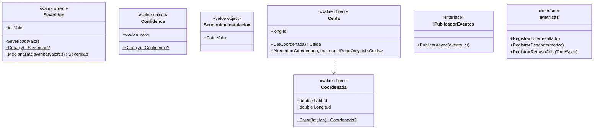
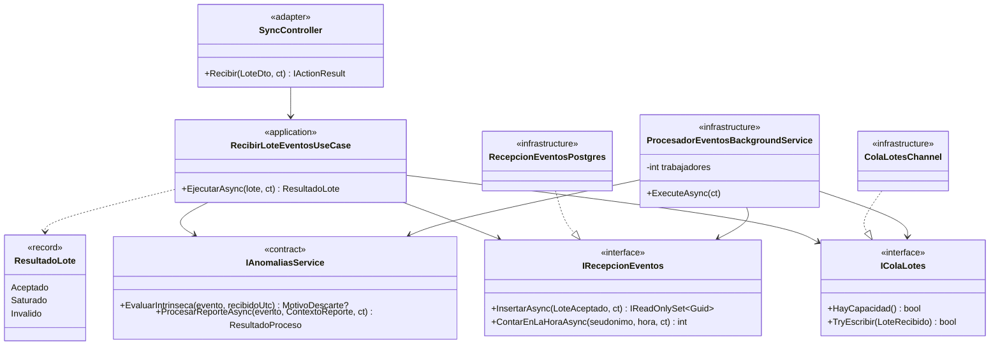
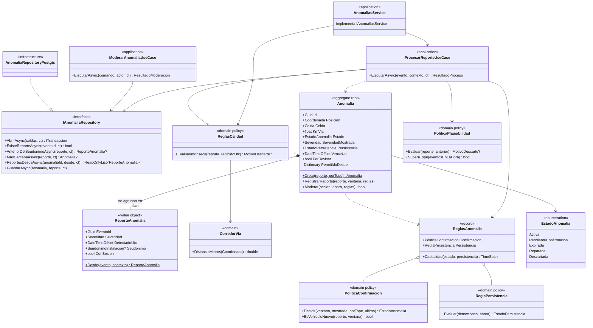
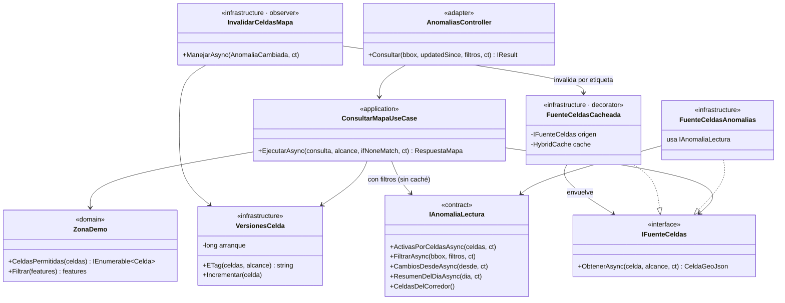
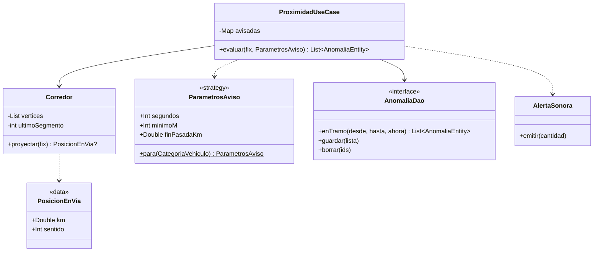

# Nivel 4 · Diagrama de Código

> **Proyecto:** KillaUru · **Modelo:** C4 · Nivel 4 de 4 · **Versión:** 3.1 · **Revisión:** 2026-10-21 · **Estado:** Vigente (alineado con `diseño-interno-de-modulos.md`)
> **Componentes detallados:** Ingesta, Anomalías y Consulta de Mapa (backend) · Proximidad (app)
> **Herramienta:** diagramas de clases UML en Mermaid (C4 recomienda este nivel solo para los componentes críticos)

## 1. Objetivo

Mostrar **cómo están construidos por dentro** los componentes que concentran las reglas y la carga: dónde vive cada regla de negocio, qué interfaces separan las capas y qué patrón se aplica en cada punto. El código de referencia de estas clases está en `diseño-interno-de-modulos.md`, sección 6.

| Aspecto | Descripción |
|---|---|
| Pregunta que responde | ¿En qué clase está cada regla y cómo se conectan las capas? |
| Audiencia | Desarrolladores y QA |
| Qué **no** muestra | Módulos de soporte (Dashboard, Auditoría, Identidad), que siguen la misma plantilla con menos reglas |
| Nivel anterior | [`Nivel3-diagrama-de-componentes.md`](Nivel3-diagrama-de-componentes.md) |

### Leyenda de capas

| Estereotipo | Capa | Puede depender de |
|---|---|---|
| `«domain»` | Domain | Solo `Shared/Domain` |
| `«application»` | Application (casos de uso y puertos) | Domain y `Contracts/` de otros módulos |
| `«adapter»` | Adapters (HTTP) | Solo Application |
| `«infrastructure»` | Infrastructure | Application y Domain |
| `«contract»` | `Contracts/` (público) | Shared |

## 2. Flujo en el código: del lote a la anomalía

```mermaid
sequenceDiagram
    participant C as SyncController «adapter»
    participant R as RecibirLoteEventosUseCase «application»
    participant S as IAnomaliasService «contract»
    participant P as RecepcionEventosPostgres «infrastructure»
    participant Q as ColaLotesChannel «infrastructure»
    participant W as ProcesadorEventos (trabajadores)
    participant U as ProcesarReporteUseCase «application»
    participant A as Anomalia «domain»
    participant B as IPublicadorEventos

    C->>R: EjecutarAsync(lote)
    R->>R: genera loteId; otro seudónimo → SeudonimoInconsistente
    R->>S: EvaluarIntrinseca(evento, recibidoUtc) × N
    R->>P: InsertarAsync(aceptados) — un INSERT con unnest
    R->>Q: TryEscribir(LoteRecibido)
    R-->>C: ResultadoLote.Aceptado → 200 por evento
    Q->>W: lote
    W->>W: arma ContextoReporte (con_sesion, eventos en la hora, recibidoUtc)
    W->>U: ProcesarReporteAsync(evento, contexto)
    U->>U: transacción + bloqueo por celdas
    U->>A: Crear(...) o RegistrarReporte(reporte, ventana, reglas)
    U->>U: commit
    U->>B: Publicar(AnomaliaCambiada)
```

## 3. Kernel compartido



| Clase | Garantía |
|---|---|
| `Severidad` | Su constructor es privado: solo existen severidades de 1 a 5. Calcula la mediana de RN-05 |
| `Celda` | Misma rejilla para el bloqueo de concurrencia y la clave de caché; `Alrededor` devuelve las celdas en orden fijo para evitar interbloqueos |
| `SeudonimoInstalacion` | UUID aleatorio, no derivado del hardware (RF-27) |

## 4. Módulo Ingesta



| Clase | Regla o métrica | Patrón |
|---|---|---|
| `RecibirLoteEventosUseCase` | Resultado por evento; 400 solo para lote ilegible; 503 si la cola está llena (RF-11) | Result |
| `RecepcionEventosPostgres` | Un `INSERT … ON CONFLICT DO NOTHING` por lote (RNF-02, DA-02) | Repository, Idempotent Receiver |
| `ProcesadorEventosBackgroundService` | N trabajadores; arma `ContextoReporte` con datos de Ingesta; barredor cada 60 s (RNF-23, EQ-09) | Competing Consumers |

## 5. Módulo Anomalías



| Clase | Regla de negocio | Patrón |
|---|---|---|
| `ReglasCalidad` + `CorredorVia` | RN-11 y RN-13 (reglas de recepción, sin BD) | Policy |
| `PoliticaPlausibilidad` | RN-15a (tope por hora) y RN-15b (velocidad con margen GPS y ≥ 10 s) | Policy |
| `PoliticaConfirmacion` | RN-06 (vehículos distintos con ≥ 3 min), RN-14 (sesión solo para lo grave), RN-15a (confirmación sin sesión), revisión de `Descartada` (RN-07) | Policy |
| `ReglaPersistencia` | RN-12 (días locales UTC−5) | Policy |
| `Anomalia` | RN-05 (posición fija, mediana), RN-07 (tabla de transiciones, «vuelve a nacer», caducidad con `VenceUtc`) | Aggregate, Factory Method, tabla de transiciones |
| `ProcesarReporteUseCase` | Orquesta; publica `AnomaliaCambiada` después del *commit* | Observer (publicador) |
| `AnomaliaRepositoryPostgis` | Bloqueo por celda, `ST_DWithin`, ventanas por índice | Repository |

## 6. Módulo Consulta de Mapa



| Clase | Qué resuelve | Métrica |
|---|---|---|
| `ConsultarMapaUseCase` | `bbox` → celdas; recorte por rol (`ZonaDemo`); 304 si el ETag coincide; concatena *features* ya serializadas | RNF-01, RNF-27 |
| `FuenteCeldasCacheada` | Caché por celda y alcance con protección contra estampida | RNF-01, EQ-14 |
| `VersionesCelda` | ETag en memoria; incluye el instante de arranque para evitar 304 falsos tras un reinicio | RNF-01 |
| `InvalidarCeldasMapa` | Mantiene la caché fiel sin que Anomalías conozca a Mapa | ADR-006 |

## 7. App: proximidad a lo largo de la vía



| Clase | Regla | Por qué así |
|---|---|---|
| `Corredor` | RN-16 (distancia a lo largo de la vía); sin alerta a más de 50 m de la vía | La búsqueda empieza en el último segmento usado: costo casi constante a 1 Hz |
| `AnomaliaDao.enTramo` | Rango por `km` con índice | Sin geometría por cada lectura del GPS |
| `ParametrosAviso` | 8 s / 100 m (Liviano, Moto) y 12 s / 150 m (Pesado); fin de pasada a 500 m | *Strategy* elegida por la categoría (RN-18) |
| `AlertaSonora` | RN-20: baja la música, suena con la pantalla bloqueada, una alerta aunque sean varias anomalías | Una sola clase con acceso al audio |

## 8. Trazabilidad

| Vista | Reglas y requisitos |
|---|---|
| Ingesta | RF-11, RN-11, RN-14, RNF-02, RNF-06, RNF-23, ADR-005 |
| Anomalías | RN-05, RN-06, RN-07, RN-12, RN-13, RN-14, RN-15, RF-12, RF-13, RF-23, RF-24 |
| Consulta de Mapa | RF-14, RN-08, RNF-01, RNF-27, ADR-006 |
| App · Proximidad | RF-10, RN-16, RN-18, RN-20 |

- **Jira:** `KU-xx` — Diagrama y documentación C4 (Código) *(completar con el ID real)*
- **Épica:** `[EPIC-04] Documentación: Modelo C4`
