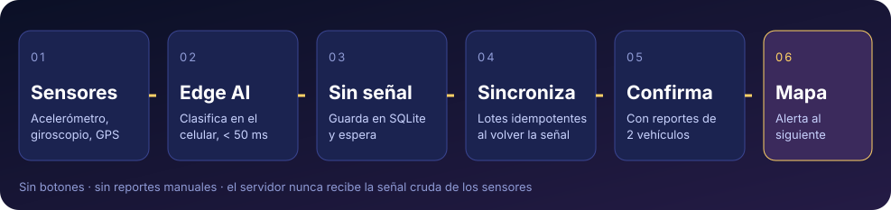
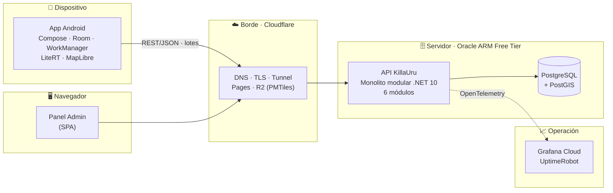
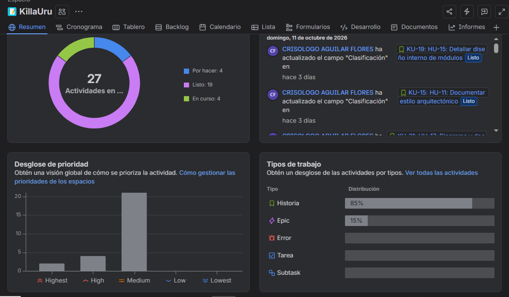
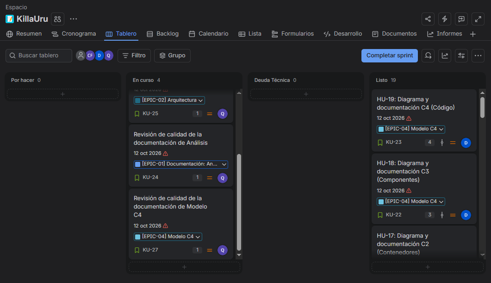
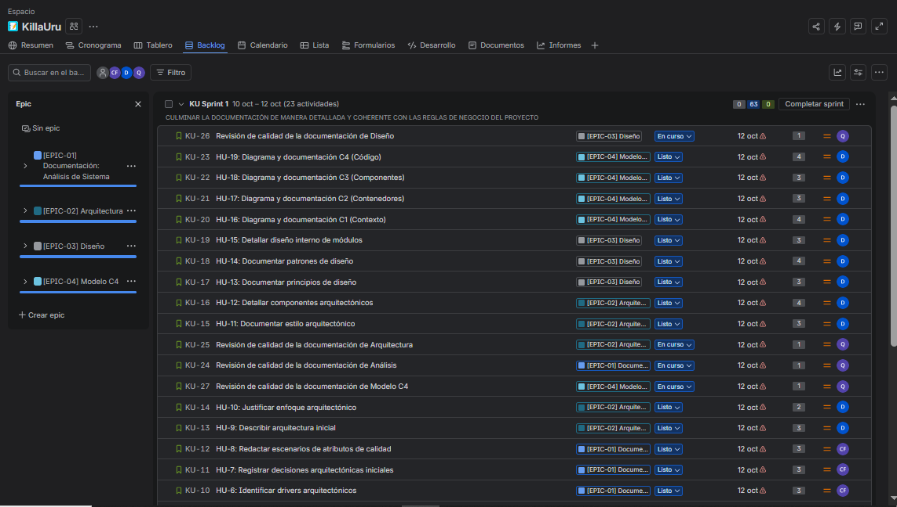

 

**Detección colaborativa de baches y hundimientos en la Vía Los Libertadores (PE-28A).** 
Tu celular siente la vía. KillaUru la convierte en un mapa vivo para el siguiente conductor.

 

---

## 🌕 En 13 segundos

> *Cada viaje que haces mejora el camino del siguiente conductor.*

La Vía Los Libertadores tiene **333 kilómetros**, **138 fallecidos en 7 meses** y **cero información en tiempo real** sobre el estado del pavimento.
KillaUru cambia eso **sin botones, sin reportes manuales y sin distraer al conductor un solo segundo.**

| 🛣️ **333 km** | 📵 **> 50 %** | ⚡ **< 50 ms** | 🚗 **2 vehículos** | 💸 **≤ US$ 10/mes** |
|:---:|:---:|:---:|:---:|:---:|
| de corredor andino cubierto | del trayecto sin señal celular, y aun así funciona | para clasificar una anomalía dentro del celular | distintos para confirmar un bache | tope de costo de operación del MVP |

---

## 🧭 El problema

El conductor que sale de Ayacucho hacia la costa no sabe qué se va a encontrar.

- 📱 **Waze** te pide soltar el volante en una curva a 3 800 msnm para reportar un bache.
- 🗓️ **Las inspecciones** de Provías llegan cada 90 días.
- 🧓 **El conocimiento de los choferes veteranos** se pierde cuando se retiran.

Hay una **asimetría de información crítica** entre quien conoce la vía de memoria y quien la recorre por primera vez.
KillaUru convierte los sensores de cada celular en **conocimiento colectivo** al alcance de todos.

---

## ⚙️ Cómo funciona

 

1. **Detecta.** La app Android usa el acelerómetro, el giroscopio y el GPS del celular en su soporte. No hace nada más.
2. **Clasifica en el celular.** Un modelo de IA en el dispositivo (LiteRT/TFLite) separa **baches** y **hundimientos** del ruido normal del manejo. Solo guarda eventos con confianza ≥ 0.75.
3. **Aguanta sin señal.** Cada evento se guarda en SQLite. Al volver la señal se sincroniza solo, en lotes idempotentes: reintentar nunca duplica un reporte.
4. **Confirma.** El servidor agrupa los reportes y publica una anomalía cuando la confirman **dos vehículos distintos**. Un solo celular no basta para ensuciar el mapa.
5. **Avisa.** El mapa se actualiza y los conductores registrados reciben una **alerta sonora con anticipación** (8 s en livianos, 12 s en pesados), sin tocar la pantalla.

---

## ✨ Lo que lo hace distinto

<table>
<tr>
<td width="50%" valign="top">

### 📵 Offline primero
Funciona **5 horas seguidas sin cobertura**. El mapa base vectorial también va dentro del celular, en formato PMTiles.

### 🧠 IA en el borde
La señal cruda de los sensores **nunca sale del teléfono**. Al servidor solo llega el evento ya clasificado.

### 🛡️ Antifraude
Reglas de plausibilidad, límite de envíos por hora y confirmación entre vehículos separados por al menos 3 minutos.

</td>
<td width="50%" valign="top">

### 🔐 Privacidad por diseño
Seudónimo de instalación rotativo, purga a las 72 h y ningún indicador que una cuentas con eventos. Cumple la **Ley 29733**.

### 🧾 Auditoría completa
Cada acción del administrador se registra **en la misma transacción** que la ejecuta (D.S. 016-2024-JUS).

### 💸 Costo casi cero
Oracle Cloud Free Tier, Cloudflare, Grafana Cloud y UptimeRobot en sus planes gratuitos. Un solo `docker compose up`.

</td>
</tr>
</table>

---

## 🏛️ Arquitectura de un vistazo

| Estilo | Dónde | Por qué |
|---|---|---|
| **Monolito modular** *(principal)* | Backend: un proceso ASP.NET Core 10 con 6 *bounded contexts* | Un desarrollador, 6–8 semanas, recursos mínimos |
| **Clean Architecture por módulo** | Domain · Application · Adapters · Infrastructure | Reglas de negocio libres de frameworks |
| **Offline-first + Store-and-Forward** | App y protocolo de sincronización | Más de la mitad del corredor no tiene señal |
| **Edge AI** | Clasificación en el celular | Sin internet y en menos de 50 ms |

<b>📜 Las 15 decisiones arquitectónicas (ADR)</b>

 

| # | Decisión | # | Decisión |
|---|---|---|---|
| 001 | Monolito modular | 009 | Identidad y accesos |
| 002 | Clean Architecture por módulo | 010 | Despliegue y operación |
| 003 | Store-and-Forward con SQLite | 011 | Mapa base vectorial offline |
| 004 | Edge AI con TFLite | 012 | Convenciones de diseño |
| 005 | Ingesta durable e idempotente | 013 | Auditoría en la misma transacción |
| 006 | Caché en memoria | 014 | Persistencia políglota |
| 007 | Privacidad por diseño | 015 | Integridad del dato contra eventos falsos |
| 008 | Ciclo de vida de la anomalía | | |

Detalle completo en [`07-decisiones-arquitectonicas.md`](docs/01-analisis-del-sistema/07-decisiones-arquitectonicas.md).

---

## 📊 El proyecto en números

| 🧑‍🤝‍🧑 3 | 📖 29 | ✅ 38 | 🎯 35 | 📏 22 | 🧪 15 | 🏛️ 15 | 🗺️ 4 |
|:---:|:---:|:---:|:---:|:---:|:---:|:---:|:---:|
| actores | historias de usuario | requisitos funcionales | atributos de calidad (RNF) | reglas de negocio | escenarios de calidad | ADR | niveles C4 |

La trazabilidad entre HU, RF, RN, drivers, ADR y escenarios se verifica de forma automática con [`tools/verificar-trazabilidad.py`](tools/verificar-trazabilidad.py).

---

## 📂 Documentación

| | Carpeta | Contenido |
|:---:|---|---|
| 🔍 | [**01 · Análisis del sistema**](docs/01-analisis-del-sistema) | [Actores](docs/01-analisis-del-sistema/01-actores.md) · [Historias de usuario](docs/01-analisis-del-sistema/02-historias-de-usuario.md) · [Requisitos funcionales](docs/01-analisis-del-sistema/03-requisitos-funcionales.md) · [Atributos de calidad](docs/01-analisis-del-sistema/04-atributos-de-calidad.md) · [Restricciones](docs/01-analisis-del-sistema/05-restricciones.md) · [Drivers](docs/01-analisis-del-sistema/06-driver-arquitectonicos.md) · [ADR](docs/01-analisis-del-sistema/07-decisiones-arquitectonicas.md) · [Escenarios](docs/01-analisis-del-sistema/08-escenarios-y-atributos-de-calidad.md) · [Reglas de negocio](docs/01-analisis-del-sistema/09-reglas-de-negocio.md) · [Glosario](docs/01-analisis-del-sistema/10-glosario.md) |
| 🏛️ | [**02 · Arquitectura de software**](docs/02-arquitectura-de-software) | [Arquitectura inicial](docs/02-arquitectura-de-software/arquitectura-inicial.md) · [Estilo](docs/02-arquitectura-de-software/estilo-arquitectonico.md) · [Enfoque](docs/02-arquitectura-de-software/enfoque-arquitectonico.md) · [Componentes](docs/02-arquitectura-de-software/componentes-arquitectonicos.md) |
| 🧩 | [**03 · Diseño de software**](docs/03-diseño-de-software) | [Principios](docs/03-diseño-de-software/principios-de-diseño.md) · [Patrones](docs/03-diseño-de-software/patrones-de-diseño.md) · [Diseño interno de módulos](docs/03-diseño-de-software/diseño-interno-de-modulos.md) |
| 🗺️ | [**04 · Modelo C4**](docs/04-modelo-C4) | [C1 Contexto](docs/04-modelo-C4/Nivel1-diagrama-de-contexto.md) · [C2 Contenedores](docs/04-modelo-C4/Nivel2-diagrama-de-contenedores.md) · [C3 Componentes](docs/04-modelo-C4/Nivel3-diagrama-de-componentes.md) · [C4 Código](docs/04-modelo-C4/Nivel4-diagrama-de-codigo.md) · [`workspace.dsl`](docs/04-modelo-C4/workspace.dsl) |

---

## 📌 Gestión ágil en Jira

El trabajo se organiza en **4 épicas** (Análisis, Arquitectura, Diseño y Modelo C4) y se sigue en un tablero Scrum.

<table>
<tr>
<td align="center"> <b>Tablero del sprint</b></td>
<td align="center"> <b>Backlog por épica</b></td>
</tr>
</table>

[**→ Abrir el backlog completo en Jira**](https://crisso.atlassian.net/jira/software/projects/KU/list?jql=project%20%3D%20KU%20ORDER%20BY%20cf%5B10019%5D%20ASC)

---

## 🚀 Hoja de ruta

| Versión | Qué trae |
|---|---|
| **v1.0** · MVP | App Android para vehículos livianos, mapa offline, alertas, confirmación colectiva y panel de administración |
| **v1.5** | Analítica de tramos para empresas de transporte y aseguradoras: estado por tramo, histórico de 2 años y tiempos de reparación. Nunca datos por vehículo ni por persona |
| **v2.0** | Acceso para autoridades viales (Provías Nacional, SUTRAN, gobiernos regionales) mediante convenio |

---

## 🎓 Contexto académico

| | |
|---|---|
| **Curso** | IS-488 Arquitectura de Software |
| **Docente** | Ing. Lizbeth Jaico Quispe |
| **Autor** | Crisólogo Aguilar Flores · CRISSO DEV S.A.C. |
| **Semestre** | 2026-II |
| **Lugar** | Ayacucho, Perú |

 

**🌕 KillaUru** · *Hecho en Ayacucho, para quienes manejan de noche por los Andes.*

[🎨 Presentación](https://canva.link/c7z789asvq54bws) · [📋 Jira](https://crisso.atlassian.net/jira/software/projects/KU/list?jql=project%20%3D%20KU%20ORDER%20BY%20cf%5B10019%5D%20ASC) · [📚 Documentación](docs)

