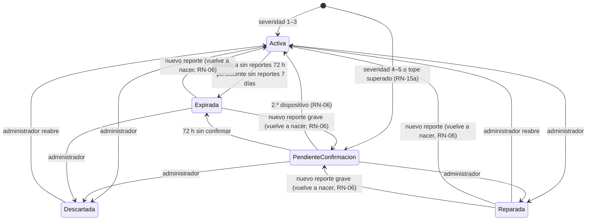

# Reglas de Negocio

> **Proyecto:** KillaUru · **Versión:** 1.2 · **Revisión:** 2026-10-14 · **Estado:** Vigente
> Una regla de negocio dice **qué es válido en el dominio**, sin importar la tecnología. Este documento es el **único catálogo de reglas y umbrales de negocio** (`RN-xx`); los demás documentos las referencian por ID y no repiten el valor.
> Todos los umbrales son **parámetros de configuración** (ADR-012) con un valor inicial que se calibra con los datos del piloto (S-04).
> **Relacionados:** `03-requisitos-funcionales.md`, `04-atributos-de-calidad.md`, `07-decisiones-arquitectonicas.md`

## 1. Catálogo de anomalías

### RN-01 — Tipos de anomalía

| Tipo (`TipoAnomalia`) | Qué es | Firma en los sensores | ¿Se guarda y se envía? |
|---|---|---|---|
| **Bache** | Hueco en el pavimento | Golpe vertical fuerte y corto, con rebote | ✅ |
| **Hundimiento** | Asentamiento, desnivel o grieta ancha en la calzada | Caída de la rueda sin rebote marcado | ✅ |
| *Normal* | Pista en buen estado | Vibración de fondo | ❌ Clase interna del modelo; nunca se guarda ni se envía |

- El catálogo debe coincidir **exactamente** con las etiquetas del modelo TFLite y estar respaldado por su matriz de confusión por clase (EQ-03).
- Agregar un tipo nuevo exige reentrenar el modelo, publicar una nueva `modeloVersion` y actualizar esta tabla.
- **Fuera del catálogo en v1.0:** rompemuelles, tramo irregular, inundación, derrumbe. Un acelerómetro no los distingue de forma confiable o el modelo aún no tiene datos etiquetados (ver riesgo RS-07 en `05-restricciones.md`).

### RN-02 — Severidad

| Severidad | Significado para el conductor |
|:---:|---|
| 1 | Imperceptible a velocidad normal |
| 2 | Leve: se siente, no exige frenar |
| 3 | Moderada: conviene reducir la velocidad |
| 4 | Alta: hay que frenar; riesgo de daño al vehículo |
| 5 | Muy alta: riesgo de pérdida de control |

- La severidad la calcula el modelo a partir de la **intensidad del golpe** registrado por los sensores, y viaja con el evento.
- La escala está calibrada para un **vehículo liviano con el celular en un soporte fijo** (RN-18). El mismo bache golpea menos a un camión y más a una moto, por eso en v1.0 solo detectan los vehículos livianos: así la severidad de todos los reportes es comparable.
- **Severidad alta = 4 o 5.** Activa la regla de confirmación RN-06.

## 2. Reglas en el dispositivo

| ID | Regla | Valor inicial | Parámetro |
|---|---|---|---|
| RN-18 | **Solo detecta el vehículo liviano con soporte.** Al usar la app por primera vez, el conductor indica qué maneja: **Liviano** (auto, camioneta, station wagon o colectivo), **Pesado** (bus, combi grande, camión) o **Moto**, y se le pide fijar el celular en un soporte. Solo con **Liviano** se activan la detección y el envío de eventos. Con **Pesado** o **Moto** la app muestra el mapa y las alertas según el rol (RN-08), pero no detecta ni envía eventos. La categoría se guarda **solo en el celular** y puede cambiarse en Ajustes. Aparte de la categoría, el conductor puede elegir «Solo ver el mapa, no enviar datos» (RF-29), así no tiene que elegir una categoría falsa para dejar de aportar. | Detecta solo `Liviano` | `CategoriasQueDetectan` |
| RN-03 | La detección se activa solo si la velocidad GPS supera el umbral **de forma sostenida**, para ignorar al peatón o al vehículo detenido. | > 5 km/h durante ≥ 10 s seguidos (se calibra en el piloto) | `VelocidadMinimaKmh`, `DuracionSostenidaSegundos` |
| RN-04 | Un evento se guarda localmente solo si el modelo lo clasifica como Bache o Hundimiento con confidence suficiente. | confidence ≥ 0.75 | `ConfidenceMinimo` |
| RN-16 | **Distancia de aviso según la velocidad y el vehículo.** La alerta suena cuando faltan unos segundos para llegar a la anomalía: `distancia = max(mínimo, velocidad × tiempo de aviso)`. El tiempo y el mínimo dependen de la categoría elegida en el celular (RN-18): un vehículo **pesado** necesita más distancia para frenar, sobre todo cargado y en bajada. Solo para anomalías `Activa` y por delante en el sentido de marcha. **La distancia se mide a lo largo de la vía** (polilínea del corredor descargada en el celular, RF-26), no en línea recta: en una curva cerrada, un bache a 80 m en línea recta puede estar a 1 km por la pista. **Una sola alerta por anomalía en cada pasada**; la pasada termina cuando el vehículo se aleja más de 500 m de la anomalía. Si varias anomalías caen dentro de la misma distancia de aviso, suena **una sola alerta** que indica cuántas son. Tolerancia de la prueba: ± 1 s. | **Liviano y Moto:** 8 s, mínimo 100 m (≈ 100 m a 30 km/h · 130 m a 60 km/h · 200 m a 90 km/h) · **Pesado:** 12 s, mínimo 150 m (≈ 150 m a 30 km/h · 200 m a 60 km/h · 300 m a 90 km/h) · Fin de pasada: 500 m | `TiempoAvisoSegundos`, `DistanciaAvisoMinimaMetros`, `TiempoAvisoPesadoSegundos`, `DistanciaAvisoMinimaPesadoMetros`, `DistanciaFinPasadaMetros` |
| RN-20 | **Cómo suena la alerta.** La alerta es **sonora** y baja el volumen de la música mientras suena; funciona con la pantalla bloqueada y en modo vibración (vibra y suena con el volumen de alarma). La parte visual es un complemento: el conductor **no necesita mirar la pantalla** para entenderla. | — | — | **Liviano y Moto:** 8 s, mínimo 100 m (≈ 100 m a 30 km/h · 130 m a 60 km/h · 200 m a 90 km/h) · **Pesado:** 12 s, mínimo 150 m (≈ 150 m a 30 km/h · 200 m a 60 km/h · 300 m a 90 km/h) | `TiempoAvisoSegundos`, `DistanciaAvisoMinimaMetros`, `TiempoAvisoPesadoSegundos`, `DistanciaAvisoMinimaPesadoMetros` |
| RN-22 | **Ahorro con batería baja.** Si la batería baja del umbral y el celular no está cargando, la app **pausa la detección y el envío, pero mantiene las alertas**, que son lo que protege al conductor. El indicador de estado muestra «En pausa: batería baja» (RF-36). Al cargar o superar el umbral, la detección se reanuda sola. | < 15 % sin cargar | `BateriaMinimaPorcentaje` |

## 3. Reglas en el servidor

### RN-11 — Calidad del evento

Un evento recibido se **descarta** (y se cuenta como métrica con su motivo) si cumple cualquiera de estas condiciones:

| Motivo | Condición | Valor inicial | Parámetro | Se evalúa en |
|---|---|---|---|---|
| `EsquemaInvalido` | al evento le falta un campo obligatorio o tiene un valor de formato inválido | — | — | Recepción |
| `ConfidenceBajo` | confidence menor al mínimo | < 0.75 | `ConfidenceMinimo` | Recepción |
| `PrecisionGpsInsuficiente` | precisión GPS peor que el máximo | > 20 m | `PrecisionGpsMaximaMetros` | Recepción |
| `TimestampFueraDeRango` | evento demasiado antiguo o en el futuro. Antigüedad = hora de recepción − hora de detección | > 168 h (7 días) atrás o > 5 min adelante | `AntiguedadMaximaDias`, `ToleranciaFuturoMinutos` | Recepción |
| `TipoDesconocido` | tipo fuera del catálogo RN-01 | — | — | Recepción |
| `FueraDelCorredor` | el punto está lejos de la vía (RN-13). Se evalúa con la polilínea cargada en memoria | > 50 m del eje de la PE-28A | `DistanciaMaximaViaMetros` | Recepción |
| `VelocidadImposible` | dos eventos del mismo seudónimo implican una velocidad irreal (RN-15b). Necesita el evento anterior en la BD | > 150 km/h | `VelocidadMaximaPlausibleKmh` | Procesamiento |

**Recepción y procesamiento (contrato del lote, RF-11).**
- Las reglas de **recepción** se evalúan antes de responder 200 y no usan la BD. Un evento que no las cumple sale en `rechazados[{id, motivo}]` y **no** se guarda en `evento_recibido`. Un evento mal formado **nunca** hace fallar el lote completo.
- Un evento que las cumple sale en `aceptados[]`, que significa **«recibido y guardado para procesar»**, no «publicado en el mapa».
- Las reglas de **procesamiento** se aplican después, en el módulo Anomalías. Lo que descartan se cuenta como métrica por motivo; la app no recibe ese resultado.
- Conciliación (RNF-06): aceptados = procesados + descartados en procesamiento + pendientes.

> La ventana de 7 días existe porque un conductor puede pasar varios días sin señal y sin sincronizar (R-08). Para no quedar en el borde, la app envía primero los eventos más antiguos y no envía los que ya pasaron las 168 h (RF-06).

### RN-05 — Agrupación de reportes en una anomalía

Un reporte pertenece a **una anomalía existente** si es del **mismo tipo** y está a **≤ 100 m** (`RadioAgrupacionMetros`) de la **posición de la anomalía**. Si no hay una anomalía cercana del mismo tipo, se crea una nueva.
- La **posición de la anomalía** es la del **reporte que la creó** y no cambia. Así se evita que la anomalía «camine» con cada reporte y que varios reportes encadenados formen una anomalía de 300 m.
- Si el reporte queda a ≤ 100 m de dos anomalías del mismo tipo, se asigna a la **más cercana**.
- Todas las ventanas de tiempo de las reglas (agrupación, confirmación, severidad, persistencia y caducidad) usan la **hora de detección** del reporte, no la hora en que llegó al servidor.

**Severidad de la anomalía.** Cada reporte trae su propia severidad (RN-02), pero el mapa y la alerta muestran un solo valor: la **mediana** de las severidades de los reportes de los **últimos 15 días**, **redondeada hacia arriba**. Con un número par de reportes, la mediana es el promedio de los dos del medio.
- La mediana ignora los extremos (un auto que pasó muy rápido o un celular mal sujeto), y redondear hacia arriba hace que, ante la duda, se avise de más y no de menos.
- La ventana de 15 días es la misma de RN-12. Así, si el bache crece con las lluvias, la severidad sube con los reportes nuevos.
- **Ejemplo:** reportes 2, 3, 3 y 5 → mediana 3 → el mapa muestra **3**. Reportes 3 y 4 → mediana 3,5 → se muestra **4**.
- Se recalcula con cada reporte nuevo. Si en 15 días no llegó ninguno, conserva el último valor calculado.

Parámetros: `RadioAgrupacionMetros = 100`, `VentanaSeveridadDias = 15`.

### RN-06 — Confirmación de severidad alta

| Severidad del reporte | ¿Cuándo aparece en el mapa? |
|---|---|
| 1 a 3 | De inmediato (estado `Activa`), salvo que el dispositivo haya superado su tope por hora (RN-15a): entonces también espera confirmación |
| **4 o 5** | Solo cuando **≥ 2 dispositivos distintos** la detectan a **≤ 100 m** dentro de **72 h**, con horas de detección **separadas al menos 3 min**, y al menos uno con sesión iniciada (RN-14). Mientras tanto queda `PendienteConfirmacion` y no se muestra a los conductores |

**Por qué:** un golpe fuerte aislado puede no ser un bache (el celular se cayó, se cerró una puerta, se pasó a alta velocidad o se enviaron datos falsos). Una alarma grave falsa daña más la confianza que una leve, por eso se le exige más prueba.

**Qué se confirma.** Basta que **un** reporte de severidad 4 o 5 llegue a una anomalía todavía no publicada para que esta espere confirmación. El segundo vehículo solo tiene que detectar **la misma anomalía** (mismo tipo, ≤ 100 m, RN-05) **con cualquier severidad**: exigir que también marque 4 o 5 dejaría sin confirmar baches graves por las diferencias normales entre autos. Una anomalía que ya está `Activa` no vuelve a `PendienteConfirmacion` porque llegue un reporte 4 o 5: ese reporte solo entra en el cálculo de la mediana (RN-05).

**Una anomalía que vuelve no se salta la confirmación.** Una anomalía `Expirada` o `Reparada` que recibe un reporte nuevo **vuelve a nacer**: se le aplican las mismas reglas que a una anomalía nueva, contando solo los reportes de las últimas 72 h. Además, si su severidad mostrada (mediana de RN-05) resulta 4 o 5, también exige confirmación. Así, un solo reporte de severidad 5 sobre un bache expirado queda `PendienteConfirmacion`, no `Activa`. Y un reporte leve sobre una anomalía que antes tuvo un 5 sin confirmar tampoco la publica como grave de forma automática.

**Dispositivos distintos = vehículos distintos.** La confirmación busca que **dos vehículos** pasen por el mismo punto. Los celulares que viajan en el mismo vehículo (chofer y pasajeros de un colectivo) detectan el mismo golpe en el mismo segundo; por eso dos reportes solo cuentan como confirmación si sus horas de detección están separadas al menos `SeparacionMinimaMinutos`. Se usa la hora de detección que ya viaja en el evento: no se guarda ningún dato nuevo.
- **Ejemplo:** en un colectivo, 4 celulares registran severidad 4 en el km 40 a las 10:15:02 por una frenada brusca. Cuentan como **un solo vehículo** y el punto sigue `PendienteConfirmacion`. Si otro auto lo detecta a las 11:40, queda confirmado.
- **Límite aceptado:** dos vehículos que viajan en caravana a menos de 3 min se cuentan como uno. Solo retrasa la confirmación hasta que pase un tercer vehículo; no publica nada falso.

Parámetros: `SeveridadAltaDesde = 4`, `DispositivosRequeridos = 2`, `VentanaConfirmacionHoras = 72`, `SeparacionMinimaMinutos = 3`. El radio es el mismo de la agrupación (`RadioAgrupacionMetros`, RN-05): no hay un segundo parámetro de radio.

### RN-12 — Persistente o episódica

| Clasificación | Condición |
|---|---|
| **Persistente** | La anomalía tiene reportes en **≥ 3 días locales distintos** dentro de los últimos **15 días** |
| **Episódica** | Cualquier otro caso |

- El **día local** se calcula con desfase fijo **UTC−5** (Perú no usa horario de verano). Un reporte a las 22:00 en Ayacucho cuenta para ese día, no para el siguiente en UTC.
- No depende del seudónimo del dispositivo (que se purga a las 72 h, RN-09): cuenta días, no dispositivos.

Parámetros: `DiasDistintosMinimos = 3`, `VentanaDias = 15`, `DesfaseHorarioHoras = -5`.

### RN-07 — Ciclo de vida de la anomalía

**Acciones del administrador** (RF-24, todas auditadas):

| Acción | Desde | Hacia |
|---|---|---|
| Marcar reparada | `Activa`, `PendienteConfirmacion` | `Reparada` |
| Descartar (falso positivo) | `Activa`, `PendienteConfirmacion`, `Expirada` | `Descartada` |
| Reabrir | `Reparada`, `Descartada` | `Activa` (el administrador ya la verificó; no espera confirmación) |

**Cuándo se aplica la caducidad.** Un proceso de fondo revisa la caducidad **cada hora**, comparando con la hora de detección del último reporte. Por eso una anomalía puede seguir visible como máximo 1 h después de su plazo. Un reporte cuya hora de detección es **anterior** al vencimiento no reactiva una anomalía ya `Expirada`: el bache ya estaba vencido cuando se detectó.

| Estado | ¿Visible para conductores? | ¿Genera alertas? |
|---|:---:|:---:|
| `Activa` | ✅ | ✅ |
| `PendienteConfirmacion` | ❌ (solo el administrador) | ❌ |
| `Expirada` | ❌ | ❌ |
| `Reparada` | ❌ | ❌ |
| `Descartada` | ❌ | ❌ |

- Una anomalía **persistente** expira a los **7 días sin reportes nuevos** (más que la episódica, porque está confirmada en varios días). Así, un bache reparado sin aviso al administrador sale del mapa en una semana como máximo. Si seguía ahí, el siguiente reporte la reactiva.
- El Dashboard muestra la **tasa de reaparición** (anomalías que vuelven a `Activa` después de expirar). Si en el piloto es alta, la caducidad es muy corta y se sube por configuración.
- `Descartada` es para falsos positivos confirmados por el administrador (p. ej. un rompemuelles clasificado como bache). Los reportes nuevos del mismo punto **no** la reactivan: la anomalía `Descartada` los **sigue absorbiendo para siempre** (un rompemuelles es permanente y no debe volver a aparecer). Pero si llegan reportes de **≥ 3 vehículos distintos en 7 días** (contados como en RN-06, con 3 min de separación), la anomalía aparece en el panel como **«Por revisar: siguen llegando reportes a un punto descartado»**, porque puede haber un bache real nuevo junto al falso positivo. El administrador la **reabre** o la **mantiene descartada**, y en ese caso el contador se reinicia. Parámetros: `VehiculosRevisionDescartada = 3`, `VentanaRevisionDescartadaDias = 7`.
- Toda transición hecha por el administrador se audita (RF-15).

Parámetros: `CaducidadEpisodicaHoras = 72`, `CaducidadPersistenteDias = 7`, `CaducidadPendienteHoras = 72`.

### RN-08 — Alcance de los datos por rol

| Rol | Qué anomalías recibe | ¿Recibe alertas (RN-16)? |
|---|---|:---:|
| Anónimo | Solo `Activa` dentro del polígono del tramo demo Ayacucho–Vinchos (~65 km), aunque pida un área mayor | ❌ |
| Conductor Registrado | `Activa` en todo el corredor de 333 km | ✅ (cualquier categoría de vehículo, RN-18) |
| Administrador | Todos los estados, con filtros por tipo, severidad, estado y fechas | — |

El recorte lo hace **siempre el servidor** (RNF-27). Las alertas son una función del rol, no de la categoría de vehículo: un camionero sin cuenta ve el mapa del tramo demo, pero no recibe alertas.

**Anónimo fuera del tramo demo.** El anónimo **sigue detectando y enviando** eventos en todo el corredor (sus datos ayudan a confirmar baches para todos). Pero fuera del tramo demo el mapa **no puede verse «limpio»**: esa zona se muestra sombreada en gris con el mensaje «Sin información de baches para usuarios sin cuenta. Crea una cuenta gratis para ver los 333 km.» Al salir del tramo demo, la app muestra ese aviso **una sola vez por viaje**, sin exigir ningún toque. Así nadie confunde «no hay datos» con «no hay baches».

## 4. Reglas contra datos falsos

El servidor juzga cada evento por **su contenido** (ubicación y hora de detección), **no por el momento en que llega**. Así, un conductor real que sube de golpe varias horas de eventos acumulados sin señal pasa las reglas, y un script que fabrica eventos sin conexión y los sube después no las pasa.

| ID | Regla | Ataque que detiene | Valor inicial |
|---|---|---|---|
| RN-13 | **Solo sobre la carretera.** Se descarta todo evento a más de cierta distancia del eje de la vía PE-28A (polilínea del corredor guardada en la BD). | Eventos inventados en cualquier parte (Lima, el cerro, el mar) | 50 m |
| RN-14 | **Sesión para confirmar lo grave.** Para que una anomalía de severidad 4–5 pase a `Activa` (RN-06), **al menos uno** de los dispositivos que la confirman debe haber enviado su reporte con sesión iniciada. El reporte guarda solo `con_sesion = sí/no`, **nunca quién** (RN-09, HU-21). | Confirmar baches graves con 2 seudónimos inventados | ≥ 1 reporte con sesión |
| RN-15 | **Plausibilidad del dispositivo.** (a) Si un seudónimo supera un tope de eventos dentro de **una misma hora de detección** (bloque de reloj, p. ej. 10:00–10:59 UTC; no la hora de subida), sus eventos **no se descartan**: se guardan, pero las anomalías **nuevas** que creen nacen `PendienteConfirmacion` hasta que otro vehículo las confirme (RN-06), aunque sean de severidad 1–3. El conteo incluye **todos los eventos ya recibidos** de ese seudónimo en esa hora, aunque todavía no se hayan procesado: un script que sube 500 eventos de golpe supera el tope desde el primero. No es retroactivo: si el tope se supera con un lote que llega después, lo ya publicado no se oculta. Sus reportes sobre anomalías que ya existen no cambian el estado de esas anomalías; solo suman a la mediana y a los días de RN-12. Esta confirmación **no** exige sesión: RN-14 es solo para severidad 4–5. (b) Dos eventos consecutivos del mismo seudónimo no pueden implicar una velocidad imposible. Para no castigar el error del GPS, la velocidad se calcula descontando la suma de las precisiones GPS de ambos eventos, y solo si están separados al menos 10 s. Se descarta **solo el evento posterior**. | (a) Scripts que inundan el mapa con baches leves falsos · (b) Scripts que reparten horas o posiciones inventadas | (a) 120 por hora (≈ 2 por minuto) · (b) 150 km/h, separación ≥ 10 s |

- Los eventos descartados se cuentan como **métricas por motivo**, y los retenidos por RN-15a también se cuentan; así un ataque se ve en los paneles técnicos (RNF-22).
- **Ejemplo legítimo:** un conductor pasa 5 h sin señal y detecta 80 eventos (~16 por hora de detección, a velocidad normal). Al recuperar señal sube los 80 en 2 lotes: **todos pasan**.
- **Ejemplo de temporada de lluvia:** en un tramo destrozado un conductor real detecta ~600 eventos en una hora (un hueco cada 100 m a 60 km/h). Supera el tope de RN-15a, pero **no se pierde ningún dato**: sus eventos esperan a que otro conductor pase por el mismo tramo y los confirme.
- **Ejemplo de ataque:** un script genera 500 eventos «entre las 10:00 y las 10:59» en el km 40: ninguno aparece en el mapa, porque superan el tope y esperan una confirmación de otro dispositivo que nunca llega (RN-15a). Si los reparte en horas inventadas, los saltos de posición los delatan (RN-15b). Y aunque pase alguno, no confirma un bache grave sin sesión (RN-14).
- **Límite conocido:** la app se distribuye como APK (S-02), por lo que no puede usarse la verificación de integridad de Google Play. Se reevaluará si se publica en Play Store.

## 5. Reglas de privacidad y retención

| ID | Regla | Valor inicial | Parámetro |
|---|---|---|---|
| RN-09 | El dispositivo se identifica con un UUID aleatorio que **rota cada mes**. El servidor **borra el seudónimo** a las 72 h **contadas desde que recibe el evento**, en **todos** los lugares donde está guardado: los reportes **y** la copia de recepción (`evento_recibido`, que se conserva 30 días pero sin seudónimo después de las 72 h). Solo se necesita para RN-06 y RN-15. Un evento que llega con varios días de atraso conserva su seudónimo 72 h desde su llegada, así que también participa en esas reglas. | 30 días / 72 h | `RotacionSeudonimoDias`, `PurgaSeudonimoHoras` |
| RN-17 | **Indicadores sin vincular identidad.** «Conductores registrados activos» se cuenta con las sesiones de Identidad; «dispositivos que aportaron datos» se cuenta como número diario de seudónimos distintos, calculado antes de la purga de 72 h. Ningún indicador une cuentas con eventos. | 7 días / 24 h | `DiasConductorActivo` |
| RN-10 | Retenciones: eventos de recepción 30 días (sin seudónimo desde las 72 h, RN-09); historial de recorridos 6 meses, **solo en el dispositivo**; **anomalías y reportes (sin seudónimo) 2 años**: se borran los reportes con más de 2 años desde su detección y las anomalías que llevan 2 años en un estado final (`Expirada`, `Reparada` o `Descartada`); auditoría permanente. Los 2 años permiten la analítica histórica de tramos para clientes (v1.5). Los backups (30 días) contienen datos ya purgados o borrados: **después de restaurar un backup se vuelven a ejecutar la purga de seudónimos y las eliminaciones de cuenta registradas en la auditoría** (RF-30) antes de reabrir el servicio. | Recepción 30 días · histórico 2 años | `RetencionRecepcionDias`, `RetencionHistoricaDias` |

## 6. Reglas de acceso

| ID | Regla | Valor inicial | Parámetro |
|---|---|---|---|
| RN-19 | **Bloqueo por intentos fallidos.** Aplica al inicio de sesión de **administradores y conductores**. Tras varios intentos fallidos seguidos dentro de una ventana, la cuenta se bloquea temporalmente, y cada nuevo bloqueo dura más. Los intentos fallidos y los bloqueos se auditan (RF-15). Al conductor se le muestra el mismo mensaje exista o no la cuenta. | 3 intentos en 15 min → 5 min, luego 15 min, luego 1 h | `IntentosMaximos`, `VentanaIntentosMinutos`, `DuracionesBloqueoMinutos` |
| RN-21 | **Acceso sin conexión y cierre de sesión.** (a) El permiso local que habilita el corredor completo y las alertas sin conexión **dura lo mismo que la sesión**: vence a los 30 días desde la última renovación. (b) **Nunca se corta durante un viaje:** si vence con el vehículo en movimiento, sigue activo hasta que el vehículo se detiene más de 30 min. (c) Al recuperar señal, si el servidor indica que la cuenta fue desactivada o eliminada, el permiso se borra de inmediato y la copia local de anomalías se recorta al tramo demo. (d) **Al cerrar sesión:** se borra el permiso local, la copia de anomalías se recorta al tramo demo, el historial de recorridos se borra (con aviso previo, para que otra persona que use el mismo celular no lo vea) y los eventos pendientes **no se pierden**: se envían como anónimos. | 30 días · 30 min detenido | `DuracionPermisoLocalDias`, `ParadaFinViajeMinutos` |

## 7. Trazabilidad

| Regla | RF | HU | ADR |
|---|---|---|---|
| RN-01, RN-02 | RF-02 | HU-02 | ADR-004 |
| RN-03, RN-04 | RF-01, RF-03 | HU-01 | ADR-004 |
| RN-18 | RF-34 | HU-26 | ADR-004 |
| RN-16, RN-20 | RF-10 | HU-09, HU-26 | ADR-011 |
| RN-22 | RF-01, RF-36 | HU-01 | ADR-004 |
| RN-17 | RF-18 | HU-13 | ADR-007 |
| RN-19 | RF-16, RF-21 | HU-11, HU-18 | ADR-009 |
| RN-21 | RF-38, RNF-26 | HU-18 | ADR-009 |
| RN-11 | RF-12 | HU-05 | ADR-005 |
| RN-05, RN-12 | RF-13 | HU-06 | ADR-008 |
| RN-06 | RF-12 | HU-05 | ADR-008 |
| RN-07 | RF-23, RF-24 | HU-06, HU-19 | ADR-008 |
| RN-08 | RF-08, RF-14 | HU-07, HU-08, HU-12 | ADR-009 |
| RN-09, RN-10 | RF-25, RF-27 | HU-10, HU-21 | ADR-007 |
| RN-13, RN-14, RN-15 | RF-12 | HU-05 | ADR-015 |
