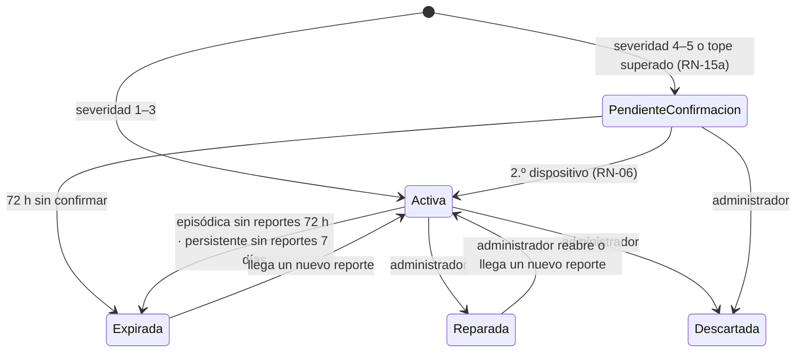

# Reglas de Negocio

> **Proyecto:** KillaUru · **Versión:** 1.0 · **Revisión:** 2026-10-13 · **Estado:** Vigente
> Una regla de negocio dice **qué es válido en el dominio**, sin importar la tecnología. Este documento es el **único catálogo de reglas y umbrales de negocio** (`RN-xx`); los demás documentos las referencian por ID y no repiten el valor.
> Todos los umbrales son **parámetros de configuración** (ADR-012) con un valor inicial que se calibra con los datos del piloto (S-04).
> **Relacionados:** `03-requisitos-funcionales.md`, `04-atributos-de-calidad.md`, `07-decisiones-arquitectonicas.md`

## 1. Catálogo de anomalías

### RN-01 — Tipos de anomalía

| Tipo (`TipoAnomalia`) | Qué es | Firma en los sensores | ¿Se guarda y se envía? |
|---|---|---|---|
| **Bache** | Hueco en el pavimento | Golpe vertical fuerte y corto, con rebote | ✅ |
| **Hundimiento** | Asentamiento, desnivel o grieta ancha en la calzada | Caída de la rueda sin rebote marcado | ✅ |
| *Normal* | Pista en buen estado | Vibración de fondo | ❌ Clase interna del modelo; nunca se guarda ni se envía |

- El catálogo debe coincidir **exactamente** con las etiquetas del modelo TFLite y estar respaldado por su matriz de confusión por clase (EQ-03).
- Agregar un tipo nuevo exige reentrenar el modelo, publicar una nueva `modeloVersion` y actualizar esta tabla.
- **Fuera del catálogo en v1.0:** rompemuelles, tramo irregular, inundación, derrumbe. Un acelerómetro no los distingue de forma confiable o el modelo aún no tiene datos etiquetados (ver riesgo RS-07 en `05-restricciones.md`).

### RN-02 — Severidad

| Severidad | Significado para el conductor |
|:---:|---|
| 1 | Imperceptible a velocidad normal |
| 2 | Leve: se siente, no exige frenar |
| 3 | Moderada: conviene reducir la velocidad |
| 4 | Alta: hay que frenar; riesgo de daño al vehículo |
| 5 | Muy alta: riesgo de pérdida de control |

- La severidad la calcula el modelo a partir de la **intensidad del golpe** registrado por los sensores, y viaja con el evento.
- **Severidad alta = 4 o 5.** Activa la regla de confirmación RN-06.

## 2. Reglas en el dispositivo

| ID | Regla | Valor inicial | Parámetro |
|---|---|---|---|
| RN-03 | La detección se activa solo si la velocidad GPS supera el umbral **de forma sostenida**, para ignorar al peatón o al vehículo detenido. | > 5 km/h; duración a calibrar en el piloto | `VelocidadMinimaKmh` |
| RN-04 | Un evento se guarda localmente solo si el modelo lo clasifica como Bache o Hundimiento con confidence suficiente. | confidence ≥ 0.75 | `ConfidenceMinimo` |
| RN-16 | **Distancia de aviso según la velocidad.** La alerta suena cuando faltan unos segundos para llegar a la anomalía: `distancia = max(mínimo, velocidad × tiempo de aviso)`. Solo para anomalías `Activa`, por delante en el sentido de marcha y una sola vez por anomalía en cada pasada. | 8 s, mínimo 100 m (≈ 100 m a 30 km/h · 130 m a 60 km/h · 200 m a 90 km/h) | `TiempoAvisoSegundos`, `DistanciaAvisoMinimaMetros` |

## 3. Reglas en el servidor

### RN-11 — Calidad del evento

Un evento recibido se **descarta** (y se cuenta como métrica con su motivo) si cumple cualquiera de estas condiciones:

| Motivo | Condición | Valor inicial | Parámetro |
|---|---|---|---|
| `ConfidenceBajo` | confidence menor al mínimo | < 0.75 | `ConfidenceMinimo` |
| `PrecisionGpsInsuficiente` | precisión GPS peor que el máximo | > 20 m | `PrecisionGpsMaximaMetros` |
| `TimestampFueraDeRango` | evento demasiado antiguo o en el futuro | > 7 días atrás o > 5 min adelante | `AntiguedadMaximaDias`, `ToleranciaFuturoMinutos` |
| `TipoDesconocido` | tipo fuera del catálogo RN-01 | — | — |
| `FueraDelCorredor` | el punto está lejos de la vía (RN-13) | > 50 m del eje de la PE-28A | `DistanciaMaximaViaMetros` |
| `VelocidadImposible` | dos eventos del mismo seudónimo implican una velocidad irreal (RN-15) | > 150 km/h | `VelocidadMaximaPlausibleKmh` |

> La ventana de 7 días existe porque un conductor puede pasar varios días sin señal y sin sincronizar (R-08).

### RN-05 — Agrupación de reportes en una anomalía

Dos reportes pertenecen a **la misma anomalía** si son del **mismo tipo** y están a **≤ 100 m** (`RadioAgrupacionMetros`). Si no hay una anomalía cercana del mismo tipo, se crea una nueva.

### RN-06 — Confirmación de severidad alta

| Severidad del reporte | ¿Cuándo aparece en el mapa? |
|---|---|
| 1 a 3 | De inmediato (estado `Activa`), salvo que el dispositivo haya superado su tope por hora (RN-15a): entonces también espera confirmación |
| **4 o 5** | Solo cuando **≥ 2 dispositivos distintos** la detectan a **≤ 100 m** dentro de **72 h**, y al menos uno con sesión iniciada (RN-14). Mientras tanto queda `PendienteConfirmacion` y no se muestra a los conductores |

**Por qué:** un golpe fuerte aislado puede no ser un bache (el celular se cayó, se cerró una puerta, se pasó a alta velocidad o se enviaron datos falsos). Una alarma grave falsa daña más la confianza que una leve, por eso se le exige más prueba.

Parámetros: `SeveridadAltaDesde = 4`, `DispositivosRequeridos = 2`, `RadioMetros = 100`, `VentanaConfirmacionHoras = 72`.

### RN-12 — Persistente o episódica

| Clasificación | Condición |
|---|---|
| **Persistente** | La anomalía tiene reportes en **≥ 3 días locales distintos** dentro de los últimos **15 días** |
| **Episódica** | Cualquier otro caso |

- El **día local** se calcula con desfase fijo **UTC−5** (Perú no usa horario de verano). Un reporte a las 22:00 en Ayacucho cuenta para ese día, no para el siguiente en UTC.
- No depende del seudónimo del dispositivo (que se purga a las 72 h, RN-09): cuenta días, no dispositivos.

Parámetros: `DiasDistintosMinimos = 3`, `VentanaDias = 15`, `DesfaseHorarioHoras = -5`.

### RN-07 — Ciclo de vida de la anomalía

| Estado | ¿Visible para conductores? | ¿Genera alertas? |
|---|:---:|:---:|
| `Activa` | ✅ | ✅ |
| `PendienteConfirmacion` | ❌ (solo el administrador) | ❌ |
| `Expirada` | ❌ | ❌ |
| `Reparada` | ❌ | ❌ |
| `Descartada` | ❌ | ❌ |

- Una anomalía **persistente** expira a los **7 días sin reportes nuevos** (más que la episódica, porque está confirmada en varios días). Así, un bache reparado sin aviso al administrador sale del mapa en una semana como máximo. Si seguía ahí, el siguiente reporte la reactiva.
- El Dashboard muestra la **tasa de reaparición** (anomalías que vuelven a `Activa` después de expirar). Si en el piloto es alta, la caducidad es muy corta y se sube por configuración.
- `Descartada` es para falsos positivos confirmados por el administrador (p. ej. un rompemuelles clasificado como bache). Los reportes nuevos del mismo punto **no** la reactivan automáticamente.
- Toda transición hecha por el administrador se audita (RF-15).

Parámetros: `CaducidadEpisodicaHoras = 72`, `CaducidadPersistenteDias = 7`, `CaducidadPendienteHoras = 72`.

### RN-08 — Alcance de los datos por rol

| Rol | Qué anomalías recibe |
|---|---|
| Anónimo | Solo `Activa` dentro del polígono del tramo demo Ayacucho–Vinchos (~65 km), aunque pida un área mayor |
| Conductor Registrado | `Activa` en todo el corredor de 333 km |
| Administrador | Todos los estados, con filtros |

El recorte lo hace **siempre el servidor** (RNF-27).

## 4. Reglas contra datos falsos

El servidor juzga cada evento por **su contenido** (ubicación y hora de detección), **no por el momento en que llega**. Así, un conductor real que sube de golpe varias horas de eventos acumulados sin señal pasa las reglas, y un script que fabrica eventos sin conexión y los sube después no las pasa.

| ID | Regla | Ataque que detiene | Valor inicial |
|---|---|---|---|
| RN-13 | **Solo sobre la carretera.** Se descarta todo evento a más de cierta distancia del eje de la vía PE-28A (polilínea del corredor guardada en la BD). | Eventos inventados en cualquier parte (Lima, el cerro, el mar) | 50 m |
| RN-14 | **Sesión para confirmar lo grave.** Para que una anomalía de severidad 4–5 pase a `Activa` (RN-06), **al menos uno** de los dispositivos que la confirman debe haber enviado su reporte con sesión iniciada. El reporte guarda solo `con_sesion = sí/no`, **nunca quién** (RN-09, HU-21). | Confirmar baches graves con 2 seudónimos inventados | ≥ 1 reporte con sesión |
| RN-15 | **Plausibilidad del dispositivo.** (a) Si un seudónimo supera un tope de eventos **por hora de detección** (no de subida), sus eventos **no se descartan**: se guardan, pero **todos** quedan `PendienteConfirmacion` hasta que otro dispositivo los confirme (RN-06), aunque sean de severidad 1–3. (b) Dos eventos consecutivos del mismo seudónimo no pueden implicar una velocidad imposible: esos sí se descartan. | (a) Scripts que inundan el mapa con baches leves falsos · (b) Scripts que reparten horas o posiciones inventadas | (a) 120 por hora (≈ 2 por minuto) · (b) 150 km/h |

- Los eventos descartados se cuentan como **métricas por motivo** (RF-18), y los retenidos por RN-15a también se cuentan; así un ataque se ve en el Dashboard.
- **Ejemplo legítimo:** un conductor pasa 5 h sin señal y detecta 80 eventos (~16 por hora de detección, a velocidad normal). Al recuperar señal sube los 80 en 2 lotes: **todos pasan**.
- **Ejemplo de temporada de lluvia:** en un tramo destrozado un conductor real detecta ~600 eventos en una hora (un hueco cada 100 m a 60 km/h). Supera el tope de RN-15a, pero **no se pierde ningún dato**: sus eventos esperan a que otro conductor pase por el mismo tramo y los confirme.
- **Ejemplo de ataque:** un script genera 500 eventos «entre las 10:00 y las 10:59» en el km 40: ninguno aparece en el mapa, porque superan el tope y esperan una confirmación de otro dispositivo que nunca llega (RN-15a). Si los reparte en horas inventadas, los saltos de posición los delatan (RN-15b). Y aunque pase alguno, no confirma un bache grave sin sesión (RN-14).
- **Límite conocido:** la app se distribuye como APK (S-02), por lo que no puede usarse la verificación de integridad de Google Play. Se reevaluará si se publica en Play Store.

## 5. Reglas de privacidad y retención

| ID | Regla | Valor inicial | Parámetro |
|---|---|---|---|
| RN-09 | El dispositivo se identifica con un UUID aleatorio que **rota cada mes**. El servidor **borra el seudónimo** de los reportes a las 72 h (solo se necesita para RN-06). | 30 días / 72 h | `RotacionSeudonimoDias`, `PurgaSeudonimoHoras` |
| RN-17 | **Indicadores sin vincular identidad.** «Conductores registrados activos» se cuenta con las sesiones de Identidad; «dispositivos que aportaron datos» se cuenta como número diario de seudónimos distintos, calculado antes de la purga de 72 h. Ningún indicador une cuentas con eventos. | 7 días / 24 h | `DiasConductorActivo` |
| RN-10 | Retenciones: eventos de recepción 30 días; historial de recorridos 6 meses, **solo en el dispositivo**; auditoría permanente. | — | `RetencionRecepcionDias` |

## 6. Trazabilidad

| Regla | RF | HU | ADR |
|---|---|---|---|
| RN-01, RN-02 | RF-02 | HU-02 | ADR-004 |
| RN-03, RN-04 | RF-01, RF-03 | HU-01 | ADR-004 |
| RN-16 | RF-10 | HU-09 | ADR-011 |
| RN-11 | RF-12 | HU-05 | ADR-005 |
| RN-05, RN-12 | RF-13 | HU-06 | ADR-008 |
| RN-06 | RF-12 | HU-05 | ADR-008 |
| RN-07 | RF-23, RF-24 | HU-06, HU-19 | ADR-008 |
| RN-08 | RF-08, RF-14 | HU-07, HU-08, HU-12 | ADR-009 |
| RN-09, RN-10 | RF-25, RF-27 | HU-10, HU-21 | ADR-007 |
| RN-13, RN-14, RN-15 | RF-12 | HU-05 | ADR-015 |
