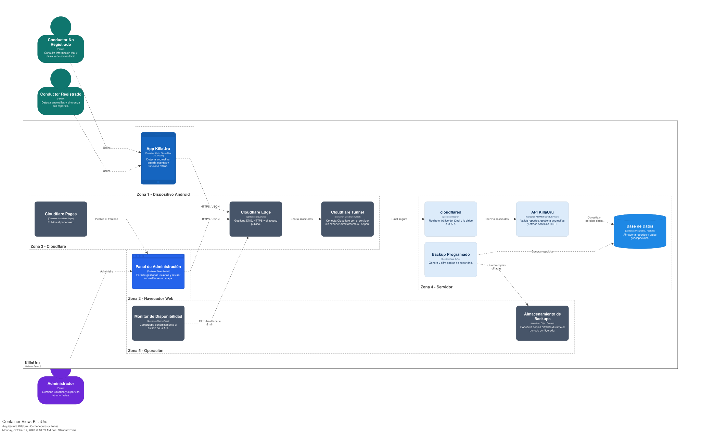
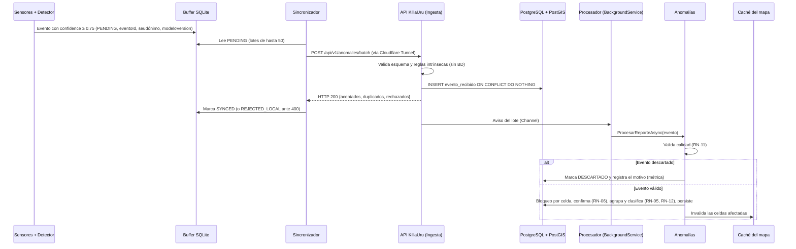
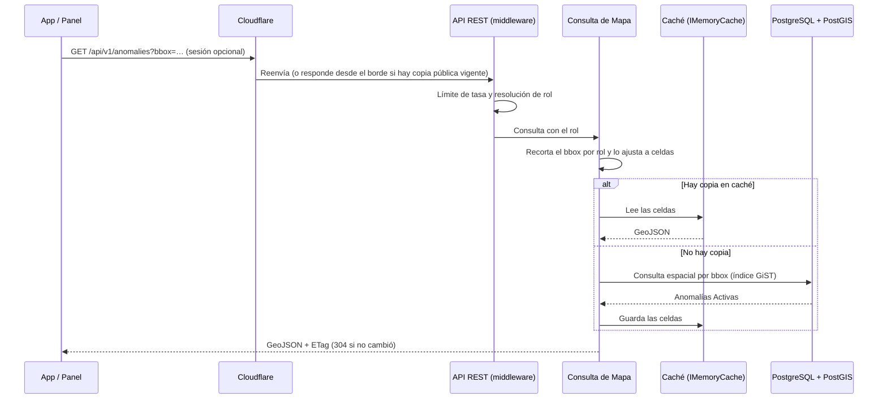

# Arquitectura Inicial del Sistema

> **Proyecto:** KillaUru · **Versión:** 2.0 · **Revisión:** 2026-10-12 · **Estado:** Vigente (alineado con ADR-001…ADR-012)
> **Relacionados:** `estilo-arquitectonico.md`, `enfoque-arquitectonico.md`, `componentes-arquitectonicos.md`, `Nivel1…Nivel4`, `07-decisiones-arquitectonicas.md`

## 1. Propósito y alcance

Este documento da la **visión de conjunto** de KillaUru: de qué zonas se compone, cómo viaja un dato desde el sensor hasta el mapa, dónde están las fronteras de confianza y qué entra en v1.0. El detalle por nivel está en los diagramas C4 (`Nivel1…Nivel4`); las decisiones, en los ADR.

KillaUru es una plataforma colaborativa que detecta, valida y presenta anomalías viales de la carretera PE-28A (Vía Los Libertadores, 333 km). Se compone de tres piezas ejecutables:

- una **app Android** que detecta y clasifica en el dispositivo y funciona sin internet;
- un **backend monolítico modular** (ASP.NET Core 10) con 7 módulos, que valida, clasifica y sirve el mapa;
- un **panel web** de administración (SPA).

## 2. Diagrama de arquitectura (vista por zonas)

## 3. Descripción de las zonas

| Zona | Qué contiene | Responsabilidad principal | Decisiones |
|---|---|---|---|
| **1 · Dispositivo** | App Android nativa con modelo TFLite embebido, buffer SQLite local, mapa base offline | Detectar y clasificar sin internet, guardar eventos, sincronizar cuando hay señal, alertar de forma local | ADR-003, ADR-004, ADR-011 |
| **2 · Navegador** | Panel Admin (SPA) | Gestión de usuarios, anomalías, dashboard, auditoría y exportación | ADR-009 |
| **3 · Borde** | Cloudflare: DNS, TLS, proxy, caché de borde, Tunnel y Pages | Terminar TLS, ocultar el origen y servir el panel estático | ADR-010 |
| **4 · Servidor** | Un proceso API (monolito modular), PostgreSQL + PostGIS, `cloudflared`, job de backup | Recibir, validar, clasificar y servir anomalías; autenticar y auditar | ADR-001, ADR-002, ADR-005, ADR-006, ADR-008 |
| **5 · Operación** | UptimeRobot, almacenamiento de objetos | Detectar caídas (RNF-20) y conservar backups (RNF-07) | ADR-010 |

> El backend **no** contiene módulos de detección ni de sincronización: viven en la app (ADR-001, ADR-003, ADR-004). El servidor nunca recibe la señal cruda de los sensores.

## 4. Flujos principales

### 4.1 Del sensor al mapa (ingesta durable)

1. El **HTTP 200 se envía solo después del *commit*** en `evento_recibido` (ADR-005). Si el proceso se reinicia, ningún evento aceptado se pierde (RNF-06, EQ-09).
2. Un reintento con los mismos `eventoId` devuelve `duplicados` y no reinserta (EQ-02).
3. El Channel es solo un **aviso de trabajo**: al arrancar, el `BackgroundService` reprocesa las filas que sigan pendientes.

### 4.2 Consulta del mapa con alcance por rol

| Rol | Resultado |
|---|---|
| Anónimo | Solo el tramo demo Ayacucho–Vinchos (~65 km), aunque pida un `bbox` mayor |
| Conductor Registrado | Corredor completo: anomalías `Activa` y confirmadas |
| Administrador | Todas las anomalías, incluidas las no confirmadas, con filtros |

### 4.3 Operación offline

1. Sin señal, la app **detecta, guarda y alerta con datos locales**: eventos `PENDING` en SQLite, mapa base descargado y copia local de anomalías.
2. Al recuperar conectividad, la app **reinicia el backoff** y sincroniza en ≤ 60 s (RF-04, HU-04).
3. Con fallos, reintenta con backoff exponencial y *jitter*, respetando `Retry-After` (RF-07).

## 5. Zonas de confianza

| Frontera | Qué no se asume | Control |
|---|---|---|
| App ↔ API | La app puede estar modificada o ser simulada | El servidor valida esquema y calidad, aplica límite de tasa por clave compuesta (RNF-11) y **decide el alcance por rol** (RNF-27) |
| Internet ↔ Servidor | El origen no debe ser alcanzable directamente | Cloudflare Tunnel (sin puertos abiertos) y TLS en el borde (RNF-08) |
| API ↔ BD | La BD no se expone | Red interna de Docker Compose; credenciales por variables de entorno o secretos |
| Panel ↔ API | El navegador puede sufrir XSS o CSRF | Cookie `HttpOnly; Secure; SameSite=Strict`, CSP y HSTS (RNF-09) |
| Datos ↔ Persona | Un seudónimo + ubicación puede reidentificar | Seudónimo rotativo, purga a 72 h, historial solo local (ADR-007) |

## 6. Alcance de v1.0 y roadmap

| Capacidad | v1.0 | Después |
|---|:---:|:---:|
| Detección, buffer offline, sincronización idempotente | ✅ | |
| Mapa offline y alertas anticipadas locales | ✅ (alertas *Should*) | |
| Ingesta durable, validación, clasificación y ciclo de vida | ✅ | |
| Registro y login de conductor | ✅ | |
| Panel: login, mapa con filtros, usuarios, auditoría | ✅ | |
| Dashboard, moderación, exportación | ✅ (*Should* y *Could*) | |
| Verificación de correo (HU-18b) | | Roadmap |
| Notificaciones push desde el servidor | | v1.5+ |
| Empresas suscriptoras y Autoridad Vial | | v1.5+ / v2.0+ |
| Caché distribuida (Redis) o extracción de módulos | | Solo si hay más de una instancia (S-03) |

## 7. Decisiones que dan forma a la arquitectura

| Decisión | Efecto visible |
|---|---|
| ADR-001 Monolito modular | Un solo proceso API con 7 módulos (Validación y Clasificación unidas en Anomalías) |
| ADR-002 Clean Architecture | Cuatro capas por módulo y contratos públicos entre módulos |
| ADR-003 / ADR-004 | La app es autónoma: buffer SQLite y modelo embebido |
| ADR-005 Ingesta durable | Tabla `evento_recibido`, HTTP 200 tras el *commit*, idempotencia por `eventoId` |
| ADR-006 Caché en memoria | Sin Redis; claves por celdas de rejilla |
| ADR-007 Privacidad | Seudónimo rotativo, purga a 72 h, historial local |
| ADR-008 Ciclo de vida | Estados de la anomalía y caducidad parametrizable |
| ADR-009 Identidad | Módulo único; sesión validada en middleware |
| ADR-010 Despliegue | Tunnel, Pages, backups y rollback por *tag* |
| ADR-011 Mapa offline | Mapa base vectorial recortado al corredor |
| ADR-012 Convenciones | Lenguaje ubicuo, EF Core, umbrales por configuración |

## 8. Mapa de documentos

| Si quieres saber… | Lee |
|---|---|
| Quién usa el sistema y con qué se integra | `Nivel1-diagrama-de-contexto.md`, `01-actores.md` |
| Qué piezas ejecutables existen | `Nivel2-diagrama-de-contenedores.md` |
| Qué módulos tiene el backend | `Nivel3-diagrama-de-componentes.md`, `componentes-arquitectonicos.md` |
| Cómo está construido el código | `Nivel4-diagrama-de-codigo.md`, `enfoque-arquitectonico.md` |
| Por qué es monolito modular y qué reglas sigue | `estilo-arquitectonico.md` |
| Qué decisiones se tomaron | `07-decisiones-arquitectonicas.md` |
| Qué debe cumplir | `03-requisitos-funcionales.md`, `04-atributos-de-calidad.md`, `08-escenarios-y-atributos-de-calidad.md` |