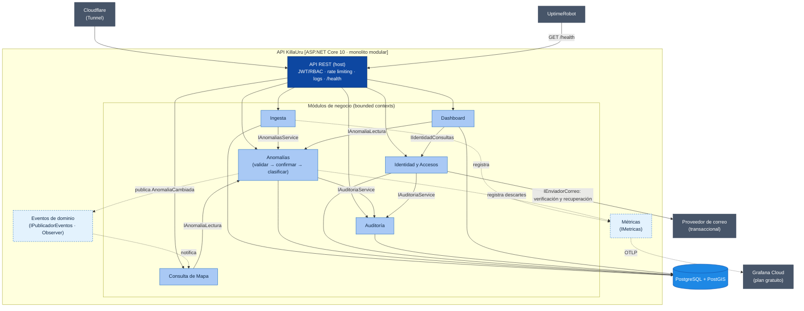
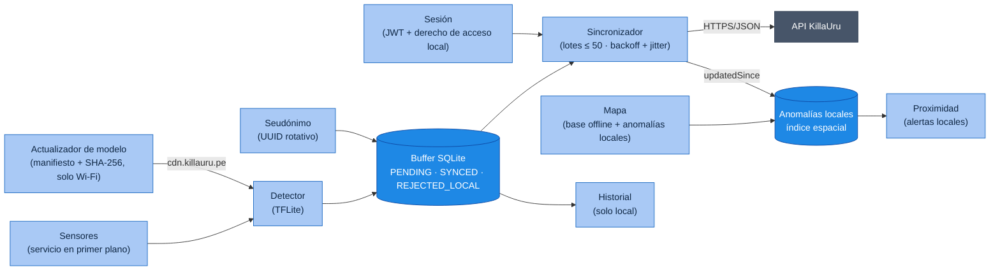

# Componentes Arquitectónicos — KillaUru

> **Proyecto:** KillaUru · **Versión:** 2.1 · **Revisión:** 2026-10-13 · **Estado:** Vigente (alineado con ADR-001…ADR-015)
> **Modelo:** C4 · Nivel 3 (componentes) · **Detalle visual:** `Nivel3-diagrama-de-componentes.md`
> **Relacionados:** `estilo-arquitectonico.md`, `enfoque-arquitectonico.md`, `03-requisitos-funcionales.md`

## 1. Propósito

Este documento es el **catálogo de componentes** de KillaUru: qué componentes existen en el backend y en la app, qué responsabilidad tiene cada uno, qué contratos públicos expone, qué datos posee y de quién depende. El diagrama de componentes del backend (C3) se mantiene en `Nivel3-diagrama-de-componentes.md`; aquí se complementa con los contratos, la propiedad de datos y los procesos en segundo plano.

Todo el backend corre en **un único proceso** (`docker compose up -d`, DA-06). Se mantiene separado en *bounded contexts* internos para poder extraerlos más adelante (DA-09).

## 2. Diagrama de componentes del backend

> **Cómo leer el diagrama:** solo los módulos **dueños** de una tabla (`ING`, `ANO`, `ID`, `AUD`, `DASH`) tienen flecha a la base de datos. Consulta de Mapa **lee a través del contrato** del dueño, nunca con SQL propio (regla 3 de `estilo-arquitectonico.md`). Las métricas son un puerto técnico compartido (como la caché): los módulos las registran sin depender de Dashboard, lo que evita el ciclo Anomalías ↔ Dashboard.

## 3. Catálogo de componentes del backend

| Componente | Responsabilidad | Funcionalidades principales | Carpeta |
|---|---|---|---|
| **API REST** (host) | Punto de entrada HTTP único y composición de módulos | Rutas `/api/v1`; middleware de sesión y **RBAC**; rate limiting con clave compuesta (seudónimo + IP, RNF-11); OpenTelemetry y logs Serilog enviados a Grafana Cloud (sin exponer `/metrics`); manejo de errores; `/health` con *liveness* y *readiness* (RF-28); auditoría de accesos administrativos sensibles. **Los controladores viven en `Adapters/` de cada módulo.** | `Api/` |
| **Identidad y Accesos** | Cuentas, credenciales, sesión y roles (ADR-009) | Registro e inicio de sesión de conductor con *refresh* (RF-21); login de administrador con sesión de máximo 8 h (RF-16); tokens de acceso de 5 min y tokens de actualización revocables y rotativos para todos los roles (ADR-009); bloqueo temporal progresivo tras 3 intentos; CRUD de usuarios y roles (RF-19); desactivación efectiva en ≤ 5 min (RNF-26); consentimiento (RF-29), eliminación de cuenta (RF-30) y «mis datos» `GET /api/v1/me` (RF-31); verificación de correo y recuperación de contraseña mediante el adaptador `IEnviadorCorreo` (RF-22, RF-32) | `Modules/Identidad/` |
| **Ingesta** | Recepción durable e idempotente de lotes (ADR-005) | `POST /api/v1/anomalies/batch`; valida esquema y reglas intrínsecas; persiste en `evento_recibido` con `ON CONFLICT DO NOTHING`; responde 200 con `aceptados`, `duplicados` y `rechazados`, o 400/503; avisa por Channel de lotes; barredor de recuperación (RF-11) | `Modules/Ingesta/` |
| **Anomalías** | Dueño del agregado `Anomalia`: calidad del dato, confirmación, clasificación y ciclo de vida | **Validar:** descarta por confidence, precisión GPS, timestamp, tipo, distancia a la vía y velocidad imposible (RN-11, RN-13, RN-15b, RF-12) y cuenta los descartes como métricas; si el dispositivo supera su tope por hora, exige confirmación en lugar de descartar (RN-15a). **Confirmar:** severidad 4–5 exige ≥ 2 dispositivos distintos en 100 m y 72 h, al menos uno con sesión (RN-06, RN-14). **Clasificar:** agrupa reportes del mismo tipo a ≤ 100 m (RN-05); PERSISTENTE / EPISÓDICA con día local UTC−5 (RN-12, RF-13). **Ciclo de vida:** `Activa`, `PendienteConfirmacion`, `Expirada`, `Reparada`, `Descartada` (RN-07, RF-23); moderación (RF-24). Es **dueño de su transacción y de su bloqueo por celda**; idempotente por `eventoId` (restricción única en `reporte_anomalia`); invalida la caché. **Exportar:** CSV y GeoJSON filtrados, **sin seudónimos de dispositivo**, auditando cada exportación (RF-20, RF-15) | `Modules/Anomalias/` |
| **Consulta de Mapa** | Lectura del mapa con alcance por rol | `GET /api/v1/anomalies?bbox=` en GeoJSON; **recorta el `bbox` por rol** (demo / corredor / todo); filtros `tipo`, `severidad`, `desde`; `updatedSince` y `ETag`; *cache-aside* por celdas con **su propia** `IMemoryCache`, que invalida al recibir `AnomaliaCambiada` (RF-14, ADR-006) | `Modules/Mapa/` |
| **Dashboard** | Indicadores **de negocio** | Eventos por día, conductores registrados activos (sesiones renovadas en 7 días), dispositivos que aportaron datos (conteo diario de seudónimos distintos, sin guardar cuáles), cobertura, tasa de confirmación y de reaparición (RF-18). Un proceso diario guarda los conteos en `dashboard.indicador_diario`. Las métricas técnicas no viven aquí: están en Grafana | `Modules/Dashboard/` |
| **Auditoría** | Trazabilidad de acciones sensibles | Registro *append-only* (timestamp UTC, actor, acción, contexto); consulta de solo lectura (RF-15). **No** registra descartes de ingesta | `Modules/Auditoria/` |
| **Eventos de dominio** | Componente técnico de comunicación (patrón Observer) | `IPublicadorEventos` en memoria: un módulo publica un hecho (`AnomaliaCambiada`) **después del *commit*** y los suscriptores reaccionan sin que el publicador los conozca (ADR-006) | `Shared/Eventos/` |
| **Métricas** | Componente técnico de observabilidad | Puerto `IMetricas` (contadores e histogramas: lotes, descartes por motivo, tamaño de la cola). Lo implementa el host con `System.Diagnostics.Metrics` y **OpenTelemetry**, que exporta a Grafana Cloud | `Shared/Metricas/` |
| **Shared / Kernel** | Solo lo verdaderamente compartido | `Coordenada`, `Severidad`, `Confidence`, `SeudonimoInstalacion`; `IPublicadorEventos`; `IMetricas`; `TimeProvider`. **No** contiene configuración de negocio (cada módulo tiene su `<Modulo>Options`) ni contratos de un módulo (`EventoReportado` y `TipoAnomalia` viven en `Anomalias/Contracts`) | `Shared/` |

### 3.1 Contratos públicos entre módulos

*(Los nombres marcados con * son propuestas a confirmar en Nivel3 y Nivel4.)*

| Módulo dueño | Interfaz (`Contracts/`) | Operaciones | Consumidores |
|---|---|---|---|
| Anomalías | `IAnomaliasService` | `EvaluarIntrinseca(evento, ahora)*` (síncrona y pura, al recibir el lote), `ProcesarReporteAsync(evento)` (validar → confirmar → clasificar) | Ingesta |
| Anomalías | `IAnomaliaLectura`* | Consulta por `bbox` y filtros, `updatedSince`, agregados de cobertura | Consulta de Mapa, Dashboard |
| Auditoría | `IAuditoriaService` | `RegistrarAsync(acción, actor, contexto)` | Identidad, Anomalías, API REST |
| Identidad | `IIdentidadConsultas`* | `ContarConductoresActivosAsync(dias)`: cuentas con sesión renovada en los últimos N días | Dashboard |
| Anomalías | Evento `AnomaliaCambiada` | `anomaliaId`, `celdas`, nuevo estado | Consulta de Mapa (invalida su caché); futuro: notificaciones |
| Shared | `IPublicadorEventos` | `PublicarAsync(evento)`, suscripción por tipo de evento | Todos los módulos |
| Shared | `IMetricas`* | `RegistrarLote(…)`, `RegistrarDescarte(motivo)`, `RegistrarLatencia(…)` | Ingesta, Anomalías, API REST (registran); el host lo implementa con OpenTelemetry |

> El conteo de dispositivos distintos para confirmar (RN-06) ya no es un contrato público: es una consulta **interna** del módulo Anomalías.

## 4. Procesos en segundo plano

| Proceso | Módulo | Frecuencia | Qué hace | Referencia |
|---|---|---|---|---|
| `ProcesadorEventosBackgroundService` | Ingesta | Continuo + barrido cada ~60 s y al arrancar | Procesa lotes recibidos y recupera los pendientes tras un reinicio | ADR-005, EQ-09 |
| Caducidad de anomalías | Anomalías | Diario | Marca `Expirada` según los plazos configurables (RN-07) | ADR-008 |
| Purga de seudónimos | Anomalías | Periódica (≤ 1 h) | Elimina el seudónimo de los reportes con más de 72 h | RF-27, RNF-25 |
| Purga de recepción | Ingesta | Diario | Elimina filas de `evento_recibido` con más de 30 días | RNF-25 |
| Indicadores diarios | Dashboard | Diario | Guarda los conteos de negocio del día (conductores activos, dispositivos que aportaron, confirmación, reaparición) | RF-18, RN-17 |
| Backup | Host (fuera de la API) | Diario | `pg_dump` cifrado a almacenamiento de objetos; retención de 30 días | RNF-07, ADR-010 |

## 5. Componentes de la app Android

| Componente | Responsabilidad | RF | RNF |
|---|---|---|---|
| **Sensores** | Capturar acelerómetro y giroscopio a 50 Hz en un servicio en primer plano si la velocidad GPS supera 5 km/h | RF-01 | RNF-15 |
| **Detector** | Clasificar ventanas de 500 ms con TFLite (tipo, severidad, confidence) | RF-02, RF-05 | RNF-04 |
| **Buffer** | Guardar eventos con `eventoId`, `modeloVersion` y estado; retener `SYNCED` según la política local | RF-03, RF-05 | RNF-15 |
| **Seudónimo** | Generar el UUID de instalación y rotarlo mensualmente | RF-27 | RNF-10 |
| **Sincronizador** | Enviar lotes ≤ 50; reintentar con backoff y *jitter*; reiniciar el backoff al recuperar red; interpretar 200/400/429/503 | RF-04, RF-06, RF-07 | — |
| **Mapa** | Mostrar el mapa base vectorial descargado y las anomalías `Activa`; descarga incremental | RF-08, RF-09, RF-26, RF-05 | RNF-15 |
| **Proximidad** | Alertar (sonido y visual) de anomalías por delante en el sentido de marcha, sin red | RF-10, RF-05 | — |
| **Historial** | Calcular y mostrar 6 meses de recorridos, solo en el dispositivo | RF-25 | RNF-10 |
| **Actualizador de modelo** | Con Wi-Fi, consultar el manifiesto de `cdn.killauru.pe`, descargar el modelo nuevo, verificar su SHA-256 y activarlo; si falla, conservar el anterior | RF-33 | RNF-15 |
| **Sesión** | Registro con aceptación de la política, inicio de sesión, renovación del JWT, derecho de acceso al corredor guardado localmente, «Mi perfil» y eliminación de cuenta (borra también el historial local) | RF-21, RF-29, RF-30, RF-31 | — |

## 5.1 Componentes del Panel Admin

SPA en **React + MapLibre GL JS**, servida como estático desde Cloudflare Pages (`panel.killauru.pe`). No tiene lógica de negocio: toda regla y todo permiso se decide en la API (regla 8 de `estilo-arquitectonico.md`).

| Pantalla | Responsabilidad | Endpoints que usa (módulo) | RF | HU |
|---|---|---|---|---|
| **Inicio de sesión** | Login, recuperar contraseña, renovación silenciosa de la sesión (cookie `HttpOnly; Secure; SameSite=Strict`) | Identidad y Accesos | RF-16, RF-32 | HU-11, HU-25 |
| **Mapa con filtros** | Todas las anomalías, incluidas las no confirmadas; filtros por tipo, severidad, fecha y estado | Consulta de Mapa | RF-17 | HU-12 |
| **Moderación** | Marcar `Reparada`, `Descartada` o reabrir | Anomalías | RF-24 | HU-19 |
| **Dashboard** | Indicadores de negocio y enlace a los paneles técnicos de Grafana | Dashboard | RF-18 | HU-13 |
| **Usuarios** | Crear, editar rol, desactivar; revisión mensual de privilegios | Identidad y Accesos | RF-19 | HU-14 |
| **Exportación** | CSV y GeoJSON con filtros, sin seudónimos | Anomalías | RF-20 | HU-20 |
| **Auditoría** | Consulta de solo lectura | Auditoría | RF-15 | HU-15 |

## 6. Propiedad de los datos

Cada tabla tiene **un solo módulo dueño** que escribe en ella. Los demás acceden por el contrato del dueño. La regla se **hace cumplir** así:

1. **Un esquema de PostgreSQL por módulo** dentro de la misma base de datos (`identidad`, `ingesta`, `anomalias`, `auditoria`, `dashboard`). Consulta de Mapa no tiene tablas propias.
2. **Un `DbContext` de EF Core por módulo**, que solo mapea su esquema y es `internal` al módulo: otro módulo no puede usarlo.
3. **Sin llaves foráneas entre esquemas.** Las referencias cruzadas son identificadores simples (p. ej. `auditoria.registro.actor_id`), para que eliminar una cuenta (RF-30) no rompa la auditoría.
4. Las **pruebas de arquitectura** (RNF-28) verifican que ningún módulo referencie el `DbContext` ni el esquema de otro.
5. Para ADR-013, el `DbContext` de Auditoría se une a la transacción del módulo que actúa usando **la misma conexión** (`UseTransaction`), sin compartir el `DbContext`.

| Esquema · tablas *(nombres propuestos)* | Dueño (escribe) | Módulos que leen (por contrato) | Retención |
|---|---|---|---|
| `identidad`: `usuarios`, `roles`, sesiones de *refresh*, `consentimientos` | Identidad y Accesos | Dashboard (`IIdentidadConsultas`) | Mientras la cuenta exista; se borran al eliminarla (RF-30) |
| `ingesta`: `evento_recibido` | Ingesta | Anomalías (a través del procesador de Ingesta) | 30 días (RNF-25) |
| `anomalias`: `anomalia`, `reporte_anomalia` (único por `evento_id`), `corredor_via` (polilínea de RN-13) | Anomalías | Consulta de Mapa, Dashboard (`IAnomaliaLectura`) | Reportes: seudónimo purgado a 72 h; anomalías según su ciclo de vida |
| `auditoria`: `registro` | Auditoría | Panel Admin, a través de la API | Permanente (solo inserción) |
| `dashboard`: `indicador_diario` | Dashboard | Panel Admin, a través de la API | 2 años (son solo números agregados) |

## 7. Sistemas y servicios externos

| Sistema | Rol | Se integra desde |
|---|---|---|
| **Cloudflare** | DNS, TLS, proxy, caché de borde, **Tunnel** hacia el origen y **Pages** para el panel | Borde: reenvía el tráfico a la API REST |
| **Grafana Cloud** (plan gratuito) | Recibe métricas, trazas y logs por OTLP; paneles técnicos y alertas por degradación (RNF-20…22, RNF-32) | Host de la API (OpenTelemetry) |
| **UptimeRobot** | Consulta `GET /health` cada 5 minutos; alerta por correo; alimenta `status.killauru.pe` | API REST |
| **Proveedor de correo transaccional** | Verificación de correo (HU-18b) y recuperación de contraseña (HU-25) | **Solo** Identidad y Accesos, mediante un adaptador |
| **Almacenamiento de objetos** | Destino de los backups cifrados (30 días) | Job de backup del host |
| **Cloudflare R2** (`cdn.killauru.pe`) | Archivo PMTiles del corredor (ADR-011), modelos TFLite versionados con su manifiesto (ADR-004) y backups cifrados en un *bucket* privado aparte (ADR-010) | La app lo descarga y el panel lo lee por rangos HTTP, ambos con MapLibre; no pasa por la API |

## 8. Reglas de composición

| # | Regla | Motivo |
|---|---|---|
| 1 | Todos los componentes se despliegan juntos en el contenedor **API KillaUru**. | Monolito: un proceso y un `docker compose up -d` |
| 2 | Un módulo usa a otro solo por su `Contracts/`, nunca por clases internas ni por su repositorio. | Evolutividad (DA-09) |
| 3 | Un módulo no escribe en tablas de otro; la lectura cruzada solo ocurre por el contrato del dueño. | Independencia de los datos |
| 4 | Las dependencias entre módulos **no forman ciclos**. Grafo actual: Ingesta → Anomalías → Auditoría; Mapa y Dashboard → Anomalías; Dashboard → Identidad; Identidad → Auditoría. Todos pueden usar `Shared` (caché, métricas), que no depende de ningún módulo. | ADR-009 eliminó el ciclo Autenticación ↔ Usuarios; mover las métricas a `Shared` evitó el ciclo Anomalías ↔ Dashboard |
| 5 | Cada sistema externo se integra desde un único módulo. | Fácil de reemplazar |
| 6 | La validación de sesión es **middleware** de la API REST, no una llamada entre módulos. | Evita dependencias circulares |
| 7 | Dominio sin dependencias externas; las dependencias apuntan hacia adentro; los controladores solo usan casos de uso y sus DTOs (tabla de capas en `enfoque-arquitectonico.md`, sección 3). | Reglas de `09-reglas-de-negocio.md` testeables |
| 8 | Cada módulo maneja su propia transacción. **Única excepción:** la auditoría de una acción sensible se escribe en la misma transacción que la acción (ADR-013). | «No hay acción sensible sin rastro» (D.S. 016-2024-JUS) |

## 9. Trazabilidad

| Componente | RF | HU | Épica | RNF |
|---|---|---|---|---|
| API REST (host) | RF-28 | HU-17 | EP-06 | RNF-08, RNF-11, RNF-21, RNF-26 (middleware de sesión, RBAC y límite de tasa) |
| Identidad y Accesos | RF-16, RF-19, RF-21, RF-22, RF-29, RF-30, RF-31, RF-32 | HU-11, HU-14, HU-18, HU-18b, HU-22, HU-23, HU-24, HU-25 | EP-05, EP-07 | RNF-26 |
| Ingesta | RF-11, RF-27 | HU-04, HU-05, HU-21 | EP-02, EP-03, EP-07 | RNF-02, RNF-03, RNF-06, RNF-25 |
| Anomalías | RF-12, RF-13, RF-20, RF-23, RF-24, RF-27 | HU-05, HU-06, HU-19, HU-20, HU-21 | EP-03, EP-05, EP-07 | RNF-10, RNF-23, RNF-25 |
| Consulta de Mapa | RF-14, RF-17, RF-26 | HU-07, HU-08, HU-12 | EP-04, EP-05 | RNF-01, RNF-27 |
| Dashboard | RF-18 | HU-13 | EP-05 | RNF-22 |
| Auditoría | RF-15, RF-30 | HU-15, HU-23 | EP-05, EP-07 | RNF-29, RNF-30, RNF-31 |
| Eventos de dominio | RF-14 | HU-08 | EP-04 | RNF-01 |
| Métricas (OpenTelemetry) | — | HU-17 | EP-06 | RNF-20, RNF-21, RNF-22, RNF-32 |

## 10. Alineación pendiente con Nivel3

| Cambio | Detalle |
|---|---|
| Módulo único de identidad | Reemplazar «Autenticación» y «Usuarios y Roles» por **Identidad y Accesos**; quitar la relación Usuarios → Autenticación |
| Auditoría en el diagrama | Añadir la relación API REST → Auditoría (HU-15) |
| Módulo Anomalías | Reemplazar «Validación» y «Clasificación» por **Anomalías**; Mapa y Dashboard leen con `IAnomaliaLectura`; quitar el módulo Exportación (es un caso de uso de Anomalías) |
| Descartes | Anomalías → `Shared/Metricas` (`IMetricas`), no a Auditoría ni a Dashboard |
| Secuencia de ingesta | Redibujar con persistencia en `evento_recibido` antes del 200 y procesamiento asíncrono |
| Consulta de Mapa | Añadir recorte por rol, filtros, `updatedSince` y celdas de rejilla |
| Trazabilidad | Corregir «Ingesta → HU-04, EP-03» por HU-04 (EP-02) y HU-05 (EP-03) |
| Procesos en segundo plano | Mencionar caducidad, purgas e indicadores diarios; las métricas técnicas van a Grafana |