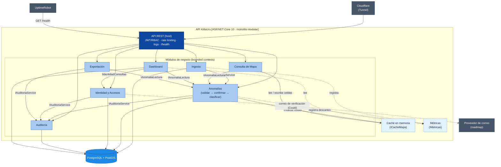
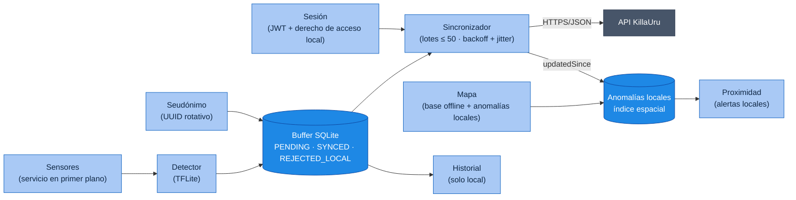

# Componentes Arquitectónicos — KillaUru

> **Proyecto:** KillaUru · **Versión:** 2.0 · **Revisión:** 2026-10-12 · **Estado:** Vigente (alineado con ADR-001…ADR-012)
> **Modelo:** C4 · Nivel 3 (componentes) · **Detalle visual:** `Nivel3-diagrama-de-componentes.md`
> **Relacionados:** `estilo-arquitectonico.md`, `enfoque-arquitectonico.md`, `03-requisitos-funcionales.md`

## 1. Propósito

Este documento es el **catálogo de componentes** de KillaUru: qué componentes existen en el backend y en la app, qué responsabilidad tiene cada uno, qué contratos públicos expone, qué datos posee y de quién depende. El diagrama de componentes del backend (C3) se mantiene en `Nivel3-diagrama-de-componentes.md`; aquí se complementa con los contratos, la propiedad de datos y los procesos en segundo plano.

Todo el backend corre en **un único proceso** (`docker compose up -d`, DA-06). Se mantiene separado en *bounded contexts* internos para poder extraerlos más adelante (DA-09).

## 2. Diagrama de componentes del backend

> **Cómo leer el diagrama:** solo los módulos **dueños** de una tabla (`ING`, `ANO`, `ID`, `AUD`, `DASH`) tienen flecha a la base de datos. Consulta de Mapa y Exportación **leen a través del contrato** del dueño, nunca con SQL propio (regla 3 de `estilo-arquitectonico.md`). Las métricas son un puerto técnico compartido (como la caché): los módulos las registran sin depender de Dashboard, lo que evita el ciclo Anomalías ↔ Dashboard.

## 3. Catálogo de componentes del backend

| Componente | Responsabilidad | Funcionalidades principales | Carpeta |
|---|---|---|---|
| **API REST** (host) | Punto de entrada HTTP único y composición de módulos | Rutas `/api/v1`; middleware de sesión y **RBAC**; rate limiting con clave compuesta (seudónimo + IP, RNF-11); logs estructurados con correlación; manejo de errores; `/health` con *liveness* y *readiness* (RF-28); `/metrics` no público; auditoría de accesos administrativos sensibles. **Los controladores viven en `Adapters/` de cada módulo.** | `Api/` |
| **Identidad y Accesos** | Cuentas, credenciales, sesión y roles (ADR-009) | Registro e inicio de sesión de conductor con *refresh* (RF-21); login de administrador con JWT de 8 h (RF-16); bloqueo temporal progresivo tras 3 intentos; CRUD de usuarios y roles (RF-19); desactivación efectiva en ≤ 5 min (RNF-26); consentimiento (RF-29), eliminación de cuenta (RF-30) y «mis datos» `GET /api/v1/me` (RF-31); verificación por correo mediante adaptador (RF-22, roadmap) | `Modules/Identidad/` |
| **Ingesta** | Recepción durable e idempotente de lotes (ADR-005) | `POST /api/v1/anomalies/batch`; valida esquema y reglas intrínsecas; persiste en `evento_recibido` con `ON CONFLICT DO NOTHING`; responde 200 con `aceptados`, `duplicados` y `rechazados`, o 400/503; avisa por Channel de lotes; barredor de recuperación (RF-11) | `Modules/Ingesta/` |
| **Anomalías** | Dueño del agregado `Anomalia`: calidad del dato, confirmación, clasificación y ciclo de vida | **Validar:** descarta por confidence, precisión GPS, timestamp, tipo, distancia a la vía y velocidad imposible (RN-11, RN-13, RN-15b, RF-12) y cuenta los descartes como métricas; si el dispositivo supera su tope por hora, exige confirmación en lugar de descartar (RN-15a). **Confirmar:** severidad 4–5 exige ≥ 2 dispositivos distintos en 100 m y 72 h, al menos uno con sesión (RN-06, RN-14). **Clasificar:** agrupa reportes del mismo tipo a ≤ 100 m (RN-05); PERSISTENTE / EPISÓDICA con día local UTC−5 (RN-12, RF-13). **Ciclo de vida:** `Activa`, `PendienteConfirmacion`, `Expirada`, `Reparada`, `Descartada` (RN-07, RF-23); moderación (RF-24). Serializa por celda e invalida la caché | `Modules/Anomalias/` |
| **Consulta de Mapa** | Lectura del mapa con alcance por rol | `GET /api/v1/anomalies?bbox=` en GeoJSON; **recorta el `bbox` por rol** (demo / corredor / todo); filtros `tipo`, `severidad`, `desde`; `updatedSince` y `ETag`; *cache-aside* por celdas (RF-14) | `Modules/Mapa/` |
| **Dashboard** | Indicadores y métricas operativas | Eventos por día, usuarios activos, cobertura, latencia p95, descartes por motivo y tasa de confirmación (RF-18); agrega métricas en memoria y las vuelca cada minuto | `Modules/Dashboard/` |
| **Exportación** | Entrega del dataset | CSV y GeoJSON filtrados, **sin seudónimos de dispositivo**; audita cada exportación (RF-20, RF-15) | `Modules/Exportacion/` |
| **Auditoría** | Trazabilidad de acciones sensibles | Registro *append-only* (timestamp UTC, actor, acción, contexto); consulta de solo lectura (RF-15). **No** registra descartes de ingesta | `Modules/Auditoria/` |
| **Caché en memoria** | Componente técnico de rendimiento | `IMemoryCache` por celdas de rejilla con invalidación explícita al persistir una anomalía (ADR-006) | `Shared/Cache/` |
| **Métricas** | Componente técnico de observabilidad | Puerto `IMetricas` (contadores e histogramas: lotes, descartes por motivo, latencias). Cualquier módulo registra; Dashboard implementa el volcado por minuto y las lee | `Shared/Metricas/` |
| **Shared / Kernel** | Tipos compartidos y configuración | `Coordenada`, `Severidad`, `Confidence`, `SeudonimoInstalacion`, `TipoAnomalia`, `EventoReportado`, `ReglasOptions` | `Shared/` |

### 3.1 Contratos públicos entre módulos

*(Los nombres marcados con * son propuestas a confirmar en Nivel3 y Nivel4.)*

| Módulo dueño | Interfaz (`Contracts/`) | Operaciones | Consumidores |
|---|---|---|---|
| Anomalías | `IAnomaliasService` | `EvaluarIntrinseca(evento, ahora)*` (síncrona y pura, al recibir el lote), `ProcesarReporteAsync(evento)` (validar → confirmar → clasificar) | Ingesta |
| Anomalías | `IAnomaliaLectura`* | Consulta por `bbox` y filtros, `updatedSince`, lectura en flujo para exportar, agregados de cobertura | Consulta de Mapa, Dashboard, Exportación |
| Auditoría | `IAuditoriaService` | `RegistrarAsync(acción, actor, contexto)` | Identidad, Anomalías, Exportación, API REST |
| Identidad | `IIdentidadConsultas`* | `ContarUsuariosActivosAsync(…)` | Dashboard |
| Shared | `ICacheMapa` | `InvalidarCeldasAsync(…)`, lectura y escritura de celdas | Anomalías (invalida), Consulta de Mapa (lee y escribe) |
| Shared | `IMetricas`* | `RegistrarLote(…)`, `RegistrarDescarte(motivo)`, `RegistrarLatencia(…)` | Ingesta, Anomalías, API REST (registran); Dashboard (implementa y lee) |

> El conteo de dispositivos distintos para confirmar (RN-06) ya no es un contrato público: es una consulta **interna** del módulo Anomalías.

## 4. Procesos en segundo plano

| Proceso | Módulo | Frecuencia | Qué hace | Referencia |
|---|---|---|---|---|
| `ProcesadorEventosBackgroundService` | Ingesta | Continuo + barrido cada ~60 s y al arrancar | Procesa lotes recibidos y recupera los pendientes tras un reinicio | ADR-005, EQ-09 |
| Caducidad de anomalías | Anomalías | Diario | Marca `Expirada` según los plazos configurables (RN-07) | ADR-008 |
| Purga de seudónimos | Anomalías | Periódica (≤ 1 h) | Elimina el seudónimo de los reportes con más de 72 h | RF-27, RNF-25 |
| Purga de recepción | Ingesta | Diario | Elimina filas de `evento_recibido` con más de 30 días | RNF-25 |
| Agregador de métricas | Dashboard (implementa `IMetricas`) | Cada minuto | Vuelca contadores e histogramas en memoria a tablas de métricas | RF-18 |
| Backup | Host (fuera de la API) | Diario | `pg_dump` cifrado a almacenamiento de objetos; retención de 30 días | RNF-07, ADR-010 |

## 5. Componentes de la app Android

| Componente | Responsabilidad | RF | RNF |
|---|---|---|---|
| **Sensores** | Capturar acelerómetro y giroscopio a 50 Hz en un servicio en primer plano si la velocidad GPS supera 5 km/h | RF-01 | RNF-15 |
| **Detector** | Clasificar ventanas de 500 ms con TFLite (tipo, severidad, confidence) | RF-02 | RNF-04 |
| **Buffer** | Guardar eventos con `eventoId`, `modeloVersion` y estado; retener `SYNCED` según la política local | RF-03 | RNF-15 |
| **Seudónimo** | Generar el UUID de instalación y rotarlo mensualmente | RF-27 | RNF-10 |
| **Sincronizador** | Enviar lotes ≤ 50; reintentar con backoff y *jitter*; reiniciar el backoff al recuperar red; interpretar 200/400/429/503 | RF-04, RF-06, RF-07 | — |
| **Mapa** | Mostrar el mapa base vectorial descargado y las anomalías `Activa`; descarga incremental | RF-08, RF-09, RF-26 | RNF-15 |
| **Proximidad** | Alertar (sonido y visual) de anomalías por delante en el sentido de marcha, sin red | RF-10 | — |
| **Historial** | Calcular y mostrar 6 meses de recorridos, solo en el dispositivo | RF-25 | RNF-10 |
| **Sesión** | Registro con aceptación de la política, inicio de sesión, renovación del JWT, derecho de acceso al corredor guardado localmente, «Mi perfil» y eliminación de cuenta (borra también el historial local) | RF-21, RF-29, RF-30, RF-31 | — |

## 6. Propiedad de los datos

Cada tabla tiene **un solo módulo dueño** que escribe en ella. Los demás acceden por el contrato del dueño.

| Datos *(nombres propuestos)* | Dueño (escribe) | Módulos que leen (por contrato) | Retención |
|---|---|---|---|
| `usuarios`, `roles`, sesiones de *refresh*, `consentimientos` | Identidad y Accesos | Dashboard (`IIdentidadConsultas`) | Mientras la cuenta exista; se borran al eliminarla (RF-30) |
| `evento_recibido` | Ingesta | Anomalías (a través del procesador de Ingesta) | 30 días (RNF-25) |
| `anomalias`, `reporte_anomalia` | Anomalías | Consulta de Mapa, Dashboard, Exportación (`IAnomaliaLectura`) | Reportes: seudónimo purgado a 72 h; anomalías según su ciclo de vida |
| `auditoria` | Auditoría | Panel Admin, a través de la API | Permanente (solo inserción) |
| `metricas_ingesta`, `metricas_minuto` | Dashboard | Panel Admin, a través de la API | A definir (p. ej. 90 días) |

## 7. Sistemas y servicios externos

| Sistema | Rol | Se integra desde |
|---|---|---|
| **Cloudflare** | DNS, TLS, proxy, caché de borde, **Tunnel** hacia el origen y **Pages** para el panel | Borde: reenvía el tráfico a la API REST |
| **UptimeRobot** | Consulta `GET /health` cada 5 minutos; alerta por correo; alimenta `status.killauru.pe` | API REST |
| **Proveedor de correo** *(roadmap)* | Correo de verificación (HU-18b) | **Solo** Identidad y Accesos, mediante un adaptador |
| **Almacenamiento de objetos** | Destino de los backups cifrados (30 días) | Job de backup del host |
| **Cloudflare R2** (mapa base) | Archivo PMTiles con las teselas vectoriales del corredor (ADR-011) | La app lo descarga y el panel lo lee por rangos HTTP, ambos con MapLibre; no pasa por la API |

## 8. Reglas de composición

| # | Regla | Motivo |
|---|---|---|
| 1 | Todos los componentes se despliegan juntos en el contenedor **API KillaUru**. | Monolito: un proceso y un `docker compose up -d` |
| 2 | Un módulo usa a otro solo por su `Contracts/`, nunca por clases internas ni por su repositorio. | Evolutividad (DA-09) |
| 3 | Un módulo no escribe en tablas de otro; la lectura cruzada solo ocurre por el contrato del dueño. | Independencia de los datos |
| 4 | Las dependencias entre módulos **no forman ciclos**. Grafo actual: Ingesta → Anomalías → Auditoría; Mapa, Dashboard y Exportación → Anomalías; Dashboard → Identidad; Identidad y Exportación → Auditoría. Todos pueden usar `Shared` (caché, métricas), que no depende de ningún módulo. | ADR-009 eliminó el ciclo Autenticación ↔ Usuarios; mover las métricas a `Shared` evitó el ciclo Anomalías ↔ Dashboard |
| 5 | Cada sistema externo se integra desde un único módulo. | Fácil de reemplazar |
| 6 | La validación de sesión es **middleware** de la API REST, no una llamada entre módulos. | Evita dependencias circulares |
| 7 | Dominio sin dependencias externas; cada capa invoca solo a la inmediata inferior. | Reglas de `09-reglas-de-negocio.md` testeables |

## 9. Trazabilidad

| Componente | RF | HU | Épica | RNF |
|---|---|---|---|---|
| API REST | RF-11, RF-14, RF-28 | HU-17 | EP-06 | RNF-11, RNF-20, RNF-21 |
| Identidad y Accesos | RF-16, RF-19, RF-21, RF-22, RF-29, RF-30, RF-31 | HU-11, HU-14, HU-18, HU-18b, HU-22, HU-23, HU-24 | EP-05, EP-07 | RNF-26 |
| Ingesta | RF-11 | HU-04, HU-05 | EP-02, EP-03 | RNF-02, RNF-03, RNF-06, RNF-25 |
| Anomalías | RF-12, RF-13, RF-23, RF-24, RF-27 | HU-05, HU-06, HU-19, HU-21 | EP-03, EP-05, EP-07 | RNF-10, RNF-23, RNF-25 |
| Consulta de Mapa | RF-14, RF-26 | HU-07, HU-08, HU-12 | EP-04, EP-05 | RNF-01, RNF-27 |
| Dashboard | RF-18 | HU-13 | EP-05 | RNF-22 |
| Exportación | RF-20 | HU-20 | EP-05 | — |
| Auditoría | RF-15 | HU-15 | EP-05 | — |
| Caché en memoria | RF-14 | HU-08 | EP-04 | RNF-01 |
| Métricas | RF-18 | HU-13 | EP-05 | RNF-22 |

## 10. Alineación pendiente con Nivel3

| Cambio | Detalle |
|---|---|
| Módulo único de identidad | Reemplazar «Autenticación» y «Usuarios y Roles» por **Identidad y Accesos**; quitar la relación Usuarios → Autenticación |
| Auditoría en el diagrama | Añadir la relación API REST → Auditoría (HU-15) |
| Módulo Anomalías | Reemplazar «Validación» y «Clasificación» por **Anomalías**; Mapa, Dashboard y Exportación leen con `IAnomaliaLectura` |
| Descartes | Anomalías → `Shared/Metricas` (`IMetricas`), no a Auditoría ni a Dashboard |
| Secuencia de ingesta | Redibujar con persistencia en `evento_recibido` antes del 200 y procesamiento asíncrono |
| Consulta de Mapa | Añadir recorte por rol, filtros, `updatedSince` y celdas de rejilla |
| Trazabilidad | Corregir «Ingesta → HU-04, EP-03» por HU-04 (EP-02) y HU-05 (EP-03) |
| Procesos en segundo plano | Mencionar caducidad, purgas y agregador de métricas |