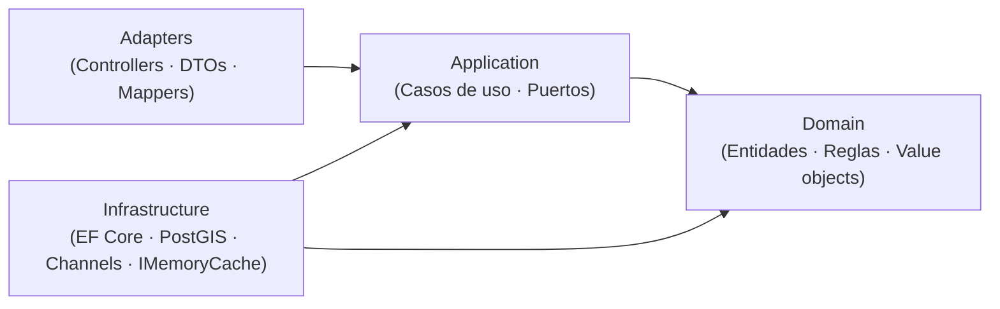
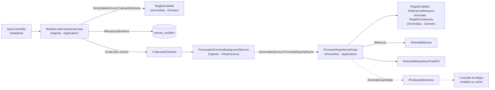
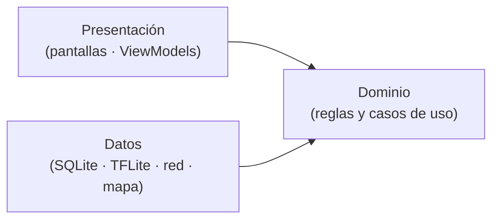

# Enfoque Arquitectónico — Clean Architecture

> **Proyecto:** KillaUru · **Versión:** 2.1 · **Revisión:** 2026-10-13 · **Estado:** Vigente (alineado con ADR-002 y ADR-012)
> **Relacionados:** `estilo-arquitectonico.md`, `componentes-arquitectonicos.md`, `Nivel4-diagrama-de-codigo.md`, `07-decisiones-arquitectonicas.md`

## 1. ¿Qué es Clean Architecture?

Es un enfoque propuesto por Robert C. Martin que organiza el sistema alrededor de las **reglas de negocio**. Su principio fundamental es la **Regla de Dependencia**: las dependencias del código fuente solo apuntan hacia adentro, hacia el dominio. El núcleo del negocio no debe depender de la interfaz, la base de datos, los frameworks ni los servicios externos.

> Si mañana cambiamos de PostgreSQL a otro motor, o de ASP.NET a otro framework, las reglas RN-11 y RN-12 no cambian ni una sola línea.

## 2. Alcance: un enfoque, dos aplicaciones

| Aplicación | Cómo se aplica | Sección |
|---|---|---|
| **Backend** (ASP.NET Core 10) | Clean Architecture **dentro de cada módulo** del monolito, con 4 capas y `Contracts/` | 3 a 8 |
| **App Android** (Kotlin) | Misma regla de dependencia, simplificada en 3 capas | 9 |

> Las dos aplicaciones **no comparten código ni capas**. La detección y la sincronización viven solo en la app; el backend nunca recibe señal cruda (ADR-001, ADR-004).

## 3. Las cuatro capas del backend



| Capa | Contiene | Puede referenciar | Nunca referencia |
|---|---|---|---|
| **Domain** | Entidades, value objects, servicios de dominio, enumeraciones | Solo `Shared/Domain` y la BCL de .NET | Application, Adapters, Infrastructure, ASP.NET, EF Core |
| **Application** | Casos de uso y **puertos** (interfaces que necesita el caso de uso) | Domain y `Contracts/` de otros módulos | Adapters, Infrastructure, EF Core |
| **Adapters** | Controladores, DTOs HTTP y mappers (solo donde hay frontera HTTP) | **Solo Application** (casos de uso y sus DTOs de entrada y salida) | Domain e Infrastructure. **Nunca expone entidades del dominio por HTTP** |
| **Infrastructure** | EF Core, PostGIS, Channels, `IMemoryCache`, adaptador de correo; implementan los puertos | Application (sus puertos) y Domain | Adapters |

> **Regla de dependencia:** las dependencias apuntan **hacia adentro**, hacia Domain; no es una fila estricta de «solo la capa inmediata». Infrastructure puede conocer Domain porque guarda y lee entidades; Adapters no, porque su contrato con el exterior son los DTOs del caso de uso. Así, cambiar una entidad no rompe la API que usa la app Android.
>
> **Los puertos viven en Application** (ADR-002), no en Domain. La capa interna define lo que necesita; la externa lo implementa.

## 4. Plantilla de un módulo

```text
src/KillaUru.Api/
├── Api/                          → Componente «API REST» (Program.cs, middleware, composición)
├── Shared/
│   ├── Domain/                   → Kernel mínimo: Coordenada, Severidad, Confidence, SeudonimoInstalacion
│   ├── Eventos/                  → IPublicadorEventos + PublicadorEnMemoria (patrón Observer)
│   └── Metricas/                 → IMetricas (puerto técnico)
└── Modules/
    └── <Modulo>/
        ├── Contracts/            → Interfaces y DTOs públicos: lo único que otros módulos pueden usar
        │                           (p. ej. Anomalias/Contracts: IAnomaliasService, EventoReportado, TipoAnomalia, AnomaliaCambiada)
        ├── Domain/               → Entidades, value objects y reglas. Sin using de ASP.NET ni EF
        ├── Application/          → Casos de uso y puertos
        ├── Adapters/             → Controladores, DTOs HTTP y mappers (solo si hay frontera HTTP)
        ├── Infrastructure/       → EF Core, PostGIS, Channels, adaptadores: implementan los puertos
        └── <Modulo>Module.cs     → Raíz de composición (registro en el contenedor DI)
```

**Convención de nombres (ADR-012):** términos de negocio en español (`Anomalia`, `ReporteAnomalia`, `Severidad`, `TipoAnomalia`); términos técnicos de capa en inglés (`Domain`, `Application`, `Adapters`, `Infrastructure`).

### 4.1 Qué capas tiene cada módulo

No todos los módulos necesitan las cuatro capas con el mismo peso (DA-12):

| Módulo | Domain | Application | Adapters (HTTP) | Infrastructure |
|---|---|---|---|---|
| **Ingesta** | Mínimo (lote y resultado) | `RecibirLoteEventosUseCase` | `SyncController` | `ColaLotesChannel`, `RecepcionEventosRepository`, `ProcesadorEventosBackgroundService` |
| **Anomalías** | **Rico**: `ReglasCalidad`, `PoliticaConfirmacion`, `Anomalia` (agregado con ciclo de vida), `ReporteAnomalia`, `ReglaPersistencia` | `ProcesarReporteUseCase` (validar → confirmar → clasificar), `ModerarAnomaliaUseCase`, `CaducarAnomaliasUseCase`, `PurgarSeudonimosUseCase`, `ExportarDatasetUseCase` | `ModeracionController`, `ExportacionController` | `AnomaliaRepositoryPostGIS`, escritores CSV y GeoJSON, jobs de mantenimiento |
| **Consulta de Mapa** | Recorte por rol (polígono demo) | `ConsultarMapaUseCase` | `AnomaliasController` (GET) | Caché por celdas |
| **Identidad y Accesos** | `Usuario`, `Rol`, política de bloqueo | Registro, login, refresh, gestión de usuarios | `AuthController`, `UsuariosController` | Repositorio EF, emisor de JWT, adaptador de correo `IEnviadorCorreo` |
| **Dashboard** | Indicadores de negocio | Consulta y cálculo diario de indicadores | `DashboardController` | Job diario de indicadores |
| **Auditoría** | Registro inmutable | `RegistrarAuditoriaUseCase`, consulta | `AuditoriaController` (solo lectura) | Repositorio *append-only* |

> Los módulos de soporte (Dashboard, Auditoría) pueden mantener un dominio liviano. La regla de dependencia se respeta igual, pero no se crean entidades artificiales.

## 5. Las reglas de negocio viven en el dominio

| Regla | Dónde vive | Parámetro (`AnomaliasOptions`, salvo que se indique) |
|---|---|---|
| Confidence mínimo (RN-11) | `ReglasCalidad` (Anomalías · Domain) | `ConfidenceMinimo = 0.75` |
| Precisión GPS máxima (se rechaza si **>** 20 m) | `ReglasCalidad` | `PrecisionGpsMaximaMetros = 20` |
| Timestamp en rango | `ReglasCalidad` | `AntiguedadMaximaDias = 7`, `ToleranciaFuturoMinutos = 5` |
| Confirmación de severidad alta | `PoliticaConfirmacion` | `SeveridadAltaDesde = 4` (RN-06), `DispositivosRequeridos = 2`, `RadioMetros = 100`, `VentanaConfirmacionHoras = 72` |
| Fuera del corredor (RN-13) | `ReglasCalidad` (intrínseca: compara con la polilínea del corredor en memoria) | `DistanciaMaximaViaMetros = 50` |
| Plausibilidad del dispositivo (RN-15) | `PoliticaPlausibilidad` (necesita los eventos previos del seudónimo, por eso se evalúa al procesar y no al recibir) | `MaxEventosPorHoraDeteccion = 120`, `VelocidadMaximaPlausibleKmh = 150` |
| Sesión para confirmar (RN-14) | `PoliticaConfirmacion` | `ReportesConSesionRequeridos = 1` |
| Persistente / episódica (RN-12) | `ReglaPersistencia` (Anomalías · Domain) | `DiasDistintosMinimos = 3`, `VentanaDias = 15`, `DesfaseHorarioHoras = -5` |
| Ciclo de vida de la anomalía (RN-07) | `Anomalia` (agregado) | `CaducidadEpisodicaHoras = 72`, `CaducidadPersistenteDias = 7`, `CaducidadPendienteHoras = 72` |
| Purga del seudónimo | Caso de uso de mantenimiento | `PurgaSeudonimoHoras = 72` |
| Lote máximo | `RecibirLoteEventosUseCase` | `IngestaOptions.MaxEventosPorLote = 50` |
| Seudónimo con formato válido | `SeudonimoInstalacion.Crear` | — |
| Severidad 1–5 y confidence 0.0–1.0 | Fábricas de `Severidad` y `Confidence` | — |

```csharp
// Modules/Anomalias/Domain/AnomaliasOptions.cs (esqueleto) · POCO sin dependencias: Domain puede usarlo
// ADR-012: umbrales por configuración tipada · ISP: cada módulo recibe solo SUS parámetros
public sealed class AnomaliasOptions
{
    public const string Seccion = "Anomalias";            // appsettings.json → "Anomalias": { ... }

    // RN-11 · Calidad
    public double ConfidenceMinimo { get; init; } = 0.75;
    public double PrecisionGpsMaximaMetros { get; init; } = 20;
    public int AntiguedadMaximaDias { get; init; } = 7;
    public int ToleranciaFuturoMinutos { get; init; } = 5;

    // RN-06 y RN-14 · Confirmación
    public int SeveridadAltaDesde { get; init; } = 4;
    public int DispositivosRequeridos { get; init; } = 2;
    public int RadioMetros { get; init; } = 100;
    public int VentanaConfirmacionHoras { get; init; } = 72;
    public int ReportesConSesionRequeridos { get; init; } = 1;

    // RN-13 y RN-15 · Antifraude
    public double DistanciaMaximaViaMetros { get; init; } = 50;
    public int MaxEventosPorHoraDeteccion { get; init; } = 120;   // al superarlo se exige confirmación (no se descarta)
    public int VelocidadMaximaPlausibleKmh { get; init; } = 150;

    // RN-12 · Persistencia
    public int DiasDistintosMinimos { get; init; } = 3;
    public int VentanaDias { get; init; } = 15;
    public int DesfaseHorarioHoras { get; init; } = -5;          // Perú no usa horario de verano

    // RN-07 y RN-09 · Ciclo de vida y privacidad
    public int CaducidadEpisodicaHoras { get; init; } = 72;
    public int CaducidadPersistenteDias { get; init; } = 7;     // un bache reparado sin aviso sale del mapa en ≤ 1 semana
    public int CaducidadPendienteHoras { get; init; } = 72;
    public int PurgaSeudonimoHoras { get; init; } = 72;
}
```

| Clase de configuración | Sección de `appsettings.json` | Qué contiene | Dónde vive |
|---|---|---|---|
| `IngestaOptions` | `Ingesta` | `MaxEventosPorLote = 50`, capacidad de la cola, retención de `evento_recibido` (30 días) | `Modules/Ingesta/Application/` |
| `AnomaliasOptions` | `Anomalias` | RN-05 a RN-15 (arriba) | `Modules/Anomalias/Domain/` |
| `IdentidadOptions` | `Identidad` | Duración de los tokens, intentos antes del bloqueo, versión vigente de la política de privacidad | `Modules/Identidad/Application/` |
| `MapaOptions` | `Mapa` | Polígono del tramo demo, tamaño de celda, tiempo de caché | `Modules/Mapa/Application/` |

> Cada módulo registra **su** clase en su `<Modulo>Module.cs`. Un módulo nunca lee la sección de configuración de otro (principio de segregación de interfaces).

```csharp
// Modules/Anomalias/Domain/ReglasCalidad.cs (esqueleto) · sin using de ASP.NET ni EF
public sealed class ReglasCalidad(AnomaliasOptions o)
{
    public MotivoDescarte? EvaluarIntrinseca(ReporteEntrante e, DateTimeOffset ahora)   // value object del dominio; Application lo mapea desde EventoReportado (Contracts)
    {
        if (e.Confidence.Valor < o.ConfidenceMinimo)
            return MotivoDescarte.ConfidenceBajo;
        if (e.Ubicacion.PrecisionMetros > o.PrecisionGpsMaximaMetros)
            return MotivoDescarte.PrecisionGpsInsuficiente;
        if (e.TimestampUtc > ahora.AddMinutes(o.ToleranciaFuturoMinutos) ||
            e.TimestampUtc < ahora.AddDays(-o.AntiguedadMaximaDias))
            return MotivoDescarte.TimestampFueraDeRango;
        return null;
    }
}
```

```csharp
// Modules/Anomalias/Domain/ReglaPersistencia.cs (esqueleto)
public sealed class ReglaPersistencia(AnomaliasOptions o)
{
    public EstadoPersistencia Evaluar(IEnumerable<DateTimeOffset> reportesUtc, DateTimeOffset ahora)
    {
        var desfase = TimeSpan.FromHours(o.DesfaseHorarioHoras);
        var desde = ahora.AddDays(-o.VentanaDias);

        var diasDistintos = reportesUtc
            .Where(t => t >= desde && t <= ahora)
            .Select(t => DateOnly.FromDateTime(t.ToOffset(desfase).DateTime))   // día local, no UTC
            .Distinct()
            .Count();

        return diasDistintos >= o.DiasDistintosMinimos
            ? EstadoPersistencia.Persistente
            : EstadoPersistencia.Episodica;
    }
}
```

> Un cambio de umbral se hace en `appsettings` y no toca código (EQ-05). `TimeProvider` reemplaza a `DateTime.UtcNow`, lo que permite pruebas deterministas.

## 6. Flujo de código: de la petición a la anomalía persistida (ADR-005)



```csharp
// Modules/Ingesta/Application/RecibirLoteEventosUseCase.cs (esqueleto)
public sealed class RecibirLoteEventosUseCase(
    IAnomaliasService anomalias,         // Contracts de Anomalías (evaluación intrínseca pura)
    IRecepcionEventos recepcion,         // puerto: persiste evento_recibido
    IColaLotes cola,                     // puerto: aviso de trabajo
    IMetricas metricas,                  // Shared/Metricas (puerto técnico)
    TimeProvider reloj)
{
    public const int MaxEventosPorLote = 50;

    public async Task<ResultadoLote> EjecutarAsync(
        Guid loteId, IReadOnlyList<EventoReportado> eventos, CancellationToken ct)
    {
        if (eventos.Count is 0 or > MaxEventosPorLote) return ResultadoLote.Invalido();   // → 400
        if (!cola.HayCapacidad()) return ResultadoLote.Saturado();                        // → 503 + Retry-After

        var ahora = reloj.GetUtcNow();
        var rechazados = eventos
            .Select(e => (e.EventoId, Motivo: anomalias.EvaluarIntrinseca(e, ahora)))
            .Where(x => x.Motivo is not null)
            .ToDictionary(x => x.EventoId, x => x.Motivo!.Value);

        // INSERT … ON CONFLICT (evento_id) DO NOTHING: durable e idempotente
        var resultado = await recepcion.RegistrarLoteAsync(loteId, eventos, rechazados, ct);

        cola.TryEscribir(new LoteRecibido(loteId));   // solo avisa; si falla, el barredor lo recupera
        metricas.RegistrarLote(resultado);            // contadores en memoria, volcados cada minuto
        return resultado;                             // → 200 {aceptados, duplicados, rechazados}
    }
}
```

**Algoritmo de `ProcesadorEventosBackgroundService`:**

1. Al **arrancar**, y luego cada ~60 s, busca filas `RECIBIDO` pendientes (barredor de recuperación, EQ-09).
2. Con cada aviso de lote, carga sus eventos desde `evento_recibido`.
3. Para cada evento llama a `IAnomaliasService.ProcesarReporteAsync`, que devuelve `Descartado` (con motivo) o `Procesado`. **Ingesta no abre transacciones ni toma bloqueos sobre tablas de Anomalías.**
4. **Solo después** de una respuesta correcta marca la fila como `PROCESADO` o `DESCARTADO` (transacción propia de Ingesta, solo sobre `evento_recibido`). Los descartes incrementan **métricas**, no auditoría.
5. Si el proceso se cae entre el paso 3 y el 4, la fila sigue `RECIBIDO`; el barredor la reenvía y Anomalías la reconoce como ya procesada (idempotencia por `eventoId`). Entrega **al menos una vez** + receptor idempotente = **efecto exactamente una vez**.

**Algoritmo de `ProcesarReporteUseCase`** (módulo Anomalías). Anomalías es **dueño de su transacción y de su bloqueo**:

0. **Idempotencia y bloqueo** — abre **su propia** transacción. Si ya existe un reporte con ese `eventoId` (restricción única en `reporte_anomalia.evento_id`), devuelve el resultado anterior sin hacer nada más. Si no, toma un **bloqueo consultivo por celda geográfica** (la celda es ≥ 5× el radio de 100 m; si el punto está cerca del borde, toma los dos bloqueos en orden fijo). Así dos reportes simultáneos del mismo bache no crean dos anomalías.
1. **Validar** — `ReglasCalidad.EvaluarIntrinseca` otra vez, por seguridad ante filas antiguas (RN-11, RN-13), y `PoliticaPlausibilidad` con los eventos previos del mismo seudónimo: velocidad plausible (RN-15b). Si hay motivo → `IMetricas.RegistrarDescarte(motivo)` y `Descartado`. Si el seudónimo supera el tope por hora de **detección** (RN-15a), el evento **sigue** pero marcado `RequiereConfirmacion`.
2. **Agrupar** — busca una anomalía del mismo tipo a ≤ 100 m (RN-05). Si no existe, `Anomalia.Crear`; si existe, `Anomalia.RegistrarReporte` (actualiza `UltimoReporteUtc` y el centroide). Si la anomalía está `Descartada`, el reporte se guarda pero no la reactiva (RN-07).
3. **Confirmar** — si `PoliticaConfirmacion.Requiere(severidad)` (severidad 4–5, RN-06), cuenta los dispositivos distintos en el radio y la ventana, y los reportes con `con_sesion = true`, con una consulta **interna** del repositorio. Con ≥ 2 dispositivos y ≥ 1 con sesión (RN-14) → `Activa`; lo mismo aplica a cualquier severidad si el evento viene marcado `RequiereConfirmacion` (RN-15a); si no → `PendienteConfirmacion`. Severidad 1–3 → `Activa`.
4. **Clasificar** — la entidad recalcula `Persistencia` con `ReglaPersistencia` (RN-12) y su estado de ciclo de vida (RN-07).
5. Guarda el reporte (con su `eventoId`) y la anomalía, confirma (*commit*) y libera el bloqueo.
6. **Después del *commit***, publica `AnomaliaCambiada(anomaliaId, celdas)` con `IPublicadorEventos`. Anomalías no sabe quién escucha; Consulta de Mapa invalida sus celdas (patrón Observer, ADR-006). Si se publicara antes del *commit* y la transacción fallara, el mapa se limpiaría por un cambio que nunca existió.

**Procesos de mantenimiento** (ver `componentes-arquitectonicos.md`): caducidad diaria de anomalías (ADR-008), purga del seudónimo a 72 h y purga de `evento_recibido` a 30 días (RNF-25).

## 7. Composición e inyección de dependencias

Cada módulo expone una extensión que registra sus tipos en el contenedor DI nativo de ASP.NET Core. La capa **Api** es la única que conoce todos los módulos.

```csharp
// Modules/Ingesta/IngestaModule.cs (esqueleto)
public static class IngestaModule
{
    public static IServiceCollection AddIngestaModule(this IServiceCollection s, IConfiguration c) => s
        .Configure<IngestaOptions>(c.GetSection(IngestaOptions.Seccion))          // solo SU sección
        .AddScoped<RecibirLoteEventosUseCase>()
        .AddScoped<IRecepcionEventos, RecepcionEventosRepository>()   // puerto → implementación
        .AddSingleton<IColaLotes, ColaLotesChannel>()
        .AddHostedService<ProcesadorEventosBackgroundService>();
}

// Api/Program.cs (extracto)
// Cada módulo registra su propia configuración dentro de Add<Modulo>Module (ISP)
builder.Services.AddSingleton(TimeProvider.System);
var cfg = builder.Configuration;
builder.Services.AddIdentidadModule(cfg).AddIngestaModule(cfg).AddAnomaliasModule(cfg)
                .AddMapaModule(cfg).AddDashboardModule(cfg).AddAuditoriaModule(cfg);
```

## 8. Estrategia de pruebas por capa

| Capa | Tipo de prueba | Herramientas *(propuestas)* | Qué se aísla |
|---|---|---|---|
| Domain | Unitarias puras (valores límite: 0.74/0.75/0.76, 19/20/21 m, 2 días vs 3 días locales, reporte nocturno en UTC−5) | xUnit | Nada: sin BD, sin red, sin reloj real |
| Application | Unitarias con dobles de los puertos | xUnit + NSubstitute + `FakeTimeProvider` | `IRecepcionEventos`, `IColaLotes`, `IAnomaliaRepository`, `IPublicadorEventos`, contratos de otros módulos |
| Infrastructure | Integración con BD real | Testcontainers (PostgreSQL + PostGIS) | Consultas espaciales, `ON CONFLICT`, bloqueos por celda, mapeos EF |
| Adapters | Pruebas de API | `WebApplicationFactory` | Contratos HTTP: 200 (con aceptados/duplicados/rechazados), 400, 429, 503; recorte por rol |
| Arquitectura | Reglas de dependencia | NetArchTest | Domain sin dependencias externas; un módulo solo usa `Contracts/` de otro; sin ciclos (RNF-28) |
| Sistema | Carga, caos y campo | Herramienta de carga; prueba de reinicio; recorrido en modo avión | EQ-01, EQ-02, EQ-06, EQ-09 |

## 9. Enfoque en la app Android

La app aplica la misma regla de dependencia con **tres capas**, porque no tiene frontera HTTP de entrada ni módulos de negocio del servidor.



| Capa | Contiene | Reglas que viven aquí |
|---|---|---|
| **Dominio** | `Evento` y su estado (`PENDING`, `SYNCED`, `REJECTED_LOCAL`), política de guardado, política de reintento, rotación de seudónimo, filtro de proximidad | confidence ≥ 0.75 (RF-03); backoff 30 s → 2 h con *jitter* ±25 % y reinicio al recuperar red (RF-07); rotación mensual del seudónimo (RF-27); alerta solo para anomalías `Activa` por delante en el sentido de marcha (RF-10) |
| **Datos** | Buffer en **Room** (SQLite), envoltorio de **LiteRT**, cliente **Retrofit**, trabajos de **WorkManager** (sincronización y actualización del modelo), almacén del mapa base y de anomalías locales (índice espacial), token y derecho de acceso en **DataStore** cifrado con **Android Keystore** | Retención de eventos `SYNCED`; descarga incremental con `updatedSince` |
| **Presentación** | Pantallas en **Jetpack Compose** (mapa, historial, sesión, perfil y alertas) con ViewModels; servicio en primer plano para los sensores | Máximo 3 toques por acción principal (RNF-12); tiempos relativos (RNF-14) |

Principios de la app:

1. **Offline-first:** nada en el flujo de detección, guardado, mapa descargado o alertas necesita red.
2. El **historial** se calcula y se guarda solo en el dispositivo (RF-25).
3. El **acceso al corredor completo** depende de un derecho de acceso (*entitlement*) guardado localmente, no de que el JWT siga vigente. El servidor sigue decidiendo qué datos entrega (RF-14).
4. El **modelo** declara su `modeloVersion` y cada evento lo lleva (ADR-004).

## 10. Beneficios

| Beneficio | Cómo se aplica en KillaUru |
|---|---|
| **Testeable** | RN-11 y RN-12 se prueban con valores límite, sin BD ni sensores |
| **Calibrable** | Los umbrales se ajustan con datos del piloto sin recompilar (S-04, EQ-05) |
| **Mantenible** | Un cambio de regla no toca controladores ni repositorios |
| **Evolutivo** | Cambiar de motor de datos solo afecta a Infrastructure; extraer un módulo solo exige mover su carpeta |
| **Legible** | Los casos de uso cuentan qué hace el sistema sin leer la infraestructura |

## 11. Alineación pendiente con Nivel4

Estos puntos de este documento aún no aparecen en `Nivel4-diagrama-de-codigo.md` y deben incorporarse:

| Cambio | En Nivel4 hoy | Debe quedar |
|---|---|---|
| Seudónimo | `DispositivoHash` (SHA-256, 64 hex) | `SeudonimoInstalacion` (UUID aleatorio rotativo, ADR-007) |
| Identificador del evento | No existe | `EventoReportado.EventoId` y `ModeloVersion` |
| Cola | `IColaEventos` / `ColaEventosChannel` (por evento) | `IColaLotes` / `ColaLotesChannel` (por lote) y puerto `IRecepcionEventos` |
| Reglas | Clases estáticas con constantes | Clases con la configuración **de su módulo** inyectada (`AnomaliasOptions`, etc.) |
| Auditoría de descartes | `IAuditoriaService` | `IMetricas` en `Shared/Metricas` (descartes = métricas) |
| Módulos Validación y Clasificación | Dos módulos con `IValidacionService` e `IClasificacionService` | Un módulo **Anomalías** con `IAnomaliasService` (`EvaluarIntrinseca` síncrona y pura + `ProcesarReporteAsync`) |
| Agregado `Anomalia` | `Persistencia` y `Confirmada` | Estado de ciclo de vida y `UltimoReporteUtc` (ADR-008) |
| Día de RN-12 | UTC | Desfase fijo UTC−5 |
| Lecturas cruzadas | `IAnomaliaConsultas` | `IAnomaliaLectura` para Mapa y Dashboard (Exportación es un caso de uso de Anomalías); el conteo de dispositivos pasa a ser interno |