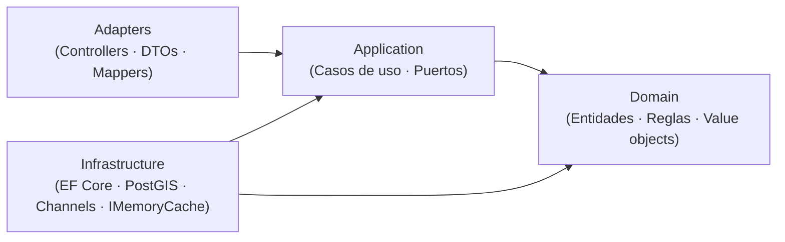
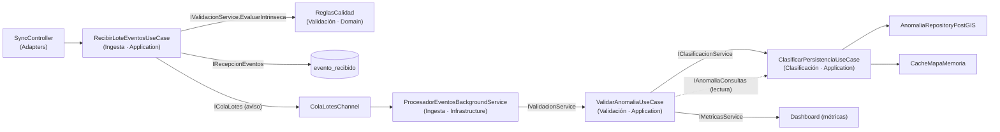
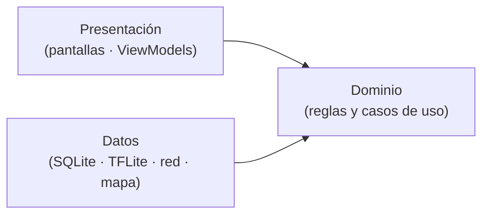

# Enfoque Arquitectónico — Clean Architecture

> **Proyecto:** KillaUru · **Versión:** 2.0 · **Revisión:** 2026-10-12 · **Estado:** Vigente (alineado con ADR-002 y ADR-012)
> **Relacionados:** `estilo-arquitectonico.md`, `componentes-arquitectonicos.md`, `Nivel4-diagrama-de-codigo.md`, `07-decisiones-arquitectonicas.md`

## 1. ¿Qué es Clean Architecture?

Es un enfoque propuesto por Robert C. Martin que organiza el sistema alrededor de las **reglas de negocio**. Su principio fundamental es la **Regla de Dependencia**: las dependencias del código fuente solo apuntan hacia adentro, hacia el dominio. El núcleo del negocio no debe depender de la interfaz, la base de datos, los frameworks ni los servicios externos.

> Si mañana cambiamos de PostgreSQL a otro motor, o de ASP.NET a otro framework, las reglas RN-11 y RN-12 no cambian ni una sola línea.

## 2. Alcance: un enfoque, dos aplicaciones

| Aplicación | Cómo se aplica | Sección |
|---|---|---|
| **Backend** (ASP.NET Core 8) | Clean Architecture **dentro de cada módulo** del monolito, con 4 capas y `Contracts/` | 3 a 8 |
| **App Android** (Kotlin) | Misma regla de dependencia, simplificada en 3 capas | 9 |

> Las dos aplicaciones **no comparten código ni capas**. La detección y la sincronización viven solo en la app; el backend nunca recibe señal cruda (ADR-001, ADR-004).

## 3. Las cuatro capas del backend



| Capa | Contiene | Puede referenciar | Nunca referencia |
|---|---|---|---|
| **Domain** | Entidades, value objects, servicios de dominio, enumeraciones | Solo `Shared/Domain` y la BCL de .NET | Application, Adapters, Infrastructure, ASP.NET, EF Core |
| **Application** | Casos de uso y **puertos** (interfaces que necesita el caso de uso) | Domain y `Contracts/` de otros módulos | Adapters, Infrastructure, EF Core |
| **Adapters** | Controladores, DTOs HTTP y mappers (solo donde hay frontera HTTP) | Application y Domain (para mapear) | Infrastructure |
| **Infrastructure** | EF Core, PostGIS, Channels, `IMemoryCache`, adaptador de correo; implementan los puertos | Application (sus puertos) y Domain | Adapters |

> **Los puertos viven en Application** (ADR-002), no en Domain. La capa interna define lo que necesita; la externa lo implementa.

## 4. Plantilla de un módulo

```text
src/KillaUru.Api/
├── Api/                          → Componente «API REST» (Program.cs, middleware, composición)
├── Shared/
│   ├── Domain/                   → Kernel: Coordenada, Severidad, Confidence, SeudonimoInstalacion, TipoAnomalia, EventoReportado
│   ├── Cache/                    → ICacheMapa + CacheMapaMemoria (IMemoryCache)
│   └── Configuracion/            → ReglasOptions (umbrales tipados)
└── Modules/
    └── <Modulo>/
        ├── Contracts/            → Interfaces y DTOs públicos: lo único que otros módulos pueden usar
        ├── Domain/               → Entidades, value objects y reglas. Sin using de ASP.NET ni EF
        ├── Application/          → Casos de uso y puertos
        ├── Adapters/             → Controladores, DTOs HTTP y mappers (solo si hay frontera HTTP)
        ├── Infrastructure/       → EF Core, PostGIS, Channels, adaptadores: implementan los puertos
        └── <Modulo>Module.cs     → Raíz de composición (registro en el contenedor DI)
```

**Convención de nombres (ADR-012):** términos de negocio en español (`Anomalia`, `ReporteAnomalia`, `Severidad`, `TipoAnomalia`); términos técnicos de capa en inglés (`Domain`, `Application`, `Adapters`, `Infrastructure`).

### 4.1 Qué capas tiene cada módulo

No todos los módulos necesitan las cuatro capas con el mismo peso (DA-12):

| Módulo | Domain | Application | Adapters (HTTP) | Infrastructure |
|---|---|---|---|---|
| **Ingesta** | Mínimo (lote y resultado) | `RecibirLoteEventosUseCase` | `SyncController` | `ColaLotesChannel`, `RecepcionEventosRepository`, `ProcesadorEventosBackgroundService` |
| **Validación** | **Rico**: `ReglasCalidad`, `PoliticaConfirmacion` | `ValidarAnomaliaUseCase` | — (sin frontera HTTP) | `ConfirmacionesReaderAdapter` |
| **Clasificación** | **Rico**: `Anomalia`, `ReporteAnomalia`, `ReglaPersistencia`, ciclo de vida | `ClasificarPersistenciaUseCase`, moderación, caducidad, purga | `ModeracionController` | `AnomaliaRepositoryPostGIS`, jobs de mantenimiento |
| **Consulta de Mapa** | Recorte por rol (polígono demo) | `ConsultarMapaUseCase` | `AnomaliasController` (GET) | Caché por celdas |
| **Identidad y Accesos** | `Usuario`, `Rol`, política de bloqueo | Registro, login, refresh, gestión de usuarios | `AuthController`, `UsuariosController` | Repositorio EF, emisor de JWT, adaptador de correo (roadmap) |
| **Dashboard** | Indicadores | Casos de uso de consulta y agregación | `DashboardController` | Agregador de métricas |
| **Exportación** | — | `ExportarDatasetUseCase` | `ExportacionController` | Escritores CSV y GeoJSON |
| **Auditoría** | Registro inmutable | `RegistrarAuditoriaUseCase`, consulta | `AuditoriaController` (solo lectura) | Repositorio *append-only* |

> Los módulos de soporte (Dashboard, Exportación, Auditoría) pueden mantener un dominio liviano. La regla de dependencia se respeta igual, pero no se crean entidades artificiales.

## 5. Las reglas de negocio viven en el dominio

| Regla | Dónde vive | Parámetro (`ReglasOptions`) |
|---|---|---|
| Confidence mínimo | `ReglasCalidad` (Validación · Domain) | `ConfidenceMinimo = 0.75` |
| Precisión GPS máxima (se rechaza si **>** 20 m) | `ReglasCalidad` | `PrecisionGpsMaximaMetros = 20` |
| Timestamp en rango | `ReglasCalidad` | `AntiguedadMaximaDias = 7`, `ToleranciaFuturoMinutos = 5` |
| Confirmación de severidad alta | `PoliticaConfirmacion` | `SeveridadAltaDesde = 4` *(a confirmar)*, `DispositivosRequeridos = 2`, `RadioMetros = 100`, `VentanaConfirmacionHoras = 72` |
| Persistente / episódica | `ReglaPersistencia` (Clasificación · Domain) | `DiasDistintosMinimos = 3`, `VentanaDias = 15`, `DesfaseHorarioHoras = -5` |
| Ciclo de vida de la anomalía | `Anomalia` (agregado) | `CaducidadEpisodicaHoras = 72`, `CaducidadPendienteHoras = 72` |
| Purga del seudónimo | Caso de uso de mantenimiento | `PurgaSeudonimoHoras = 72` |
| Lote máximo | `RecibirLoteEventosUseCase.MaxEventosPorLote` | 50 |
| Seudónimo con formato válido | `SeudonimoInstalacion.Crear` | — |
| Severidad 1–5 y confidence 0.0–1.0 | Fábricas de `Severidad` y `Confidence` | — |

```csharp
// Shared/Configuracion/ReglasOptions.cs (esqueleto) · ADR-012: umbrales por configuración tipada
public sealed class ReglasOptions
{
    public const string Seccion = "Reglas";

    public double ConfidenceMinimo { get; init; } = 0.75;
    public double PrecisionGpsMaximaMetros { get; init; } = 20;
    public int AntiguedadMaximaDias { get; init; } = 7;
    public int ToleranciaFuturoMinutos { get; init; } = 5;

    public int SeveridadAltaDesde { get; init; } = 4;        // a confirmar (decisión abierta 2)
    public int DispositivosRequeridos { get; init; } = 2;
    public int RadioMetros { get; init; } = 100;
    public int VentanaConfirmacionHoras { get; init; } = 72;

    public int DiasDistintosMinimos { get; init; } = 3;
    public int VentanaDias { get; init; } = 15;
    public int DesfaseHorarioHoras { get; init; } = -5;      // Perú no usa horario de verano

    public int CaducidadEpisodicaHoras { get; init; } = 72;
    public int CaducidadPendienteHoras { get; init; } = 72;
    public int PurgaSeudonimoHoras { get; init; } = 72;
}
```

```csharp
// Modules/Validacion/Domain/ReglasCalidad.cs (esqueleto) · sin using de ASP.NET ni EF
public sealed class ReglasCalidad(ReglasOptions o)
{
    public MotivoDescarte? EvaluarIntrinseca(EventoReportado e, DateTimeOffset ahora)
    {
        if (e.Confidence.Valor < o.ConfidenceMinimo)
            return MotivoDescarte.ConfidenceBajo;
        if (e.Ubicacion.PrecisionMetros > o.PrecisionGpsMaximaMetros)
            return MotivoDescarte.PrecisionGpsInsuficiente;
        if (e.TimestampUtc > ahora.AddMinutes(o.ToleranciaFuturoMinutos) ||
            e.TimestampUtc < ahora.AddDays(-o.AntiguedadMaximaDias))
            return MotivoDescarte.TimestampFueraDeRango;
        return null;
    }
}
```

```csharp
// Modules/Clasificacion/Domain/ReglaPersistencia.cs (esqueleto)
public sealed class ReglaPersistencia(ReglasOptions o)
{
    public EstadoPersistencia Evaluar(IEnumerable<DateTimeOffset> reportesUtc, DateTimeOffset ahora)
    {
        var desfase = TimeSpan.FromHours(o.DesfaseHorarioHoras);
        var desde = ahora.AddDays(-o.VentanaDias);

        var diasDistintos = reportesUtc
            .Where(t => t >= desde && t <= ahora)
            .Select(t => DateOnly.FromDateTime(t.ToOffset(desfase).DateTime))   // día local, no UTC
            .Distinct()
            .Count();

        return diasDistintos >= o.DiasDistintosMinimos
            ? EstadoPersistencia.Persistente
            : EstadoPersistencia.Episodica;
    }
}
```

> Un cambio de umbral se hace en `appsettings` y no toca código (EQ-05). `TimeProvider` reemplaza a `DateTime.UtcNow`, lo que permite pruebas deterministas.

## 6. Flujo de código: de la petición a la anomalía persistida (ADR-005)



```csharp
// Modules/Ingesta/Application/RecibirLoteEventosUseCase.cs (esqueleto)
public sealed class RecibirLoteEventosUseCase(
    IValidacionService validacion,       // Contracts de Validación (evaluación intrínseca pura)
    IRecepcionEventos recepcion,         // puerto: persiste evento_recibido
    IColaLotes cola,                     // puerto: aviso de trabajo
    IMetricasService metricas,           // Contracts de Dashboard
    TimeProvider reloj)
{
    public const int MaxEventosPorLote = 50;

    public async Task<ResultadoLote> EjecutarAsync(
        Guid loteId, IReadOnlyList<EventoReportado> eventos, CancellationToken ct)
    {
        if (eventos.Count is 0 or > MaxEventosPorLote) return ResultadoLote.Invalido();   // → 400
        if (!cola.HayCapacidad()) return ResultadoLote.Saturado();                        // → 503 + Retry-After

        var ahora = reloj.GetUtcNow();
        var rechazados = eventos
            .Select(e => (e.EventoId, Motivo: validacion.EvaluarIntrinseca(e, ahora)))
            .Where(x => x.Motivo is not null)
            .ToDictionary(x => x.EventoId, x => x.Motivo!.Value);

        // INSERT … ON CONFLICT (evento_id) DO NOTHING: durable e idempotente
        var resultado = await recepcion.RegistrarLoteAsync(loteId, eventos, rechazados, ct);

        cola.TryEscribir(new LoteRecibido(loteId));   // solo avisa; si falla, el barredor lo recupera
        metricas.RegistrarLote(resultado);            // contadores en memoria, volcados cada minuto
        return resultado;                             // → 200 {aceptados, duplicados, rechazados}
    }
}
```

**Algoritmo de `ProcesadorEventosBackgroundService`:**

1. Al **arrancar**, y luego cada ~60 s, busca filas `RECIBIDO` pendientes (barredor de recuperación, EQ-09).
2. Con cada aviso de lote, carga sus eventos desde `evento_recibido`.
3. Para cada evento, abre una transacción y toma un **bloqueo consultivo por celda geográfica** (la celda es ≥ 5× el radio de 100 m; si el punto está cerca del borde, toma los dos bloqueos en orden fijo). Así dos lectores no confirman ni crean la misma anomalía a la vez.
4. Llama a `IValidacionService.ValidarAsync`, que descarta (`DESCARTADO` + motivo) o entrega el reporte a Clasificación con el indicador `confirmado`.
5. Marca la fila como `PROCESADO` o `DESCARTADO`. Los descartes incrementan **métricas**, no auditoría.

**Algoritmo de `ValidarAnomaliaUseCase`:**

1. `ReglasCalidad.EvaluarIntrinseca` (otra vez, por seguridad ante filas antiguas): si hay motivo → `Descartado`.
2. Si `PoliticaConfirmacion.Requiere(severidad)` es falsa → `IClasificacionService.RegistrarReporteAsync(evento, confirmado: true)` y `Valido`.
3. Si la requiere → cuenta dispositivos distintos en el radio y la ventana con `IAnomaliaConsultas`. Con el actual suma ≥ 2 → `Valido`; si no → `PendienteConfirmacion`. En ambos casos entrega el reporte a Clasificación.

**Algoritmo de `ClasificarPersistenciaUseCase`:**

1. Busca una anomalía del mismo tipo a ≤ 100 m. Si no existe, `Anomalia.Crear`; si existe, `Anomalia.RegistrarReporte` (actualiza `UltimoReporteUtc` y el centroide).
2. La entidad recalcula `Persistencia` con `ReglaPersistencia` y su estado de ciclo de vida: `Activa`, `PendienteConfirmacion`, `Expirada` o `Reparada`.
3. Guarda y llama a `ICacheMapa.InvalidarCeldasAsync` para las celdas afectadas.

**Procesos de mantenimiento** (ver `componentes-arquitectonicos.md`): caducidad diaria de anomalías (ADR-008), purga del seudónimo a 72 h y purga de `evento_recibido` a 30 días (RNF-25).

## 7. Composición e inyección de dependencias

Cada módulo expone una extensión que registra sus tipos en el contenedor DI nativo de ASP.NET Core. La capa **Api** es la única que conoce todos los módulos.

```csharp
// Modules/Ingesta/IngestaModule.cs (esqueleto)
public static class IngestaModule
{
    public static IServiceCollection AddIngestaModule(this IServiceCollection s) => s
        .AddScoped<RecibirLoteEventosUseCase>()
        .AddScoped<IRecepcionEventos, RecepcionEventosRepository>()   // puerto → implementación
        .AddSingleton<IColaLotes, ColaLotesChannel>()
        .AddHostedService<ProcesadorEventosBackgroundService>();
}

// Api/Program.cs (extracto)
builder.Services.Configure<ReglasOptions>(builder.Configuration.GetSection(ReglasOptions.Seccion));
builder.Services.AddSingleton(sp => sp.GetRequiredService<IOptions<ReglasOptions>>().Value);
builder.Services.AddSingleton(TimeProvider.System);
builder.Services.AddIdentidadModule().AddIngestaModule().AddValidacionModule()
                .AddClasificacionModule().AddMapaModule().AddDashboardModule()
                .AddExportacionModule().AddAuditoriaModule();
```

## 8. Estrategia de pruebas por capa

| Capa | Tipo de prueba | Herramientas *(propuestas)* | Qué se aísla |
|---|---|---|---|
| Domain | Unitarias puras (valores límite: 0.74/0.75/0.76, 19/20/21 m, 2 días vs 3 días locales, reporte nocturno en UTC−5) | xUnit | Nada: sin BD, sin red, sin reloj real |
| Application | Unitarias con dobles de los puertos | xUnit + NSubstitute + `FakeTimeProvider` | `IRecepcionEventos`, `IColaLotes`, `IAnomaliaRepository`, `ICacheMapa`, contratos de otros módulos |
| Infrastructure | Integración con BD real | Testcontainers (PostgreSQL + PostGIS) | Consultas espaciales, `ON CONFLICT`, bloqueos por celda, mapeos EF |
| Adapters | Pruebas de API | `WebApplicationFactory` | Contratos HTTP: 200 (con aceptados/duplicados/rechazados), 400, 429, 503; recorte por rol |
| Arquitectura | Reglas de dependencia | NetArchTest | Domain sin dependencias externas; un módulo solo usa `Contracts/` de otro; sin ciclos (RNF-28) |
| Sistema | Carga, caos y campo | Herramienta de carga; prueba de reinicio; recorrido en modo avión | EQ-01, EQ-02, EQ-06, EQ-09 |

## 9. Enfoque en la app Android

La app aplica la misma regla de dependencia con **tres capas**, porque no tiene frontera HTTP de entrada ni módulos de negocio del servidor.



| Capa | Contiene | Reglas que viven aquí |
|---|---|---|
| **Dominio** | `Evento` y su estado (`PENDING`, `SYNCED`, `REJECTED_LOCAL`), política de guardado, política de reintento, rotación de seudónimo, filtro de proximidad | confidence ≥ 0.75 (RF-03); backoff 30 s → 2 h con *jitter* ±25 % y reinicio al recuperar red (RF-07); rotación mensual del seudónimo (RF-27); alerta solo para anomalías `Activa` por delante en el sentido de marcha (RF-10) |
| **Datos** | Buffer SQLite, envoltorio de TFLite, cliente HTTP, almacén del mapa base y de anomalías locales (índice espacial) | Retención de eventos `SYNCED`; descarga incremental con `updatedSince` |
| **Presentación** | Pantallas de mapa, historial, sesión y alertas; servicio en primer plano | Máximo 3 toques por acción principal (RNF-12); tiempos relativos (RNF-14) |

Principios de la app:

1. **Offline-first:** nada en el flujo de detección, guardado, mapa descargado o alertas necesita red.
2. El **historial** se calcula y se guarda solo en el dispositivo (RF-25).
3. El **acceso al corredor completo** depende de un derecho de acceso (*entitlement*) guardado localmente, no de que el JWT siga vigente. El servidor sigue decidiendo qué datos entrega (RF-14).
4. El **modelo** declara su `modeloVersion` y cada evento lo lleva (ADR-004).

## 10. Beneficios

| Beneficio | Cómo se aplica en KillaUru |
|---|---|
| **Testeable** | RN-11 y RN-12 se prueban con valores límite, sin BD ni sensores |
| **Calibrable** | Los umbrales se ajustan con datos del piloto sin recompilar (S-04, EQ-05) |
| **Mantenible** | Un cambio de regla no toca controladores ni repositorios |
| **Evolutivo** | Cambiar de motor de datos solo afecta a Infrastructure; extraer un módulo solo exige mover su carpeta |
| **Legible** | Los casos de uso cuentan qué hace el sistema sin leer la infraestructura |

## 11. Alineación pendiente con Nivel4

Estos puntos de este documento aún no aparecen en `Nivel4-diagrama-de-codigo.md` y deben incorporarse:

| Cambio | En Nivel4 hoy | Debe quedar |
|---|---|---|
| Seudónimo | `DispositivoHash` (SHA-256, 64 hex) | `SeudonimoInstalacion` (UUID aleatorio rotativo, ADR-007) |
| Identificador del evento | No existe | `EventoReportado.EventoId` y `ModeloVersion` |
| Cola | `IColaEventos` / `ColaEventosChannel` (por evento) | `IColaLotes` / `ColaLotesChannel` (por lote) y puerto `IRecepcionEventos` |
| Reglas | Clases estáticas con constantes | Clases con `ReglasOptions` inyectado |
| Auditoría de descartes | `IAuditoriaService` | `IMetricasService` (descartes = métricas) |
| Validación intrínseca | Solo `ValidarAsync` | `IValidacionService.EvaluarIntrinseca` (síncrona y pura) |
| Agregado `Anomalia` | `Persistencia` y `Confirmada` | Estado de ciclo de vida y `UltimoReporteUtc` (ADR-008) |
| Día de RN-12 | UTC | Desfase fijo UTC−5 |
| Lecturas cruzadas | `IAnomaliaConsultas` | Añadir `IAnomaliaLectura` para Mapa, Dashboard y Exportación |