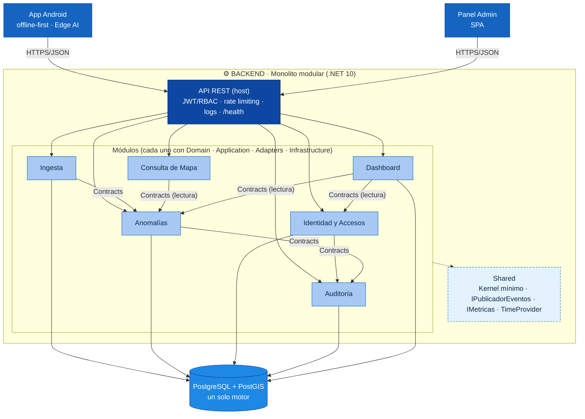

# Estilo Arquitectónico

> **Proyecto:** KillaUru · **Versión:** 2.1 · **Revisión:** 2026-10-13 · **Estado:** Vigente (alineado con ADR-001…ADR-014)
> **Relacionados:** `arquitectura-inicial.md`, `enfoque-arquitectonico.md`, `componentes-arquitectonicos.md`, `06-driver-arquitectonicos.md`, `07-decisiones-arquitectonicas.md`

## 1. ¿Qué es un estilo arquitectónico?

Un estilo arquitectónico define la forma global en que se organiza y despliega un sistema. No describe qué hace el sistema, sino cómo se estructura y cómo se relacionan sus partes. Condiciona los módulos, las tecnologías, el despliegue y la capacidad de evolución.

## 2. Estilo seleccionado

KillaUru combina **un estilo principal y tres estilos de apoyo**:

| Estilo | Dónde se aplica | Por qué |
|---|---|---|
| **Monolito modular** *(principal)* | Backend: un único proceso ASP.NET Core 10 con 6 módulos (*bounded contexts*) | Una sola persona, 6–8 semanas, recursos mínimos (DA-06, DA-12) |
| **Capas por módulo (Clean Architecture)** | Dentro de cada módulo: Domain, Application, Adapters, Infrastructure | Reglas de negocio independientes de frameworks (ADR-002) |
| **Offline-first con Store-and-Forward** | App Android y protocolo de sincronización | Más del 50 % del corredor no tiene señal (DA-01, DA-02) |
| **Edge AI** | Clasificación en el dispositivo con TFLite | Sin internet y en < 50 ms (DA-03, DA-04) |

> **Capas = organización lógica interna. Monolito = unidad de despliegue.**

Se apoya además en dos mecanismos de comunicación:

- **Cliente-servidor REST/JSON** entre app/panel y la API.
- **Procesamiento asíncrono interno ligero** (tabla de recepción + `Channel` + `BackgroundService`) para absorber ráfagas de sincronización (DA-05). No usa broker externo.

### 2.1 ¿Por qué monolito modular?

| Razón | Explicación |
|---|---|
| **Un solo desarrollador** | No hay equipo que paralelice servicios; la complejidad operacional debe ser mínima (R-09) |
| **Plazo académico** | Con 6 a 8 semanas, un monolito se despliega con un solo comando (R-10, RNF-17) |
| **Presupuesto cero** | Un proceso consume menos memoria en Oracle ARM Free Tier que varios servicios (R-04, DA-08) |
| **Evolución ordenada** | Contratos públicos entre módulos desde el inicio: cada módulo puede extraerse sin reescribir su lógica (DA-09) |

### 2.2 Estilos evaluados y descartados

| Estilo | Motivo del descarte |
|---|---|
| Microservicios | Complejidad operacional inviable para una persona (ADR-001) |
| Monolito tradicional sin módulos | Se vuelve difícil de mantener y no permite evolucionar a servicios |
| Clasificación en el servidor (señal cruda) | Requiere internet permanente y latencia inaceptable (ADR-004) |
| Broker externo (RabbitMQ, Kafka) | Costo y operación inviables; la tabla de recepción cubre la durabilidad (ADR-005) |
| Redis como caché | Un contenedor más que operar; `IMemoryCache` basta con una instancia (ADR-006) |
| App híbrida (Flutter, React Native) | Se requiere acceso directo a sensores a 50 Hz (R-01) |
| *Event sourcing* / CQRS completo | Complejidad desproporcionada; se usan puertos de lectura y escritura separados dentro del mismo proceso |

## 3. Diagrama de estilo (módulos y reglas de dependencia)

> Solo el **dueño** de cada tabla escribe en ella (`ING`, `ANO`, `ID`, `AUD`, `DASH`). El módulo que solo lee (`MAPA`) lo hace **a través del contrato** del dueño, no con SQL propio.

## 4. Reglas fundamentales

Estas reglas no son sugerencias: mantienen el sistema ordenado conforme crece. Las 1 a 4 y 12 se verifican con pruebas de arquitectura en cada build (RNF-28).

| # | Regla | Motivo | Cómo se verifica |
|---|---|---|---|
| 1 | **Regla de dependencia hacia adentro.** Adapters → Application → Domain; Infrastructure implementa los puertos de Application y conoce Domain. Los controladores no usan Domain ni exponen entidades. | Orden predecible y testeable | Pruebas de arquitectura |
| 2 | **Aislamiento entre módulos.** Un módulo usa a otro **solo** mediante su carpeta `Contracts/`. | Un cambio interno no rompe a los demás (DA-09) | Pruebas de arquitectura |
| 3 | **Un dueño por tabla.** Un esquema de PostgreSQL y un `DbContext` por módulo; solo el dueño escribe; los demás leen por su contrato; sin llaves foráneas entre esquemas. | Independencia de los datos; extraer un módulo es mover su esquema | Pruebas de arquitectura (RNF-28) |
| 4 | **Sin ciclos entre módulos.** Las dependencias forman un grafo acíclico. | Evita acoplamiento circular (ADR-009 eliminó el de Autenticación ↔ Usuarios) | Pruebas de arquitectura |
| 5 | **Dominio sin dependencias externas.** Nada de ASP.NET, EF Core ni SDKs en `Domain/`. | RN-11 y RN-12 se prueban sin infraestructura | Pruebas de arquitectura |
| 6 | **Despliegue único.** Un proceso API, una BD y `cloudflared`; sin orquestación de múltiples servicios en v1.0. | R-09, RNF-17 | `docker compose up -d` |
| 7 | **Ingesta durable.** El HTTP 200 se responde **solo tras el *commit*** en `evento_recibido`; el procesamiento es asíncrono e idempotente por `eventoId`. | RNF-06, DA-02 | EQ-02, EQ-09 |
| 8 | **El servidor decide el acceso.** RBAC y recorte por rol se aplican en la API; la app no es frontera de seguridad. | R-07, DA-10 | EQ-04, EQ-11 |
| 9 | **Offline-first.** La app nunca depende de la red para detectar, guardar, mostrar el mapa descargado ni alertar. | R-08, DA-01 | EQ-01 |
| 10 | **Privacidad por diseño.** Seudónimo rotativo, purga a 72 h, historial solo local, exportación sin seudónimos. | R-06, DA-07 | EQ-04 |
| 11 | **Una integración externa por módulo.** El proveedor de correo se integra solo desde Identidad y Accesos, mediante un adaptador. | Fácil de reemplazar | Revisión de código |
| 12 | **Umbrales por configuración, reloj inyectado.** Ninguna regla de negocio (`09-reglas-de-negocio.md`) usa constantes ni `DateTime.UtcNow`. Día local con desfase fijo UTC−5. | Calibrar con el piloto sin tocar código (S-04) | Pruebas con `FakeTimeProvider` |
| 13 | **Evolución controlada.** Un módulo se extrae como servicio sin tocar a los demás, porque sus contratos ya existen. Candidatos: Ingesta y Consulta de Mapa. | DA-09 | — |

## 5. Tácticas por atributo de calidad

| Atributo | Táctica arquitectónica | Dónde vive |
|---|---|---|
| AC-01 Disponibilidad offline | Store-and-Forward, mapa base y anomalías locales | App: Buffer, Mapa, Proximidad |
| AC-02 Confiabilidad del dato | Ingesta durable, idempotencia, conciliación recibidos = procesados + descartados + pendientes | Ingesta; tabla `evento_recibido` |
| AC-03 Rendimiento en móvil | Edge AI con modelo cuantizado | App: Detector |
| AC-04 Seguridad y privacidad | Seudónimo rotativo, purga a 72 h, RBAC en servidor, Tunnel, CSP/HSTS | Identidad y Accesos, API REST, Anomalías |
| AC-05 Mantenibilidad | Módulos aislados, pruebas de arquitectura, umbrales por configuración | Todos los módulos |
| AC-06 Escalabilidad | Cola por lote, serialización por celda geográfica, caché por celdas | Ingesta, Anomalías, Consulta de Mapa |
| AC-07 Observabilidad | `/health`, OpenTelemetry, logs estructurados y alertas de degradación | API REST, Grafana Cloud |
| AC-08 Usabilidad | Detección pasiva en servicio en primer plano | App: Sensores |

## 6. Stack tecnológico

| Componente | Tecnología | Justificación |
|---|---|---|
| App móvil | Kotlin + corrutinas · **Jetpack Compose** · **Room** (SQLite) · **WorkManager** · servicio en primer plano (tipo `location`) · **Hilt** · **Retrofit + OkHttp** con kotlinx.serialization · **LiteRT** (antes TensorFlow Lite, MLP cuantizado) · **MapLibre Native** con PMTiles · **DataStore + Android Keystore** · `minSdk` 26 (Android 8.0) | Stack oficial de Google y gratuito; sensores a 50 Hz, inferencia local < 50 ms, sincronización resistente a reinicios y mapa offline en celulares de gama baja (R-01, ADR-003, ADR-004, ADR-011) |
| Backend | ASP.NET Core 10 · .NET Channels · `IMemoryCache` · rate limiting integrado · `TimeProvider` | Tecnología del autor (R-02) y procesamiento asíncrono nativo |
| Acceso a datos | EF Core + NetTopologySuite · Npgsql | Una sola ruta de datos (ADR-012) |
| Persistencia (ADR-014) | SQL relacional (PostgreSQL) · documental (`JSONB`) · SQL embebido (SQLite en el celular) · objetos (R2) · clave-valor (`IMemoryCache`) | Cada dato en el almacén que mejor encaja, sin servicios nuevos |
| Base de datos | PostgreSQL + PostGIS · columna `geography(Point, 4326)` · índice GiST · bloqueos consultivos por celda | Consultas espaciales y serialización por zona (R-03) |
| Panel web | React · **MapLibre GL JS** con el mismo PMTiles y estilo que la app | Un solo mapa base y una sola librería de mapas en todo el sistema (ADR-011) |
| Hosting del panel y mapa base | Cloudflare Pages (panel) y **Cloudflare R2** para el mapa base PMTiles (Pages no admite archivos de más de 25 MiB) | Costo cero y sin servidor propio (ADR-010, ADR-011) |
| Infraestructura | Docker Compose en Oracle Cloud ARM · `cloudflared` | Un comando levanta todo; origen sin puertos abiertos |
| Borde | Cloudflare Free: DNS, TLS, proxy, caché de borde, Tunnel | TLS, A+ en SSL Labs y origen oculto (RNF-08) |
| Observabilidad | OpenTelemetry (.NET 10) · Serilog (JSON) · **Grafana Cloud, plan gratuito, sin tarjeta** · UptimeRobot Free · `/health` | Métricas, trazas, logs y alertas sin código hecho a mano y con costo cero (RNF-20…22, RNF-32) |
| Backups | `pg_dump` cifrado a almacenamiento de objetos, retención de 30 días | RNF-07, RNF-24 |
| Correo transaccional | Proveedor con plan gratuito o costo marginal (p. ej. Amazon SES, Brevo o Resend), detrás del adaptador `IEnviadorCorreo` | Verificación de correo y recuperación de contraseña en v1.0 (HU-18b, HU-25); el plan gratuito de SendGrid ya no existe (RS-04) |
| Pruebas | xUnit · NSubstitute · `FakeTimeProvider` · Testcontainers (PostgreSQL + PostGIS) · `WebApplicationFactory` · NetArchTest · herramienta de carga *(p. ej. k6)* | Estrategia por capas (ver `enfoque-arquitectonico.md`) |

> **Riesgos de la infraestructura gratuita:** ver RS-01…RS-06 en `05-restricciones.md`. En particular, comprobar que PostGIS tenga imagen arm64 y confirmar las condiciones vigentes de Oracle, UptimeRobot y del proveedor de correo.

## 7. Camino de evolución

| Disparador | Cambio | Qué no cambia |
|---|---|---|
| Más de una instancia del backend (supuesto S-03) | Migrar la caché a Redis y la cola a un mecanismo compartido | Contratos y reglas de dominio |
| Carga de lectura del mapa creciente | Extraer **Consulta de Mapa** como servicio de solo lectura | Resto de módulos |
| Carga de escritura creciente | Extraer **Ingesta** (con su tabla de recepción) | Anomalías |
| Empresas y Autoridad Vial (v1.5+/v2.0+) | Nuevos roles y una *fachada* de API comercial | Módulos existentes |
| Notificaciones desde el servidor (v1.5+) | Nuevo adaptador de salida (patrón *Observer*) | Alertas locales de la app |
| Reglas distintas por versión de modelo | Umbrales por `modeloVersion` | Contrato de ingesta |