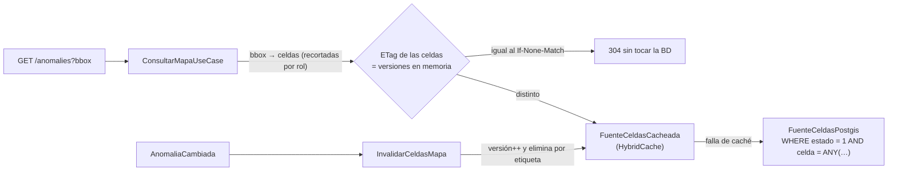

# Diseño Interno de Módulos

> **Proyecto:** KillaUru · **Versión:** 3.0 · **Revisión:** 2026-10-14 · **Estado:** Vigente (rediseñado desde `01-analisis-del-sistema` y `02-arquitectura-de-software`)
> **Stack:** ASP.NET Core 10 · EF Core + NetTopologySuite · PostgreSQL + PostGIS · Kotlin + Room + WorkManager + LiteRT
> **Relacionados:** `principios-de-diseño.md`, `patrones-de-diseño.md`, `enfoque-arquitectonico.md`, `componentes-arquitectonicos.md`, `09-reglas-de-negocio.md`

## 1. Propósito

Este documento baja la arquitectura al **código y a los datos**: cómo se organiza la solución, cómo se diseñan las tablas, la caché y la base local del celular, y cómo se escribe el código de los flujos críticos. Cada decisión indica **qué métrica protege** (RNF) y **qué regla implementa** (RN), para que un cambio futuro sepa qué no debe romper.

**Módulo de referencia:** Anomalías, porque concentra las reglas de negocio. Los demás módulos siguen la misma plantilla con menos reglas.

## 2. Estructura de la solución

```text
KillaUru.sln
├── src/
│   ├── KillaUru.Api/                     Host: Program.cs, middleware, límite de tasa, salud, composición
│   ├── KillaUru.Shared/                  Kernel: value objects, IPublicadorEventos, IMetricas
│   └── Modules/
│       ├── KillaUru.Identidad/           un .csproj por módulo
│       ├── KillaUru.Ingesta/
│       ├── KillaUru.Anomalias/
│       ├── KillaUru.Mapa/
│       ├── KillaUru.Dashboard/
│       └── KillaUru.Auditoria/
├── tests/
│   ├── KillaUru.<Modulo>.Tests/          dominio y aplicación (sin BD)
│   ├── KillaUru.Integracion.Tests/       Testcontainers (PostgreSQL + PostGIS) y WebApplicationFactory
│   └── KillaUru.Arquitectura.Tests/      NetArchTest (RNF-28)
└── db/migraciones/                       migraciones SQL versionadas, ejecutadas como paso explícito (RNF-18)
```

Dentro de cada proyecto de módulo:

```text
KillaUru.Anomalias/
├── Contracts/        public   → IAnomaliasService, IAnomaliaLectura, EventoReportado, ContextoReporte, AnomaliaCambiada
├── Domain/           internal → Anomalia, ReporteAnomalia, políticas, AnomaliasOptions
├── Application/      internal → casos de uso y puertos (IAnomaliaRepository)
├── Adapters/         internal → ModeracionController, ExportacionController, DTOs HTTP
├── Infrastructure/   internal → AnomaliasDbContext, AnomaliaRepositoryPostgis, jobs
└── AnomaliasModule.cs public  → AddAnomaliasModule(...): única puerta de registro
```

**Por qué un proyecto por módulo:** todo es `internal` salvo `Contracts/` y el registro. Si otro módulo intenta usar `Anomalia` o `AnomaliasDbContext`, **no compila**. La regla 2 de `estilo-arquitectonico.md` queda garantizada por el compilador, y NetArchTest solo vigila las capas internas. Son 8 proyectos de producción, una cantidad que una persona maneja sin problema.

**`Directory.Build.props`** (común a todos): `net10.0`, `Nullable=enable`, `TreatWarningsAsErrors=true`, `AnalysisLevel=latest-recommended`, `InvariantGlobalization=true`.

## 3. Diseño de la base de datos (PostgreSQL + PostGIS)

### 3.1 Criterios de modelado

| Criterio | Decisión | Qué protege |
|---|---|---|
| Un esquema por módulo, sin llaves foráneas entre esquemas | `identidad`, `ingesta`, `anomalias`, `auditoria`, `dashboard` | Independencia de módulos (regla 3, RNF-28) |
| Lo que **nunca cambia** se calcula **una vez** al escribir | La posición de la anomalía es fija (RN-05), así que su `celda` se guarda en una columna | p95 del mapa (RNF-01): se consulta por un entero, no por geometría |
| Índices **parciales** para las consultas calientes | Mapa, caducidad, barredor y purgas usan índices con `WHERE` | Índices pequeños que caben en memoria |
| Enumeraciones como `smallint` con `CHECK` | Estados, tipos y motivos | 2 bytes por fila e integridad en la BD |
| Tiempos en `timestamptz` (UTC) | Toda hora se guarda en UTC; el día local (UTC−5) se calcula en el dominio | RN-12 sin errores de zona horaria |
| Datos personales mínimos | El seudónimo vive en una **columna** que se pone en `NULL` a las 72 h (RN-09); nunca dentro del `JSONB` | Purga barata (un `UPDATE` de una columna) y fácil de auditar (EQ-04) |
| Sin particionado en v1.0 | `evento_recibido` necesita una llave única solo por `evento_id` para la idempotencia; PostgreSQL exige que la llave única de una tabla particionada incluya la columna de partición | Idempotencia de extremo a extremo (DA-02). Las purgas se hacen con `DELETE` por lotes sobre un índice |

### 3.2 Esquema `ingesta` (dueño: Ingesta)

```sql
CREATE TABLE ingesta.evento_recibido (
    evento_id      uuid        PRIMARY KEY,                 -- idempotencia (DA-02)
    lote_id        uuid        NOT NULL,
    recibido_utc   timestamptz NOT NULL,
    detectado_utc  timestamptz NOT NULL,                    -- hora GPS del celular (RF-03)
    seudonimo      uuid        NULL,                        -- NULL a las 72 h de recibido (RN-09)
    con_sesion     boolean     NOT NULL,                    -- según el token del lote (RN-14)
    estado         smallint    NOT NULL DEFAULT 0 CHECK (estado IN (0, 1, 2)),  -- 0 Recibido · 1 Procesado · 2 Descartado
    motivo         smallint    NULL,                        -- MotivoDescarte del procesamiento
    payload        jsonb       NOT NULL                     -- evento tal como llegó, sin seudónimo (ADR-014)
);
CREATE INDEX ix_recibido_pendiente ON ingesta.evento_recibido (recibido_utc) WHERE estado = 0;      -- barredor (EQ-09)
CREATE INDEX ix_recibido_tope      ON ingesta.evento_recibido (seudonimo, detectado_utc)
                                    WHERE seudonimo IS NOT NULL;                                    -- conteo de RN-15a
CREATE INDEX ix_recibido_fecha     ON ingesta.evento_recibido (recibido_utc);                        -- purgas de 72 h y 30 días
```

### 3.3 Esquema `anomalias` (dueño: Anomalías)

```sql
CREATE TABLE anomalias.anomalia (
    id                    uuid        PRIMARY KEY,          -- UUIDv7: ordenado por tiempo, buen índice
    tipo                  smallint    NOT NULL CHECK (tipo IN (1, 2)),               -- RN-01
    estado                smallint    NOT NULL CHECK (estado BETWEEN 1 AND 5),       -- RN-07
    persistencia          smallint    NOT NULL DEFAULT 0,                            -- RN-12
    severidad_mostrada    smallint    NOT NULL CHECK (severidad_mostrada BETWEEN 1 AND 5),  -- mediana (RN-05)
    posicion              geography(Point, 4326) NOT NULL,  -- fija: la del reporte que la creó (RN-05)
    celda                 bigint      NOT NULL,             -- calculada de la posición; nunca cambia
    ultima_deteccion_utc  timestamptz NOT NULL,
    vence_utc             timestamptz NOT NULL,             -- calculada por el dominio (RN-07)
    estado_desde_utc      timestamptz NOT NULL,
    actualizada_utc       timestamptz NOT NULL,             -- para updatedSince (RF-14)
    creada_por_tope       boolean     NOT NULL DEFAULT false,                        -- RN-15a
    marcas_revision       timestamptz[] NOT NULL DEFAULT '{}',                       -- vehículos tras descartar (RN-07)
    por_revisar           boolean     NOT NULL DEFAULT false
);
CREATE INDEX ix_anomalia_posicion  ON anomalias.anomalia USING gist (posicion);                     -- agrupación (ST_DWithin)
CREATE INDEX ix_anomalia_mapa      ON anomalias.anomalia (celda) WHERE estado = 1;                   -- mapa: solo Activa
CREATE INDEX ix_anomalia_vence     ON anomalias.anomalia (vence_utc) WHERE estado IN (1, 2);         -- caducidad
CREATE INDEX ix_anomalia_cambios   ON anomalias.anomalia (actualizada_utc);                          -- updatedSince
CREATE INDEX ix_anomalia_revision  ON anomalias.anomalia (actualizada_utc) WHERE por_revisar;        -- lista «Por revisar»

CREATE TABLE anomalias.reporte_anomalia (
    evento_id      uuid        PRIMARY KEY,                 -- idempotencia del procesamiento
    anomalia_id    uuid        NOT NULL REFERENCES anomalias.anomalia (id) ON DELETE CASCADE,
    detectado_utc  timestamptz NOT NULL,
    recibido_utc   timestamptz NOT NULL,
    severidad      smallint    NOT NULL CHECK (severidad BETWEEN 1 AND 5),
    confidence     real        NOT NULL,
    posicion       geography(Point, 4326) NOT NULL,
    precision_m    real        NOT NULL,
    seudonimo      uuid        NULL,                        -- NULL a las 72 h de recibido (RN-09)
    con_sesion     boolean     NOT NULL,                    -- sí/no, nunca quién (RN-14)
    modelo_version text        NOT NULL
);
CREATE INDEX ix_reporte_ventana    ON anomalias.reporte_anomalia (anomalia_id, detectado_utc DESC);  -- mediana, RN-06, RN-12
CREATE INDEX ix_reporte_seudonimo  ON anomalias.reporte_anomalia (seudonimo, detectado_utc DESC)
                                    WHERE seudonimo IS NOT NULL;                                      -- RN-15b
CREATE INDEX ix_reporte_purga      ON anomalias.reporte_anomalia (recibido_utc) WHERE seudonimo IS NOT NULL;
CREATE INDEX ix_reporte_historico  ON anomalias.reporte_anomalia (detectado_utc);                     -- purga de 2 años

CREATE TABLE anomalias.corredor_via (
    id    smallint PRIMARY KEY,
    traza geography(LineString, 4326) NOT NULL              -- PE-28A; se carga en memoria al arrancar (RN-13)
);
```

**Celda de rejilla:** cuadro de 0.005° × 0.005° (≈ 550 m, al menos 5 veces el radio de 100 m). Su identificador es un `bigint` calculado en `Shared/Domain/Celda`. La misma celda sirve para el bloqueo de concurrencia y para la clave de la caché.

### 3.4 Esquemas `identidad`, `auditoria` y `dashboard`

```sql
CREATE TABLE identidad.usuario (
    id                 uuid PRIMARY KEY,
    correo             citext      NOT NULL UNIQUE,
    hash_contrasena    text        NOT NULL,            -- PasswordHasher (PBKDF2), nunca la contraseña
    rol                smallint    NOT NULL,            -- 1 ConductorRegistrado · 2 Administrador
    activo             boolean     NOT NULL DEFAULT true,
    correo_verificado  boolean     NOT NULL DEFAULT false,
    intentos_fallidos  smallint    NOT NULL DEFAULT 0,  -- RN-19
    nivel_bloqueo      smallint    NOT NULL DEFAULT 0,
    bloqueado_hasta    timestamptz NULL,
    creado_utc         timestamptz NOT NULL
);
CREATE TABLE identidad.sesion_refresh (
    id              uuid PRIMARY KEY,
    usuario_id      uuid        NOT NULL REFERENCES identidad.usuario (id) ON DELETE CASCADE,
    familia_id      uuid        NOT NULL,               -- todos los tokens de una misma sesión
    hash_token      bytea       NOT NULL UNIQUE,        -- SHA-256 del token; el token nunca se guarda
    expira_utc      timestamptz NOT NULL,               -- 8 h administrador · 30 días conductor (RF-16, RF-21)
    usado_utc       timestamptz NULL,                   -- reuso tras 60 s → se revoca la familia (ADR-009)
    revocado_utc    timestamptz NULL
);
CREATE INDEX ix_sesion_usuario ON identidad.sesion_refresh (usuario_id) WHERE revocado_utc IS NULL;
CREATE TABLE identidad.consentimiento (
    usuario_id   uuid        NOT NULL REFERENCES identidad.usuario (id) ON DELETE CASCADE,
    documento    smallint    NOT NULL,                  -- 1 Política de privacidad · 2 Términos de uso
    version      text        NOT NULL,
    aceptado_utc timestamptz NOT NULL,
    PRIMARY KEY (usuario_id, documento, version)        -- RF-29, RF-37
);
CREATE TABLE identidad.token_correo (
    hash_token  bytea PRIMARY KEY,
    usuario_id  uuid        NOT NULL REFERENCES identidad.usuario (id) ON DELETE CASCADE,
    proposito   smallint    NOT NULL,                   -- 1 Verificación (24 h) · 2 Recuperación (30 min)
    expira_utc  timestamptz NOT NULL,
    usado_utc   timestamptz NULL
);

CREATE TABLE auditoria.registro (
    id            bigint GENERATED ALWAYS AS IDENTITY PRIMARY KEY,
    ocurrido_utc  timestamptz NOT NULL,
    actor_id      uuid        NULL,                     -- identificador interno, nunca el correo (RF-30)
    actor_rol     smallint    NULL,
    accion        smallint    NOT NULL,                 -- catálogo de RF-15
    objetivo      text        NULL,
    contexto      jsonb       NOT NULL DEFAULT '{}'
);
CREATE INDEX ix_registro_fecha ON auditoria.registro (ocurrido_utc);
CREATE INDEX ix_registro_actor ON auditoria.registro (actor_id, ocurrido_utc);
REVOKE UPDATE, DELETE, TRUNCATE ON auditoria.registro FROM killauru_app;    -- append-only en la BD (RNF-31)

CREATE TABLE dashboard.indicador_diario (
    dia        date     NOT NULL,
    indicador  smallint NOT NULL,                       -- eventos, conductores activos, dispositivos, cobertura…
    valor      numeric  NOT NULL,
    PRIMARY KEY (dia, indicador)                        -- solo números agregados (RN-17)
);
```

### 3.5 Consultas críticas y el índice que las sostiene

| Consulta | SQL (forma) | Índice | Métrica |
|---|---|---|---|
| Mapa por celdas | `WHERE estado = 1 AND celda = ANY(@celdas)` | `ix_anomalia_mapa` (B-tree parcial) | RNF-01 |
| Anomalía más cercana del mismo tipo | `WHERE tipo = @t AND ST_DWithin(posicion, @p, 100) ORDER BY posicion <-> @p LIMIT 1` | `ix_anomalia_posicion` (GiST) | RNF-23 |
| Reportes de la ventana (mediana, RN-06, RN-12) | `WHERE anomalia_id = @id AND detectado_utc >= @desde` | `ix_reporte_ventana` | RNF-23 |
| Reporte anterior del seudónimo (RN-15b) | `WHERE seudonimo = @s AND detectado_utc < @t ORDER BY detectado_utc DESC LIMIT 1` | `ix_reporte_seudonimo` | RNF-23 |
| Eventos del seudónimo en la hora (RN-15a) | `count(*) WHERE seudonimo = @s AND detectado_utc >= @hora AND < @hora + 1 h` | `ix_recibido_tope` | RNF-23 |
| Cambios para la copia offline | `WHERE actualizada_utc > @desde` | `ix_anomalia_cambios` | RF-26 |
| Caducidad (cada hora) | `UPDATE … SET estado = 3 WHERE estado IN (1, 2) AND vence_utc <= now() RETURNING id, celda` | `ix_anomalia_vence` | RN-07 |
| Barredor de recuperación | `WHERE estado = 0 AND recibido_utc < now() - 1 min` | `ix_recibido_pendiente` | EQ-09 |

**Caducidad sin cargar agregados:** el dominio calcula `vence_utc` cada vez que registra un reporte (episódica +72 h, persistente +7 días, pendiente +72 h). La tarea horaria solo compara una fecha con un `UPDATE` masivo, así la regla sigue en el dominio y el proceso cuesta una consulta.

### 3.6 Volumen esperado y holgura

Estimación con el supuesto S-01 (300 dispositivos, ~10 h de manejo al día y ~16 eventos por hora, como el ejemplo de RN-15): unos **48 000 eventos por día**.

| Tabla | Filas | Tamaño aprox. (con índices) | Comentario |
|---|---|---|---|
| `evento_recibido` (30 días) | ~1,5 millones | ~1 GB | Se purga a diario |
| `reporte_anomalia` (2 años) | ~35 millones | ~8 GB | Las consultas siempre usan `anomalia_id` o `seudonimo` |
| `anomalia` | decenas de miles | < 50 MB | El índice del mapa solo contiene las `Activa` |
| `auditoria.registro` | miles por mes | < 1 GB en años | Permanente |

Caben de sobra en el disco de la VM Always Free. Si `reporte_anomalia` pasa de ~100 millones de filas, se particiona por `detectado_utc` (sección 9).

### 3.7 Roles, migraciones y configuración

| Elemento | Decisión |
|---|---|
| Roles de BD | `killauru_migrador` (DDL, solo durante el paso de migración) y `killauru_app` (solo DML, sin `UPDATE`/`DELETE` en auditoría). Contraseñas en el inventario de secretos (RNF-34) |
| Migraciones | Scripts SQL versionados en `db/migraciones/`, ejecutados como paso explícito antes del despliegue, precedidos de un `pg_dump`, y en dos fases (agregar primero, borrar después) (RNF-18) |
| EF Core | Un `DbContext` por módulo con `HasDefaultSchema`; NetTopologySuite para `geography`; lecturas con `AsNoTracking`; consultas compiladas en el camino caliente |
| Conexiones | Un pool de Npgsql de 30 conexiones como máximo (`Maximum Pool Size=30`), suficiente para los trabajadores, las peticiones HTTP y las tareas |
| PostgreSQL | `shared_buffers` ≈ 25 % de la RAM, `effective_cache_size` ≈ 70 %, `random_page_cost = 1.1` (disco SSD) y `jit = off` (consultas cortas). Ajustar en el piloto |

### 3.8 Tareas de mantenimiento (SQL)

| Tarea | Frecuencia | Sentencia (forma) | Regla |
|---|---|---|---|
| Caducidad | Cada hora | `UPDATE anomalias.anomalia SET estado = 3 … WHERE estado IN (1, 2) AND vence_utc <= now()`; publica `AnomaliaCambiada` por cada fila | RN-07 |
| Purga de seudónimos | Cada hora | `UPDATE … SET seudonimo = NULL WHERE seudonimo IS NOT NULL AND recibido_utc < now() - interval '72 hours'` en **ambas** tablas | RN-09 |
| Purga de recepción | Diaria | `DELETE … WHERE recibido_utc < now() - interval '30 days'`, en lotes de 5 000 | RN-10 |
| Purga histórica | Diaria | Borra reportes de más de 2 años y anomalías que llevan 2 años en estado final | RN-10 |
| Indicadores | Diaria | Cuenta seudónimos distintos del día **antes** de la purga y guarda solo el número | RN-17 |

Cada tarea guarda su última ejecución correcta (métrica, RNF-22); Grafana alerta si pasan más de 26 h sin ejecutarse.

## 4. Diseño de la caché del mapa



| Aspecto | Decisión | Motivo |
|---|---|---|
| Tecnología | **HybridCache** de .NET (su nivel 1 es `IMemoryCache` en proceso, ADR-006) | Protección contra estampida (una sola consulta por clave aunque lleguen 300 peticiones a la vez), invalidación por etiqueta y un nivel 2 (Redis) **opcional** sin cambiar el código cuando haya más de una instancia (S-03) |
| Clave | `celda:{id}:{alcance}`, con alcance = `Anonimo` o `Registrado` | Nunca se mezclan roles (RNF-27). El administrador, que usa filtros, no pasa por la caché |
| Valor | Las *features* de la celda ya **serializadas a UTF-8** | La respuesta se arma concatenando bytes; no se vuelve a serializar en cada petición |
| Recorte del anónimo | `ZonaDemo` precalcula al arrancar qué celdas están **dentro** del polígono demo y cuáles en el **borde**. Las del borde se filtran punto por punto en memoria **antes** de guardarse con alcance `Anonimo` | Sin cálculo espacial por petición |
| Vigencia | 10 min absolutos **más** invalidación inmediata por `AnomaliaCambiada` | Los datos nunca quedan viejos más de lo que tarda un evento en llegar |
| ETag | Hash de (instante de arranque del proceso, alcance, versiones de las celdas pedidas) | Un 304 se resuelve en memoria. El instante de arranque evita que, tras un reinicio, una versión repetida dé un 304 falso |
| Tamaño | Límite de 64 MB (`SizeLimit`) | El corredor tiene ~1 000 celdas × 2 alcances: cabe holgado |
| Borde (Cloudflare) | `Cache-Control: public, max-age=60` **solo** sin token; con token, `private, no-store` | Ningún anónimo recibe una respuesta de un registrado (ADR-006) |
| `updatedSince` | No usa la caché; consulta `ix_anomalia_cambios` y devuelve las bajas como `{id, eliminada: true}` | Respuesta personalizada por fecha, poco frecuente |

## 5. Ingesta y procesamiento concurrente

| Paso | Diseño | Métrica |
|---|---|---|
| 1. Recepción | Reglas de recepción en memoria (sin BD) y **un solo `INSERT`** con `unnest` para todo el lote (sección 6.4) | RNF-02: < 300 ms p95 |
| 2. Aviso | `Channel<LoteRecibido>` acotado (`IngestaOptions.CapacidadCola`, inicial 2 000 lotes). Si está lleno → 503 con `Retry-After` | Contrapresión (DA-05) |
| 3. Procesamiento | `IngestaOptions.Trabajadores` consumidores en paralelo (inicial = núcleos de la VM). Cada evento va en **su propia transacción** de Anomalías con `pg_advisory_xact_lock` sobre sus celdas, en orden ascendente | RNF-23: ≤ 100 ms por evento; celdas distintas en paralelo, la misma zona en serie, sin interbloqueos |
| 4. Recuperación | Barredor cada 60 s y al arrancar | EQ-09 |
| 5. Idempotencia | Llave primaria `evento_id` en las dos tablas | DA-02 |

**Capacidad estimada:** un evento cuesta ~5 consultas indexadas (~5–15 ms). Con 4 trabajadores son ≥ 250 eventos por segundo. El pico de RNF-03 (300 clientes × 500 eventos en 10 min) es de ~250 eventos por segundo, así que la cola se mantiene por debajo del límite de 30 s de RNF-23. Si no alcanza en la prueba de carga, se suben los trabajadores por configuración.

## 6. Código de referencia (backend)

El código es un **esqueleto fiel**: muestra la forma y el tamaño esperados, no cada línea.

### 6.1 Kernel compartido

```csharp
// KillaUru.Shared/Domain — value objects: inmutables y siempre válidos
public readonly record struct Severidad
{
    public int Valor { get; }
    private Severidad(int valor) => Valor = valor;            // nadie crea una severidad inválida

    public static Severidad? Crear(int v) => v is >= 1 and <= 5 ? new(v) : null;

    // RN-05: mediana de la ventana, redondeada hacia arriba
    public static Severidad MedianaHaciaArriba(IEnumerable<Severidad> valores)
    {
        var v = valores.Select(s => s.Valor).Order().ToArray();
        var m = v.Length % 2 == 1 ? v[v.Length / 2] : (v[v.Length / 2 - 1] + v[v.Length / 2]) / 2.0;
        return new((int)Math.Ceiling(m));
    }
}

public readonly record struct Celda(long Id)
{
    private const double Paso = 0.005;   // ≈ 550 m ≥ 5 × RadioAgrupacionMetros

    public static Celda De(Coordenada c) =>
        new(((long)Math.Floor(c.Latitud / Paso) + 18_000) * 100_000 + (long)Math.Floor(c.Longitud / Paso) + 36_000);

    // Celdas que toca un cuadro de ±metros alrededor del punto, en orden fijo (evita interbloqueos)
    public static IReadOnlyList<Celda> Alrededor(Coordenada c, double metros)
    {
        var d = metros / 100_000.0;   // grados, con holgura
        return new[] { (-d, -d), (-d, d), (d, -d), (d, d) }
            .Select(x => De(c with { Latitud = c.Latitud + x.Item1, Longitud = c.Longitud + x.Item2 }))
            .Distinct().OrderBy(x => x.Id).ToArray();
    }
}
```

### 6.2 Dominio de Anomalías

```csharp
// Anomalia.cs — agregado: única puerta para cambiar estado, severidad y persistencia
internal sealed class Anomalia
{
    // RN-07: acciones del administrador y desde qué estados valen
    private static readonly Dictionary<AccionAdmin, EstadoAnomalia[]> PermitidoDesde = new()
    {
        [AccionAdmin.MarcarReparada] = [EstadoAnomalia.Activa, EstadoAnomalia.PendienteConfirmacion],
        [AccionAdmin.Descartar]      = [EstadoAnomalia.Activa, EstadoAnomalia.PendienteConfirmacion, EstadoAnomalia.Expirada],
        [AccionAdmin.Reabrir]        = [EstadoAnomalia.Reparada, EstadoAnomalia.Descartada],
    };

    public Guid Id { get; private set; }
    public TipoAnomalia Tipo { get; private set; }
    public Coordenada Posicion { get; private set; }          // fija (RN-05)
    public Celda Celda { get; private set; }
    public EstadoAnomalia Estado { get; private set; }
    public Severidad SeveridadMostrada { get; private set; }
    public EstadoPersistencia Persistencia { get; private set; }
    public DateTimeOffset UltimaDeteccionUtc { get; private set; }
    public DateTimeOffset VenceUtc { get; private set; }
    public DateTimeOffset EstadoDesdeUtc { get; private set; }
    public bool CreadaPorTope { get; private set; }
    public bool PorRevisar { get; private set; }
    public List<DateTimeOffset> MarcasRevision { get; private set; } = [];

    private Anomalia() { }   // EF Core

    public static Anomalia Crear(ReporteAnomalia r, bool porTope) => new()
    {
        Id = Guid.CreateVersion7(), Tipo = r.Tipo, Posicion = r.Ubicacion, Celda = Celda.De(r.Ubicacion),
        Estado = EstadoAnomalia.PendienteConfirmacion,          // RegistrarReporte decide si se publica
        SeveridadMostrada = r.Severidad, UltimaDeteccionUtc = r.DetectadoUtc,
        EstadoDesdeUtc = r.DetectadoUtc, CreadaPorTope = porTope,
    };

    // RN-05, RN-06, RN-07, RN-12 y RN-14. `ventana` ya incluye el reporte nuevo.
    public void RegistrarReporte(ReporteAnomalia r, IReadOnlyList<ReporteAnomalia> ventana, ReglasAnomalia reglas)
    {
        if (Estado == EstadoAnomalia.Descartada) { AnotarParaRevision(r, ventana, reglas); return; }
        if (Estado is EstadoAnomalia.Expirada or EstadoAnomalia.Reparada)
        {
            var vencio = Estado == EstadoAnomalia.Expirada ? VenceUtc : EstadoDesdeUtc;
            if (r.DetectadoUtc <= vencio) return;                // detectado antes de vencer: no reactiva
            CambiarEstado(EstadoAnomalia.PendienteConfirmacion, r.DetectadoUtc);   // vuelve a nacer
        }

        UltimaDeteccionUtc = r.DetectadoUtc > UltimaDeteccionUtc ? r.DetectadoUtc : UltimaDeteccionUtc;
        SeveridadMostrada = Severidad.MedianaHaciaArriba(ventana.Select(x => x.Severidad));
        Persistencia = reglas.Persistencia.Evaluar(ventana.Select(x => x.DetectadoUtc), UltimaDeteccionUtc);
        if (Estado == EstadoAnomalia.PendienteConfirmacion)
            CambiarEstado(reglas.Confirmacion.Decidir(ventana, SeveridadMostrada, CreadaPorTope, UltimaDeteccionUtc), UltimaDeteccionUtc);
        VenceUtc = UltimaDeteccionUtc + reglas.Caducidad(Estado, Persistencia);
    }

    public ResultadoModeracion Moderar(AccionAdmin accion, DateTimeOffset ahora)
    {
        if (!PermitidoDesde[accion].Contains(Estado)) return ResultadoModeracion.NoPermitida(Estado);
        CambiarEstado(accion switch
        {
            AccionAdmin.MarcarReparada => EstadoAnomalia.Reparada,
            AccionAdmin.Descartar      => EstadoAnomalia.Descartada,
            _                          => EstadoAnomalia.Activa,   // reabrir: verificada por el administrador
        }, ahora);
        MarcasRevision.Clear(); PorRevisar = false;
        return ResultadoModeracion.Hecha;
    }

    // RN-07: una Descartada absorbe reportes; ≥ 3 vehículos en 7 días → «Por revisar»
    private void AnotarParaRevision(ReporteAnomalia r, IReadOnlyList<ReporteAnomalia> ventana, ReglasAnomalia reglas)
    {
        if (reglas.Confirmacion.EsVehiculoNuevo(r, ventana)) MarcasRevision.Add(r.DetectadoUtc);
        MarcasRevision.RemoveAll(m => m < r.DetectadoUtc - reglas.VentanaRevision);
        PorRevisar = MarcasRevision.Count >= reglas.VehiculosRevision;
    }

    private void CambiarEstado(EstadoAnomalia nuevo, DateTimeOffset desde) => (Estado, EstadoDesdeUtc) = (nuevo, desde);
}
```

```csharp
// PoliticaConfirmacion.cs — RN-06, RN-14 y RN-15a en un solo lugar
internal sealed class PoliticaConfirmacion(AnomaliasOptions o)
{
    public EstadoAnomalia Decidir(IReadOnlyList<ReporteAnomalia> ventana, Severidad mostrada, bool porTope, DateTimeOffset ultima)
    {
        var recientes = ventana.Where(r => r.DetectadoUtc >= ultima.AddHours(-o.VentanaConfirmacionHoras)).ToList();
        var grave = EsAlta(mostrada) || recientes.Any(r => EsAlta(r.Severidad));
        if (!grave && !porTope) return EstadoAnomalia.Activa;                       // severidad 1–3: se publica
        return HayDosVehiculos(recientes, exigeSesion: grave)                       // RN-14 solo para lo grave
            ? EstadoAnomalia.Activa : EstadoAnomalia.PendienteConfirmacion;
    }

    // Distinto vehículo = distinto seudónimo y ≥ 3 min de separación (los celulares de un colectivo cuentan como uno)
    public bool EsVehiculoNuevo(ReporteAnomalia r, IReadOnlyList<ReporteAnomalia> ventana) =>
        ventana.Where(x => x.EventoId != r.EventoId && x.Seudonimo is not null)
               .All(x => SonVehiculosDistintos(x, r));

    private bool HayDosVehiculos(List<ReporteAnomalia> rs, bool exigeSesion) =>
        rs.Any(a => rs.Any(b => SonVehiculosDistintos(a, b) && (!exigeSesion || a.ConSesion || b.ConSesion)));

    private bool SonVehiculosDistintos(ReporteAnomalia a, ReporteAnomalia b) =>
        a.Seudonimo is { } sa && b.Seudonimo is { } sb && sa != sb &&
        (a.DetectadoUtc - b.DetectadoUtc).Duration() >= TimeSpan.FromMinutes(o.SeparacionMinimaMinutos);

    private bool EsAlta(Severidad s) => s.Valor >= o.SeveridadAltaDesde;
}
```

`ReglasAnomalia` es un `record` que agrupa lo que necesita el agregado: las políticas (`Confirmacion`, `Persistencia`) y los parámetros de `AnomaliasOptions` ya convertidos a `TimeSpan` (radio, ventanas, caducidades). Así el agregado recibe **un** parámetro en vez de diez.

**Por qué la revisión de una `Descartada` usa marcas y no seudónimos:** RN-07 cuenta vehículos en 7 días, pero el seudónimo se borra a las 72 h (RN-09). Por eso, cuando llega cada reporte (y su seudónimo todavía existe), se decide si es un vehículo nuevo y se guarda solo **la hora** en `marcas_revision`. Límite aceptado: un mismo celular que pasa por el punto en días distintos, con más de 72 h entre pasadas, puede contar dos veces. El efecto es solo pedirle al administrador que revise; nada se publica solo.

### 6.3 Caso de uso de Anomalías

```csharp
// ProcesarReporteUseCase.cs — coordina; las reglas viven en el dominio
internal sealed class ProcesarReporteUseCase(
    IAnomaliaRepository repositorio, ReglasCalidad calidad, PoliticaPlausibilidad plausibilidad,
    ReglasAnomalia reglas, IPublicadorEventos eventos, IMetricas metricas, TimeProvider reloj)
{
    public async Task<ResultadoProceso> EjecutarAsync(EventoReportado evento, ContextoReporte contexto, CancellationToken ct)
    {
        var reporte = ReporteAnomalia.Desde(evento, contexto.ConSesion);
        await using var tx = await repositorio.AbrirAsync(Celda.Alrededor(reporte.Ubicacion, reglas.Radio), ct);
        if (await repositorio.ExisteReporteAsync(reporte.EventoId, ct)) return ResultadoProceso.YaProcesado;

        var motivo = calidad.EvaluarIntrinseca(reporte, reloj.GetUtcNow())
                  ?? plausibilidad.Evaluar(reporte, await repositorio.AnteriorDelSeudonimoAsync(reporte, ct));
        if (motivo is { } m) { metricas.RegistrarDescarte(m); return ResultadoProceso.Descartado(m); }

        var anomalia = await repositorio.MasCercanaAsync(reporte, ct)
                    ?? Anomalia.Crear(reporte, porTope: plausibilidad.SuperaTope(contexto.EventosEnLaHora));
        var ventana = await repositorio.ReportesDesdeAsync(anomalia.Id, reporte.DetectadoUtc - reglas.VentanaMaxima, ct);
        anomalia.RegistrarReporte(reporte, [.. ventana, reporte], reglas);

        await repositorio.GuardarAsync(anomalia, reporte, ct);
        await tx.ConfirmarAsync(ct);
        await eventos.PublicarAsync(new AnomaliaCambiada(anomalia.Id, anomalia.Celda.Id), ct);   // después del commit
        return ResultadoProceso.Procesado;
    }
}
```

`AbrirAsync` abre la transacción y toma `pg_advisory_xact_lock` por cada celda en el orden recibido. El bloqueo se libera solo con el *commit* o el *rollback*.

### 6.4 Ingesta: un lote = una consulta

```csharp
// RecepcionEventosPostgres.cs — persiste los aceptados en un solo viaje a la BD (RNF-02)
internal sealed class RecepcionEventosPostgres(IngestaDbContext db) : IRecepcionEventos
{
    private const string Sql = """
        INSERT INTO ingesta.evento_recibido (evento_id, lote_id, recibido_utc, detectado_utc, seudonimo, con_sesion, payload)
        SELECT u.id, @lote, @ahora, u.detectado, u.seudonimo, @sesion, u.payload
        FROM unnest(@ids, @detectados, @seudonimos, @payloads) AS u(id, detectado, seudonimo, payload)
        ON CONFLICT (evento_id) DO NOTHING
        RETURNING evento_id AS "Value"
        """;

    public async Task<IReadOnlySet<Guid>> InsertarAsync(LoteAceptado lote, CancellationToken ct) =>
        (await db.Database.SqlQueryRaw<Guid>(Sql, lote.ComoParametros()).ToListAsync(ct)).ToHashSet();
        // ids devueltos = aceptados nuevos; el resto del lote aceptado = duplicados
}
```

### 6.5 Consulta de Mapa: *Decorator* sobre un puerto de un método

```csharp
internal interface IFuenteCeldas
{
    ValueTask<CeldaGeoJson> ObtenerAsync(Celda celda, Alcance alcance, CancellationToken ct);
}

// Decorator: misma interfaz, agrega la caché sin tocar FuenteCeldasPostgis (abierto/cerrado)
internal sealed class FuenteCeldasCacheada(IFuenteCeldas origen, HybridCache cache) : IFuenteCeldas
{
    public ValueTask<CeldaGeoJson> ObtenerAsync(Celda celda, Alcance alcance, CancellationToken ct) =>
        cache.GetOrCreateAsync($"celda:{celda.Id}:{alcance}",
            token => origen.ObtenerAsync(celda, alcance, token),
            tags: [$"celda:{celda.Id}"], cancellationToken: ct);
}

// Observer: Anomalías avisa; Mapa invalida (Anomalías no sabe que esto existe)
internal sealed class InvalidarCeldasMapa(HybridCache cache, VersionesCelda versiones) : IManejador<AnomaliaCambiada>
{
    public async Task ManejarAsync(AnomaliaCambiada e, CancellationToken ct)
    {
        versiones.Incrementar(e.Celda);
        await cache.RemoveByTagAsync($"celda:{e.Celda}", ct);
    }
}
```

`CeldaGeoJson` es un tipo `sealed` marcado con `[ImmutableObject(true)]` que guarda solo un `byte[]`: así HybridCache devuelve la misma instancia en cada acierto, sin copiarla. Registro en `MapaModule.cs`: `services.AddSingleton<IFuenteCeldas>(sp => new FuenteCeldasCacheada(new FuenteCeldasPostgis(...), ...))`. Quitar la caché es borrar esa envoltura.

### 6.6 Controlador: solo traduce HTTP

```csharp
[ApiController, Route("api/v1/anomalies")]
internal sealed class SyncController(RecibirLoteEventosUseCase recibir) : ControllerBase
{
    [HttpPost("batch"), RequestSizeLimit(256 * 1024)]
    public async Task<IActionResult> Recibir(LoteDto dto, CancellationToken ct) =>
        await recibir.EjecutarAsync(dto.ALote(User), ct) switch
        {
            ResultadoLote.Aceptado r => Ok(RespuestaLoteDto.De(r)),
            ResultadoLote.Saturado s => this.Saturado(s.ReintentarEn),     // 503 + Retry-After
            _                        => BadRequest(),                      // lote ilegible, vacío o > 50
        };
}
```

### 6.7 Identidad y Accesos

| Tema | Diseño |
|---|---|
| Contraseñas | `PasswordHasher<Usuario>` de `Microsoft.Extensions.Identity.Core` (PBKDF2 con sal), sin adoptar todo ASP.NET Identity |
| Token de acceso | JWT de 5 min firmado con una clave del inventario de secretos (RNF-34); lleva solo `sub` y `rol` |
| Token de actualización | 32 bytes aleatorios; se guarda su SHA-256. Cada uso rota el token dentro de la misma `familia_id`. Si se reusa uno ya usado dentro de 60 s, se emite un par nuevo; después de 60 s, se revoca toda la familia (ADR-009) |
| Desactivación | Revoca todas las familias del usuario; el JWT vigente muere solo en ≤ 5 min (RNF-26) |
| Bloqueo | `intentos_fallidos`, `nivel_bloqueo` y `bloqueado_hasta` en `usuario`, según RN-19; respuesta idéntica exista o no la cuenta |
| Auditoría | `IAuditoriaService.RegistrarAsync` dentro de la misma transacción de la acción (ADR-013) |

## 7. App Android

### 7.1 Estructura

Un solo módulo Gradle organizado **por funcionalidad**, cada una con sus tres capas (`dominio`, `datos`, `ui`): `deteccion`, `sincronizacion`, `mapa`, `alertas`, `sesion`, `historial`, `actualizador`. Hilt conecta las implementaciones. Un solo módulo evita la complejidad de compilación de varios; la separación por paquetes y la regla de dependencia se revisan con Konsist o una prueba equivalente.

### 7.2 Base local (Room / SQLite)

```kotlin
@Entity(tableName = "evento", indices = [Index("estado", "detectadoUtc")])
data class EventoEntity(
    @PrimaryKey val eventoId: String,          // UUID generado en el celular (RF-03)
    val detectadoUtc: Long,                    // hora del fix GPS, en ms (RF-03)
    val lat: Double, val lon: Double, val precisionM: Float,
    val tipo: Int, val severidad: Int, val confidence: Float,
    val modeloVersion: String, val seudonimo: String,
    val estado: EstadoLocal,                   // PENDING · ENVIANDO · SYNCED · REJECTED_LOCAL · EXPIRADO_LOCAL
    val estadoDesde: Long,                     // para purgar estados finales a los 7 días
)

@Entity(tableName = "anomalia", indices = [Index("km")])
data class AnomaliaEntity(
    @PrimaryKey val id: String,
    val tipo: Int, val severidad: Int, val persistente: Boolean,
    val lat: Double, val lon: Double,
    val km: Double,                            // posición sobre la vía, calculada UNA vez al descargar
    val venceUtc: Long,                        // la envía el servidor (RN-07): sin recalcular reglas en el celular
)

@Entity(tableName = "recorrido")
data class RecorridoEntity(                    // historial: solo resúmenes, 6 meses (RF-25)
    @PrimaryKey(autoGenerate = true) val id: Long = 0,
    val inicioUtc: Long, val finUtc: Long, val kmDesde: Double, val kmHasta: Double, val eventos: Int,
)

@Dao
interface AnomaliaDao {
    @Query("SELECT * FROM anomalia WHERE km BETWEEN :desde AND :hasta AND venceUtc > :ahora")
    suspend fun enTramo(desde: Double, hasta: Double, ahora: Long): List<AnomaliaEntity>

    @Upsert suspend fun guardar(lista: List<AnomaliaEntity>)
    @Query("DELETE FROM anomalia WHERE id IN (:ids)") suspend fun borrar(ids: List<String>)   // bajas de updatedSince
}
```

| Dato | Dónde | Por qué |
|---|---|---|
| Eventos, anomalías locales, recorridos | Room (SQLite, modo WAL) | Consultas indexadas y transacciones |
| Seudónimo, categoría, «Solo ver el mapa», versiones aceptadas, última sincronización | DataStore | Ajustes pequeños de clave y valor |
| Tokens y permiso local (RN-21) | DataStore cifrado con Android Keystore | Datos sensibles |
| Mapa base (PMTiles), polilínea con kilómetros acumulados, modelo TFLite | Archivos verificados con SHA-256 | Archivos grandes y versionados por manifiesto |

**Presupuesto de almacenamiento (RNF-15, < 100 MB sin mapa base):** un evento ocupa ~150 B y se purga a los 7 días de su estado final; el corredor completo son unos miles de anomalías (< 1 MB); 6 meses de recorridos son < 1 MB. El total esperado es de unos pocos MB.

### 7.3 Alertas a lo largo de la vía (RN-16) sin geometría pesada

1. La **polilínea** del corredor se descarga con el kilómetro acumulado de cada vértice.
2. Al descargar cada anomalía, se **proyecta una vez** sobre la polilínea y se guarda su `km`.
3. Con cada fix GPS (1 Hz), `Corredor.proyectar(fix)` busca el segmento cercano **a partir del último segmento usado** (costo casi constante) y devuelve el `km` actual y el **sentido** de la marcha. Si el vehículo está a más de 50 m de la vía, no hay alerta.
4. La consulta de alertas es un **rango por índice**: `km` entre la posición actual y la posición más la distancia de aviso, en el sentido de la marcha.

```kotlin
class ProximidadUseCase(private val corredor: Corredor, private val dao: AnomaliaDao, private val reloj: Clock) {
    private val avisadas = mutableMapOf<String, Double>()          // id → km, para «una vez por pasada»

    suspend fun evaluar(fix: Location, p: ParametrosAviso): List<AnomaliaEntity> {
        val pos = corredor.proyectar(fix) ?: return emptyList()    // fuera de la vía
        val alcanceKm = maxOf(p.minimoM, fix.speed * p.segundos) / 1000.0   // RN-16 (Strategy por categoría)
        avisadas.entries.removeIf { abs(it.value - pos.km) > p.finPasadaKm } // la pasada terminó (500 m)
        val (desde, hasta) = if (pos.sentido > 0) pos.km to pos.km + alcanceKm else pos.km - alcanceKm to pos.km
        return dao.enTramo(desde, hasta, reloj.millis()).filter { avisadas.putIfAbsent(it.id, it.km) == null }
    }
}
```

Si la lista trae más de una anomalía, `Alertas` emite **una sola** alerta que dice cuántas son (RN-16), con el sonido de RN-20.

### 7.4 Detección eficiente en batería (RNF-15)

| Técnica | Efecto |
|---|---|
| Sensores en lote (`registerListener` con `maxReportLatencyUs` ≈ 1 s) | El procesador despierta 1 vez por segundo, no 50 |
| Acelerómetro y giroscopio **apagados** por debajo de la velocidad de RN-03 o en las situaciones de RN-18 y RN-22 | Cero costo de sensores con el vehículo detenido |
| **Prefiltro de energía**: la ventana solo pasa al modelo si su variación vertical supera un umbral mínimo | En una pista lisa, el modelo casi no corre |
| GPS a 1 Hz con `LocationManagerCompat` (sin depender de Google Play Services) | Funciona en cualquier Android con GPS |
| Inferencia LiteRT con un intérprete reutilizado y *buffers* preasignados | Sin basura en memoria por ventana; < 50 ms (RNF-04) |

### 7.5 Sincronización

- `WorkManager` con un **trabajo único** (`sync`) y la restricción de red conectada. Además, un `NetworkCallback` lo lanza apenas vuelve la señal (≤ 60 s, RNF-33).
- Cada ejecución toma hasta 50 eventos `PENDING`, **los más antiguos primero** (índice `estado, detectadoUtc`), los marca `ENVIANDO` y aplica el contrato de RF-06.
- El backoff de RF-07 lo calcula la app y programa el siguiente trabajo con `setInitialDelay`, porque el backoff propio de WorkManager no sigue esa secuencia.
- Al iniciar la app, todo evento que quedó en `ENVIANDO` vuelve a `PENDING`.

## 8. Presupuesto de rendimiento frente a las métricas

| Métrica | Meta | Costo esperado por diseño | Dónde se mide |
|---|---|---|---|
| RNF-01 mapa | p95 < 250 ms (API) | Acierto: ~1 ms · 304: < 1 ms · fallo de caché: 1 consulta por B-tree (~5–20 ms) | Grafana p95 + k6 |
| RNF-02 lote | p95 < 300 ms | Reglas en memoria (< 1 ms) + 1 `INSERT` con `unnest` (~5–15 ms) | Grafana p95 |
| RNF-23 procesamiento | ≤ 100 ms por evento | ~5 consultas indexadas (~5–15 ms) | Métrica interna |
| RNF-03 concurrencia | 300 dispositivos | Cola acotada + N trabajadores + bloqueo por celda | k6, perfil de RNF-03 |
| RNF-04 inferencia | p95 < 50 ms | MLP cuantizado: pocos ms | *Benchmark* en 3 celulares |
| RNF-15 batería y almacenamiento | ≤ 5 %/h · < 100 MB | Sensores en lote, prefiltro y purgas | Perfilado en campo |
| RNF-06 ningún evento perdido | 0 pérdidas | 200 solo tras el *commit*; barredor | Prueba de reinicio (EQ-09) |

## 9. Escalabilidad: qué cambia cuando el sistema crezca

| Disparador | Cambio | Qué **no** cambia |
|---|---|---|
| Más de una instancia de la API (S-03) | Nivel 2 de HybridCache con Redis; `VersionesCelda` en Redis; el barredor de cada instancia toma filas con `FOR UPDATE SKIP LOCKED` (la tabla de recepción ya es una cola durable) | Casos de uso, dominio y contratos |
| `reporte_anomalia` > ~100 millones de filas | Particionar por `detectado_utc` (la idempotencia ya la garantiza `evento_recibido`) | Consultas, que ya filtran por fecha |
| Analítica de tramos de v1.5 con consultas pesadas | Réplica de lectura o almacén analítico (ADR-014) | El esquema transaccional |
| Carga de lectura del mapa | Extraer Consulta de Mapa como servicio; `AnomaliaCambiada` pasa a un Outbox | Anomalías |
| Más corredores viales | `corredor_via` ya admite varias filas; la celda es global | El modelo de datos |

## 10. Pruebas clave del diseño

| Prueba | Tipo | Qué asegura |
|---|---|---|
| `PoliticaConfirmacion`: mismo colectivo (4 celulares, mismo segundo) → sigue pendiente; otro auto a los 3:00 min con sesión → `Activa`; a los 2:59 → pendiente | Unitaria | RN-06, RN-14 |
| `Anomalia`: `Expirada` + reporte de severidad 5 → `PendienteConfirmacion`; reporte detectado antes de vencer → sin cambios | Unitaria | RN-07 |
| `Severidad.MedianaHaciaArriba`: {2, 3, 3, 5} → 3; {3, 4} → 4 | Unitaria | RN-05 |
| Lote de 50 con 1 evento mal formado → 200 con 49 aceptados y 1 rechazado | API | RF-11 |
| Mismo `bbox` con token y luego sin token a través de la caché → el anónimo recibe solo el tramo demo | Integración | RNF-27, EQ-11 |
| Matar el proceso a mitad de un lote → conciliación exacta | Caos | RNF-06, EQ-09 |
| Purga horaria → ningún seudónimo con más de 72 h en ninguna tabla | Integración | RN-09, EQ-04 |
| Ninguna clase de `Domain` usa EF Core, ASP.NET ni `DateTime.UtcNow` | Arquitectura | RNF-28 |

## 11. Trazabilidad

| Sección | Reglas y requisitos |
|---|---|
| 3 Base de datos | RN-05, RN-07, RN-09, RN-10, RN-12, RN-14, RN-15, RN-17, RN-19, RF-15, RF-29, RF-37, RNF-18, RNF-31, RNF-34, DA-02 |
| 4 Caché | RF-14, RNF-01, RNF-27, ADR-006, EQ-11, EQ-14 |
| 5 Concurrencia | RNF-02, RNF-03, RNF-23, ADR-005, EQ-06, EQ-09 |
| 6 Código | RN-05, RN-06, RN-07, RN-11, RN-14, RN-15, ADR-002, ADR-009, ADR-012, ADR-013 |
| 7 App | RF-03, RF-06, RF-10, RF-26, RN-16, RN-20, RN-21, RN-22, RNF-15, RNF-33 |
