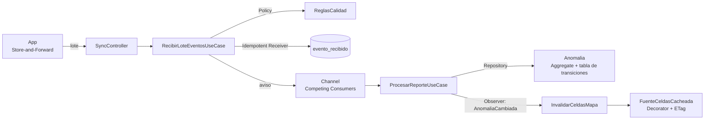

# Patrones de Diseño

> **Proyecto:** KillaUru · **Versión:** 3.0 · **Revisión:** 2026-10-14 · **Estado:** Vigente (rediseñado desde `01-analisis-del-sistema` y `02-arquitectura-de-software`)
> **Relacionados:** `principios-de-diseño.md`, `diseño-interno-de-modulos.md`, `componentes-arquitectonicos.md`, `07-decisiones-arquitectonicas.md`

## 1. Criterio

Un patrón entra al código **solo si resuelve un problema real de KillaUru** y su costo (archivos, indirección) es menor que el problema. Por eso este documento tiene tres listas: los que **se usan**, los que **se descartaron a propósito** y los que **se agregarán cuando ocurra un disparador concreto**.

## 2. Patrones que se usan

### 2.1 Backend

| Patrón | Problema concreto que resuelve | Dónde vive | Por qué este y no otro |
|---|---|---|---|
| **Aggregate** (DDD) | Las reglas del ciclo de vida (RN-05, RN-06, RN-07) deben cumplirse **siempre juntas** | `Anomalia` (Anomalías · Domain): única puerta para cambiar estado, severidad y persistencia | Sin agregado, cada caso de uso cambiaría el estado a su manera |
| **Tabla de transiciones** (variante declarativa de *State*) | Qué acción del administrador vale desde qué estado (RN-07) | Diccionario estático en `Anomalia` | Con 5 estados y 3 acciones, una tabla de 6 líneas es más clara que 5 clases *State* |
| **Factory Method** | Una anomalía, un usuario o un value object nunca deben existir en estado inválido | `Anomalia.Crear(...)`, `Severidad.De(...)`, `Coordenada.De(...)` | El constructor es privado; validar en un solo lugar |
| **Value Object** | Coordenadas, severidades o seudónimos inválidos no deben circular | `Shared/Domain`: `Coordenada`, `Severidad`, `Confidence`, `SeudonimoInstalacion`, `Celda` | Son `readonly record struct`: inmutables, sin costo de memoria en el *heap* |
| **Policy** (variante de *Strategy*) | Cada regla de negocio cambia por razones distintas | `ReglasCalidad` (RN-11, RN-13), `PoliticaPlausibilidad` (RN-15), `PoliticaConfirmacion` (RN-06, RN-14), `ReglaPersistencia` (RN-12) | Cada política se prueba sola y se reemplaza sin tocar el agregado |
| **Repository** (uno por agregado) | El dominio no debe conocer SQL ni PostGIS | `IAnomaliaRepository` (puerto en Application) → `AnomaliaRepositoryPostgis` | Métodos con nombre de negocio (`MasCercanaAsync`), no CRUD genérico |
| **Query Service** (lectura separada) | El mapa necesita lecturas rápidas que no son el agregado completo | `IAnomaliaLectura` (Contracts de Anomalías): proyecciones `AsNoTracking` y SQL de lectura | Separa lectura y escritura **sin** el costo de un CQRS completo |
| **Decorator** | Responder el mapa sin consultar PostgreSQL en cada petición (RNF-01) | `FuenteCeldasCacheada` envuelve a `FuenteCeldasPostgis` (Consulta de Mapa) | La caché se agrega o se quita en una línea de DI; la consulta original no cambia (abierto/cerrado) |
| **Cache-aside + ETag** | Ahorrar CPU, red y BD en clientes que piden lo mismo | `FuenteCeldasCacheada` + `VersionesCelda` | Un 304 se resuelve en memoria, sin tocar la BD |
| **Observer** (eventos de dominio en proceso) | Anomalías no debe conocer a quién le interesa un cambio | `IPublicadorEventos` publica `AnomaliaCambiada` después del *commit*; `InvalidarCeldasMapa` se suscribe | Agregar notificaciones en v1.5 = un suscriptor más (ADR-006) |
| **Adapter** | Aislar servicios externos y técnicos | `IEnviadorCorreo` (correo transaccional), `IMetricas` (OpenTelemetry), `TimeProvider` (reloj) | Cambiar de proveedor toca un archivo |
| **Idempotent Receiver** | Un reintento de la app no debe duplicar eventos (DA-02) | `INSERT … ON CONFLICT (evento_id) DO NOTHING` en Ingesta y llave primaria `evento_id` en `reporte_anomalia` | Entrega al menos una vez + receptor idempotente = efecto exactamente una vez |
| **Competing Consumers con bloqueo por celda** | Procesar en paralelo sin crear dos anomalías del mismo bache | N trabajadores del `Channel`; bloqueo consultivo de PostgreSQL por celda | Paraleliza celdas distintas y serializa solo la misma zona |
| **Result** | Los descartes y los rechazos son resultados esperados, no errores | `ResultadoLote`, `ResultadoProceso`, `ResultadoLogin` | Obliga a manejar cada caso; las excepciones quedan para lo inesperado |
| **Options** | Umbrales calibrables sin recompilar (ADR-012, S-04) | `<Modulo>Options` por módulo | Segregación de interfaces: cada módulo lee solo su sección |
| **Composition Root** | Un solo lugar conecta interfaces con implementaciones | `<Modulo>Module.cs` y `Program.cs` | El resto del código no usa `new` para sus dependencias |

### 2.2 App Android

| Patrón | Problema concreto | Dónde vive |
|---|---|---|
| **Store-and-Forward** | Operar sin señal durante horas (DA-01) | Buffer Room + Sincronizador |
| **Repository** | La UI no debe saber si un dato viene de Room o de la red | `AnomaliaRepository` (Room como fuente única y Retrofit para actualizarla) |
| **Observer** (Kotlin `Flow`) | La pantalla se actualiza sola cuando cambia la base local | DAOs de Room que devuelven `Flow` |
| **Strategy** | La distancia de aviso depende de la categoría de vehículo (RN-16) | `ParametrosAviso` por categoría (Liviano/Moto vs. Pesado) |
| **State machine** | Estados locales del evento (`PENDING` → `ENVIANDO` → …) | Enum `EstadoLocal` con las transiciones de RF-06 |
| **Worker** | Sincronizar y actualizar el modelo aunque la app esté cerrada | `WorkManager` (trabajos únicos con restricciones de red) |

## 3. Cómo encajan en el flujo principal

## 4. Patrones descartados a propósito

| Patrón o herramienta | Por qué **no** | Cuándo se reconsideraría |
|---|---|---|
| **Repositorio genérico** `IRepository<T>` | Expone operaciones que el negocio no usa y oculta las consultas que sí importan | Nunca |
| **Unit of Work propio** | `DbContext` de EF Core ya es una unidad de trabajo por módulo | Nunca |
| **CQRS completo / Event Sourcing** | Duplica modelos y almacenes; desproporcionado para una persona (estilo descartado en `estilo-arquitectonico.md`) | Si la analítica de v1.5 necesita un almacén aparte (ADR-014) |
| **Mediator** (librería de *in-process messaging*) | Agrega una capa de indirección y búsqueda por reflexión; inyectar el caso de uso es más directo y se navega con «Ir a definición» | Si aparecen comportamientos transversales en muchos casos de uso que el *middleware* no cubra |
| **Mapeo automático** (librería de *object mapping*) | Esconde errores de mapeo y agrega costo de reflexión; el mapeo manual es corto y explícito | Nunca en el camino caliente |
| **Specification** para RN-11 | Son 6 reglas fijas de una línea; una función ordenada es más legible | Si las reglas de recepción pasan de ~10 o varían por `modeloVersion` |
| **State** con una clase por estado | 5 estados y 3 acciones caben en una tabla | Si cada estado empieza a tener comportamiento propio complejo |
| **Outbox** | Una tabla y un proceso más por módulo, sin necesidad en un solo proceso (ADR-013) | Si se extrae un módulo como servicio |
| **Saga** | No hay transacciones distribuidas | Si se extraen servicios con flujos que crucen varios |

## 5. Patrones previstos (con disparador concreto)

| Patrón | Dónde | Disparador |
|---|---|---|
| **Facade** | API comercial de **analítica de tramos** para empresas y autoridades | Activación de los actores de v1.5 / v2.0 (`01-actores.md`) |
| **Strategy por versión de modelo** | Umbrales de recepción distintos por `modeloVersion` | Cuando convivan modelos con calibraciones distintas (ADR-004) |
| **Suscriptor adicional** (Observer) | Notificaciones desde el servidor | v1.5+ |
| **Redis como *backplane*** del Decorator y de `VersionesCelda` | Caché compartida | Más de una instancia del backend (S-03) |
| **Outbox** | Publicar `AnomaliaCambiada` fuera del proceso | Extracción de Consulta de Mapa como servicio |
