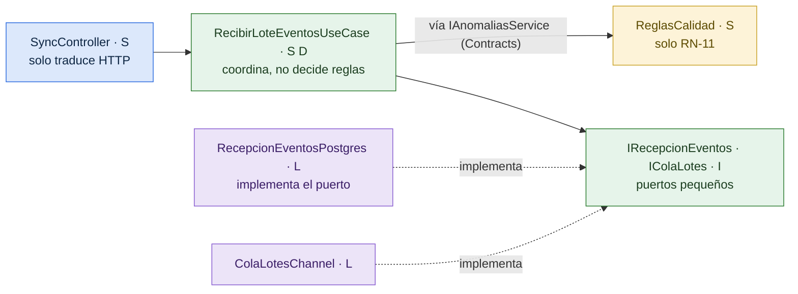

# Principios de Diseño

> **Proyecto:** KillaUru · **Versión:** 3.0 · **Revisión:** 2026-10-14 · **Estado:** Vigente (rediseñado desde `01-analisis-del-sistema` y `02-arquitectura-de-software`)
> **Relacionados:** `patrones-de-diseño.md`, `diseño-interno-de-modulos.md`, `enfoque-arquitectonico.md`, `estilo-arquitectonico.md`

## 1. Propósito

Este documento fija **cómo se escribe el código** de KillaUru para que sea legible, corto, fácil de cambiar y probado. La meta práctica es concreta: **una persona que recién llega al proyecto debe poder cambiar una regla sin miedo**, porque sabe en qué archivo está, qué prueba la cubre y qué más no se va a romper.

Los principios se aplican igual en el backend (.NET 10) y en la app Android (Kotlin). La estructura de capas y módulos ya está decidida en `enfoque-arquitectonico.md` (ADR-002); aquí se baja al nivel de clases y métodos.

## 2. Principios que guían el código

| Principio | Qué significa en KillaUru | Ejemplo concreto |
|---|---|---|
| **S** · Responsabilidad única | Cada clase tiene **una razón para cambiar** | `ReglasCalidad` solo cambia si cambia RN-11; `SyncController` solo si cambia el contrato HTTP |
| **O** · Abierto/cerrado | Lo nuevo se **agrega**, lo probado no se edita | La caché del mapa es un *Decorator* (`FuenteCeldasCacheada`): se activó sin tocar la consulta original |
| **L** · Sustitución de Liskov | Toda implementación de un puerto cumple el **mismo contrato**, incluidos los dobles de prueba | `FuenteCeldasCacheada` y `FuenteCeldasPostgis` devuelven exactamente el mismo GeoJSON |
| **I** · Segregación de interfaces | Interfaces **pequeñas, por consumidor** | Mapa no depende de todo Anomalías: usa `IAnomaliaLectura`; Ingesta usa `IAnomaliasService` |
| **D** · Inversión de dependencias | Las capas internas declaran **puertos**; las externas los implementan | `ProcesarReporteUseCase` pide `IAnomaliaRepository`; EF Core y PostGIS viven en Infrastructure |
| **KISS** · Lo simple primero | Se elige la solución más corta que cumple la métrica | Un `Channel` en memoria con tabla durable, en vez de RabbitMQ (ADR-005) |
| **YAGNI** · No construir «por si acaso» | Una abstracción entra cuando hay **dos usos reales** o una métrica que la exige | No hay repositorio genérico ni capa de mapeo automático (ver `patrones-de-diseño.md`, sección 4) |
| **DRY** bien entendido | **Una regla de negocio vive en un solo lugar**; no se fuerza a compartir código que solo se parece | En el servidor, el umbral de confidence está solo en `AnomaliasOptions` (y en la app, solo en su configuración); ambos valores salen de RN-04. Dos DTOs parecidos de módulos distintos **no** se unifican |
| **Ley de Deméter** | Cada objeto habla con sus colaboradores directos, sin cadenas `a.b.c.d` | `anomalia.RegistrarReporte(reporte, reglas)`; el caso de uso no toca `anomalia.Reportes.Last().Severidad` |
| **Tell, don't ask** | Se le pide al objeto que **haga** algo con sus datos | El agregado decide su estado (`RegistrarReporte`); el caso de uso no lee el estado para cambiarlo afuera |
| **Validar en el borde, confiar adentro** | Los datos se validan una vez al entrar; adentro solo circulan **value objects válidos** | `Severidad.De(7)` falla en el borde; el dominio nunca recibe una severidad imposible |
| **Inmutabilidad por defecto** | Value objects, comandos y DTOs son `record` inmutables | `Coordenada`, `EventoReportado`, `ContextoReporte` |
| **Composición sobre herencia** | No hay jerarquías de clases de negocio; se combinan objetos pequeños | `ReglasAnomalia` agrupa las políticas que necesita el agregado |

## 3. SOLID aplicado módulo por módulo

| Principio | Ingesta | Anomalías | Consulta de Mapa | Identidad y Accesos | App Android |
|---|---|---|---|---|---|
| **S** | El controlador traduce HTTP; el caso de uso coordina; el repositorio inserta | `ReglasCalidad`, `PoliticaPlausibilidad`, `PoliticaConfirmacion`, `ReglaPersistencia`: una regla de `09` cada una | El caso de uso arma la respuesta; la caché es otra clase | Emitir tokens, verificar contraseñas y bloquear cuentas son clases distintas | `Detector` solo clasifica; `Proximidad` solo decide alertas |
| **O** | Un motivo de rechazo nuevo se agrega en `ReglasCalidad` sin tocar el caso de uso | Un estado nuevo se agrega a la **tabla de transiciones**, no a un `switch` disperso | La caché se agregó como *Decorator* | Otro proveedor de correo = otro adaptador de `IEnviadorCorreo` | Un modelo nuevo llega por el Actualizador (RF-33) sin cambiar el Detector |
| **L** | `ColaLotesChannel` y una cola falsa de prueba son intercambiables | `AnomaliaRepositoryPostgis` y el repositorio en memoria de las pruebas respetan el mismo contrato | `FuenteCeldasCacheada` ≡ `FuenteCeldasPostgis` | `EnviadorCorreoResend` ≡ `EnviadorCorreoConsola` (desarrollo) | El Room DAO y su versión en memoria |
| **I** | `IRecepcionEventos` y `IColaLotes` en vez de un `IIngestaService` gigante | `IAnomaliasService` (escritura) separado de `IAnomaliaLectura` (lectura) | `IFuenteCeldas` tiene un solo método | `IIdentidadConsultas` solo cuenta conductores activos | `EventoDao`, `AnomaliaDao` y `RecorridoDao` separados |
| **D** | El caso de uso depende de puertos; `IngestaModule.cs` conecta las implementaciones | Igual, con `AnomaliasModule.cs` | Igual | Igual | Hilt inyecta las implementaciones |

**Cómo se comprueba, no solo se declara:**
1. **Compilador:** cada módulo es un proyecto propio y todo es `internal` salvo `Contracts/` (ver `diseño-interno-de-modulos.md`, sección 2). Usar el interior de otro módulo **no compila**.
2. **Pruebas de arquitectura (RNF-28):** NetArchTest verifica que `Domain` no referencie EF Core ni ASP.NET y que no haya ciclos entre módulos.
3. **Pruebas unitarias:** si una clase necesita más de 3 dobles de prueba para probarse, tiene demasiadas responsabilidades.

## 4. Reglas de código del equipo

Son pocas y verificables. El objetivo es que todo el código se lea igual.

| # | Regla | Por qué | Cómo se verifica |
|---|---|---|---|
| 1 | **Un caso de uso = una clase = un archivo**, con un único método público `EjecutarAsync` | Se encuentra por su nombre, se prueba solo | Revisión de código |
| 2 | Métodos de **≤ 20 líneas** y clases de **≤ 200 líneas** | Si no cabe en una pantalla, hace demasiado | Analizador (*CA1502*, *S138* o similar) |
| 3 | **Sin excepciones para el flujo de negocio:** un evento descartado o una cuenta bloqueada son resultados (`ResultadoProceso`, `ResultadoLogin`), no errores | Las excepciones son para lo inesperado; el resultado obliga a manejar cada caso | Revisión |
| 4 | **Nada de `DateTime.UtcNow` ni constantes de negocio en el código:** reloj por `TimeProvider`, umbrales por `<Modulo>Options` (ADR-012) | Pruebas deterministas y calibración sin recompilar (S-04) | Prueba de arquitectura que prohíbe `DateTime.UtcNow` |
| 5 | **Todo I/O es `async` y recibe `CancellationToken`** | Un cliente que corta la conexión no deja trabajo colgado | Analizador *CA2016* |
| 6 | `<Nullable>enable</Nullable>` y **advertencias como errores** | Los nulos se ven en compilación, no en producción | `Directory.Build.props` |
| 7 | **Nombres de negocio en español, términos técnicos de capa en inglés** (ADR-012) | El código se lee como el glosario (`10-glosario.md`) | Revisión |
| 8 | **Sin mapeo automático ni reflexión en el camino caliente:** los DTOs se mapean a mano en el adaptador | Es más corto de lo que parece, se depura con un *breakpoint* y no tiene costo oculto | Revisión |
| 9 | **Las consultas de lectura son proyecciones `AsNoTracking`**; nunca se carga una entidad completa para mostrarla | Evita N+1 y memoria desperdiciada (RNF-01) | Revisión + prueba de rendimiento |
| 10 | **Cada regla de `09-reglas-de-negocio.md` tiene su prueba con valores límite** (por ejemplo 0.74 / 0.75 / 0.76) | La regla y su prueba se cambian juntas | Cobertura del dominio ≥ 90 % |

## 5. «¿Dónde cambio si…?» (guía rápida)

| Necesito… | Toco solo | No toco |
|---|---|---|
| Ajustar un umbral (confidence, 3 min, 72 h…) | `appsettings.json` (sección del módulo) | Código |
| Agregar un motivo de rechazo en la recepción | `ReglasCalidad.EvaluarIntrinseca` + su prueba + el enum `MotivoDescarte` | Ingesta, controladores |
| Cambiar cómo se confirma una anomalía grave | `PoliticaConfirmacion` + sus pruebas | El caso de uso, el repositorio |
| Agregar un estado o una acción del administrador | La tabla de transiciones de `Anomalia` + sus pruebas | Los demás estados |
| Agregar un tipo de anomalía (por ejemplo, rompemuelles) | El enum `TipoAnomalia`, el modelo TFLite y RN-01 | Reglas del servidor (no dependen del tipo) |
| Cambiar de proveedor de correo | Un adaptador nuevo de `IEnviadorCorreo` y una línea en `IdentidadModule.cs` | Casos de uso de Identidad |
| Agregar un indicador al Dashboard | Un caso de uso de Dashboard y su consulta | Los módulos que generan los datos |
| Cambiar la distancia de aviso | Parámetros de RN-16 en la configuración de la app | La lógica de proximidad |
| Agregar un campo nuevo al evento | El contrato `EventoReportado` como campo **opcional** y su lectura en `ReporteAnomalia.Desde` | Los lotes ya guardados (el `payload` es `JSONB`, ADR-014) |

## 6. Antipatrones que el diseño evita a propósito

| Antipatrón | Riesgo | Cómo lo evita KillaUru |
|---|---|---|
| **Código espagueti en el controlador** | La regla queda atada a HTTP y no se puede probar | Los controladores tienen ≤ 15 líneas y solo llaman a un caso de uso |
| **Repositorio genérico** (`IRepository<T>`) | Expone consultas que el negocio no necesita y esconde las que sí | Un repositorio por agregado, con métodos con nombre de negocio (`MasCercanaAsync`) |
| **Servicio «Manager» que lo hace todo** | Una clase de 2 000 líneas que nadie se atreve a tocar | Casos de uso pequeños y políticas de dominio con una sola regla |
| **Base de datos compartida entre módulos** | Un cambio de columna rompe otro módulo | Un esquema y un `DbContext` por módulo (regla 3 de `estilo-arquitectonico.md`) |
| **Consultas N+1** | El mapa se vuelve lento con muchos datos | Proyecciones por celda en una sola consulta (sección 4 de `diseño-interno-de-modulos.md`) |
| **`catch (Exception)` que esconde fallas** | Errores silenciosos | Solo el *middleware* global captura, registra con correlación y responde 500 |
| **`async void` o `.Result`** | Bloqueos y excepciones perdidas | Analizadores activados |
| **Estado estático mutable** | Pruebas que fallan según el orden | Todo estado vive en servicios registrados en DI |

## 7. Relación con los patrones y con la arquitectura

| Principio | Lo materializa | Documento |
|---|---|---|
| S, I | Casos de uso pequeños, políticas de dominio, puertos por consumidor | `diseño-interno-de-modulos.md` |
| O, L | *Decorator* (caché), *Adapter* (correo, métricas), *Observer* (eventos de dominio) | `patrones-de-diseño.md` |
| D | Puertos en Application + raíz de composición por módulo (`<Modulo>Module.cs`) | `enfoque-arquitectonico.md` |
| KISS, YAGNI | Monolito modular, sin broker, sin Redis, sin CQRS completo | ADR-001, ADR-005, ADR-006 |
