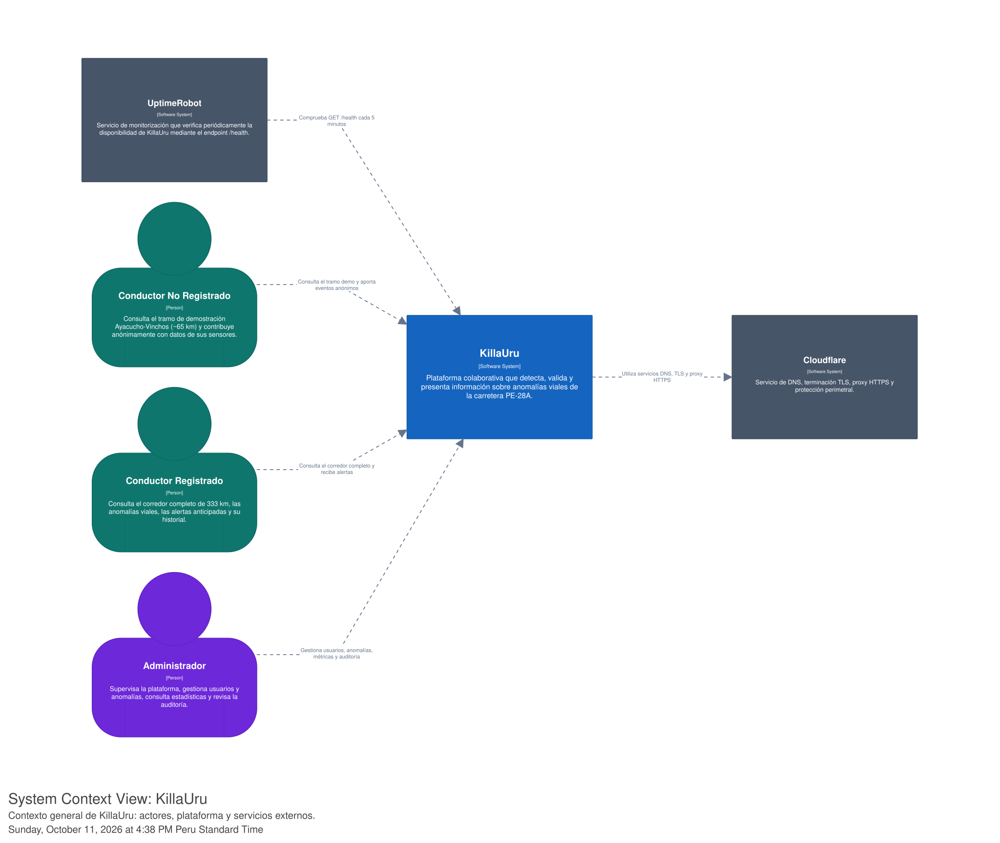

# Nivel 1 · Diagrama de contexto del sistema

> **Proyecto:** KillaUru (ViaLibre)
> **Modelo:** C4 · Nivel 1 de 4 · **Versión:** 1.0
> **Herramienta:** Structurizr (DSL)

---

## 1. Objetivo

Mostrar **KillaUru como una sola caja**: quiénes lo usan y con qué sistemas externos se comunica. Es la vista de mayor nivel de abstracción y la primera que se presenta a cualquier persona, técnica o no — incluido el docente del curso IS488.

| Aspecto | Descripción |
|---|---|
| Pregunta que responde | ¿Qué es KillaUru, quién lo usa y con quién se integra? |
| Audiencia | Negocio, docente, equipo del proyecto (PO/Dev/QA/SM), operaciones |
| Qué **no** muestra | Tecnologías internas, servidores, base de datos, módulos del backend |
| Siguiente nivel | [`Nivel2-diagrama-de-contenedores.md`](Nivel2-diagrama-de-contenedores.md) |

---

## 2. Diagrama

> Exportado en SVG (vectorial, sin pérdida de calidad) desde Structurizr Lite. Fuente editable: `workspace.dsl` del repositorio del proyecto.

---

## 3. Personas (actores)

| Persona | Tipo | Descripción | Qué hace en el sistema |
|---|---|---|---|
| **Conductor No Registrado** | Usuario Externo | Visitante sin cuenta | Consulta el tramo de demostración Ayacucho–Vinchos (~65 km) y contribuye anónimamente con datos de sus sensores |
| **Conductor Registrado** | Usuario Externo | Usuario con cuenta creada | Consulta el corredor completo de 333 km, las anomalías viales, recibe alertas anticipadas y revisa su historial |
| **Administrador** | Personal Interno | Responsable de la operación de la plataforma | Supervisa la plataforma, gestiona usuarios y anomalías, consulta estadísticas y revisa la auditoría |

---

## 4. Sistemas

| Sistema | Tipo | Responsabilidad | Quién lo opera |
|---|---|---|---|
| **KillaUru** | Sistema en alcance | Plataforma colaborativa que detecta, valida y presenta información sobre anomalías viales de la carretera PE-28A | Equipo del proyecto (POCrisso, DevCrisso, QACrisso, SMCrisso) |
| **Cloudflare** | Infraestructura externa | Servicio de DNS, terminación TLS, proxy HTTPS y protección perimetral | Cloudflare Inc. |
| **UptimeRobot** | Infraestructura externa | Monitorización que verifica periódicamente la disponibilidad de KillaUru mediante el endpoint `/health` | UptimeRobot |

---

## 5. Relaciones

| Origen | Destino | Descripción | Protocolo |
|---|---|---|---|
| Conductor No Registrado | KillaUru | Consulta el tramo demo y aporta eventos anónimos | — |
| Conductor Registrado | KillaUru | Consulta el corredor completo y recibe alertas | — |
| Administrador | KillaUru | Gestiona usuarios, anomalías, métricas y auditoría | — |
| KillaUru | Cloudflare | Utiliza servicios DNS, TLS y proxy HTTPS | HTTPS |
| UptimeRobot | KillaUru | Comprueba `GET /health` cada 5 minutos | HTTPS |

> Nota de dirección: la flecha de monitoreo va de **UptimeRobot hacia KillaUru** (UptimeRobot es quien consulta), no al revés — así está modelado en el DSL.
> En el nivel 1 no se indica el protocolo entre personas y el sistema: eso se detalla en el nivel 2 (app móvil vs. panel web, REST vs. sync offline).

---

## 6. Leyenda de estilos (del workspace DSL)

| Elemento | Color | Hex | Tipo de nodo |
|---|---|---|---|
| 🟦 Software System | Azul | `#1565C0` | KillaUru (sistema en alcance) |
| 🟢 Usuario Externo | Verde azulado | `#0F766E` | Conductor No Registrado, Conductor Registrado |
| 🟣 Personal Interno | Violeta | `#6D28D9` | Administrador |
| ⬜ Infraestructura Externa | Gris pizarra | `#475569` | Cloudflare, UptimeRobot |
| ─ Relationship | Gris medio, grosor 2 | `#64748B` | Todas las flechas |

Esta paleta se mantiene consistente en los 4 niveles del modelo C4 para que cualquier lector reconozca de inmediato el tipo de elemento sin leer la leyenda cada vez.

---

## 7. Decisiones y supuestos

| # | Decisión o supuesto | Motivo |
|---|---|---|
| 1 | Cloudflare se usa únicamente como capa de red (DNS, TLS, proxy) — no procesa ni almacena datos de anomalías | Mantener los datos del proyecto dentro de la infraestructura propia (Oracle Cloud Free Tier) por costo y por la Ley 29733 |
| 2 | UptimeRobot solo consulta el endpoint `/health`, sin acceso a datos internos del sistema | Monitoreo externo de disponibilidad sin exponer información sensible |
| 3 | El Conductor No Registrado puede contribuir datos sin crear cuenta | Bajar la barrera de entrada y ampliar la cobertura de datos del tramo demo |
| 4 | El Administrador es personal interno, no un sistema externo | Es un rol operativo dentro del propio equipo, no un tercero |

### Pendientes por definir

| Tema | Detalle |
|---|---|
| Servicio de notificaciones | Las alertas anticipadas (HU-09) hoy son solo in-app; falta definir si se agrega un proveedor externo (push/SMS) como nuevo sistema en C1 |
| Autenticación | Actualmente el login de Administrador es JWT propio (RF-16); confirmar si en algún momento se evalúa un proveedor externo (ej. OAuth) que debería aparecer como sistema externo |

---

## 8. Trazabilidad

- **Jira:** `KU-20` — Diagrama y documentación C1 (Contexto)
- **Épica:** `[EPIC-04] Documentación: Modelo C4`
- **Documento de análisis relacionado:** Actores (`01-actores.md`), Decisiones arquitectónicas (`07-decisiones-arquitectonicas.md`)