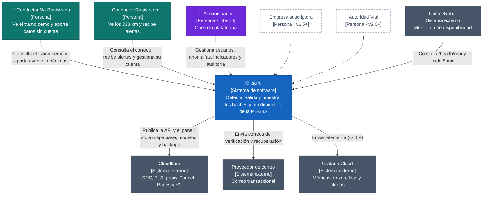

# Nivel 1 · Diagrama de Contexto del Sistema

> **Proyecto:** KillaUru · **Modelo:** C4 · Nivel 1 de 4 · **Versión:** 3.0 · **Revisión:** 2026-10-14 · **Estado:** Vigente (alineado con `01-actores.md` y ADR-001…ADR-015)
> **Herramienta:** Structurizr DSL (`workspace.dsl`, vista `C1_Contexto`) · copia en Mermaid en este documento

## 1. Objetivo

Mostrar **KillaUru como una sola caja**: quién lo usa y con qué sistemas externos se comunica. Es la primera vista que se presenta a cualquier persona, técnica o no.

| Aspecto | Descripción |
|---|---|
| Pregunta que responde | ¿Qué es KillaUru, quién lo usa y con quién se integra? |
| Audiencia | Negocio, docente, equipo del proyecto, operaciones |
| Qué **no** muestra | Tecnologías, servidores, base de datos ni módulos internos |
| Siguiente nivel | [`Nivel2-diagrama-de-contenedores.md`](Nivel2-diagrama-de-contenedores.md) |

## 2. Diagrama

## 3. Personas

| Persona | Tipo | Qué hace con el sistema | Reglas clave |
|---|---|---|---|
| **Conductor No Registrado** | Usuario externo | Acepta términos y aviso de privacidad; ve solo el tramo demo Ayacucho–Vinchos; aporta eventos anónimos si maneja un vehículo liviano con soporte | RN-08, RN-18, HU-27, RF-29 |
| **Conductor Registrado** | Usuario externo | Ve el corredor de 333 km, recibe alertas anticipadas sin señal, consulta su historial local y gestiona su cuenta y sus datos | RN-08, RN-16, RN-21, HU-08, HU-09 |
| **Administrador** | Personal interno | Gestiona usuarios y privilegios, modera anomalías (incluida la lista «Por revisar»), ve indicadores, exporta datos y revisa la auditoría | RF-16…RF-20, RF-24, RNF-30 |
| *Empresa suscriptora* | Futuro (v1.5+) | Consumirá **analítica de tramos** | `01-actores.md` |
| *Autoridad Vial* | Futuro (v2.0+) | Accederá bajo convenio | `01-actores.md` |

## 4. Sistemas externos

| Sistema | Responsabilidad | Datos que recibe | Por qué es externo |
|---|---|---|---|
| **Cloudflare** | DNS, TLS, proxy y caché de borde; Tunnel hacia el origen; Pages (panel); R2 (mapa base, modelos y backups) | Tráfico HTTPS; archivos estáticos y backups cifrados | Red y almacenamiento de terceros (R-05, ADR-010) |
| **UptimeRobot** | Consulta `GET /health/ready` y publica una página de estado pública gratuita | Solo el código de respuesta | Monitoreo independiente del servidor (RNF-20) |
| **Proveedor de correo transaccional** | Envía los correos de verificación y de recuperación de contraseña | Correo del destinatario y el enlace | Integrado **solo** desde Identidad y Accesos (regla 11) |
| **Grafana Cloud** | Recibe métricas, trazas y logs; alerta por degradación | Telemetría sin datos personales de alta cardinalidad (RNF-32) | Observabilidad gratuita sin servidor propio (ADR-010) |

> Todos reciben datos fuera del Perú: están declarados como flujo transfronterizo en la política de privacidad (R-06).

## 5. Relaciones

| Origen | Destino | Descripción | Protocolo |
|---|---|---|---|
| Conductor No Registrado | KillaUru | Consulta el tramo demo y aporta eventos anónimos | — (detalle en C2) |
| Conductor Registrado | KillaUru | Consulta el corredor, recibe alertas y gestiona su cuenta | — |
| Administrador | KillaUru | Gestiona la plataforma | — |
| KillaUru | Cloudflare | Publica la API y el panel; aloja archivos y backups | HTTPS |
| UptimeRobot | KillaUru | Comprueba `/health/ready` | HTTPS |
| KillaUru | Proveedor de correo | Envía correos transaccionales | HTTPS (API) |
| KillaUru | Grafana Cloud | Envía telemetría | OTLP sobre HTTPS |

> La flecha del monitoreo va **de UptimeRobot hacia KillaUru**, porque UptimeRobot es quien consulta.

## 6. Leyenda

| Elemento | Color | Hex |
|---|---|---|
| Sistema en alcance | Azul | `#1565C0` |
| Usuario externo | Verde azulado | `#0F766E` |
| Personal interno | Violeta | `#6D28D9` |
| Sistema externo | Gris pizarra | `#475569` |
| Actor futuro | Borde gris punteado | `#94A3B8` |

La paleta es la misma en los 4 niveles y en `workspace.dsl`.

## 7. Decisiones reflejadas

| # | Decisión | Fuente |
|---|---|---|
| 1 | Los dos tipos de conductor usan la **misma app**; cambia el alcance de los datos, no la aplicación | `01-actores.md` |
| 2 | El servidor nunca recibe la señal cruda de los sensores: la clasificación ocurre en el celular | ADR-004 |
| 3 | La página de estado es la pública gratuita de UptimeRobot, sin dominio propio | R-05, RS-03 |
| 4 | Las alertas son locales en la app; no hay proveedor de notificaciones *push* en v1.0 | HU-09, `estilo-arquitectonico.md` |
| 5 | El correo es parte de v1.0 (verificación y recuperación son *Must*) | HU-18b, HU-25 |

## 8. Trazabilidad

- **Jira:** `KU-20` — Diagrama y documentación C1 (Contexto)
- **Épica:** `[EPIC-04] Documentación: Modelo C4`
- **Fuentes:** `01-actores.md`, `05-restricciones.md` (R-05, R-06), `07-decisiones-arquitectonicas.md`
