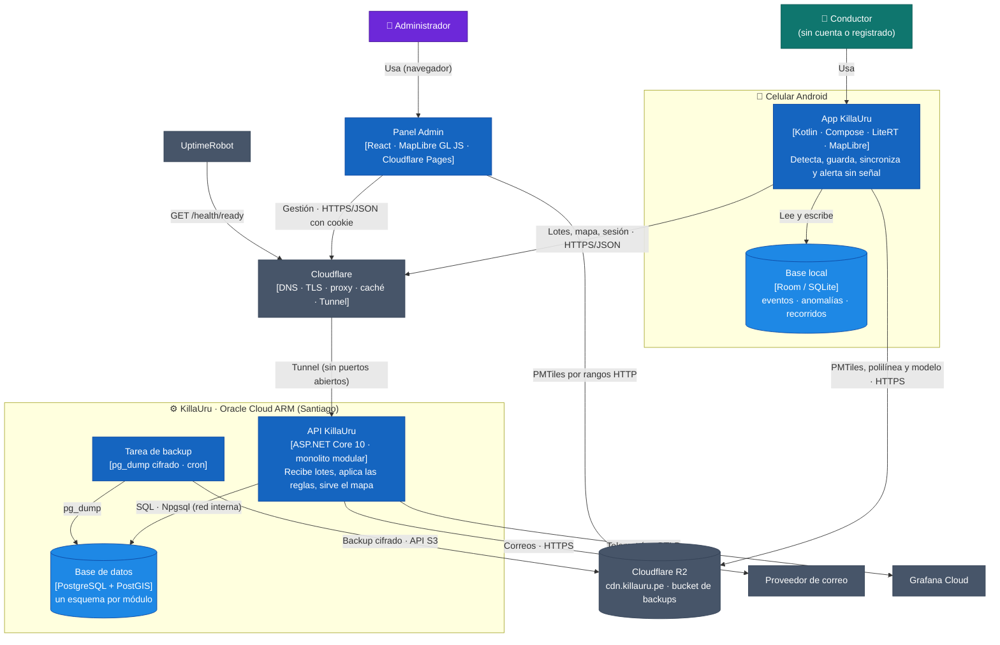

# Nivel 2 · Diagrama de Contenedores

> **Proyecto:** KillaUru · **Modelo:** C4 · Nivel 2 de 4 · **Versión:** 3.0 · **Revisión:** 2026-10-14 · **Estado:** Vigente (alineado con `estilo-arquitectonico.md` y ADR-001…ADR-015)
> **Herramienta:** Structurizr DSL (`workspace.dsl`, vistas `C2_Contenedores` y `Despliegue`) · copia en Mermaid en este documento

## 1. Objetivo

Abrir la caja «KillaUru» y mostrar sus **contenedores**: las aplicaciones y almacenes de datos que se ejecutan o persisten por separado, con su tecnología y cómo se comunican.

| Aspecto | Descripción |
|---|---|
| Pregunta que responde | ¿De qué piezas ejecutables se compone KillaUru y cómo se hablan? |
| Qué es un contenedor | Una aplicación o un almacén de datos que se ejecuta o persiste por separado. **No** es lo mismo que un contenedor Docker |
| Qué **no** muestra | Módulos internos (nivel 3) ni clases (nivel 4) |
| Nivel anterior | [`Nivel1-diagrama-de-contexto.md`](Nivel1-diagrama-de-contexto.md) |
| Siguiente nivel | [`Nivel3-diagrama-de-componentes.md`](Nivel3-diagrama-de-componentes.md) |

## 2. Diagrama

## 3. Contenedores

| Contenedor | Tecnología | Responsabilidad | Datos que maneja |
|---|---|---|---|
| **App KillaUru** | Kotlin · Jetpack Compose · LiteRT (MLP cuantizado) · MapLibre Native · WorkManager · Hilt · Retrofit · `minSdk` 26 | Sensores a 50 Hz solo con vehículo liviano en movimiento (RN-03, RN-18); clasifica en < 50 ms; guarda y sincroniza (Store-and-Forward); alerta a lo largo de la vía sin señal (RN-16); términos, permisos e indicador de estado | Base local; tokens y permiso local en DataStore cifrado; archivos verificados (PMTiles, polilínea, modelo) |
| **Base local** | Room (SQLite, modo WAL) | Persistencia del celular | `evento` (estados locales), `anomalia` (con su km sobre la vía), `recorrido` (6 meses) |
| **Panel Admin** | SPA React + MapLibre GL JS, estáticos en Cloudflare Pages | Interfaz del administrador. **Sin reglas de negocio**: todo se decide en la API | Solo estado de pantalla; sesión en cookie `HttpOnly; Secure; SameSite=Strict` |
| **API KillaUru** | ASP.NET Core 10 · EF Core + NetTopologySuite · `Channel` · HybridCache (sobre `IMemoryCache`) · OpenTelemetry · Serilog | **Un solo proceso** con 6 módulos (C3): recibe lotes de forma durable e idempotente, aplica las reglas de `09`, sirve el mapa por rol con caché y ETag, gestiona identidad y auditoría | Ninguno propio persistente; caché en memoria por celda y rol |
| **Base de datos** | PostgreSQL + PostGIS | Persistencia y consultas espaciales. Esquemas `identidad`, `ingesta`, `anomalias`, `auditoria`, `dashboard` | Ver `diseño-interno-de-modulos.md`, sección 3 |
| **Tarea de backup** | Contenedor con `pg_dump` + cifrado, programado a diario | Backup cifrado fuera de la VM (RNF-07) y `pg_dump` antes de cada migración (RNF-18) | Ninguno propio |

> **La caché no es un contenedor:** vive dentro del proceso de la API. Si hubiera más de una instancia (S-03), Redis aparecería como contenedor y como nivel 2 de HybridCache, sin cambiar el código.

## 4. Sistemas externos

| Sistema | Uso | Desde |
|---|---|---|
| **Cloudflare** | DNS, TLS (HSTS en todos los subdominios), proxy, caché de borde **solo para respuestas anónimas**, Tunnel, Pages | App y panel → API |
| **Cloudflare R2** | `cdn.killauru.pe`: PMTiles, polilínea, modelos TFLite y sus manifiestos con SHA-256; *bucket* privado de backups | App, panel y tarea de backup |
| **Proveedor de correo** | Verificación y recuperación | Solo la API (módulo Identidad y Accesos) |
| **Grafana Cloud** | Telemetría y alertas (plan gratuito, sin tarjeta) | API |
| **UptimeRobot** | Monitoreo y página de estado pública | Hacia la API |

## 5. Relaciones

| Origen | Destino | Qué viaja | Protocolo |
|---|---|---|---|
| App | API | `POST /api/v1/anomalies/batch` (≤ 50 eventos), `GET /api/v1/anomalies` (mapa, `updatedSince`), sesión | HTTPS/JSON a través de Cloudflare |
| App | R2 | Mapa base, polilínea y modelo (solo Wi-Fi o con permiso del usuario) | HTTPS, descarga reanudable |
| Panel | API | Gestión, mapa con filtros, moderación, exportación, auditoría | HTTPS/JSON con cookie |
| API | Base de datos | Lecturas y escrituras por módulo | TCP 5432 en la red interna de Docker |
| API | Proveedor de correo | Correos transaccionales | HTTPS |
| API | Grafana Cloud | Métricas, trazas y logs | OTLP/HTTPS |
| UptimeRobot | API | `GET /health/ready` | HTTPS |
| Tarea de backup | BD y R2 | `pg_dump` cifrado | Red interna y API S3 |

## 6. Flujo principal: del sensor al mapa

1. La **App** detecta una ventana con el modelo local y guarda el evento en la **Base local** como `PENDING`, con la hora del GPS.
2. Con señal, envía hasta 50 eventos, los más antiguos primero.
3. La **API** evalúa cada evento con las reglas de recepción (RN-11), guarda los aceptados en `evento_recibido` con **un solo `INSERT`** y recién entonces responde 200 con el resultado por evento.
4. Los trabajadores de la API procesan cada evento en su propia transacción, con bloqueo por celda: plausibilidad, agrupación, confirmación y clasificación (RN-05…RN-15).
5. Después del *commit* se publica `AnomaliaCambiada`; la caché del mapa invalida esa celda.
6. La App pide `updatedSince` y recibe altas y **bajas**; actualiza su copia y su `km` sobre la vía para las alertas.

## 7. Despliegue

| Nodo | Contenido | Notas |
|---|---|---|
| **VM Oracle Cloud ARM (Always Free, Santiago)** | `docker compose` de producción: `api`, `postgres` (volumen persistente), `cloudflared`, `backup` | Sin puertos abiertos: todo entra por el Tunnel (ADR-010) |
| Misma VM, bajo demanda | `docker compose` de pruebas («killauru-pruebas»): BD propia y datos sintéticos | Solo para simulacros; se apaga al terminar (R-11) |
| **Cloudflare** | Pages (panel), R2 (archivos y backups), caché de borde | Plan gratuito |
| **Celular** | APK de la app | Sin Play Store en el MVP (S-02) |

Pasos de un despliegue: `pg_dump` → migraciones (rol `killauru_migrador`) → `docker compose up -d` con el nuevo *tag*. El rollback vuelve al *tag* anterior, porque las migraciones son en dos fases (RNF-18).

## 8. Seguridad entre contenedores

| Frontera | Control |
|---|---|
| Internet → API | Cloudflare Tunnel, TLS, HSTS; límite de tasa con la IP real (`CF-Connecting-IP`) (RNF-11) |
| App → API | JWT de 5 min; `con_sesion` la decide el servidor por el token; el alcance por rol lo recorta el servidor (RNF-27) |
| Panel → API | Cookie `HttpOnly; Secure; SameSite=Strict`, CSP (RNF-09) |
| API → BD | Red interna; rol `killauru_app` sin permisos de DDL ni de borrar la auditoría |
| Secretos | Variables de entorno fuera del repositorio, con copia cifrada fuera de la VM (RNF-34) |

## 9. Atributos de calidad y su contenedor responsable

| Atributo | Meta | Contenedor | Táctica |
|---|---|---|---|
| Offline (AC-01) | 5 h sin señal, 7 días de pendientes | App + Base local | Store-and-Forward, copia local con bajas |
| Confiabilidad (AC-02) | Ningún evento aceptado perdido | API + BD | 200 tras el *commit*, idempotencia, barredor |
| Rendimiento móvil (AC-03) | < 50 ms, ≤ 5 %/h | App | Prefiltro de energía, sensores en lote |
| Seguridad (AC-04) | Recorte por rol al 100 % | API + Cloudflare | RBAC, caché por rol, Tunnel |
| Escalabilidad (AC-06) | 300 dispositivos, p95 < 250 ms | API + BD | Cola acotada, trabajadores, índices parciales, caché con ETag |
| Observabilidad (AC-07) | Alertas antes que los usuarios | API + Grafana + UptimeRobot | `/health/live` y `/health/ready`, OTLP |
| Costo (AC-09) | ≤ US$ 10/mes | Todos | Planes gratuitos, una VM |

## 10. Leyenda

| Elemento | Color | Hex |
|---|---|---|
| Usuario externo | Verde azulado | `#0F766E` |
| Personal interno | Violeta | `#6D28D9` |
| Contenedor | Azul | `#1565C0` |
| Almacén de datos | Azul claro (cilindro) | `#1E88E5` |
| Sistema externo | Gris pizarra | `#475569` |

## 11. Trazabilidad

- **Jira:** `KU-xx` — Diagrama y documentación C2 *(completar con el ID real)*
- **Épica:** `[EPIC-04] Documentación: Modelo C4`
- **Fuentes:** `arquitectura-inicial.md`, `estilo-arquitectonico.md`, ADR-003, ADR-005, ADR-006, ADR-010, ADR-011, ADR-014
