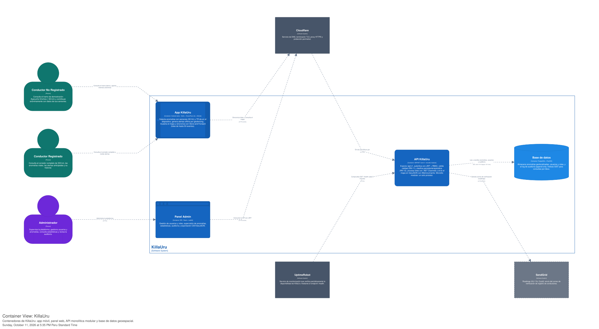

# Nivel 2 · Diagrama de contenedores

> **Proyecto:** KillaUru (ViaLibre)
> **Modelo:** C4 · Nivel 2 de 4 · **Versión:** 1.0
> **Herramienta:** Structurizr (DSL) · vista `C2_Contenedores`

---

## 1. Objetivo

Abrir la caja «KillaUru» del nivel 1 y mostrar los **contenedores** que la forman: las aplicaciones y almacenes de datos que se ejecutan o persisten de forma independiente, la tecnología de cada uno y cómo se comunican entre sí y con los sistemas externos.

| Aspecto | Descripción |
|---|---|
| Pregunta que responde | ¿De qué piezas ejecutables se compone KillaUru, con qué tecnología y cómo se comunican? |
| Audiencia | Arquitectos, desarrolladores, operaciones, docente del curso IS488 |
| Qué es un contenedor | Una aplicación o almacén de datos que se ejecuta o persiste por separado (app móvil, SPA, API, base de datos). **No** es lo mismo que un contenedor Docker |
| Qué **no** muestra | Módulos internos de la API (eso es el nivel 3), clases ni detalle de despliegue |
| Nivel anterior | [`Nivel1-diagrama-de-contexto.md`](Nivel1-diagrama-de-contexto.md) |
| Siguiente nivel | [`Nivel3-diagrama-de-componentes.md`](Nivel3-diagrama-de-componentes.md) |

---

## 2. Diagrama

> Exportado en SVG desde Structurizr Lite. Fuente editable: `workspace.dsl` (vista `C2_Contenedores`).
---

## 3. Contenedores

| Contenedor | Tecnología | Responsabilidad | Datos que maneja |
|---|---|---|---|
| **App KillaUru** | Aplicación Android nativa · Kotlin, TensorFlow Lite, SQLite | Lee acelerómetro y giroscopio a 50 Hz en segundo plano, clasifica anomalías en el dispositivo (ventana de 500 ms, inferencia < 50 ms), genera alertas anticipadas por geofencing sin conexión, muestra el mapa y sincroniza eventos con el patrón Store-and-Forward (lotes de hasta 50 eventos, backoff exponencial) | Buffer local SQLite con eventos `PENDING` / `SYNCED`; identificador de dispositivo hasheado con SHA-256 irreversible; modelo `.tflite` embebido en el APK |
| **Panel Admin** | SPA · React + Leaflet sobre OpenStreetMap | Interfaz del administrador: gestión de usuarios y roles, supervisión de anomalías, dashboard de estadísticas, consulta de auditoría y exportación CSV/GeoJSON. Se ejecuta en el navegador | Ninguno persistente; solo estado de pantalla y el token JWT de sesión |
| **API KillaUru** | ASP.NET Core 8 (.NET 8) · monolito modular con Clean Architecture por módulo | Único punto de entrada al backend: expone `/api/v1`, autentica con JWT + RBAC, aplica rate limiting, valida calidad de eventos (RN-11), clasifica persistentes/episódicas (RN-12), absorbe sincronizaciones simultáneas con .NET Channels y sirve el mapa en GeoJSON con `IMemoryCache`. Es **un solo proceso** con módulos internos (detalle en C3) | Ninguno propio persistente; usa la base de datos. Caché en memoria de consultas frecuentes del mapa |
| **Base de datos** | PostgreSQL + PostGIS (índices GiST) | Almacenamiento permanente y consultas geoespaciales por `bbox` | Anomalías geolocalizadas, usuarios y roles, log de auditoría append-only |

> **Nota sobre la caché:** `IMemoryCache` vive **dentro** del proceso de la API, por eso no aparece como contenedor aparte. Aparecería como contenedor solo si se adoptara Redis (ver sección 9).

---

## 4. Sistemas externos

| Sistema | Rol | Relación con el nivel 1 |
|---|---|---|
| **Cloudflare** | Borde único: DNS, terminación TLS 1.3, proxy HTTPS y protección perimetral hacia `api.killauru.pe` y `panel.killauru.pe` | Ya declarado en C1 |
| **UptimeRobot** | Consulta `GET /health` cada 5 minutos, alerta por correo ante caídas y alimenta `status.killauru.pe` | Ya declarado en C1 |
| **SendGrid** *(roadmap)* | Envío del correo de verificación de registro de conductores (HU-11b, prioridad Could) | **Nuevo en C2**; se oculta en C1 hasta que se implemente |

---

## 5. Relaciones

| Origen | Destino | Descripción | Protocolo |
|---|---|---|---|
| Conductor No Registrado | App KillaUru | Consulta el tramo demo Ayacucho–Vinchos y aporta eventos anónimos | Interacción en dispositivo |
| Conductor Registrado | App KillaUru | Consulta el corredor completo de 333 km, recibe alertas e historial | Interacción en dispositivo |
| Administrador | Panel Admin | Administra usuarios, anomalías, métricas y auditoría | HTTPS (navegador) |
| App KillaUru | API KillaUru (vía Cloudflare) | Envía lotes `POST /api/v1/anomalies/batch` y consulta `GET /api/v1/anomalies?bbox=` con delta sync | HTTPS/JSON |
| Panel Admin | API KillaUru (vía Cloudflare) | Login, gestión de usuarios, estadísticas, auditoría y exportación | HTTPS/JSON + JWT |
| Cloudflare | API KillaUru | Reenvía el tráfico del subdominio `api` | HTTPS |
| API KillaUru | Base de datos | Lee y escribe anomalías, usuarios y auditoría | SQL sobre TCP (Npgsql / EF Core) |
| UptimeRobot | API KillaUru | Comprueba `GET /health` cada 5 minutos | HTTPS |
| API KillaUru | SendGrid *(roadmap)* | Solicita el envío del correo de verificación | HTTPS/REST |

> En C2 los conductores interactúan con la **app**, no con el sistema abstracto: aquí se resuelve lo que C1 dejó indicado (app móvil para conductores, panel web para el administrador).

---

## 6. Flujo principal: del sensor al mapa

1. La **App** captura la ventana de 500 ms y TFLite clasifica en el dispositivo. Si `confidence ≥ 0.75`, guarda el evento como `PENDING` en SQLite; si no, lo descarta.
2. Con conectividad, la App envía lotes de hasta 50 eventos a la **API** (reintentos con backoff exponencial). Sin señal, el buffer local retiene los eventos.
3. La **API** encola el lote en .NET Channels, valida cada evento (confidence, precisión GPS < 20 m, timestamp) y exige confirmación de ≥ 2 dispositivos en 100 m / 72 h para severidad alta.
4. Las anomalías válidas se clasifican (persistente / episódica) y se guardan en **PostgreSQL + PostGIS**; se invalida la caché del tramo afectado.
5. La API responde HTTP 200 y la App marca los eventos como `SYNCED`.
6. Cualquier cliente consulta el mapa con `GET /anomalies?bbox=`; la respuesta sale de la caché en memoria o de PostGIS (objetivo < 250 ms).

---

## 7. Decisiones arquitectónicas reflejadas

| Decisión | Alternativa descartada | Motivo |
|---|---|---|
| Un único contenedor de backend (monolito modular) | Microservicios | Un solo desarrollador (DA-06), 6–8 semanas de plazo y recursos limitados en Oracle Cloud ARM Free Tier; los módulos con interfaces claras permiten extraer servicios después (DA-09) |
| Detección y clasificación en el dispositivo (TFLite) | Enviar señal cruda al servidor y clasificar en backend | Funciona sin cobertura en tramos de montaña, reduce tráfico y permite alertas offline por geofencing |
| Buffer local SQLite + Store-and-Forward | Envío en tiempo real obligatorio | La Vía Los Libertadores tiene tramos sin señal; ningún evento debe perderse |
| App nativa Kotlin | Multiplataforma (Flutter, React Native) | Acceso directo a sensores a 50 Hz y ejecución confiable en segundo plano |
| Panel separado de la API (SPA + REST) | Páginas generadas en el servidor | Frontend y backend evolucionan y se despliegan de forma independiente |
| PostgreSQL + PostGIS como única base de datos | Base NoSQL o motor geoespacial adicional | Consultas geoespaciales por `bbox` con índices GiST y consistencia transaccional para usuarios y auditoría |
| `IMemoryCache` dentro de la API | Redis como contenedor aparte | Costo operativo cercano a cero (R-04) y operación por una sola persona (DA-06) |
| Solo la API habla con la base de datos y con servicios de terceros | Acceso directo desde la app o el navegador | Las credenciales quedan en el servidor y las reglas de negocio no se pueden eludir desde el cliente |
| Cloudflare como único borde | Exponer el servidor directamente | TLS 1.3, protección perimetral y CDN sin costo; oculta la IP de origen |

---

## 8. Seguridad entre contenedores

| Comunicación | Medida |
|---|---|
| Usuarios → App, Panel y API | Tráfico cifrado con HTTPS (TLS 1.3 terminado en Cloudflare) |
| App → API | Cifrado en tránsito; identificador de dispositivo hasheado con SHA-256 antes de salir de la app; validación de esquema y límites de tasa en la API |
| Panel Admin → API | JWT en cada petición (expiración 8 h), RBAC por rol, bloqueo tras 3 intentos fallidos de login |
| Cloudflare → API | Solo el tráfico proxificado por Cloudflare debe alcanzar el origen |
| API → Base de datos | Acceso solo desde la red interna de Docker Compose; credenciales en variables de entorno, sin exposición del puerto 5432 a internet |
| API → Servicios externos | Credenciales (p. ej. SendGrid) guardadas solo en el servidor |
| Datos personales | Cumplimiento de la Ley 29733: ubicación anonimizada, sin datos identificables del conductor no registrado |
| Auditoría | Log append-only de acciones sensibles (timestamp UTC, actor, acción, contexto); solo lectura |

---

## 9. Atributos de calidad y su contenedor responsable

| Atributo | Meta | Contenedor / mecanismo |
|---|---|---|
| Rendimiento de consulta | Mapa < 250 ms | API (`IMemoryCache`) + índices GiST en PostGIS |
| Concurrencia | Hasta 300 dispositivos sincronizando a la vez | API (.NET Channels) |
| Latencia de inferencia | < 50 ms por ventana | App (TFLite en dispositivo) |
| Disponibilidad | Monitoreo cada 5 min, alerta por correo | UptimeRobot → `/health` de la API |
| Resiliencia offline | Cero pérdida de eventos sin señal | App (SQLite + Store-and-Forward) |
| Costo | Cercano a cero | Oracle Cloud ARM Free Tier, Cloudflare Free, UptimeRobot Free |
| Evolutividad | Extraer módulos como servicios sin reescribir | API (bounded contexts con Clean Architecture) |

---

## 10. Despliegue (vista rápida)

Todo el backend se levanta con `docker compose up -d` en una instancia Oracle Cloud ARM: contenedor de la **API** y contenedor de **PostgreSQL + PostGIS** (volumen persistente). El **Panel Admin** se sirve como archivos estáticos detrás de Cloudflare. La **App** se distribuye como APK y corre en el dispositivo del conductor. El detalle de nodos y puertos corresponde a la vista de despliegue.

---

## 11. Leyenda de estilos (del workspace DSL)

| Elemento | Color | Hex | Tipo de nodo |
|---|---|---|---|
| 🟢 Usuario Externo | Verde azulado | `#0F766E` | Conductor No Registrado, Conductor Registrado |
| 🟣 Personal Interno | Violeta | `#6D28D9` | Administrador |
| 🟦 Contenedor | Azul | `#1565C0` | App KillaUru, Panel Admin, API KillaUru |
| 🔷 Almacén de datos | Azul claro (cilindro) | `#1E88E5` | Base de datos |
| ⬜ Infraestructura Externa | Gris pizarra | `#475569` | Cloudflare, UptimeRobot, SendGrid |
| ─ Relationship | Gris medio, grosor 2 | `#64748B` | Todas las flechas |

La paleta es la misma del nivel 1 para que el lector reconozca el tipo de elemento sin releer la leyenda.

---

## 12. Decisiones y supuestos

| # | Decisión o supuesto | Motivo |
|---|---|---|
| 1 | Cloudflare se modela como intermediario del tráfico hacia la API (no como contenedor propio) | Es infraestructura externa de red; no procesa ni almacena datos de anomalías |
| 2 | La caché es un componente interno de la API, no un contenedor | `IMemoryCache` no es un proceso independiente |
| 3 | SendGrid aparece con línea punteada y etiqueta *roadmap* | HU-11b es prioridad Could y aún no está implementada |
| 4 | Los conductores no registrado y registrado usan la misma App | Cambia el alcance (tramo demo vs. corredor completo), no la aplicación |

### Pendientes por definir

| Tema | Detalle |
|---|---|
| Caché: Redis vs. `IMemoryCache` | `arquitectura-inicial.md`, `estilo-arquitectonico.md` y `enfoque-arquitectonico.md` mencionan Redis; el diagrama de componentes (C3) usa `IMemoryCache`. Este C2 sigue C3 (decisión DA-06 / R-04). Si se adopta Redis, añadir un contenedor «Caché» (TCP) y actualizar C3 |
| Hosting del Panel Admin | Confirmar si los estáticos se sirven desde un contenedor Nginx en el mismo host o desde otro servicio; define si el panel aparece como contenedor de despliegue propio |
| Subdominios | Los documentos previos hablan de 4 subdominios monitoreados; aquí se documentan `api`, `panel` y `status`. Confirmar el cuarto |
| Notificaciones push/SMS | Si se agrega un proveedor (HU-09), aparecería como nuevo sistema externo desde C1 |

---

## 13. Trazabilidad

- **Jira:** `KU-xx` — Diagrama y documentación C2 (Contenedores) *(completar con el ID real)*
- **Épica:** `[EPIC-04] Documentación: Modelo C4`
- **Documentos relacionados:** `Nivel1-diagrama-de-contexto.md`, `estilo-arquitectonico.md`, `componentes-arquitectonicos.md`, `07-decisiones-arquitectonicas.md`