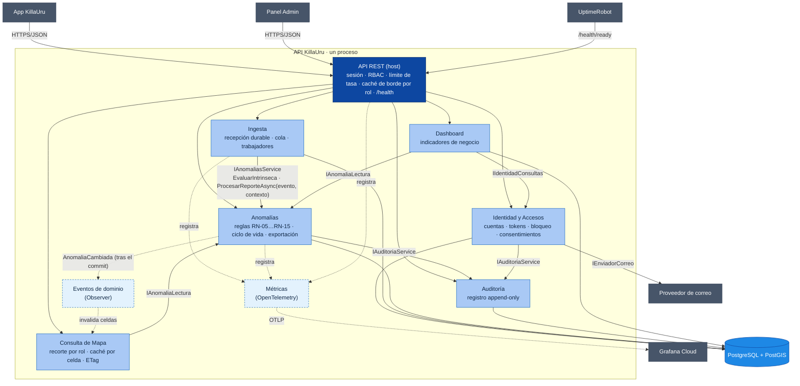
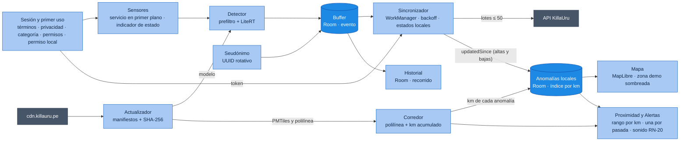

# Nivel 3 · Diagrama de Componentes

> **Proyecto:** KillaUru · **Modelo:** C4 · Nivel 3 de 4 · **Versión:** 3.0 · **Revisión:** 2026-10-14 · **Estado:** Vigente (alineado con `componentes-arquitectonicos.md`)
> **Contenedores detallados:** API KillaUru y App KillaUru
> **Herramienta:** Structurizr DSL (`workspace.dsl`, vistas `C3_API` y `C3_App`) · copia en Mermaid en este documento

## 1. Objetivo

Abrir los dos contenedores con lógica propia, la **API** y la **App**, y mostrar sus componentes: qué hace cada uno, qué contrato expone y de quién depende. El catálogo completo, con la propiedad de datos y los procesos en segundo plano, está en `componentes-arquitectonicos.md`. Este documento es su vista C4.

| Aspecto | Descripción |
|---|---|
| Pregunta que responde | ¿Qué partes tiene cada contenedor y cómo colaboran sin acoplarse? |
| Audiencia | Desarrolladores, QA, docente |
| Nivel anterior | [`Nivel2-diagrama-de-contenedores.md`](Nivel2-diagrama-de-contenedores.md) |
| Siguiente nivel | [`Nivel4-diagrama-de-codigo.md`](Nivel4-diagrama-de-codigo.md) |

## 2. API KillaUru: componentes

> Solo los **dueños** de datos tienen flecha a la BD. Consulta de Mapa no tiene tablas: lee por el contrato de Anomalías. Las dependencias forman un grafo **sin ciclos**: Ingesta → Anomalías → Auditoría; Mapa y Dashboard → Anomalías; Dashboard → Identidad; Identidad → Auditoría.

### 2.1 Componentes

| Componente | Responsabilidad | Funcionalidad clave | Requisitos |
|---|---|---|---|
| **API REST (host)** | Punto de entrada y composición | Rutas `/api/v1`; middleware de sesión y RBAC; límite de tasa con IP real y cuota de lotes; cabeceras de caché por rol; `/health/live` y `/health/ready`; manejo global de errores | RF-28, RNF-08, RNF-11 |
| **Identidad y Accesos** | Quién es quién | Registro con política y términos; login con bloqueo (RN-19); JWT de 5 min y *refresh* rotativo con 60 s de gracia; cierre de sesión; usuarios, roles y revisión mensual; «mis datos» y baja; correo de verificación y recuperación | RF-16, RF-19, RF-21, RF-22, RF-29…RF-32, RF-37 |
| **Ingesta** | Recepción durable | Reglas de recepción por evento; `con_sesion` por el token; un `INSERT` por lote; cola acotada con trabajadores; barredor; contexto para Anomalías (conteo de RN-15a) | RF-11, RF-27, RNF-02, RNF-06 |
| **Anomalías** | Corazón del negocio | Plausibilidad (RN-15b); agrupación por posición fija y mediana (RN-05); confirmación (RN-06, RN-14, RN-15a); persistencia (RN-12); ciclo de vida y moderación con «Por revisar» (RN-07); purgas (RN-09, RN-10); exportación sin seudónimos | RF-12, RF-13, RF-20, RF-23, RF-24 |
| **Consulta de Mapa** | Lectura rápida por rol | Recorte por rol con `ZonaDemo`; caché por celda y alcance; ETag en memoria; `updatedSince` con bajas | RF-14, RF-17, RF-26, RNF-01, RNF-27 |
| **Dashboard** | Indicadores de negocio | Conteos diarios sin vincular identidad; cobertura, confirmación y reaparición | RF-18, RN-17 |
| **Auditoría** | Rastro inmutable | Registro en la misma transacción de la acción; consulta de solo lectura | RF-15, RNF-31 |
| **Eventos de dominio** | Comunicación sin acoplamiento | `IPublicadorEventos` en memoria; publica después del *commit* | ADR-006 |
| **Métricas** | Observabilidad | `IMetricas` → OpenTelemetry | RNF-21, RNF-22 |

### 2.2 Contratos públicos (`Contracts/`)

| Dueño | Contrato | Operaciones | Consumidores |
|---|---|---|---|
| Anomalías | `IAnomaliasService` | `EvaluarIntrinseca(evento, ahora)` (pura, al recibir); `ProcesarReporteAsync(evento, contexto)` | Ingesta |
| Anomalías | `IAnomaliaLectura` | Anomalías `Activa` por celdas; cambios desde una fecha (con bajas); filtros del administrador; agregados de cobertura | Consulta de Mapa, Dashboard |
| Anomalías | `EventoReportado`, `ContextoReporte`, `AnomaliaCambiada` | DTOs y evento públicos. `ContextoReporte = (ConSesion, EventosEnLaHora)` | Ingesta, Consulta de Mapa |
| Identidad | `IIdentidadConsultas` | `ContarConductoresActivosAsync(dias)` | Dashboard |
| Auditoría | `IAuditoriaService` | `RegistrarAsync(acción, actor, objetivo, contexto)` dentro de la transacción del llamador (ADR-013) | Identidad, Anomalías, host |
| Shared | `IPublicadorEventos`, `IMetricas`, value objects | Publicar y suscribir; contadores; `Coordenada`, `Severidad`, `Confidence`, `SeudonimoInstalacion`, `Celda` | Todos |

### 2.3 Procesos en segundo plano

| Proceso | Módulo | Frecuencia | Regla |
|---|---|---|---|
| Trabajadores del `Channel` + barredor | Ingesta | Continuo · cada 60 s | ADR-005, EQ-09 |
| Caducidad | Anomalías | Cada hora | RN-07 |
| Purga de seudónimos (reportes y recepción) | Anomalías e Ingesta | Cada hora | RN-09 |
| Purga de recepción (30 días) e histórica (2 años) | Ingesta · Anomalías | Diaria | RN-10 |
| Indicadores diarios | Dashboard | Diaria (antes de la purga) | RN-17 |

## 3. App KillaUru: componentes

| Componente | Responsabilidad | Requisitos |
|---|---|---|
| **Sesión y primer uso** | Términos de uso y aviso de privacidad aceptados; categoría de vehículo; permisos de Android; «Solo ver el mapa»; login, renovación, cierre de sesión y permiso local | RF-21, RF-29, RF-34, RF-35, RF-37, RF-38, RN-21 |
| **Sensores** | 50 Hz en lote solo si corresponde (RN-03, RN-18, RN-22); indicador de estado | RF-01, RF-36 |
| **Detector** | Prefiltro de energía y clasificación local en < 50 ms | RF-02, RNF-04 |
| **Seudónimo** | UUID aleatorio de instalación con rotación mensual | RF-27 |
| **Buffer** | Eventos con hora del GPS y estados locales; purga a 7 días | RF-03, RF-06 |
| **Sincronizador** | Lotes de los más antiguos primero; contrato 200/400/401/429/503; backoff con *jitter*; reanudación ≤ 60 s | RF-04, RF-06, RF-07 |
| **Mapa** | Mapa base y anomalías locales; «Actualizado hace…»; zona fuera del demo sombreada para el anónimo | RF-08, RF-09, RF-26 |
| **Corredor** | Polilínea con km acumulado; proyección del GPS con búsqueda incremental | RN-16 |
| **Proximidad y Alertas** | Rango por km en el sentido de marcha; una alerta por pasada; sonido que no exige mirar la pantalla | RF-10, RN-16, RN-20 |
| **Historial** | Resúmenes de recorridos de 6 meses, solo locales, borrados al cerrar sesión | RF-25, RN-21 |
| **Actualizador** | Modelo (prioridad *Should*) y mapa base con manifiesto, SHA-256 y versión mínima de app | RF-26, RF-33 |

## 4. Reglas de composición

| # | Regla | Cómo se hace cumplir |
|---|---|---|
| 1 | Un módulo usa a otro **solo** por su `Contracts/` | Un proyecto por módulo con todo `internal` salvo `Contracts/`: el compilador lo impide |
| 2 | Un esquema y un `DbContext` por módulo; solo el dueño escribe | NetArchTest (RNF-28) |
| 3 | Sin ciclos entre módulos | NetArchTest |
| 4 | Cada sistema externo se integra desde un único módulo | Revisión |
| 5 | Cada módulo maneja su transacción; la auditoría se une a ella (ADR-013) | Pruebas de integración |
| 6 | Los eventos de dominio se publican **después** del *commit* | Revisión + prueba de integración |

## 5. Trazabilidad

| Componente | RF | HU | Épica |
|---|---|---|---|
| API REST (host) | RF-28 | HU-17 | EP-06 |
| Identidad y Accesos | RF-16, RF-19, RF-21, RF-22, RF-29…RF-32, RF-37 | HU-11, HU-14, HU-18, HU-18b, HU-22…HU-25, HU-27 | EP-05, EP-07 |
| Ingesta | RF-11, RF-27 | HU-04, HU-05, HU-21 | EP-02, EP-03 |
| Anomalías | RF-12, RF-13, RF-20, RF-23, RF-24 | HU-05, HU-06, HU-19, HU-20 | EP-03, EP-05 |
| Consulta de Mapa | RF-14, RF-17, RF-26 | HU-07, HU-08, HU-12 | EP-04, EP-05 |
| Dashboard | RF-18 | HU-13 | EP-05 |
| Auditoría | RF-15 | HU-15 | EP-05 |
| App (todos sus componentes) | RF-01…RF-10, RF-25, RF-26, RF-33…RF-38 | HU-01…HU-04, HU-07…HU-10, HU-26, HU-27 | EP-01, EP-02, EP-04, EP-07 |

- **Jira:** `KU-xx` — Diagrama y documentación C3 (Componentes) *(completar con el ID real)*
- **Épica:** `[EPIC-04] Documentación: Modelo C4`
