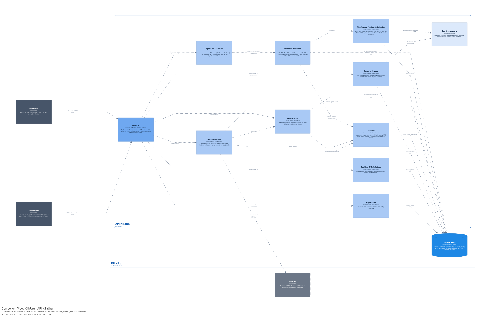
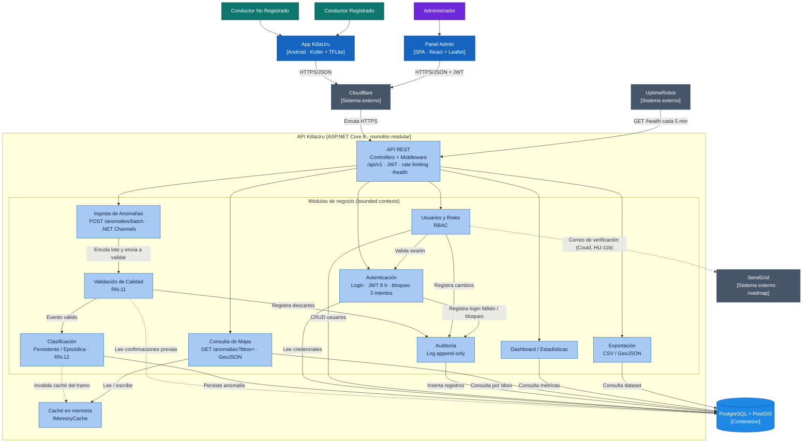
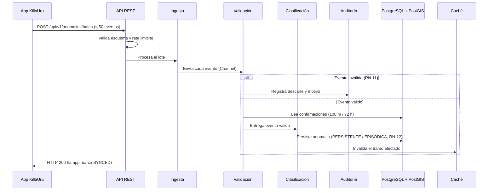

# Nivel 3 · Diagrama de componentes

> **Proyecto:** KillaUru (ViaLibre) · **Contenedor detallado:** API KillaUru
> **Modelo:** C4 · Nivel 3 de 4 · **Versión:** 1.0
> **Herramienta:** Structurizr (DSL) · vista `C3_Componentes`

---

## 1. Objetivo

Abrir el contenedor **API KillaUru** del nivel 2 y mostrar sus **componentes**: los módulos del monolito modular, la responsabilidad de cada uno, las reglas de negocio que implementan y cómo se relacionan entre sí, con la base de datos, con la caché y con los sistemas externos.

| Aspecto | Descripción |
|---|---|
| Pregunta que responde | ¿Cómo se divide el backend por dentro y qué hace cada parte? |
| Audiencia | Arquitectos, desarrolladores, docente del curso IS488 |
| Qué es un componente | Un grupo de funcionalidades con una responsabilidad clara, accesible mediante una interfaz. Aquí cada **módulo** del monolito (bounded context) es un componente |
| Qué **no** muestra | Clases, entidades ni casos de uso individuales (eso es el nivel 4) |
| Nivel anterior | [`Nivel2-diagrama-de-contenedores.md`](Nivel2-diagrama-de-contenedores.md) |
| Siguiente nivel | [`Nivel4-diagrama-de-codigo.md`](Nivel4-diagrama-de-codigo.md) |

---

## 2. Diagrama

> Exportado en SVG desde Structurizr Lite. Fuente editable: `workspace.dsl` (vista `C3_Componentes`). Vista de respaldo en Mermaid:

---

## 3. Componentes

| Componente | Responsabilidad | Funcionalidades principales | Carpeta en el código *(propuesta)* |
|---|---|---|---|
| **API REST** | Punto de entrada HTTP único del contenedor | Rutas `/api/v1`; middleware transversal (autenticación JWT, rate limiting, logger, manejo de errores); validación del esquema de entrada; endpoint `/health` y métricas | `Api/` |
| **Autenticación** | Identidad del administrador | Login, emisión y validación de JWT (8 h), bloqueo tras 3 intentos fallidos | `Modules/Autenticacion/` |
| **Usuarios y Roles** | Gestión de cuentas y permisos | Crear usuarios, cambiar rol (Administrador / Conductor registrado), desactivar cuentas (RBAC); correo de verificación (roadmap) | `Modules/Usuarios/` |
| **Ingesta de Anomalías** | Recepción de eventos desde la app | Recibe lotes de hasta 50 eventos (`POST /api/v1/anomalies/batch`), los encola con .NET Channels para absorber hasta 300 dispositivos sincronizando a la vez | `Modules/Ingesta/` |
| **Validación de Calidad** | Filtro de calidad del dato (RN-11) | Descarta eventos con `confidence < 0.75`, precisión GPS > 20 m o timestamp fuera de rango; exige confirmación de ≥ 2 dispositivos en 100 m / 72 h para severidad alta | `Modules/Validacion/` |
| **Clasificación Persistente/Episódica** | Tipificación temporal de la anomalía (RN-12) | Marca PERSISTENTE si aparece en ≥ 3 días distintos dentro de 15 días; en caso contrario EPISÓDICA; persiste la anomalía en PostGIS e invalida la caché del tramo | `Modules/Clasificacion/` |
| **Consulta de Mapa** | Lectura pública del mapa | `GET /api/v1/anomalies?bbox=` en GeoJSON con soporte de delta sync, respaldado por caché (objetivo < 250 ms) | `Modules/Mapa/` |
| **Dashboard / Estadísticas** | Indicadores de operación | Eventos por día, usuarios activos, cobertura del corredor y latencia p95 del backend | `Modules/Dashboard/` |
| **Exportación** | Entrega del dataset | Genera CSV y GeoJSON del dataset filtrado | `Modules/Exportacion/` |
| **Auditoría** | Trazabilidad de acciones sensibles | Log append-only (timestamp UTC, actor, acción, contexto); solo lectura; registra también los eventos descartados | `Modules/Auditoria/` |
| **Caché en memoria** | Componente técnico de rendimiento | `IMemoryCache` con resultados frecuentes del mapa; se invalida cuando entra una anomalía nueva en un tramo | `Shared/Cache/` |

### Trazabilidad con requisitos

| Componente | Requisitos / historias / épica |
|---|---|
| API REST | RF-11, RF-16 |
| Autenticación | RF-16, HU-11, EP-05 |
| Usuarios y Roles | RF-19, HU-14, EP-05 |
| Ingesta de Anomalías | RF-11, HU-04, EP-03 |
| Validación de Calidad | RF-12, HU-05, EP-03 |
| Clasificación Persistente/Episódica | RF-13, HU-06, EP-03 |
| Consulta de Mapa | RF-14, HU-08, EP-04 |
| Dashboard / Estadísticas | RF-18, HU-13, EP-05 |
| Exportación | RF-20, HU-12, EP-05 |
| Auditoría | RF-15, HU-15, EP-05 |
| Caché en memoria | RNF-01, DA-06 |

---

## 4. Relaciones entre componentes

| Origen | Destino | Descripción | Tipo de comunicación |
|---|---|---|---|
| Cloudflare | API REST | Entrega el tráfico HTTPS de `api.killauru.pe` | HTTPS |
| UptimeRobot | API REST | `GET /health` cada 5 minutos | HTTPS |
| API REST | Autenticación, Usuarios, Ingesta, Mapa, Dashboard, Exportación | Invoca los casos de uso de cada módulo | Llamada en memoria |
| Ingesta | Validación | Entrega cada evento del lote (vía .NET Channels) | Cola en memoria |
| Validación | Clasificación | Pasa los eventos válidos | Llamada en memoria |
| Validación | Auditoría | Registra los eventos descartados y el motivo | Llamada en memoria (API pública del módulo) |
| Clasificación | Caché | Invalida el tramo afectado tras persistir | Llamada en memoria |
| Usuarios | Autenticación | Valida la sesión del administrador que opera | Llamada en memoria (API pública del módulo) |
| Usuarios | Auditoría | Registra altas, cambios de rol y desactivaciones | Llamada en memoria |
| Autenticación | Auditoría | Registra logins fallidos y bloqueos de cuenta | Llamada en memoria |
| Mapa | Caché | Lee y escribe resultados de consultas por bbox | Llamada en memoria |

---

## 5. Relaciones con contenedores y sistemas externos

| Componente | Destino | Descripción | Protocolo | Patrón aplicado |
|---|---|---|---|---|
| Clasificación | PostgreSQL + PostGIS | Persiste las anomalías con geometría | SQL sobre TCP | Repository |
| Validación | PostgreSQL + PostGIS | Lee eventos cercanos recientes para contar confirmaciones (solo lectura) | SQL sobre TCP | Repository |
| Autenticación | PostgreSQL + PostGIS | Lee credenciales y estado de bloqueo | SQL sobre TCP | Repository |
| Usuarios y Roles | PostgreSQL + PostGIS | CRUD de usuarios y roles | SQL sobre TCP | Repository |
| Auditoría | PostgreSQL + PostGIS | Inserta registros (sin UPDATE ni DELETE) | SQL sobre TCP | Repository (append-only) |
| Consulta de Mapa | PostgreSQL + PostGIS | Consulta por `bbox` con índices GiST | SQL sobre TCP | Repository + Cache-Aside |
| Dashboard / Estadísticas | PostgreSQL + PostGIS | Agregaciones de operación | SQL sobre TCP | Repository (solo lectura) |
| Exportación | PostgreSQL + PostGIS | Lectura del dataset filtrado | SQL sobre TCP | Repository (solo lectura) |
| Usuarios y Roles | SendGrid *(roadmap)* | Correo de verificación de registro (HU-11b, Could) | HTTPS/REST | Adapter |

---

## 6. Propiedad de los datos por módulo

Cada tabla tiene **un solo módulo dueño** que escribe en ella. Los módulos de lectura acceden por la interfaz del repositorio del dueño, nunca con SQL propio sobre tablas ajenas.

| Datos *(nombres propuestos)* | Módulo dueño (escribe) | Módulos que leen |
|---|---|---|
| `usuarios`, `roles` | Usuarios y Roles | Autenticación (credenciales) |
| `anomalias` | Clasificación | Validación (confirmaciones), Consulta de Mapa, Dashboard, Exportación |
| `auditoria` | Auditoría | Panel Admin, a través de la API |

---

## 7. Reglas del monolito modular

| # | Regla | Motivo |
|---|---|---|
| 1 | Todos los componentes se despliegan juntos en el contenedor API KillaUru | Monolito: un solo proceso, un solo `docker compose up -d` |
| 2 | Un módulo usa a otro solo a través de su interfaz pública (por ejemplo `IAuditoriaService`), nunca de sus clases internas ni de su repositorio | Un cambio interno no rompe a los demás y el módulo puede extraerse como servicio (DA-09) |
| 3 | Un módulo no escribe en las tablas de otro; la lectura cruzada solo ocurre por la interfaz del repositorio del dueño (sección 6) | Mantiene la independencia de los datos |
| 4 | Cada sistema externo se integra en un único módulo (SendGrid solo desde Usuarios) | La integración queda en un solo lugar y es fácil de reemplazar |
| 5 | Cada módulo se organiza por dentro con Clean Architecture: Dominio → Aplicación → Adaptadores → Infraestructura, con dependencias solo hacia adentro | Las reglas de negocio (RN-11, RN-12) no dependen de ASP.NET ni de PostgreSQL (ver nivel 4) |
| 6 | Cada capa solo invoca a la inmediatamente inferior: controlador → caso de uso → repositorio | Orden de invocación predecible y testeable |
| 7 | Las dependencias entre módulos no forman ciclos | Si Usuarios depende de Autenticación, Autenticación no puede depender de Usuarios |

---

## 8. Flujo clave: ingesta de un lote

---

## 9. Atributos de calidad por componente

| Atributo | Meta | Componente responsable |
|---|---|---|
| Rendimiento de lectura | Mapa < 250 ms | Consulta de Mapa + Caché + índices GiST |
| Concurrencia | 300 dispositivos sincronizando a la vez | Ingesta (.NET Channels) |
| Calidad del dato | Solo eventos confiables llegan al mapa | Validación de Calidad (RN-11) |
| Seguridad | JWT 8 h, bloqueo a los 3 intentos, RBAC | Autenticación, Usuarios y Roles, API REST |
| Integridad y trazabilidad | Auditoría inmutable | Auditoría (append-only) |
| Observabilidad | `/health` cada 5 min, latencia p95 | API REST + Dashboard |
| Evolutividad | Extraer un módulo sin reescribir | Reglas 2, 3 y 5 del monolito modular |

---

## 10. Decisiones y supuestos

| # | Decisión o supuesto | Motivo |
|---|---|---|
| 1 | La caché es un componente interno (`IMemoryCache`), no Redis | Costo cercano a cero (R-04) y operación por una sola persona (DA-06) |
| 2 | Ingesta, Validación y Clasificación son módulos separados | Cada uno nace de una regla de negocio distinta (RN-11, RN-12) y puede evolucionar o extraerse por separado |
| 3 | Clasificación invalida la caché del tramo al persistir | Evita servir un mapa desactualizado tras una anomalía nueva |
| 4 | Autenticación registra login fallido y bloqueo en Auditoría | Son acciones sensibles (RF-15) |
| 5 | Las lecturas de Mapa, Dashboard y Exportación pasan por la interfaz del repositorio de `anomalias` | Respeta la regla 3 sin duplicar datos |
| 6 | La carpeta `Modules/` y los nombres de interfaces son una propuesta | Se confirman al arrancar la implementación |

### Pendientes por definir

| Tema | Detalle |
|---|---|
| Momento del HTTP 200 | Si responde al encolar el lote en el Channel, un reinicio del proceso puede perder eventos que la app ya marcó como `SYNCED`. Definir si el 200 se envía tras persistir o si se acepta ese riesgo en v1.0 |
| Nombre del módulo de entrada | `estilo-arquitectonico.md` lo llama «Sincronización» (`SyncController`); aquí «Ingesta de Anomalías». Unificar el nombre |
| Caché | `estilo-arquitectonico.md` y `enfoque-arquitectonico.md` mencionan Redis; este nivel usa `IMemoryCache`. Alinear los tres documentos |
| Métricas del Dashboard | Definir cómo obtiene la latencia p95 (middleware con `/metrics`, tabla propia o contador en memoria) |
| Auditoría de exportaciones | Evaluar si cada exportación del dataset debe registrarse en Auditoría |

---

## 11. Leyenda de estilos (del workspace DSL)

| Elemento | Color | Hex | Tipo de nodo |
|---|---|---|---|
| 🟢 Usuario Externo | Verde azulado | `#0F766E` | Conductores |
| 🟣 Personal Interno | Violeta | `#6D28D9` | Administrador |
| 🟦 Contenedor | Azul | `#1565C0` | App KillaUru, Panel Admin |
| 🔷 Almacén de datos | Azul claro (cilindro) | `#1E88E5` | Base de datos |
| 🩵 Componente | Celeste | `#A9C9F5` | Módulos y API REST |
| ⬜ Infraestructura Externa | Gris pizarra | `#475569` | Cloudflare, UptimeRobot, SendGrid |

---

## 12. Trazabilidad

- **Jira:** `KU-xx` — Diagrama y documentación C3 (Componentes) *(completar con el ID real)*
- **Épica:** `[EPIC-04] Documentación: Modelo C4`
- **Documentos relacionados:** `Nivel2-diagrama-de-contenedores.md`, `componentes-arquitectonicos.md`, `estilo-arquitectonico.md`, `enfoque-arquitectonico.md`, `07-decisiones-arquitectonicas.md`