# Nivel 4 · Diagrama de código

> **Proyecto:** KillaUru (ViaLibre) · **Componentes detallados:** Ingesta de Anomalías, Validación de Calidad, Clasificación Persistente/Episódica
> **Modelo:** C4 · Nivel 4 de 4 · **Versión:** 1.0
> **Herramienta:** Structurizr (DSL) · vistas `C4_Flujo`, `C4_Kernel`, `C4_Ingesta`, `C4_Validacion`, `C4_Clasificacion` · respaldo UML en Mermaid

---

## 1. Objetivo

Abrir los componentes del **flujo central de KillaUru** (de que llega un lote de eventos hasta que la anomalía queda persistida y clasificada) y mostrar su **estructura de código**: clases, interfaces, capas de Clean Architecture y dónde vive cada regla de negocio.

| Aspecto | Descripción |
|---|---|
| Pregunta que responde | ¿Cómo está construido por dentro un módulo y dónde está cada regla de negocio en el código? |
| Audiencia | Desarrolladores, QA, docente del curso IS488 |
| Por qué estos tres módulos | Concentran las reglas de negocio propias de KillaUru (RN-11, RN-12) y la mayor carga del backend. Los demás módulos siguen la misma plantilla (sección 3) |
| Qué **no** muestra | Código de módulos de soporte (Auditoría, Dashboard, Exportación, Usuarios), la app Android ni el panel React |
| Nivel anterior | [`Nivel3-diagrama-de-componentes.md`](Nivel3-diagrama-de-componentes.md) |
| Herramienta | **Structurizr (DSL)**: cada clase se modela como componente y se colorea por capa de Clean Architecture. Como respaldo, cada vista incluye su versión UML en Mermaid con atributos y métodos. C4 solo recomienda este nivel para componentes críticos |

> Los nombres de clases, carpetas e interfaces son la **propuesta de diseño** previa a la implementación. Los que ya aparecen en `enfoque-arquitectonico.md` (`ValidarAnomaliaUseCase`, `ClasificarPersistenciaUseCase`, `SyncController`, `EventoBatchDTO`, `IAnomaliaRepository`, `AnomaliaRepositoryPostGIS`) se mantienen.

### Leyenda de las vistas de Structurizr

| Color | Capa de Clean Architecture | Ejemplos |
|---|---|---|
| 🟥 Rojo | Dominio | `ReglasCalidad`, `Anomalia`, `Severidad` |
| 🟨 Amarillo | Aplicación (casos de uso y puertos) | `ValidarAnomaliaUseCase`, `IAnomaliaRepository` |
| 🟩 Verde | Adaptadores | `SyncController`, `EventoMapper` |
| 🟦 Azul | Infraestructura | `AnomaliaRepositoryPostGIS`, `ColaEventosChannel` |
| Borde punteado | Contrato público entre módulos (`Contracts/`) | `IValidacionService`, `IClasificacionService` |
| Flecha punteada | «Implementa» (puerto ← adaptador) | |

> Fuente editable: `c4-codigo/workspace.dsl`. Las imágenes se exportan como SVG desde Structurizr Lite a `img/fuentes-svg/`.

---

## 2. Visión general: el flujo en el código

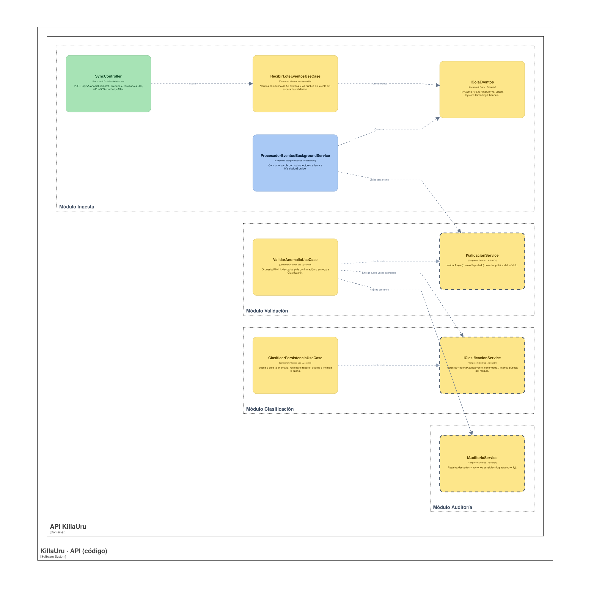

<details>
<summary>Ver versión UML en Mermaid (con atributos y métodos)</summary>

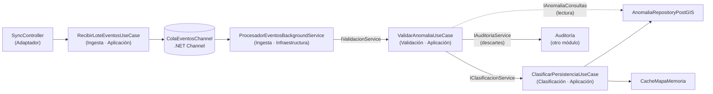

</details>

Los módulos se hablan **solo por interfaces de su carpeta `Contracts/`** (reglas 2 y 3 del monolito modular, nivel 3).

---

## 3. Plantilla de un módulo (Clean Architecture)

```
src/KillaUru.Api/
├── Api/                         → Componente «API REST» (Program.cs, middleware)
├── Shared/
│   ├── Domain/                  → Kernel compartido: Coordenada, Severidad, Confidence, DispositivoHash, EventoReportado
│   └── Cache/                   → ICacheMapa + CacheMapaMemoria (IMemoryCache)
└── Modules/
    └── <Modulo>/
        ├── Contracts/           → Interfaces y DTOs públicos, lo único que otros módulos pueden usar
        ├── Domain/              → Entidades, value objects, reglas. Sin ningún using de ASP.NET ni EF
        ├── Application/         → Casos de uso y puertos (interfaces que necesita el caso de uso)
        ├── Adapters/            → Controladores, DTOs HTTP y mappers (solo donde hay frontera HTTP)
        └── Infrastructure/      → EF Core, PostGIS, Channels, IMemoryCache: implementan los puertos
```

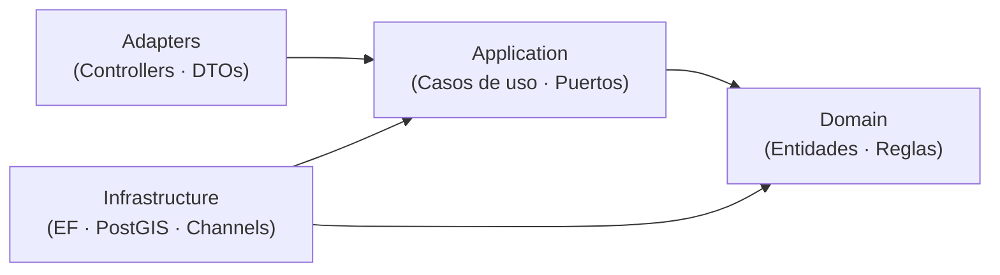

| Capa | Puede referenciar | Nunca referencia |
|---|---|---|
| Domain | Solo `Shared/Domain` y la BCL de .NET | Application, Adapters, Infrastructure, ASP.NET, EF Core |
| Application | Domain, `Contracts/` de otros módulos | Adapters, Infrastructure, EF Core |
| Adapters | Application, Domain (para mapear) | Infrastructure |
| Infrastructure | Application (implementa sus puertos), Domain | Adapters |

---

## 4. Kernel compartido

Value objects y el evento de entrada que usan los tres módulos. Se validan en su fábrica: **no puede existir** una `Severidad` fuera de 1–5 ni una `Confidence` fuera de 0.0–1.0.

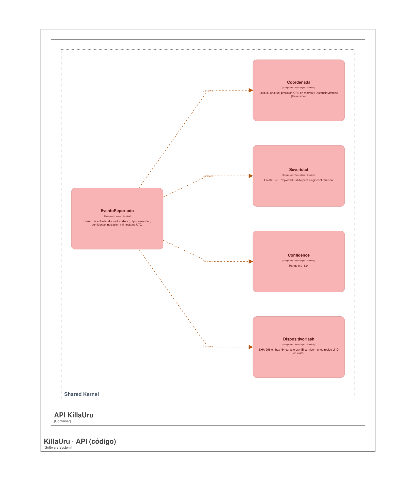

<details>
<summary>Ver versión UML en Mermaid (con atributos y métodos)</summary>

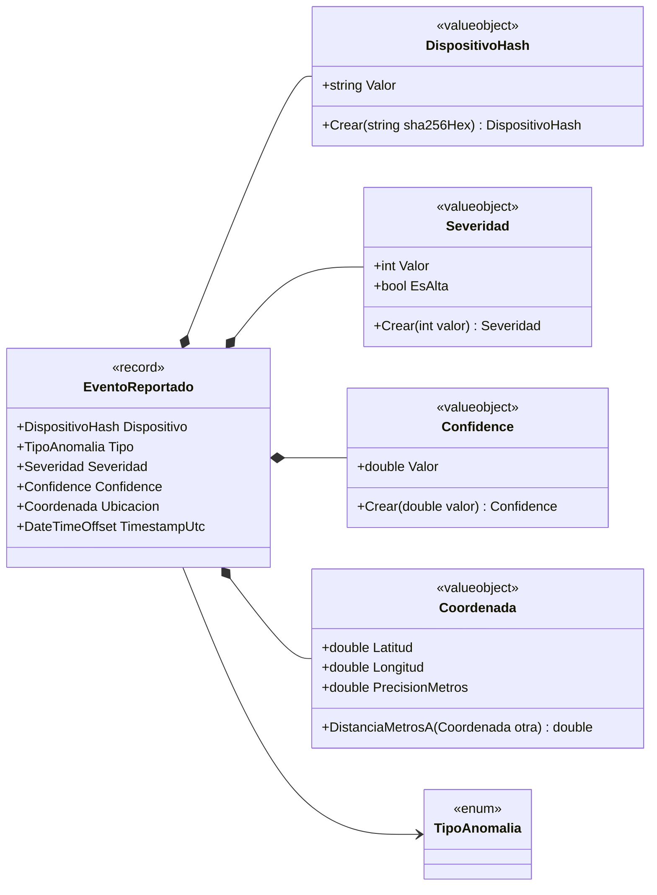

</details>

| Clase | Regla que protege |
|---|---|
| `Severidad` | Escala 1–5; `EsAlta` define cuándo se exige confirmación |
| `Confidence` | Rango 0.0–1.0 |
| `DispositivoHash` | Exige 64 caracteres hexadecimales (SHA-256): el servidor **nunca** recibe un identificador de dispositivo en claro (privacidad, Ley 29733) |
| `Coordenada` | Latitud/longitud válidas; `PrecisionMetros` alimenta la regla de GPS; `DistanciaMetrosA` usa Haversine para pruebas sin base de datos |

---

## 5. Módulo Ingesta de Anomalías

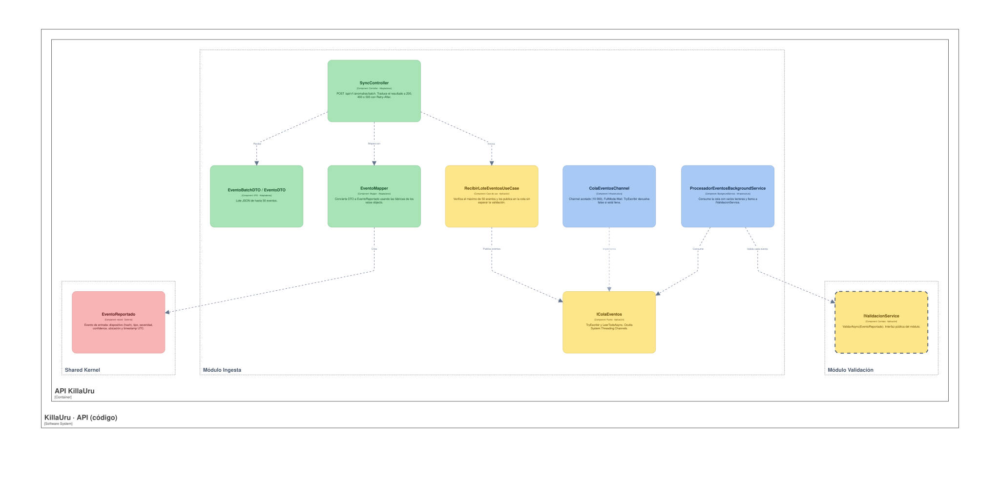

<details>
<summary>Ver versión UML en Mermaid (con atributos y métodos)</summary>

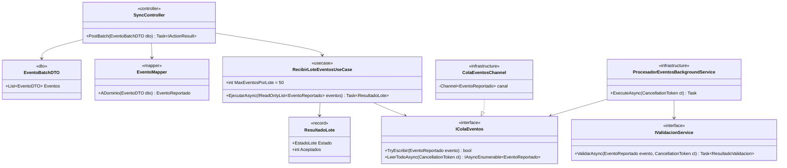

</details>

| Clase | Capa | Responsabilidad |
|---|---|---|
| `SyncController` | Adaptadores | `POST /api/v1/anomalies/batch`. Valida el esquema, mapea y traduce `ResultadoLote` a HTTP: `200` aceptado, `400` lote inválido, `503` con `Retry-After` si la cola está llena (la app aplica su backoff exponencial) |
| `EventoBatchDTO` / `EventoDTO` | Adaptadores | Formato JSON del lote (hasta 50 eventos) |
| `EventoMapper` | Adaptadores | Convierte DTO → `EventoReportado` usando las fábricas de los value objects |
| `RecibirLoteEventosUseCase` | Aplicación | Verifica el máximo de 50 eventos y los publica en `IColaEventos` sin esperar la validación |
| `IColaEventos` | Aplicación (puerto) | Abstrae la cola para que el caso de uso no conozca `System.Threading.Channels` |
| `ColaEventosChannel` | Infraestructura | `Channel` acotado con `BoundedChannelFullMode.Wait`; `TryEscribir` devuelve `false` si está lleno |
| `ProcesadorEventosBackgroundService` | Infraestructura | `BackgroundService` que consume la cola y llama a `IValidacionService`, con varios lectores en paralelo |

```csharp
// Infrastructure/ColaEventosChannel.cs (esqueleto)
public sealed class ColaEventosChannel : IColaEventos
{
    private readonly Channel<EventoReportado> _canal =
        Channel.CreateBounded<EventoReportado>(new BoundedChannelOptions(10_000)
        {
            FullMode = BoundedChannelFullMode.Wait,
            SingleReader = false,
            SingleWriter = false
        });

    public bool TryEscribir(EventoReportado evento) => _canal.Writer.TryWrite(evento);

    public IAsyncEnumerable<EventoReportado> LeerTodoAsync(CancellationToken ct) =>
        _canal.Reader.ReadAllAsync(ct);
}
```

---

## 6. Módulo Validación de Calidad

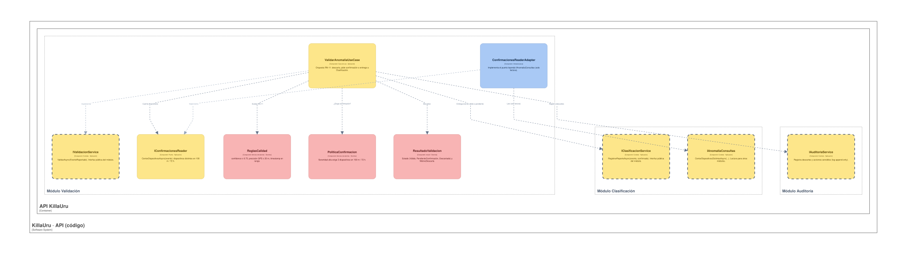

<details>
<summary>Ver versión UML en Mermaid (con atributos y métodos)</summary>

```mermaid
classDiagram
    direction TB
    class IValidacionService {
        <<interface>>
        +ValidarAsync(EventoReportado evento, CancellationToken ct) Task~ResultadoValidacion~
    }
    class ValidarAnomaliaUseCase {
        <<usecase>>
        +ValidarAsync(EventoReportado evento, CancellationToken ct) Task~ResultadoValidacion~
    }
    class IConfirmacionesReader {
        <<interface>>
        +ContarDispositivosAsync(EventoReportado evento, CancellationToken ct) Task~int~
    }
    class ReglasCalidad {
        <<domainservice>>
        +double ConfidenceMinimo = 0.75
        +double PrecisionGpsMaximaMetros = 20
        +EvaluarIntrinseca(EventoReportado e, DateTimeOffset ahora) MotivoDescarte
    }
    class PoliticaConfirmacion {
        <<domainservice>>
        +int DispositivosRequeridos = 2
        +int RadioMetros = 100
        +TimeSpan Ventana = 72h
        +Requiere(Severidad s) bool
        +Cumple(int dispositivosDistintos) bool
    }
    class ResultadoValidacion {
        <<record>>
        +EstadoValidacion Estado
        +MotivoDescarte Motivo
    }
    class EstadoValidacion {
        <<enum>>
        Valido
        PendienteConfirmacion
        Descartado
    }
    class MotivoDescarte {
        <<enum>>
        ConfidenceBajo
        PrecisionGpsInsuficiente
        TimestampFueraDeRango
    }
    class ConfirmacionesReaderAdapter {
        <<infrastructure>>
    }
    class IClasificacionService {
        <<contrato otro módulo>>
    }
    class IAuditoriaService {
        <<contrato otro módulo>>
    }
    class IAnomaliaConsultas {
        <<contrato otro módulo>>
    }

    ValidarAnomaliaUseCase ..|> IValidacionService
    ValidarAnomaliaUseCase --> ReglasCalidad
    ValidarAnomaliaUseCase --> PoliticaConfirmacion
    ValidarAnomaliaUseCase --> IConfirmacionesReader
    ValidarAnomaliaUseCase --> IClasificacionService
    ValidarAnomaliaUseCase --> IAuditoriaService
    ValidarAnomaliaUseCase --> ResultadoValidacion
    ResultadoValidacion --> EstadoValidacion
    ResultadoValidacion --> MotivoDescarte
    ConfirmacionesReaderAdapter ..|> IConfirmacionesReader
    ConfirmacionesReaderAdapter --> IAnomaliaConsultas
```

</details>

**Algoritmo de `ValidarAnomaliaUseCase`:**

1. `ReglasCalidad.EvaluarIntrinseca` revisa confidence, precisión GPS y timestamp. Si hay motivo → registra el descarte en Auditoría y devuelve `Descartado`.
2. Si `PoliticaConfirmacion.Requiere(severidad)` es falsa → llama a `IClasificacionService` con el evento confirmado y devuelve `Valido`.
3. Si la requiere → cuenta dispositivos distintos en 100 m / 72 h con `IConfirmacionesReader`. Con el evento actual suma ≥ 2 → `Valido`; si no → `PendienteConfirmacion`. En ambos casos el reporte se entrega a Clasificación (el estado indica si ya está confirmado).

```csharp
// Domain/ReglasCalidad.cs (esqueleto)
public static class ReglasCalidad
{
    public const double ConfidenceMinimo = 0.75;
    public const double PrecisionGpsMaximaMetros = 20;
    public static readonly TimeSpan ToleranciaFuturo = TimeSpan.FromMinutes(5);

    public static MotivoDescarte? EvaluarIntrinseca(
        EventoReportado e, DateTimeOffset ahora, TimeSpan antiguedadMaxima)
    {
        if (e.Confidence.Valor < ConfidenceMinimo)
            return MotivoDescarte.ConfidenceBajo;
        if (e.Ubicacion.PrecisionMetros > PrecisionGpsMaximaMetros)
            return MotivoDescarte.PrecisionGpsInsuficiente;
        if (e.TimestampUtc > ahora + ToleranciaFuturo || e.TimestampUtc < ahora - antiguedadMaxima)
            return MotivoDescarte.TimestampFueraDeRango;
        return null;
    }
}
```

---

## 7. Módulo Clasificación Persistente/Episódica

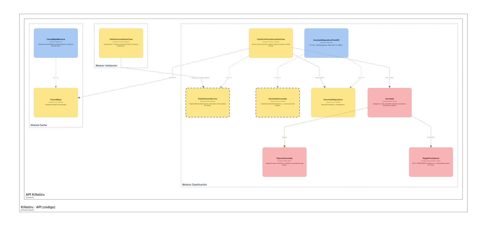

<details>
<summary>Ver versión UML en Mermaid (con atributos y métodos)</summary>

```mermaid
classDiagram
    direction TB
    class IClasificacionService {
        <<interface>>
        +RegistrarReporteAsync(EventoReportado evento, bool confirmado, CancellationToken ct) Task
    }
    class IAnomaliaConsultas {
        <<interface>>
        +ContarDispositivosDistintosAsync(Coordenada c, int radioMetros, DateTimeOffset desde, TipoAnomalia tipo, CancellationToken ct) Task~int~
    }
    class ClasificarPersistenciaUseCase {
        <<usecase>>
        +RegistrarReporteAsync(EventoReportado evento, bool confirmado, CancellationToken ct) Task
    }
    class IAnomaliaRepository {
        <<interface>>
        +BuscarCercanaAsync(Coordenada c, int radioMetros, TipoAnomalia tipo, CancellationToken ct) Task~Anomalia~
        +GuardarAsync(Anomalia anomalia, CancellationToken ct) Task
    }
    class ICacheMapa {
        <<interface>>
        +InvalidarTramoAsync(Coordenada c) Task
    }
    class Anomalia {
        <<entity>>
        +Guid Id
        +TipoAnomalia Tipo
        +Severidad Severidad
        +Coordenada Ubicacion
        +EstadoPersistencia Persistencia
        +bool Confirmada
        +IReadOnlyList~ReporteAnomalia~ Reportes
        +Crear(EventoReportado e, bool confirmado) Anomalia
        +RegistrarReporte(EventoReportado e, bool confirmado, DateTimeOffset ahora) void
    }
    class ReporteAnomalia {
        <<entity>>
        +DispositivoHash Dispositivo
        +DateTimeOffset TimestampUtc
        +Confidence Confidence
        +Severidad Severidad
    }
    class ReglaPersistencia {
        <<domainservice>>
        +int DiasDistintosMinimos = 3
        +int VentanaDias = 15
        +Evaluar(IEnumerable~DateTimeOffset~ reportes, DateTimeOffset ahora) EstadoPersistencia
    }
    class EstadoPersistencia {
        <<enum>>
        Episodica
        Persistente
    }
    class AnomaliaRepositoryPostGIS {
        <<infrastructure>>
    }
    class CacheMapaMemoria {
        <<infrastructure>>
    }

    ClasificarPersistenciaUseCase ..|> IClasificacionService
    ClasificarPersistenciaUseCase --> IAnomaliaRepository
    ClasificarPersistenciaUseCase --> ICacheMapa
    Anomalia *-- ReporteAnomalia
    Anomalia --> ReglaPersistencia
    Anomalia --> EstadoPersistencia
    AnomaliaRepositoryPostGIS ..|> IAnomaliaRepository
    AnomaliaRepositoryPostGIS ..|> IAnomaliaConsultas
    CacheMapaMemoria ..|> ICacheMapa
```

</details>

**Algoritmo de `ClasificarPersistenciaUseCase`:**

1. Busca con `IAnomaliaRepository` una anomalía del mismo tipo a ≤ 100 m.
2. Si no existe, `Anomalia.Crear`; si existe, `Anomalia.RegistrarReporte`.
3. La entidad agrega el `ReporteAnomalia` y recalcula `Persistencia` con `ReglaPersistencia` (RN-12). Si llega `confirmado = true`, marca `Confirmada`.
4. Guarda y llama a `ICacheMapa.InvalidarTramoAsync` para el tramo afectado.

```csharp
// Domain/ReglaPersistencia.cs (esqueleto)
public static class ReglaPersistencia
{
    public const int DiasDistintosMinimos = 3;
    public const int VentanaDias = 15;

    public static EstadoPersistencia Evaluar(
        IEnumerable<DateTimeOffset> reportesUtc, DateTimeOffset ahora)
    {
        var desde = ahora.AddDays(-VentanaDias);
        var diasDistintos = reportesUtc
            .Where(t => t >= desde && t <= ahora)
            .Select(t => DateOnly.FromDateTime(t.UtcDateTime))
            .Distinct()
            .Count();

        return diasDistintos >= DiasDistintosMinimos
            ? EstadoPersistencia.Persistente
            : EstadoPersistencia.Episodica;
    }
}
```

`AnomaliaRepositoryPostGIS` usa EF Core con NetTopologySuite y un índice GiST sobre la columna de ubicación; es el **único** lugar con consultas espaciales (`ST_DWithin`).

---

## 8. Trazabilidad regla de negocio → código

| Regla | Dónde vive | Prueba que la valida |
|---|---|---|
| `confidence ≥ 0.75` | `ReglasCalidad.ConfidenceMinimo` (Dominio) | Unitaria: valores 0.74, 0.75, 0.76 |
| Precisión GPS ≤ 20 m | `ReglasCalidad.PrecisionGpsMaximaMetros` | Unitaria: 19, 20, 21 m |
| Timestamp en rango | `ReglasCalidad.EvaluarIntrinseca` | Unitaria con `FakeTimeProvider` |
| Confirmación ≥ 2 dispositivos / 100 m / 72 h (severidad alta) | `PoliticaConfirmacion` + `IAnomaliaConsultas` | Unitaria (política) e integración (consulta espacial) |
| PERSISTENTE si ≥ 3 días distintos en 15 días | `ReglaPersistencia.Evaluar` (Dominio) | Unitaria: 2 días, 3 días, 3 reportes el mismo día, reportes fuera de ventana |
| Lote máximo de 50 eventos | `RecibirLoteEventosUseCase.MaxEventosPorLote` | Unitaria: 50 y 51 eventos |
| Identificador de dispositivo hasheado (SHA-256) | `DispositivoHash.Crear` | Unitaria: hex válido, longitud incorrecta, texto en claro |
| Severidad 1–5 / confidence 0–1 | Fábricas de `Severidad` y `Confidence` | Unitaria: límites |

---

## 9. Estrategia de pruebas por capa

| Capa | Tipo de prueba | Herramientas *(propuestas)* | Qué se aísla |
|---|---|---|---|
| Dominio | Unitarias puras | xUnit | Nada: sin base de datos, sin red, sin reloj real |
| Aplicación | Unitarias con dobles de los puertos | xUnit + NSubstitute + `FakeTimeProvider` | `IAnomaliaRepository`, `ICacheMapa`, `IAuditoriaService`, `IClasificacionService` |
| Infraestructura | Integración con base real | Testcontainers (PostgreSQL + PostGIS) | Consultas espaciales y mapeos EF |
| Adaptadores | Pruebas de API | `WebApplicationFactory` | Contratos HTTP: 200, 400, 503 |
| Arquitectura | Reglas de dependencia | NetArchTest | Dominio sin dependencias externas; un módulo solo usa `Contracts/` de otro |

Las pruebas de arquitectura hacen **ejecutables** las reglas 2, 3 y 5 del nivel 3: si alguien rompe el aislamiento entre módulos, el build falla.

---

## 10. Impacto sobre los niveles anteriores

| Cambio | Nivel afectado | Acción |
|---|---|---|
| Aparece `Contracts/` con `IValidacionService`, `IClasificacionService`, `IAnomaliaConsultas` e `IAuditoriaService` como interfaces públicas | C3, reglas del monolito | Citar `Contracts/` en la regla 2 |
| Los reportes por día y por dispositivo se guardan (`ReporteAnomalia`) | C3, sección 6 (datos) | La tabla `anomalias` incluye sus reportes; el dueño sigue siendo Clasificación. Sin ellos RN-12 y la confirmación por dispositivos no se pueden calcular |
| La cola del Channel tiene consumidor propio (`BackgroundService`) | C3, componente Ingesta | Mencionarlo en la descripción de Ingesta |

---

## 11. Decisiones y supuestos

| # | Decisión o supuesto | Motivo |
|---|---|---|
| 1 | Los puertos (`IAnomaliaRepository`, `IColaEventos`, `ICacheMapa`) viven en **Aplicación** | En Clean Architecture la capa interna define lo que necesita. `enfoque-arquitectonico.md` los ubica en Adaptadores; conviene alinear ese documento |
| 2 | Los eventos de severidad alta sin confirmar se guardan con `Confirmada = false` y el mapa solo muestra confirmadas | Permite que un segundo dispositivo confirme sin perder el primer reporte |
| 3 | Cola acotada con `503 + Retry-After` al saturarse | Da contrapresión; la app ya reintenta con backoff exponencial |
| 4 | `TimeProvider` (nativo en .NET 8) en lugar de un reloj propio | Pruebas deterministas sin librerías extra |
| 5 | Una anomalía agrupa reportes del mismo tipo a ≤ 100 m | Reutiliza el radio de la regla de confirmación; es un supuesto |

### Pendientes por definir

| Tema | Detalle |
|---|---|
| Qué es «severidad alta» | Proponer `Severidad ≥ 4`; confirmar con la regla RN-11 original |
| Antigüedad máxima del timestamp | Con Store-and-Forward un evento puede llegar días después; la ventana válida debe ser mayor que el tiempo máximo sin señal |
| Día calendario de RN-12 | El código usa día UTC; Perú es UTC-5, por lo que un reporte nocturno puede caer en otro día. Decidir si se usa `America/Lima` |
| Criterio de «misma anomalía» | ¿100 m y mismo tipo? Evaluar si también cuenta la severidad |
| Lote con eventos mal formados | Hoy se rechaza el lote completo con 400; alternativa: aceptar los válidos y reportar los rechazados |
| Catálogo de `TipoAnomalia` | Debe coincidir con las categorías del modelo TFLite |
| Nombre de la entidad | `enfoque-arquitectonico.md` usa `Anomalia`; `estilo-arquitectonico.md` usa `AnomaliaVial`. Unificar |
| Momento del HTTP 200 | Sigue pendiente del nivel 3: con el 200 al encolar, un reinicio pierde eventos ya marcados `SYNCED` en la app |

---

## 12. Trazabilidad

- **Jira:** `KU-xx` — Diagrama y documentación C4 (Código) *(completar con el ID real)*
- **Épica:** `[EPIC-04] Documentación: Modelo C4`
- **Requisitos:** RF-11, RF-12, RF-13 · HU-04, HU-05, HU-06 · EP-03 · RN-11, RN-12
- **Documentos relacionados:** `Nivel3-diagrama-de-componentes.md`, `enfoque-arquitectonico.md`, `estilo-arquitectonico.md`, `07-decisiones-arquitectonicas.md`